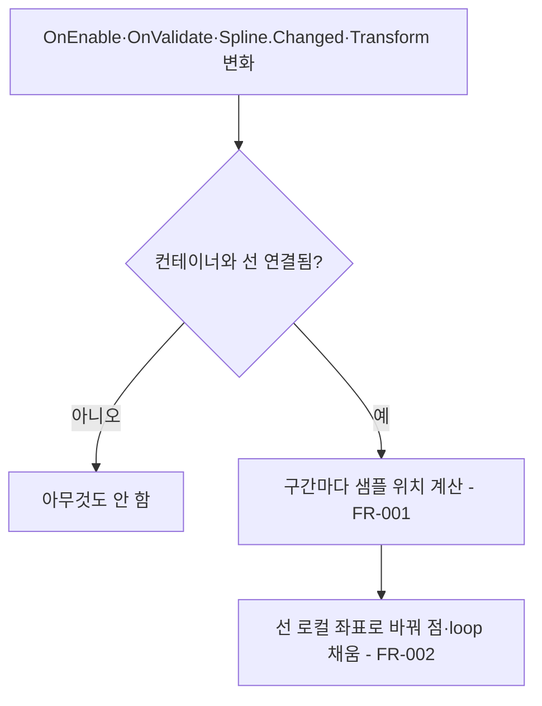

# 스플라인 따라 선 그리기

## 1. 개요

- 목적: Splines 패키지로 만든 곡선을 따라 `LineRenderer` 선을 그려, 다른 선 그림과 같은 방식으로 곡선 장식선을 만든다. 에디트 모드에서 스플라인 점을 옮기면 선이 바로 따라온다.
- 대상: 씬에서 곡선을 그리는 제작자

## 2. 범위

- 포함:
  - 스플라인을 샘플링해 `LineRenderer` 점을 채우는 `SplineLine` 컴포넌트 (에디트 모드·Play 모두 동작)
  - 씬의 `e` 오브젝트에 컴포넌트 붙이기
- 제외:
  - 스플라인 편집 도구, 선 두께·색·재질 자동 설정 (기존 `LineRenderer` 값을 그대로 쓴다)
  - 메시 압출(`Spline Extrude`)

## 3. 기술 방향

- 사용 기술/API: Unity Splines(`SplineContainer`, `Spline.EvaluatePosition`, `Spline.Changed`), `LineRenderer`, `[ExecuteAlways]`
- 핵심 방식:
  - 샘플링: 곡선 구간(점 사이) 하나마다 `_samplesPerCurve`개씩 점을 찍는다. 닫힌 스플라인은 `LineRenderer.loop`를 켜고 마지막 점을 겹쳐 찍지 않는다.
  - 좌표: 스플라인 로컬 좌표를 컨테이너 Transform으로 월드로 바꾼 뒤, 선 Transform 로컬 좌표로 바꿔 넣고 선은 로컬 공간(`useWorldSpace` 끔)으로 그린다. 그래서 오브젝트를 옮기거나 돌려도 다시 계산할 필요 없이 따라간다.
  - 갱신: `Spline.Changed`가 오면 해당 스플라인일 때 다시 그린다. Inspector 값이 바뀌면(`OnValidate`) 다시 그린다. 두 Transform의 상대 위치가 바뀌면 `Update`에서 다시 그린다.
- 선택하지 않은 방식: 매 프레임 무조건 다시 그리는 방식은 필요 없는 계산이 많아 쓰지 않는다. `Spline Extrude`는 3D 튜브라 평평한 선 그림과 맞지 않아 쓰지 않는다.
- 외부 의존성: `com.unity.splines`

## 4. 구조

| 구분 | 이름 | 역할 |
|------|------|------|
| 클래스 | SplineLine | 스플라인을 샘플링해 LineRenderer 점과 loop를 채움 |
| 씬 | EyeMaze | `e` 오브젝트에 `SplineLine` 추가, 같은 오브젝트의 컨테이너·선 연결 |

- 오브젝트 구성: `SplineContainer`와 `LineRenderer`가 있는 오브젝트(또는 다른 오브젝트)에 `SplineLine`을 붙이고 두 컴포넌트를 연결한다.
- 클래스 간 관계: `SplineLine`이 `SplineContainer`를 읽고 `LineRenderer`에 쓴다.
- 실행 순서 의존성: 없음
- 기존 코드와의 접점: 없음

## 5. 동작 플로우차트

## 6. 요구사항

- FR-001: `SplineLine`은 `_splineIndex`번 스플라인의 곡선 구간마다 `_samplesPerCurve`개씩 위치를 계산한다. 닫힌 스플라인이면 끝점을 겹치지 않고 loop를 켠다.
- FR-002: `SplineLine`은 계산한 위치를 선 Transform 로컬 좌표로 바꿔 `LineRenderer`에 넣고, 선을 로컬 공간으로 그린다.
- FR-003: 에디트 모드와 Play 모두에서 스플라인 점이 바뀌거나, Inspector 값이 바뀌거나, 컨테이너와 선의 상대 위치가 바뀌면 `SplineLine`은 선을 다시 그린다.

### 상태와 데이터

| 이름 | 타입 | 설명 | 초기값 |
|------|------|------|--------|
| _dirty | bool | 다시 그려야 하는지 | true |
| _lastRelative | Matrix4x4 | 마지막으로 그릴 때 컨테이너→선 변환 | 그릴 때 |

### 예외 및 경계 조건

- 컨테이너나 선이 비어 있거나 스플라인 점이 2개 미만이면 그리지 않는다.
- `_splineIndex`가 범위를 넘으면 그리지 않는다.

## 7. Inspector 노출값

| 필드 | 타입 | 기본값 | 설명 |
|------|------|--------|------|
| _container | SplineContainer | 같은 오브젝트 | 따라 그릴 스플라인 |
| _line | LineRenderer | 같은 오브젝트 | 점을 채울 선 |
| _splineIndex | int | 0 | 컨테이너 안 스플라인 번호 |
| _samplesPerCurve | int | 16 | 점 사이 구간 하나에 찍는 점 수 (클수록 매끄럽다) |

## 8. 인수 조건

- FR-001: 닫힌 4점 스플라인에 붙이면 끊김 없이 한 바퀴 이어진 곡선이 그려진다.
- FR-002: 오브젝트를 옮기거나 돌려도 선이 스플라인과 겹친 채 따라간다.
- FR-003: 에디트 모드에서 스플라인 점이나 접선을 끌면 선이 바로 따라온다.

## 9. 미결 사항

- 없음
