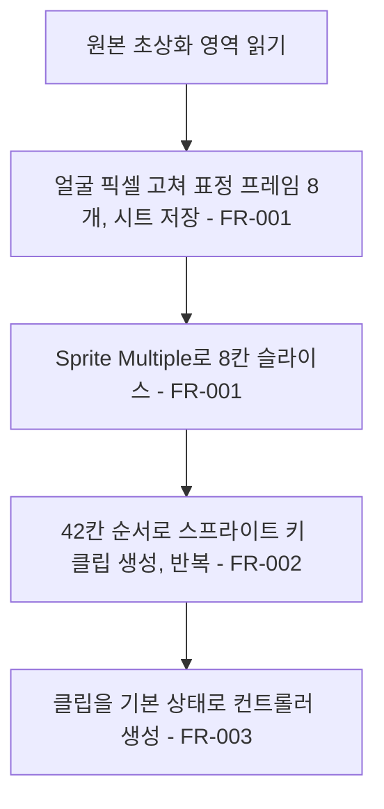

# 은재 경계 스프라이트 시트 애니메이션

## 1. 개요

- 목적: 은재 초상화의 얼굴을 직접 고쳐(눈동자 방향, 가늘게 뜬 눈, 다문 입, 땀방울) 경계하는 표정 변화 프레임을 그린 스프라이트 시트와, 그 프레임을 반복 재생하는 애니메이션 에셋을 만든다. 그림 전체를 옮기지 않는다.
- 상태: 은재 초상화를 새 그림으로 바꾸면서 이 스펙의 에셋(`Arts/Animation/Eunjae/` 전체)은 사용자 요청으로 삭제했다.
- 대상: 애니메이션을 고치거나 붙이는 제작자

## 2. 범위

- 포함:
  - 스프라이트 시트 PNG 1장 (프레임 8개, 4×2) 과 프레임별 스프라이트 슬라이스
  - 반복 재생 AnimationClip (UI `Image`의 스프라이트를 바꾸는 키) 과 그 클립을 기본 상태로 둔 Animator Controller
- 제외:
  - 씬 연결 (대화 상자 초상화는 `GameFlowUI`가 매 프레임 스프라이트를 정하므로, 붙이는 방법은 따로 정한다)
  - 기존 `PortraitWaryMotion`(스펙 038) 변경
  - 얼굴 밖(머리카락·몸) 변화, 그림 전체 이동·크기 변화

## 3. 기술 방향

- 사용 기술/API: `TextureImporter`(Sprite Multiple), 2D Sprite 패키지 `ISpriteEditorDataProvider`, `AnimationClip`(`ObjectReferenceKeyframe`), `AnimatorController`
- 핵심 방식:
  - 프레임 원본: `흑백 픽셀 초상, 소녀와 보호자_1` 스프라이트 영역(612×976). 그림 전체는 그대로 두고 얼굴 픽셀만 고친다.
  - 눈동자: 두 눈의 홍채(검은 부분, 회색 테두리 포함)를 지우고 같은 모양을 가로로 옮겨 눈 안쪽 흰 곳에만 다시 칠한다. 눈꺼풀은 그대로다.
  - 가늘게 뜬 눈: 윗눈꺼풀을 4줄 내리고 홍채 아래 3줄을 흰색으로 걷는다.
  - 다문 입: 원래 입(9×4)을 지우고 5×2로 작게 다시 그린다.
  - 땀방울: 얼굴 옆 검은 머리카락 위에 흰 물방울(안쪽 작은 반사점)을 그린다.
  - 프레임 8개: 0 가만히, 1 왼쪽 흘끔(눈동자 4px), 2 왼쪽 흘끔(8px), 3 왼쪽 흘끔 + 가늘게 뜬 눈 + 다문 입, 4 오른쪽 흘끔(3px), 5 오른쪽 흘끔(6px), 6 오른쪽 흘끔 + 가늘게 뜬 눈 + 다문 입, 7 움찔(가늘게 뜬 눈 + 다문 입 + 땀방울).
  - 재생 순서(12fps, 42칸, 3.5초 반복): 가만히 → 왼쪽 흘끔·머묾·눈 가늘게 → 가만히 → 오른쪽 흘끔·머묾·눈 가늘게 → 가만히 → 움찔(땀) → 가만히.
  - 슬라이스 피벗은 원본 스프라이트와 같게 둔다. 필터는 Point, 압축 없음.
- 선택하지 않은 방식: 코드로 위치·크기를 바꾸는 방식은 사용자가 애니메이션 데이터 자체를 원해 쓰지 않는다.
- 외부 의존성: `com.unity.2d.sprite`, 원본 초상화 텍스처

## 4. 구조

| 구분 | 이름 | 역할 |
|------|------|------|
| 텍스처 | Eunjae_Wary_Sheet.png | 프레임 8개 스프라이트 시트 |
| 애니메이션 | Eunjae_Wary.anim | Image 스프라이트를 프레임 순서대로 바꾸는 반복 클립 |
| 컨트롤러 | Eunjae_Portrait.controller | `Eunjae_Wary` 기본 상태 |

- 오브젝트 구성: 에셋은 `Assets/EyeMaze/Arts/Animation/Eunjae/`에 둔다.
- 클래스 간 관계: 없음
- 실행 순서 의존성: 없음
- 기존 코드와의 접점: 없음

## 5. 동작 플로우차트

## 6. 요구사항

- FR-001: 원본 초상화의 눈동자·눈꺼풀·입을 고치고 땀방울을 더한 표정 프레임 8개를 그린 4×2 스프라이트 시트를 만들고, `Eunjae_Wary_0`~`7` 스프라이트로 슬라이스한다.
- FR-002: 12fps로 42칸 순서대로 `Image` 스프라이트를 바꾸고 반복하는 `Eunjae_Wary.anim`을 만든다.
- FR-003: `Eunjae_Wary`를 기본 상태로 하는 `Eunjae_Portrait.controller`를 만든다.

### 상태와 데이터

| 이름 | 타입 | 설명 | 초기값 |
|------|------|------|--------|
| (없음) | | | |

### 예외 및 경계 조건

- 시트 크기(2448×1952)가 줄지 않도록 최대 크기를 4096으로 둔다.

## 7. Inspector 노출값

- 해당 없음 (클립의 프레임 순서·간격은 Animation 창에서 고친다)

## 8. 인수 조건

- FR-001: 시트의 8칸에서 은재 그림 위치는 같고, 눈동자 방향·눈 뜬 정도·입·땀방울이 칸마다 다르다.
- FR-002: Animation 창에서 클립을 재생하면 은재가 눈동자만 좌우로 굴려 흘끔거리고, 눈을 가늘게 뜨고 입을 다물며, 움찔하며 땀을 흘리기를 반복한다.
- FR-003: 컨트롤러를 Image가 있는 오브젝트의 Animator에 넣으면 바로 반복 재생된다.

## 9. 미결 사항

- 없음
