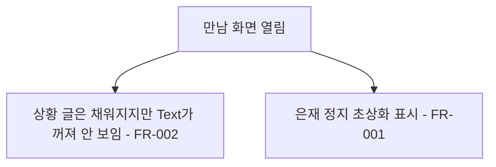

# 만남 화면 상황 칸 은재 초상화

## 1. 개요

- 목적: 만남(눈 속) 화면 왼쪽 상황 칸의 글을 숨기고, 그 자리를 채우는 큰 은재 초상화(`Eunjae_Portrait.png`, 움직임 없는 그림)를 보여 준다. 글 오브젝트는 지우지 않는다.
- 대상: 플레이어

## 2. 범위

- 포함:
  - 씬 `UI (Canvas)/만남 UI/상황 칸/속지`에 에디터 UI 메뉴(GameObject > UI (Canvas) > Image)로 `초상화` Image를 만들고, 상황 글이 있던 자리(신뢰도 막대 위 전체)에 배치
  - 은재 새 그림(`Arts/은재.png`)에서 바깥 흰 배경을 투명하게 뺀 `Portraits/Eunjae/Eunjae_Portrait.png`를 만들어 쓴다
  - 초상화 바깥에 흰 테두리(7px)를 둘러 검은 배경에 묻히지 않게 한다
  - 스펙 041 애니메이션과 예전 표정 에셋은 삭제했다. 지금 초상화 애니메이션은 스펙 043을 따른다
  - `상황` Text 컴포넌트를 꺼서 글을 숨긴다 (오브젝트와 타자 효과는 남긴다)
- 제외:
  - 코드 변경
  - 다른 손님(지수 등)일 때 초상화 바꾸기
  - 상태 글, 신뢰도 막대, 관찰 버튼 변경

## 3. 기술 방향

- 사용 기술/API: uGUI `Image`(Preserve Aspect)
- 핵심 방식:
  - `초상화`는 가로 전체, 세로 앵커 0.27~1(사방 여백 8)로 두고 Preserve Aspect로 비율을 지킨다. 스프라이트는 `Eunjae_Portrait`.
  - 배경 빼기: 연필 선을 4px 두껍게 한 벽 바깥의 흰 곳을 위·왼쪽·오른쪽 가장자리부터 채워 투명하게 한다. 아래는 마지막 선 줄에서 잘라 셔츠 안쪽이 빠지지 않게 한다.
  - 흰 테두리: 그림 테두리에서 7px 안의 투명한 곳을 흰색으로 칠하고 가장자리는 부드럽게 한다. 위·왼쪽·오른쪽에만 여백 9px를 더하고, 잘린 아래는 여백을 두지 않는다.
  - 팔 밑 구멍 메우기: 그림 아래쪽 절반은 줄마다 가장 왼쪽과 오른쪽 그림 사이의 투명한 곳을 흰색으로 채워, 머리카락과 팔 사이로 배경이 비치지 않게 한다.
  - `상황` 오브젝트는 켜 둔 채 Text 컴포넌트만 끈다. 오브젝트를 끄면 `Typewriter`가 멈춰 글 찍기가 끝나지 않을 수 있다.

- 선택하지 않은 방식: 상황 글 오브젝트를 지우는 방식은 사용자가 글을 지우지 말라고 해서 쓰지 않는다. 코드로 Image를 만드는 방식은 UI 생성 규칙에 맞지 않아 쓰지 않는다.
- 외부 의존성: 없음

## 4. 구조

| 구분 | 이름 | 역할 |
|------|------|------|
| 씬 | EyeMaze `상황 칸/속지/초상화` | Image(Eunjae_Portrait) |
| 텍스처 | Portraits/Eunjae/Eunjae_Portrait.png | 배경을 빼고 흰 테두리를 두른 은재 새 초상화 (779×866) |
| 씬 | EyeMaze `상황 칸/속지/상황` | Text 컴포넌트 꺼짐 (오브젝트 유지) |

- 오브젝트 구성: 위 표와 같다.
- 클래스 간 관계: 없음
- 실행 순서 의존성: 없음
- 기존 코드와의 접점: 없음

## 5. 동작 플로우차트

## 6. 요구사항

- FR-001: 만남 화면 상황 칸의 글 자리(신뢰도 막대 위 전체)에 은재 초상화가 비율을 지킨 채 움직임 없이 보인다.
- FR-002: 상황 칸의 글은 보이지 않고(오브젝트는 남음), 상태 글·신뢰도 막대·관찰 버튼은 그대로다.

### 상태와 데이터

| 이름 | 타입 | 설명 | 초기값 |
|------|------|------|--------|
| (없음) | | | |

### 예외 및 경계 조건

- 다른 손님의 눈 속이어도 은재 초상화가 나온다 (범위 제외).

## 7. Inspector 노출값

- 해당 없음 (위치·크기는 `초상화` RectTransform에서 조절)

## 8. 인수 조건

- FR-001: 눈 속 화면 왼쪽 칸 위쪽을 은재 새 초상화가 크게 채우고 움직이지 않으며, 흰 테두리로 검은 배경과 구분된다.
- FR-002: 상황 글이 보이지 않고, Text 컴포넌트를 다시 켜면 글이 돌아온다.

## 9. 미결 사항

- 없음
