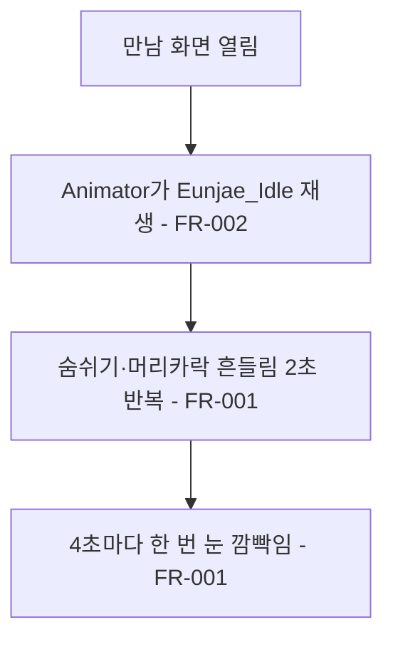

# 은재 아이들 초상화 애니메이션

## 1. 개요

- 목적: 눈 미로(만남 화면) 왼쪽 칸 은재 초상화를 숨쉬기·머리카락 흔들림·눈 깜빡임이 있는 아이들 애니메이션으로 바꾼다. 프레임은 그림을 직접 변형해 만든 스프라이트 시트이고, 코드가 아닌 애니메이션 에셋으로 재생한다.
- 대상: 플레이어

## 2. 범위

- 포함:
  - `Eunjae_Portrait.png`(흰 테두리·팔 밑 메우기 적용본)로 만든 아이들 프레임 16장과 눈 감은 프레임 2장의 스프라이트 시트
  - 반복 재생 AnimationClip과 Animator Controller
  - 씬 `상황 칸/속지/초상화`에 Animator를 붙여 재생
- 제외:
  - 필드 대화 상자 초상화 (정지 그림 유지)
  - 코드 변경
  - `Arts/은재Animate.gif` 사용: 그림 한 장(380×506)을 4×2 조각으로 나눈 8프레임이라 움직임 정보가 없다

## 3. 기술 방향

- 사용 기술/API: `TextureImporter`(Sprite Multiple), `ISpriteEditorDataProvider`, `AnimationClip`(`ObjectReferenceKeyframe`, Image `m_Sprite`), `AnimatorController`
- 핵심 방식:
  - 프레임은 원본 픽셀을 거꾸로 찾아 양선형 보간하는 변형으로 만든다. 위상 t(0~1)마다 한 장.
  - 숨쉬기: 어깨선(위에서 600px) 위 전체가 최대 3px 올라가고, 어깨선 아래는 잘린 아래 끝으로 갈수록 0이 되어 가슴이 늘어나 보인다. 아래 끝은 움직이지 않아 틈이 생기지 않는다.
  - 머리카락: 얼굴 가운데(x 360)에서 120~260px 밖으로 갈수록, 아래로 갈수록 좌우로 최대 3.5px 흔들린다. 아래쪽 머리카락은 위상이 늦어 끝이 따라오는 느낌을 준다. 얼굴은 흔들리지 않는다.
  - 눈 깜빡임: 두 눈 타원 안 선을 얼굴색으로 지우고, 아래로 처진 감은 눈 곡선과 눈꼬리 속눈썹을 그린 그림을 같은 변형으로 6·7번 위상에서 만든다.
  - 재생: 8fps, 16칸 한 바퀴 2초. 클립은 두 바퀴(4초)이고 두 번째 바퀴 6·7칸에서 눈을 감는다.
  - 시트는 5×4 칸(3895×3464), 최대 크기 4096, 고품질 압축.
- 선택하지 않은 방식: 그림 전체를 옮기거나 크기를 바꾸는 방식, 코드로 움직이는 방식은 사용자가 원하지 않아 쓰지 않는다.
- 외부 의존성: `com.unity.2d.sprite`

## 4. 구조

| 구분 | 이름 | 역할 |
|------|------|------|
| 텍스처 | Animation/Eunjae/Eunjae_Idle_Sheet.png | `Eunjae_Idle_00`~`15`, `Eunjae_Blink_06`·`07` 스프라이트 |
| 애니메이션 | Animation/Eunjae/Eunjae_Idle.anim | Image 스프라이트를 바꾸는 4초 반복 클립 |
| 컨트롤러 | Animation/Eunjae/Eunjae_Idle.controller | `Eunjae_Idle` 기본 상태 |
| 씬 | EyeMaze `상황 칸/속지/초상화` | Image(Eunjae_Idle_00) + Animator(Eunjae_Idle) |

- 클래스 간 관계: 없음
- 실행 순서 의존성: 없음
- 기존 코드와의 접점: 없음

## 5. 동작 플로우차트

## 6. 요구사항

- FR-001: 은재 초상화 프레임은 숨쉬기(어깨 위가 올라감), 머리카락 끝 흔들림, 눈 감음을 그림 변형으로 담고, 얼굴 위치와 그림체는 유지한다.
- FR-002: 만남 화면 왼쪽 칸 초상화는 `Eunjae_Idle` 클립을 끊김 없이 반복 재생한다.

### 상태와 데이터

| 이름 | 타입 | 설명 | 초기값 |
|------|------|------|--------|
| (없음) | | | |

### 예외 및 경계 조건

- 대화 기록 창이 게임을 멈추면(timeScale 0) 애니메이션도 멈춘다.

## 7. Inspector 노출값

- 해당 없음 (재생 속도는 Animator `Speed` 또는 클립 프레임 간격으로 조절)

## 8. 인수 조건

- FR-001: 시트의 칸마다 머리카락 끝과 어깨 높이가 조금씩 다르고, 눈 감은 칸 2개가 있다.
- FR-002: 눈 미로 시작 화면에서 은재가 숨쉬며 머리카락이 흔들리고, 4초마다 한 번 눈을 깜빡인다.

## 9. 미결 사항

- 없음
