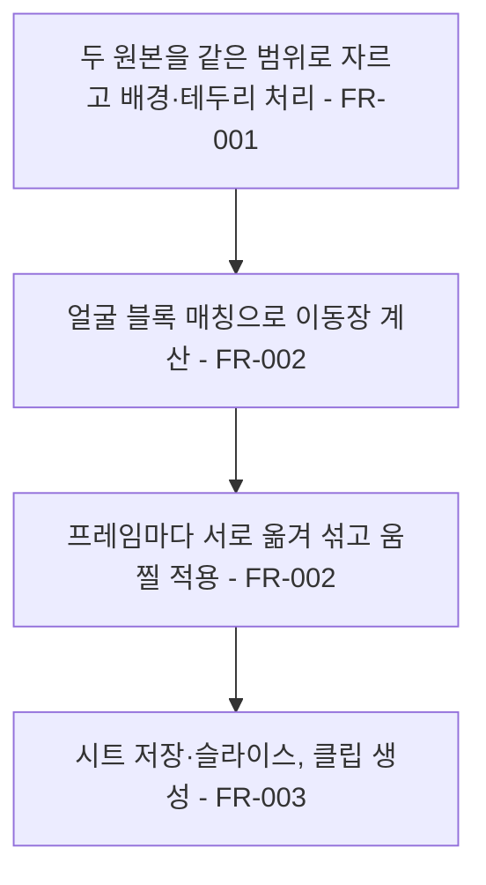

# 은재 일반 → 경계 전환 애니메이션

## 1. 개요

- 목적: 일반 은재 그림(`Arts/은재.png`)에서 경계하는 은재 그림(`Arts/경계하는 은재.png`)으로 자연스럽게 넘어가는 8프레임 전환 애니메이션 에셋을 만든다.
- 대상: 은재 초상화 연출을 붙이는 제작자

## 2. 범위

- 포함:
  - 두 그림을 스펙 042와 같은 방법(배경 빼기, 흰 테두리 7px, 아래 절반 구멍 메우기)으로 처리한 8프레임 스프라이트 시트
  - 한 번 재생하는 AnimationClip (UI `Image` 스프라이트 키)
- 제외:
  - 씬 연결과 재생 조건 (언제 경계로 바뀌는지는 따로 정한다)
  - 경계 → 일반 되돌리기, 경계 상태 반복 애니메이션
  - 코드 변경

## 3. 기술 방향

- 사용 기술/API: `TextureImporter`(Sprite Multiple), `ISpriteEditorDataProvider`, `AnimationClip`(`ObjectReferenceKeyframe`, Image `m_Sprite`)
- 핵심 방식:
  - 배경: 두 그림의 바깥 영역이 겹치는 곳만 투명하게 해 모든 프레임의 테두리 모양을 같게 한다.
  - 모핑: 얼굴 영역(위에서 250~500, 가로 170~480)을 18px 격자로 나눠, 칸마다 33px 조각을 ±18px 안에서 맞춰 보고(블록 매칭) 경계 그림 쪽 이동량을 구한다. 이동량을 가우시안(σ 22px)으로 이어 이동장을 만든다.
  - 프레임 p(0~1, 부드럽게 가속·감속)마다 일반 그림은 p만큼, 경계 그림은 1-p만큼 이동장으로 옮긴 뒤 섞는다. 눈·코·입이 미끄러지듯 제자리로 가서 겹선이 적다.
  - 섞는 순서: 위(눈썹)부터 아래로 늦게 바뀌고, 4px 덩어리 노이즈로 연필 선이 번지듯 바뀐다.
  - 움찔: 가운데 프레임에서 어깨 위가 최대 3px 올라가고 머리가 2.5px 옆으로 빠졌다가 마지막 프레임에서 제자리로 온다.
  - 0번은 일반 그림, 7번은 경계 그림 그대로다.
  - 재생: 12fps, 8칸(약 0.67초), 반복하지 않는다.
- 선택하지 않은 방식: 단순 크로스페이드는 두 그림의 눈·코·입 위치가 8~10px 달라 겹선이 생겨 쓰지 않는다.
- 외부 의존성: `com.unity.2d.sprite`

## 4. 구조

| 구분 | 이름 | 역할 |
|------|------|------|
| 텍스처 | Arts/경계하는 은재.png | 경계 원본 그림 (1016×1139) |
| 텍스처 | Animation/Eunjae/Eunjae_ToWary_Sheet.png | `Eunjae_ToWary_0`~`7` 스프라이트 (4×2, 칸 779×866) |
| 애니메이션 | Animation/Eunjae/Eunjae_ToWary.anim | 0.67초 한 번 재생 클립 |

- 클래스 간 관계: 없음
- 실행 순서 의존성: 없음
- 기존 코드와의 접점: 없음

## 5. 동작 플로우차트

## 6. 요구사항

- FR-001: 두 그림은 같은 바깥 모양과 흰 테두리를 가져, 프레임 사이에 테두리가 튀지 않는다.
- FR-002: 0번은 일반 그림, 7번은 경계 그림이고, 사이 프레임은 얼굴 부위가 이동하며 바뀌고 움찔했다가 가라앉는다.
- FR-003: `Eunjae_ToWary.anim`은 12fps로 8칸을 한 번 재생한다.

### 상태와 데이터

| 이름 | 타입 | 설명 | 초기값 |
|------|------|------|--------|
| (없음) | | | |

### 예외 및 경계 조건

- 두 그림은 눈썹 모양 자체가 달라 가운데 프레임에서 눈썹이 잠깐 옅게 겹쳐 보일 수 있다.

## 7. Inspector 노출값

- 해당 없음 (재생 속도는 Animator `Speed` 또는 클립 프레임 간격으로 조절)

## 8. 인수 조건

- FR-001: 시트 8칸의 흰 테두리 바깥 모양이 같다.
- FR-002: Animation 창에서 재생하면 은재가 눈썹을 찡그리며 눈을 옆으로 돌리고 살짝 움찔한 뒤 경계 그림으로 멈춘다.
- FR-003: 클립 길이는 약 0.67초이고 반복하지 않는다.

## 9. 미결 사항

- 언제 경계로 바뀌는지(재생 조건)와 씬 연결
