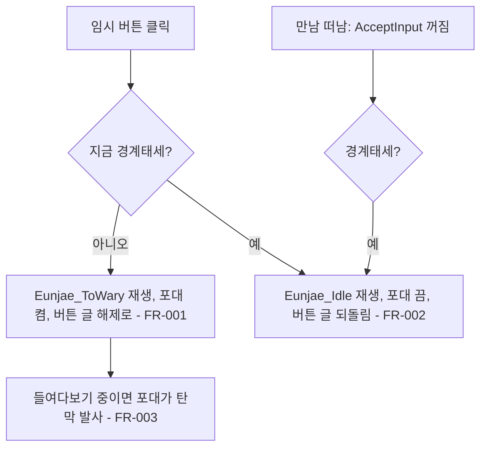

# 경계태세 전환 (임시 버튼)

## 1. 개요

- 목적: 만남 화면 대화 칸에 임시 "경계태세 전환" 버튼을 두고, 누르면 은재 초상화가 경계 전환 애니메이션(스펙 044)을 재생하고 눈 가운데 공격성 포대(`AggressionGunner`)가 켜져 들여다보는 동안 탄막을 쏜다. 다시 누르면 평소 상태로 돌아간다.
- 대상: 플레이어 (임시 테스트용)

## 2. 범위

- 포함:
  - 경계태세 상태를 켜고 끄는 `WaryStance` 컴포넌트
  - 씬 `만남 UI/대화 칸/속지`에 에디터 UI 메뉴로 만든 임시 버튼과 클릭 연결
  - `Eunjae_Idle.controller`에 `Eunjae_ToWary` 상태 추가
  - 씬의 `미로 (Iris Maze)/AggressionGunner`를 꺼진 상태로 저장
- 제외:
  - 대화 CSV 선택지로 경계태세 들어가기 (장면마다 선택지가 이미 3개라 임시 버튼으로 대신한다)
  - 경계 상태의 반복(아이들) 애니메이션, 경계 → 일반 되돌리기 애니메이션
  - `동공 (Pupil)/Aggression` (빈 오브젝트 회전만 있어 보이는 효과가 없다)
  - `OnAggression`, `MazeGunner` 동작 변경

## 3. 기술 방향

- 사용 기술/API: uGUI `Button`(onClick 영구 연결), `Animator.Play`, `GameObject.SetActive`
- 핵심 방식:
  - 경계태세 켜기: 초상화 Animator에서 `Eunjae_ToWary`를 처음부터 재생한다(반복하지 않아 마지막 경계 그림에서 멈춘다). `_aggressionObjects`를 켠다. 버튼 글을 해제 문구로 바꾼다.
  - 끄기: `Eunjae_Idle`을 처음부터 재생하고 `_aggressionObjects`를 끄고 버튼 글을 되돌린다.
  - 포대는 원래대로 디렉터가 들여다보기 중일 때만 쏜다(`CanRunHazards`). 그래서 대화 중에 경계태세로 바꾸고 들여다보면 탄막이 나온다.
  - 만남을 떠나면(디렉터 `AcceptInput`이 꺼지면) 경계태세를 자동으로 끈다.
  - 시작 상태는 씬에 저장된 값(포대 꺼짐)을 그대로 쓰고 Awake·Start에서 바꾸지 않는다.
- 선택하지 않은 방식: 대화 CSV에 4번째 선택지를 넣는 방식은 장면당 3개 제한 검사에 걸려 쓰지 않는다. 디렉터 코드를 고쳐 임시 선택지를 끼워 넣는 방식은 임시 기능에 비해 변경 범위가 커서 쓰지 않는다.
- 외부 의존성: 스펙 043 컨트롤러, 스펙 044 클립, 스펙 033 포대

## 4. 구조

| 구분 | 이름 | 역할 |
|------|------|------|
| 클래스 | WaryStance | 경계태세 상태, 초상화 애니메이션 전환, 공격성 오브젝트 켜고 끄기, 만남 종료 시 해제 |
| 씬 | EyeMaze `만남 UI` | `WaryStance` 추가 |
| 씬 | EyeMaze `만남 UI/대화 칸/속지/경계태세 전환 (임시)` | 임시 Button, onClick → `WaryStance.Toggle` |
| 씬 | EyeMaze `미로 (Iris Maze)/AggressionGunner` | 꺼진 상태로 저장 |
| 컨트롤러 | Eunjae_Idle.controller | `Eunjae_ToWary` 상태 추가 (전환 없음) |

- 클래스 간 관계: `WaryStance`가 `EyeMazeDirector.AcceptInput`을 읽는다.
- 실행 순서 의존성: 없음
- 기존 코드와의 접점: 없음 (기존 클래스 수정 없음)

## 5. 동작 플로우차트

## 6. 요구사항

- FR-001: 경계태세가 아닐 때 버튼을 누르면 초상화가 `Eunjae_ToWary`를 처음부터 재생하고, `_aggressionObjects`가 켜지고, 버튼 글이 `_exitLabel`로 바뀐다.
- FR-002: 경계태세일 때 버튼을 누르면 초상화가 `Eunjae_Idle`로 돌아가고, `_aggressionObjects`가 꺼지고, 버튼 글이 `_enterLabel`로 바뀐다.
- FR-003: 경계태세에서 들여다보기를 하면 눈 가운데 포대가 기존 설정대로 탄막을 쏜다.
- FR-004: 경계태세로 만남을 떠나면 자동으로 FR-002 상태가 된다.

### 상태와 데이터

| 이름 | 타입 | 설명 | 초기값 |
|------|------|------|--------|
| _isWary | bool | 경계태세인지 | false |
| IsWary | bool (읽기 전용) | 외부에서 보는 경계태세 여부 | false |

### 예외 및 경계 조건

- 같은 상태로 다시 바꾸라는 요청은 무시한다.
- 초상화 Animator나 버튼 글이 비어 있으면 그 부분만 건너뛴다.

## 7. Inspector 노출값

| 필드 | 타입 | 기본값 | 설명 |
|------|------|--------|------|
| _director | EyeMazeDirector | 씬 디렉터 | 만남을 떠났는지 볼 디렉터 |
| _portraitAnimator | Animator | `초상화` | 은재 초상화 Animator |
| _idleState | string | Eunjae_Idle | 평소 상태 이름 |
| _waryState | string | Eunjae_ToWary | 경계 전환 상태 이름 |
| _aggressionObjects | GameObject[] | AggressionGunner | 경계태세에서만 켤 공격성 오브젝트 |
| _toggleLabel | Text | 임시 버튼 글 | 상태에 따라 바꿀 글 |
| _enterLabel | string | 경계태세 전환 (임시) | 평소일 때 버튼 글 |
| _exitLabel | string | 경계태세 해제 (임시) | 경계태세일 때 버튼 글 |

## 8. 인수 조건

- FR-001: 만남 화면에서 임시 버튼을 누르면 은재가 경계 표정으로 바뀌고 버튼 글이 "경계태세 해제 (임시)"가 된다.
- FR-002: 다시 누르면 은재가 숨쉬는 평소 모습으로 돌아가고 탄막이 나오지 않는다.
- FR-003: 경계태세에서 들여다보면 눈 가운데에서 예고선 뒤 탄막이 나온다. 평소에는 나오지 않는다.
- FR-004: 경계태세로 필드에 돌아갔다 다시 만나면 평소 상태다.

## 9. 미결 사항

- 없음
