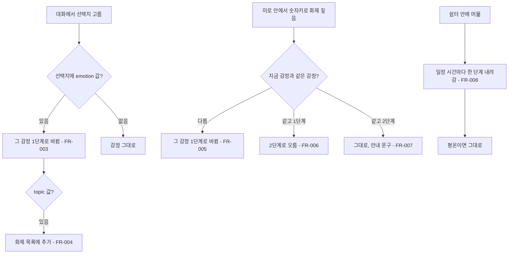
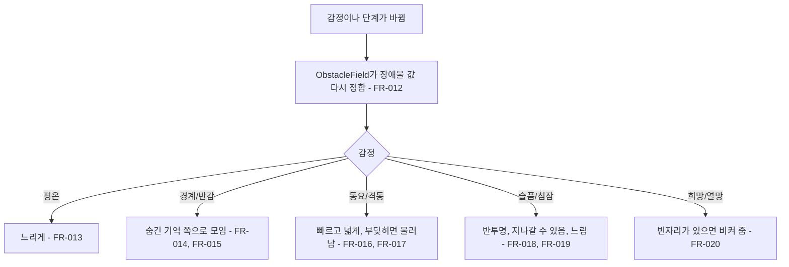
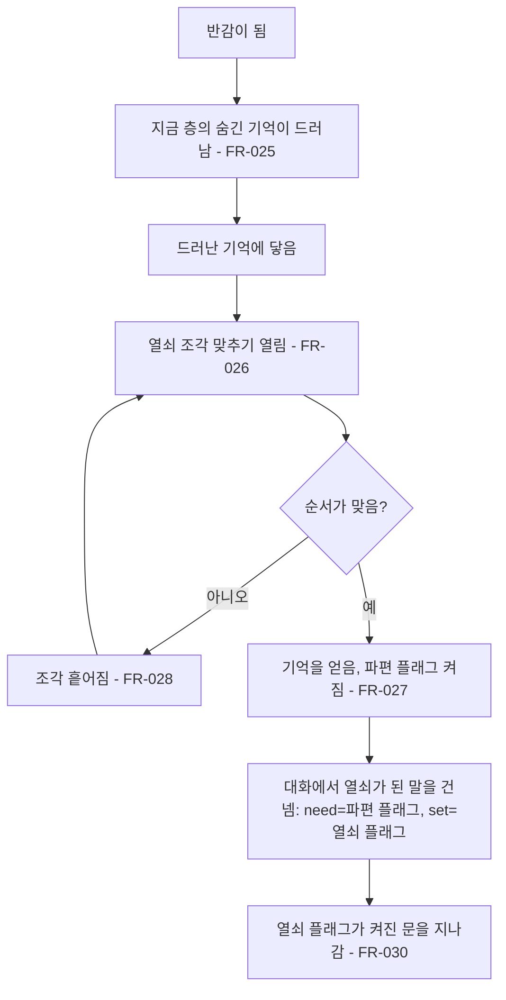

# 감정 조절과 감정별 미로

## 1. 개요

- 목적: 상대의 감정에 따라 미로의 장애물과 플레이어가 얻는 정보가 달라지게 해서, 플레이어가 대화와 미로 안에서 감정을 다루며 숨긴 기억에 닿고 문을 열게 한다.
- 대상: 플레이어, 감정별 수치와 쉼터·장애물을 배치하는 제작자, 대화 CSV와 열쇠 조각 CSV를 쓰는 제작자

## 2. 범위

- 포함:
  - 상대의 감정 상태(평온, 경계, 동요, 슬픔, 희망)와 단계(1, 2)
  - 대화 선택지로 감정 바꾸기, 미로 안에서 화제를 짚어 감정 바꾸기
  - 미로에 배치한 쉼터에서 감정이 천천히 가라앉기
  - 감정과 단계에 따른 부담감 누적 속도
  - 왕복·회전·선 장애물의 감정별 움직임
  - 숨긴 기억과 반감으로 드러내기
  - 낱말 조각을 한 문장으로 맞추는 열쇠 조각 맞추기
  - 열쇠로 여는 층 사이 문과 동공의 문
  - 감정별 장애물 밖의 이득(동요의 새어 나오는 말, 슬픔의 흔적, 희망의 문 표시, 열망의 끌려오는 기억)
  - 경계·반감일 때 은재 초상화의 경계 애니메이션
  - 은재 1회차의 감정·열쇠 데이터
- 제외:
  - 포대·포탑·탄환 스크립트 삭제. 씬에서만 끄고 스크립트와 프리팹은 남긴다.
  - 파편 조각판(`FragmentPuzzle`) 스크립트 삭제. 씬 연결만 끊는다.
  - 미로 벽의 종류 추가(얇은 벽, 굵은 벽, 박자 문)
  - 깜빡임 주기와 맵 변화 방식 변경
  - 부담감이 가득 찼을 때의 처리, 휴식 신호, 좋은 말의 부담감 감소
  - 신뢰 수치의 계산과 결말 판정
  - 지수의 감정·열쇠 데이터
  - 감정별 눈 표현(초점, 눈물, 눈꺼풀)
  - 소리

## 3. 기술 방향

- 사용 기술/API: Unity Input System(기존 `Keyboard.current`), `LineRenderer`, uGUI 레거시 `Text`와 `Button`, 기존 `Csv` 파서, 기존 `Flags`
- 핵심 방식:
  - 감정 상태는 `Person`에 두고, 바꾸는 규칙은 새 클래스 `EmotionControl`이 맡는다. `EyeMazeDirector`는 대화 선택과 입력을 `EmotionControl`에 넘긴다.
  - 장애물은 새 컴포넌트 `MazeObstacleBody`를 붙여 속도 배율, 통과 가능 여부, 위치 치우침, 투명도를 받는다. 새 클래스 `ObstacleField`가 감정에 따라 모든 `MazeObstacleBody`의 값을 정한다. 팀원의 장애물 스크립트는 `MazeObstacleBody`의 값을 읽는 줄만 더한다.
  - 장애물의 모이기, 비켜 주기, 부딪혀 물러나기는 모두 "제자리에서의 치우침"으로 처리한다. 장애물의 원래 왕복·회전은 그대로 돈다.
  - 숨긴 기억, 열쇠, 문은 기존 플래그를 쓴다. 기억을 얻으면 기존처럼 파편의 `_flag`가 켜지고, 대화 선택지가 `need`로 그 플래그를 요구하고 `set`으로 문의 열쇠 플래그를 켠다. 문은 열쇠 플래그로 열린다.
  - 열쇠 조각 글은 새 CSV `Assets/EyeMaze/Data/KeyPieces.csv`에 둔다.
  - UI 오브젝트는 씬에 미리 만들어 두고 스크립트는 `[SerializeField]`로 참조만 한다.
- 선택하지 않은 방식:
  - 모든 감정이 같은 규칙 하나(층이 어긋남)를 쓰는 방식은 쓰지 않는다.
  - 감정에 따라 미로에 사물이 나타나고 사라지는 방식은 쓰지 않는다.
  - 즉시 가라앉히는 버튼은 만들지 않는다.
  - 걸어서 밟으면 숨긴 기억이 드러나는 방식은 쓰지 않는다.
  - 2단계를 감정마다 한 번만 쓰는 제한은 두지 않는다.
  - 감정이 깜빡임을 멈추거나 열쇠 조각을 대신 맞춰 주는 방식은 쓰지 않는다.
  - 희망에서 기억을 얻지 못하게 하는 제한은 두지 않는다.
  - 열쇠 조각 글을 `Flags.csv`에 열로 더하는 방식은 쓰지 않는다(플래그 관리 창이 저장할 때 열을 지울 수 있다).
  - UI 오브젝트를 런타임 코드로 만들지 않는다. TextMeshPro를 쓰지 않는다.
- 외부 의존성: `EyeMazeDirector`, `Person`, `ClientCase`, `IrisMaze`, `MazeGate`, `MemoryFragment`, `GazeCursor`, `EyeMazeUI`, `WaryStance`, `DialogueScript`, `Csv`, `Flags`, 대사 편집기(`DialogueEditorFormat`, `DialogueData`, `DialogueEditorGraph`), 팀원의 장애물 스크립트(`MoveObstaclesBasic`, `RotationObstaclesBasic`, `SplineObstacle`)

## 4. 구조

| 구분 | 이름 | 역할 |
|------|------|------|
| 클래스 | `Emotion` (enum) | 감정 종류 |
| 클래스 | `EmotionControl` | 감정 바꾸기 규칙, 화제 목록, 쉼터 가라앉기, 감정별 수치 제공 |
| 클래스 | `RestSpot` | 미로에 놓는 쉼터. 위치와 반지름 |
| 클래스 | `MazeObstacleBody` | 장애물 하나가 받는 속도 배율, 통과 가능 여부, 치우침, 투명도 |
| 클래스 | `ObstacleField` | 감정에 따라 모든 장애물의 값을 정함. 모이기, 비켜 주기, 부딪힘 계산 |
| 클래스 | `KeyPieces` | `KeyPieces.csv` 읽기 |
| 클래스 | `KeyForgeUI` | 열쇠 조각 맞추기 화면 |
| 클래스 | `GazeTrail` | 슬픔·침잠의 지나온 길 흔적 그리기 |
| 클래스(수정) | `Person` | 감정 상태 보관 |
| 클래스(수정) | `ClientCase` | 인물별 문 열쇠 플래그 |
| 클래스(수정) | `EyeMazeDirector` | 감정 연결, 미로 안 화제 입력, 부담감 배율, 시선 속도 배율, 파편 닿기 처리 |
| 클래스(수정) | `MemoryFragment`, `FragmentFeedback` | 숨김 상태, 들은 말, 끌려온 자리. 숨긴 파편의 후광 끔 |
| 클래스(수정) | `MazeGate`, `IrisMaze` | 열쇠 플래그 조건 |
| 클래스(수정) | `DialogueScript`, 대사 편집기 3개 | `emotion`, `topic` 열 |
| 클래스(수정) | `EyeMazeUI` | 감정 표시, 화제 목록 표시 |
| 클래스(수정, 팀원) | `MoveObstaclesBasic`, `RotationObstaclesBasic`, `SplineObstacle` | `MazeObstacleBody` 값 반영, 회전 장애물 피격 판정 |
| 데이터 | `Assets/EyeMaze/Data/KeyPieces.csv` | 기억별 열쇠 조각, 새어 나오는 말 |
| 데이터(수정) | `Assets/EyeMaze/Data/Dialogue/Eunjae_Day1.csv` | `emotion`, `topic` 열과 열쇠 선택지 |
| 씬 | EyeMaze | 탄막 오브젝트 끔, 임시 경계태세 버튼 끔, 조각판 연결 끊음, 쉼터·열쇠 화면·화제 목록 UI 추가, 장애물에 `MazeObstacleBody` 추가, 선 장애물 참조 연결 |

- 오브젝트 구성: `게임 디렉터 (Director)`에 `EmotionControl`과 `ObstacleField`를 붙인다. 각 장애물 오브젝트에 `MazeObstacleBody`를 붙인다. 쉼터는 층 오브젝트 아래에 `RestSpot`을 가진 오브젝트로 둔다. `GazeTrail`은 미로 아래에 `LineRenderer`와 함께 둔다. `KeyForgeUI`는 만남 UI 아래의 패널에 붙인다.
- 클래스 간 관계: `EyeMazeDirector` → `EmotionControl`(감정 변경 요청, 수치 읽기). `ObstacleField` → `EmotionControl`(현재 감정 읽기), `MazeObstacleBody`(값 쓰기), `MemoryFragment`(숨긴 기억 위치 읽기). 팀원의 장애물 스크립트 → 같은 오브젝트의 `MazeObstacleBody`(값 읽기). `KeyForgeUI` → `EyeMazeDirector`(완성·취소 알림).
- 실행 순서 의존성: `ObstacleField`는 `Start`에서 씬의 `MazeObstacleBody`를 모은다. 장애물 스크립트는 `MazeObstacleBody`가 없으면 기존처럼 동작한다.
- 기존 코드와의 접점: `EyeMazeDirector.ChooseOption`, `HandleInput`, `Steer`, `TickBurden`, `CheckFragment`, `LoadCase`, `ResetAll`. `IrisMaze.Generate`와 `MakeGate`. `MazeGate.CanPass`. `MemoryFragment.Update`. `DialogueScript.Parse`. `DialogueEditorFormat`의 `DAY_COLUMNS`와 스키마, `DialogueData.CreateDialogue`, `DialogueEditorGraph`의 선택지 기본값.

## 5. 동작 플로우차트

## 6. 요구사항

### 묶음 1: 감정 상태

- FR-001: 인물을 불러오거나(`LoadCase`) 만남을 처음부터 다시 시작할 때(`ResetAll`), 그리고 씬에 이미 불러와 둔 인물로 Play를 시작할 때 상대의 감정은 그 인물의 `ClientCase._startEmotion`이 된다. 평온이 아니면 1단계이고, 화제 목록에는 그 감정의 화제 하나만 들어 있다. 평온이면 화제 목록은 비어 있다.
- FR-002: 감정은 평온, 경계, 동요, 슬픔, 희망 가운데 하나이고, 평온이 아닌 감정은 1단계 또는 2단계를 가진다. 2단계의 이름은 경계는 반감, 동요는 격동, 슬픔은 침잠, 희망은 열망이다.
- FR-003: 대화에서 `emotion` 값이 있는 선택지를 고를 때 상대의 감정은 그 감정의 1단계가 된다. 지금 감정이 무엇이든 바로 바뀐다.
- FR-004: 대화에서 `emotion`과 `topic` 값이 둘 다 있는 선택지를 고를 때 그 `topic` 글과 감정이 화제 목록에 더해진다. 같은 `topic`은 한 번만 들어간다. 같은 감정의 화제가 이미 있으면 새 화제가 그 자리를 대신해, 화제는 감정마다 하나만 남는다.
- FR-005: 들여다보는 중 숫자키 1~4로 화제를 짚고 그 화제의 감정이 지금 감정과 다를 때 상대의 감정은 그 화제 감정의 1단계가 된다. 평온을 거치지 않는다.
- FR-006: 들여다보는 중 화제를 짚고 그 화제의 감정이 지금 감정과 같으며 1단계일 때 2단계가 된다.
- FR-007: 들여다보는 중 화제를 짚고 그 화제의 감정이 지금 감정과 같으며 2단계일 때 감정은 그대로이고 문구 줄에 `_alreadyMaxMessage`가 나온다.
- FR-008: 들여다보는 중 시선이 쉼터의 반지름 안에 있을 때 `_restStepSeconds`초마다 한 단계씩 내려간다(2단계 → 1단계 → 평온). 쉼터 밖으로 나가면 시간 계산은 0으로 돌아간다.
- FR-009: 들여다보는 중 부담감이 시간으로 쌓일 때 평온이면 누적 속도에 `_calmBurdenScale`을, 2단계이면 `_stage2BurdenScale`을 곱한다. 그 밖의 경우는 기존 속도다.
- FR-039: 들여다보는 중 시선이 쉼터의 반지름 안에 있을 때 부담감은 시간으로 쌓이지 않고 초당 `_restBurdenReliefPerSecond`만큼 줄어든다. 감정이 평온이어도 같다.
- FR-010: 감정이나 단계가 바뀔 때 만남 UI의 감정 글은 지금 감정의 이름(2단계는 2단계 이름)을 그 감정의 색(`_emotionColors`)으로 보여 주고, 문구 줄에 그 상태에서 일어나는 일을 한 줄로 적은 문구가 한 번 나온다. 화제 목록은 번호와 감정 이름만 그 감정의 색으로 보여 준다.
- FR-011: 감정이 경계 또는 반감이 될 때 `WaryStance.SetWary(true)`가 불리고, 다른 감정이 될 때 `SetWary(false)`가 불린다.

### 묶음 2: 감정별 장애물

- FR-012: 감정이나 단계가 바뀔 때 `ObstacleField`는 모든 `MazeObstacleBody`의 통과 가능 여부와 투명도를 그 감정의 값으로 바꾼다. 속도 배율, 왕복 폭 배율, 치우침은 `_offsetLerpSpeed`로 부드럽게 따라간다. 치우침은 미로 기준으로 기억해 깜빡임으로 미로가 돌 때 함께 돈다.
- FR-013: 평온일 때 장애물의 속도 배율은 `_calmSpeedScale`이다.
- FR-014: 경계일 때, 시선이 있는 층의 얻지 못한 기억(숨김 여부와 상관없음) 가운데 시선에 가장 가까운 것을 지킬 기억으로 정한다. 지킬 기억은 그 기억을 얻거나, 감정이 경계·반감이 아니게 되거나, 시선이 다른 층으로 갈 때까지 바뀌지 않는다. 그 층의 장애물 가운데 지킬 기억에 가까운 `_guardMaxCount`개만 그 기억을 중심으로 반지름 `_guardWideRadius`의 원 둘레에 고르게 나뉘어 자리 잡고, 나머지 장애물은 제자리에서 움직인다. 둘러싸고 선 장애물의 왕복 폭 배율은 `_guardSwingScale`로 줄어든다(반감도 같다). 그 층에 얻지 못한 기억이 없으면 모두 제자리에 있는다.
- FR-015: 반감일 때, FR-014와 같은 지킬 기억과 같은 장애물이 반지름 `_guardTightRadius`의 원 둘레에 자리 잡는다. 이때 시선 쪽을 향한 `_guardGapDegrees`도 범위에는 장애물을 두지 않는다.
- FR-016: 동요일 때 장애물의 속도 배율은 `_stirSpeedScale`, 왕복 폭 배율은 `_stirSwingScale`이다. 격동일 때는 `_stirSpeedScale2`, `_stirSwingScale2`다.
- FR-017: 동요 또는 격동일 때 두 장애물 사이 거리가 `_clashRadius`보다 가까워지면, 두 장애물은 서로 반대쪽으로 `_clashRetreat`만큼 물러나 물러난 자리에 닿은 뒤 `_clashHoldSeconds`초 동안 그 자리에 머문다. 이미 치우쳐 있던 장애물은 그 자리에서 더 물러난다. 격동일 때는 물러난 장애물에서 `_chainRadius` 안에 있는 다른 장애물도 같은 방향으로 물러난다. 머무는 동안 그 장애물의 왕복과 회전은 멈추고, 머문 뒤 `_clashHoldSeconds`초 동안은 다시 부딪히지 않는다. 물러나는 치우침은 `_clashLerpSpeed`로 따라간다.
- FR-018: 슬픔 또는 침잠일 때 장애물은 `_sadAlpha` 투명도로 그려지고, 닿아도 피격이 일어나지 않으며, 속도 배율은 `_sadSpeedScale`이다.
- FR-019: 슬픔일 때 시선의 이동 속도에 `_sadGazeScale`을 곱한다. 침잠일 때도 같지만, 시선이 어느 장애물의 피격 반지름 안에 있는 동안에는 곱하지 않는다.
- FR-020: 희망 또는 열망일 때 시선에서 `_yieldRadius` 안에 있는 장애물은 시선 반대 방향으로 `_yieldDistance`만큼 물러난다. 물러날 자리에서 `_yieldClearance` 안에 다른 장애물이 있거나, 물러날 자리까지 닫힌 벽이나 잠긴 문이 가로막으면 물러나지 않는다. 물러나는 속도는 `_yieldSpeed`다.
- FR-021: 회전 장애물은 왕복 장애물과 같은 방식으로 시선과의 거리를 `_hitRadius`와 비교해 피격을 요청한다.
- FR-041: 감정이 동요, 격동, 슬픔, 침잠, 희망, 열망일 때 은재 초상화는 `EmotionPortrait._sprites`에 넣은 그 감정의 그림을 보여 준다. 평온, 경계, 반감일 때는 기존 애니메이션(FR-011)을 보여 준다. 그림이 비어 있는 감정은 기존 애니메이션을 보여 준다.
- FR-042: 만남을 시작한 뒤 첫 파편을 얻기 전까지, 들여다보는 중 감정이 경계 1단계이고 드러난 파편이 하나도 없을 때 화제 목록의 경계 줄이 `_nudgePulseSeconds` 주기로 밝아졌다 어두워진다. 그 상태로 `_nudgeTopicSeconds`초가 지나면 문구 줄에 `_nudgeTopicMessage`가 한 번 나온다(글 속의 `{key}`는 경계 화제의 번호로 바뀐다). 첫 안내가 진행되는 동안(FR-042, FR-043)에는 눈을 깜빡여도 깜빡임 문구를 문구 줄에 쓰지 않는다.
- FR-043: 만남을 시작한 뒤 첫 파편을 얻기 전까지, 들여다보는 중 드러났지만 얻지 못한 파편에서 `_nudgeRingSeconds`초마다 획득 고리와 같은 고리가 퍼진다. 그 상태로 `_nudgeFragmentSeconds`초가 지나면 문구 줄에 `_nudgeFragmentMessage`가 한 번 나온다.
- FR-045: 열쇠 플래그가 켜진 문(초록색)에 시선이 처음 닿을 때 문은 바로 지나가지지 않고 문 여는 컷신 창이 열린다. 창에는 자물쇠 판과 열쇠 구멍이 보이고, 열쇠를 든 손이 구멍으로 들어가 열쇠를 돌린 뒤 창이 사라진다. 창이 사라지면 미로의 그 문 선을 따라 먼지 알갱이가 날려 흩어지며 가라앉고, 문 선은 옅어져 사라진다(`_unlockSeconds`). 컷신과 문이 사라지는 동안 시선 이동, 부담감 누적, 깜빡임, 장애물 피격은 멈춘다. 끝난 뒤에는 그 문의 선이 그려지지 않고 시선이 지나갈 수 있다. 벽을 다시 만들어도 연 문은 선이 없는 채로 있고, 만남을 처음부터 다시 시작하면 진행 중인 장면은 취소되고 문은 닫힌 상태로 돌아간다.
- FR-022: `MazeObstacleBody`가 붙지 않은 장애물은 기존과 똑같이 움직인다.
- FR-046: 들여다보는 중 감정이 슬픔 또는 침잠일 때 미로는 시선에서 `_sadRadius`(침잠은 `_deepRadius`) 안쪽만 보이고 바깥은 어둡게 덮인다. 벽, 문, 파편, 장애물, 쉼터가 함께 가려지고, 시선과 지나온 길의 흔적(FR-035)은 덮개 위에 그려져 보인다. 덮개는 `_fadeSpeed`로 짙어지고 걷힌다. 동공 안에서는 덮지 않는다.
- FR-047: 희망 또는 열망일 때 장애물 피격으로 오르는 부담감에 `_hopeHitBurdenScale`을 곱한다. 희망 또는 열망인 동안 `_hopeBreakHits`번 맞으면 감정이 경계 1단계가 되고 문구 줄에 `_hopeBrokenMessage`가 나온다. 맞은 횟수는 다른 감정으로 바뀌면 0으로 돌아간다.
- FR-048: 희망 또는 열망에서 비켜 주는 중인 왕복·회전 장애물은 `_yieldColor`가 섞인 색으로 그려진다. 열망일 때 시선이 있는 층의 드러났지만 얻지 못한 파편과 시선 사이에 빛줄이 그려진다.
- FR-040: 왕복·회전·선 장애물은 시선에 한 번 피격을 준 뒤, 시선이 그 장애물의 접촉 범위를 벗어났다가 다시 닿을 때까지 같은 시선에 다시 피격을 주지 않는다.
- FR-023: Play를 시작할 때 씬의 포대(`Gunner`, `ThreeWayTurret`, `AggressionGunner`)와 동공의 `Aggression`, 임시 경계태세 버튼은 꺼져 있다. 씬의 `WaryStance._aggressionObjects`는 비워서, 경계나 반감이 되어도(FR-011) 포대가 다시 켜지지 않는다.

### 묶음 3: 숨긴 기억, 열쇠, 문

- FR-024: `_hiddenAtStart`가 켜진 기억 파편은 인물을 불러올 때 숨긴 상태가 된다. 숨긴 파편은 그려지지 않고, 시선이 그 자리를 지나도 아무 일도 일어나지 않는다.
- FR-025: 감정이 반감이 될 때, 그리고 반감인 채로 시선이 다른 층에 들어설 때 시선이 있는 층의 숨긴 파편이 모두 드러난다. 한 번 드러난 파편은 감정이 바뀌어도 드러난 채로 있다.
- FR-026: 시선이 드러났지만 아직 얻지 못한 파편에 닿을 때 열쇠 조각 맞추기 화면이 열린다. 화면에는 그 기억의 글, 가로로 누운 열쇠(왼쪽 고리, 오른쪽으로 뻗은 몸통, 몸통 아래로 난 깊이가 서로 다른 빈 홈), 순서가 섞인 낱말 조각들이 나온다. 열려 있는 동안 시선 이동, 부담감 누적, 깜빡임, 장애물 피격은 멈추고, 화면 아래 조작 안내 줄은 비운다. 조각은 조각 버튼을 누르거나 숫자키 1~6으로 놓고, Backspace로 마지막에 놓은 조각을 되돌린다. 놓은 조각은 `_moveSeconds` 동안 다음 빈 홈으로 움직이며 그 홈의 크기에 맞춰져 끼워지고, 되돌린 조각은 원래 자리로 움직여 돌아간다.
- FR-027: 열쇠 조각 맞추기에서 모든 조각을 `KeyPieces.csv`에 적힌 순서대로 놓을 때 열쇠 그림과 조각이 `_doneColor`로 바뀌어 `_doneHoldSeconds` 동안 보인 뒤 화면이 닫히고, 그 파편을 얻은 것으로 처리한다(`Collected = true`, 파편 플래그 켜짐, 기존 획득 연출). 문구 줄에 완성한 문장이 나온다.
- FR-028: 열쇠 조각 맞추기에서 마지막 조각을 놓았을 때 순서가 틀리면 마지막 조각이 홈에 닿은 뒤 놓은 조각이 모두 원래 자리로 움직여 돌아가고 `_wrongOrderMessage`가 나온다.
- FR-029: 열쇠 조각 맞추기에서 Esc를 누를 때 화면이 닫히고 파편은 얻지 못한 채로 남는다. 시선이 그 자리를 벗어났다가 다시 닿으면 화면이 다시 열린다. 완성한 열쇠를 보여 주는 동안(FR-027)에는 Esc를 받지 않는다.
- FR-030: 층 사이 문과 동공의 문은 그 문에 정해진 열쇠 플래그가 켜져 있을 때만 지나갈 수 있다. 열쇠 플래그는 `ClientCase`의 `_gateKeyFlags`에서 층 순서대로 읽는다. 열쇠 플래그가 비어 있는 문은 기존 조건(신뢰, 동공 열림)을 쓴다. 열쇠 플래그는 인물을 불러올 때와, 씬에 이미 불러와 둔 인물로 Play를 시작할 때 문에 적용하고, 벽을 다시 만들어 새로 생긴 문에도 적용한다.
- FR-031: 대사 편집기는 `emotion`과 `topic` 열을 대화 선택지의 속성으로 읽고 쓰며, 저장할 때 그 값을 지우지 않는다.
- FR-032: 기억 파편에 닿았을 때 파편 조각판(`FragmentPuzzle`)은 열리지 않는다.

### 묶음 4: 장애물 밖의 이득

- FR-033: 동요 또는 격동일 때 시선이 드러났지만 얻지 못한 파편에서 `_leakRadius` 안에 들어가면, 문구 줄에 그 기억의 `leak1` 글이 나오고 그 기억은 "말을 들은" 상태가 된다. 격동이면 `leak1`과 `leak2`가 이어서 나온다.
- FR-034: 열쇠 조각 맞추기 화면이 열릴 때, 그 기억이 "말을 들은" 상태이면 들은 글이 기억 글 아래에 함께 나온다. 화면이 열린 뒤에 감정을 바꿔도 들은 글은 달라지지 않는다.
- FR-035: 슬픔 또는 침잠일 때 시선이 지나온 칸을 잇는 흔적 선이 그려진다. 슬픔을 벗어나면 흔적은 지워진다. 슬픔은 최근 `_sadTrailCells`칸, 침잠은 최근 `_deepTrailCells`칸이다. 흔적은 층과 함께 돈다.
- FR-036: 흔적 선에서 이어진 두 칸 사이가 지금 닫힌 벽으로 막혀 있으면 그 구간은 그려지지 않는다.
- FR-037: 희망 또는 열망일 때, 열쇠 플래그가 켜져 있고 아직 열쇠로 열지 않았고 지나가지 않은 문은 `_gateGlowColor`로 맥동한다. 시선이 문이 있는 고리 경계를 실제로 넘었을 때 지나간 것으로 본다.
- FR-038: 열망일 때 시선이 있는 층의 드러났지만 얻지 못한 파편은 `_pullStepSeconds`초마다 시선 쪽으로 한 칸씩 옮겨 온다. 옮겨 오는 길은 그 층의 열린 칸만 지난다. 길이 없으면 옮겨 오지 않는다.

### 상태와 데이터

| 이름 | 타입 | 설명 | 초기값 |
|------|------|------|--------|
| `Person.Emotion` | `Emotion` | 지금 감정 | 평온 |
| `Person.EmotionStage` | `int` | 0(평온), 1, 2 | 0 |
| `EmotionControl._topics` | `List<Topic>` | 화제 글과 감정 | 빈 목록 |
| `EmotionControl._restT` | `float` | 쉼터에 머문 시간 | 0 |
| `MemoryFragment._hidden` | `bool` | 숨긴 상태 | `_hiddenAtStart` 값 |
| `MemoryFragment._leakHeard` | `int` | 들은 말의 단계(0, 1, 2) | 0 |
| `MazeObstacleBody.SpeedScale` | `float` | 속도 배율 | 1 |
| `MazeObstacleBody.SwingScale` | `float` | 왕복 폭 배율 | 1 |
| `MazeObstacleBody.Passable` | `bool` | 닿아도 피격 없음 | false |
| `MazeObstacleBody.Offset` | `Vector3` | 제자리에서의 치우침(월드) | 0 |
| `MazeObstacleBody.Alpha` | `float` | 그림 투명도 | 1 |
| `GazeTrail._cells` | `List` | 지나온 칸(층, 고리, 섹터) | 빈 목록 |

`KeyPieces.csv` 열: `flag`(파편 플래그), `pieces`(`|`로 나눈 낱말 조각, 적힌 순서가 정답), `leak1`, `leak2`.

대화 CSV에 더하는 열: `emotion`(`guard`, `stir`, `sad`, `hope` 가운데 하나 또는 빈칸), `topic`(화제 목록에 보일 글).

### 예외 및 경계 조건

- 화제가 하나도 없을 때 숫자키를 누르면: 아무 일도 일어나지 않는다.
- 화제가 5개 이상일 때: 먼저 얻은 4개만 목록에 보이고 짚을 수 있다. 화제는 감정마다 하나이므로 지금의 네 감정에서는 일어나지 않는다.
- 파편을 읽는 중, 열쇠 조각 맞추기 중, 깜빡임 중일 때의 화제 짚기: 받지 않는다.
- 쉼터 안에서 화제를 짚을 때: 감정이 바뀌고 쉼터의 시간 계산은 0으로 돌아간다.
- `KeyPieces.csv`에 그 파편의 줄이 없거나 조각이 2개 미만일 때: 열쇠 조각 맞추기를 열지 않고 닿는 즉시 얻는다.
- 조각이 6개를 넘을 때: 앞의 6개만 쓴다.
- 반감이 될 때 그 층에 숨긴 파편이 없으면: 드러낼 것이 없다는 `_nothingHiddenMessage`가 나온다.
- 경계·반감에서 층에 장애물이 없을 때: 장애물 효과는 없고 드러내기만 동작한다.
- 열망으로 파편이 옮겨 오는 중 깜빡임으로 벽이 바뀔 때: 다음 걸음부터 새 벽으로 길을 찾는다.
- 경계에서 지킬 기억을 정한 뒤 다른 기억 가까이 가서 반감이 될 때: 지킬 기억은 바뀌지 않는다(FR-014).
- 열망으로 끌려온 파편이 시선의 칸에 닿았을 때: 시선이 움직이지 않아도 열쇠 조각 맞추기가 열린다.
- 대화에서 이미 고른 좋은 말을 다시 고를 때: 신뢰와 동공은 다시 오르지 않지만 `emotion`과 `topic`은 다시 적용된다.
- 감정이 바뀌는 순간 시선이 장애물과 겹쳐 있을 때: 기존 피격 무적 시간(`_hazardInvulnerabilitySeconds`) 동안 피격하지 않는다. 겹쳐 있지 않으면 무적을 주지 않는다.
- 열쇠 조각 맞추기 중 대화 기록 창이 열려 있을 때: 조각 놓기와 Esc를 받지 않는다.
- 열망으로 한 칸에 모인 여러 파편을 차례로 그만두었을 때: 그만둔 파편은 모두 시선이 그 칸을 벗어나기 전까지 다시 열리지 않는다.
- 대화로 나가 있는 동안: 쉼터 시간, 장애물 치우침 계산, 열망의 끌어오기는 멈춘다(기존 `CanRunHazards`와 같은 조건).
- 만남을 처음부터 다시 시작할 때(`ResetAll`): 장애물의 치우침과 부딪힘 상태도 처음으로 돌아가고, 벽은 그 인물의 시작 시드로 다시 만든다.
- 개발자 진입(F2)으로 들여다볼 때: 넘기던 선택지 결과를 끝까지 넘겨 미뤄 둔 장면 이동을 적용하고, 화제가 없는 감정마다 개발용 화제를 넣는다.
- 가까이 있는 파편이 여럿일 때 열쇠 조각 맞추기를 열면: 새어 나오는 말은 지금 여는 그 파편에 대해 확인한다.
- 은재 1회차의 기억 파편은 모두 `_hiddenAtStart`가 켜져 있다. 글과 조각이 없는 임시 파편 `새 기억`은 꺼 둔다.

## 7. Inspector 노출값

| 필드 | 타입 | 기본값 | 설명 |
|------|------|--------|------|
| `EmotionControl._restStepSeconds` | float | 2.5 | 쉼터에서 한 단계 내려가는 시간(초) |
| `EmotionControl._calmBurdenScale` | float | 0.6 | 평온일 때 부담감 누적 속도 배율 |
| `EmotionControl._stage2BurdenScale` | float | 1.5 | 2단계일 때 부담감 누적 속도 배율 |
| `EmotionControl._restBurdenReliefPerSecond` | float | 0.04 | 쉼터 안에서 초당 줄어드는 부담감 |
| `ObstacleField._guardMaxCount` | int | 3 | 경계와 반감에서 기억을 지키러 모이는 장애물 수 |
| `ClientCase._startEmotion` | Emotion | 평온 | 이 인물과의 만남이 시작될 때의 감정. 은재는 경계 |
| `EmotionPortrait._sprites` | Sprite[6] | (연결) | 동요, 격동, 슬픔, 침잠, 희망, 열망의 초상화 그림 |
| `EmotionPortrait._animator`, `_image` | Animator, Image | (연결) | 초상화의 애니메이터와 그림 |
| `EyeMazeDirector._nudgeTopicSeconds` / `_nudgeFragmentSeconds` | float | 5 / 8 | 첫 안내 문구가 나오기까지 기다리는 시간(초) |
| `EyeMazeDirector._nudgeTopicMessage` | string | 은재가 무언가를 지키고 있다. {key}을 눌러 더 다가선다. | 경계 화제를 짚지 않고 머물 때 |
| `EyeMazeDirector._nudgeFragmentMessage` | string | 드러난 기억에 시선을 가져간다. | 드러난 파편에 닿지 않고 머물 때 |
| `EyeMazeUI._nudgePulseSeconds` | float | 1 | 화제 줄이 밝아졌다 어두워지는 주기(초) |
| `FragmentFeedback._nudgeRingSeconds` | float | 2 | 드러난 파편에서 고리가 퍼지는 간격(초) |
| `FragmentFeedback._director` | EyeMazeDirector | (연결) | 첫 안내 상태를 읽을 디렉터 |
| `EyeMazeUI._emotionColors` | Color[5] | 흰색, 주황, 노랑, 파랑, 연두 | 평온, 경계, 동요, 슬픔, 희망의 글 색 |
| `KeyForgeUI._moveSeconds` | float | 0.15 | 조각이 홈으로 또는 원래 자리로 움직이는 시간(초) |
| `KeyForgeUI._doneHoldSeconds` | float | 0.6 | 완성한 열쇠를 보여 주는 시간(초) |
| `KeyForgeUI._doneColor` | Color | 금색 | 완성한 열쇠와 조각의 색 |
| `KeyForgeUI._keyGraphics` | Graphic[] | (연결) | 완성할 때 색을 바꿀 열쇠 몸통 그림 |
| `EmotionControl._sadGazeScale` | float | 0.8 | 슬픔·침잠일 때 시선 속도 배율 |
| `EmotionControl._hopeHitBurdenScale` | float | 2 | 희망·열망에서 장애물에 맞을 때 오르는 부담감 배율 |
| `EmotionControl._hopeBreakHits` | int | 3 | 희망·열망에서 이만큼 맞으면 경계가 됨 |
| `EmotionControl._hopeBrokenMessage` | string | 희망이 꺾였다. 은재가 다시 경계한다. | 희망이 꺾였을 때 |
| `GazeFog._sadRadius` / `_deepRadius` | float | 0.55 / 0.55 | 슬픔 / 침잠에서 시선 둘레로 보이는 반지름 |
| `GazeFog._fadeSpeed`, `_maxAlpha` | float | 2, 1 | 안개가 짙어지고 걷히는 속도, 가장 짙을 때의 투명도 |
| `GazeFog`의 연결 | EyeMazeDirector, SpriteRenderer, SpriteMask | (연결) | 디렉터, 미로를 덮는 그림, 시선 둘레의 구멍 |
| `MazeObstacleBody._yieldColor` | Color | 연두 | 희망·열망에서 비켜 주는 동안 섞이는 색 |
| `FragmentFeedback._tetherAlpha` | float | 0.45 | 열망에서 끌려오는 기억과 시선을 잇는 빛줄의 투명도 |
| `EmotionControl._alreadyMaxMessage` | string | 더는 밀어붙일 수 없다. | 2단계에서 같은 화제를 짚었을 때 |
| `EmotionControl._nothingHiddenMessage` | string | 이 층에는 숨긴 것이 없다. | 드러낼 파편이 없을 때 |
| `EmotionControl._stateMessages` | string[9] | (감정별 문구) | 감정이 바뀔 때 나오는 얻는 것과 잃는 것 |
| `RestSpot._radius` | float | 0.14 | 쉼터 반지름 |
| `RestSpot._color` | Color | 연한 초록 | 쉼터 원의 색 |
| `ObstacleField._offsetLerpSpeed` | float | 1.2 | 치우침이 목표를 따라가는 속도 |
| `ObstacleField._calmSpeedScale` | float | 0.5 | 평온의 장애물 속도 배율 |
| `ObstacleField._guardWideRadius` | float | 0.45 | 경계에서 모이는 원의 반지름 |
| `ObstacleField._guardTightRadius` | float | 0.2 | 반감에서 좁혀 지키는 원의 반지름 |
| `ObstacleField._guardGapDegrees` | float | 70 | 반감에서 비워 두는 틈의 각도 |
| `ObstacleField._guardSwingScale` | float | 0.15 | 기억을 둘러싸고 선 장애물의 왕복 폭 배율 |
| `ObstacleField._stirSpeedScale` / `_stirSpeedScale2` | float | 1.8 / 2.4 | 동요 / 격동의 속도 배율 |
| `ObstacleField._stirSwingScale` / `_stirSwingScale2` | float | 1.5 / 1.8 | 동요 / 격동의 왕복 폭 배율 |
| `ObstacleField._clashRadius` | float | 0.1 | 부딪힌 것으로 보는 거리 |
| `ObstacleField._clashRetreat` | float | 0.16 | 부딪힌 뒤 물러나는 거리 |
| `ObstacleField._clashHoldSeconds` | float | 1.2 | 물러나 머무는 시간(초) |
| `ObstacleField._chainRadius` | float | 0.3 | 격동에서 함께 물러나는 범위 |
| `ObstacleField._clashLerpSpeed` | float | 6 | 부딪혀 물러나는 치우침이 목표를 따라가는 속도 |
| `ObstacleField._sadAlpha` | float | 0.3 | 슬픔·침잠의 장애물 투명도 |
| `ObstacleField._sadSpeedScale` | float | 0.5 | 슬픔·침잠의 장애물 속도 배율 |
| `ObstacleField._yieldRadius` | float | 0.3 | 희망에서 비켜 주기 시작하는 거리 |
| `ObstacleField._yieldDistance` | float | 0.3 | 비켜 주는 거리 |
| `ObstacleField._yieldClearance` | float | 0.12 | 물러날 자리에 필요한 빈 거리 |
| `ObstacleField._yieldSpeed` | float | 0.6 | 물러나는 속도 |
| `MazeObstacleBody._hitRadius` | float | 0.12 | 침잠의 "장애물 속" 판정과 회전 장애물 피격에 쓰는 반지름 |
| `MazeObstacleBody._renderers` | Renderer[] | (연결) | 투명도를 바꿀 그림 |
| `RotationObstaclesBasic._director` | EyeMazeDirector | (연결) | 회전 장애물의 피격을 요청할 디렉터 |
| `RotationObstaclesBasic._burdenAmount` | float | 0.02 | 회전 장애물에 닿을 때 오르는 부담감 |
| `MemoryFragment._hiddenAtStart` | bool | false | 켜면 숨긴 채로 시작 |
| `EyeMazeDirector._leakRadius` | float | 0.3 | 새어 나오는 말이 들리는 거리 |
| `EyeMazeDirector._pullStepSeconds` | float | 1.5 | 열망에서 파편이 한 칸 옮겨 오는 시간(초) |
| `GazeTrail._sadTrailCells` / `_deepTrailCells` | int | 6 / 18 | 슬픔 / 침잠의 흔적 칸 수 |
| `GazeTrail._color` | Color | 옅은 흰색 | 흔적 선 색 |
| `GazeTrail._director` | EyeMazeDirector | (연결) | 시선, 미로, 감정을 읽을 디렉터 |
| `MazeGate._gateGlowColor` | Color | 푸른 흰색 | 희망에서 열쇠가 맞는 문의 맥동 색 |
| `MazeGate._glowSeconds` | float | 1.2 | 맥동 한 주기(초) |
| `MazeGate._unlockSeconds` | float | 1.4 | 문이 먼지가 되어 사라지는 장면의 길이(초) |
| `MazeGate._unlockColor` | Color | 옅은 초록빛 흰색 | 먼지 알갱이의 색 |
| `MazeGate._dustCount` / `_dustSpeed` / `_dustFall` | int / float / float | 80 / 0.1 / 0.015 | 먼지 알갱이 수, 흩어지는 속도, 가라앉는 정도 |
| `GateUnlockScene`의 시간 값 | float | 0.2 / 0.8 / 0.2 / 0.35 / 0.35 | 창이 나타나고 사라지는 시간, 손이 가는 시간, 멈춤, 돌리는 시간, 돌린 뒤 멈춤(초) |
| `GateUnlockScene._turnDegrees`, `_turnSquash`, `_turnedColor` | float, float, Color | -8, 0.5, 옅은 초록빛 흰색 | 열쇠를 돌릴 때 손이 기우는 각도, 손 그림의 세로 배율, 돌아간 뒤 자물쇠 판의 색 |
| `GateUnlockScene`의 연결 | CanvasGroup, Graphic, RectTransform 3개 | (연결) | 창, 자물쇠 판, 손 그림, 손의 출발 자리와 들어간 자리 |
| `GateUnlockScene._handImage`, `_turnedSprite` | Image, Sprite | (연결) | 손 그림의 Image와 열쇠를 돌린 뒤의 손 그림. 돌리는 중간에 바꿔 끼운다 |
| `EyeMazeDirector._gateScene` | GateUnlockScene | (연결) | 문 여는 컷신 창 |
| `MazeGate._keyFlag` | string | 빈 글 | 이 문의 열쇠 플래그. `IrisMaze`가 `ClientCase._gateKeyFlags`에서 넣는다 |
| `ClientCase._gateKeyFlags` | string[] | 빈 배열 | 층 순서대로 문의 열쇠 플래그. 마지막은 동공의 문 |
| `KeyForgeUI._wrongOrderMessage` | string | 말이 이어지지 않는다. | 순서가 틀렸을 때 |
| `KeyForgeUI`의 UI 참조 | Text, Button[6], Text[6], Text[6] | (연결) | 기억 글, 조각 버튼, 조각 버튼의 글, 놓은 칸 |
| `KeyForgeUI._emptySlotText` | string | ＿＿ | 아직 조각을 놓지 않은 칸에 보이는 글 |
| `EyeMazeDirector._keyForge`, `_keyPiecesCsv`, `_trail` | KeyForgeUI, TextAsset, GazeTrail | (연결) | 열쇠 조각 맞추기 화면, 열쇠 조각 표, 흔적 선 |
| `ObstacleField._director` | EyeMazeDirector | (연결) | 시선, 미로, 파편을 읽을 디렉터 |
| `EyeMazeUI._emotionLabel`, `_topicLabels[4]` | Text | (연결) | 감정 글, 화제 목록 |

## 8. 인수 조건

- FR-001: Play를 시작해 은재를 만나면 감정 글이 "경계"이고 화제 목록에 "1 경계"만 있다. R로 다시 시작해도 같다. 시작 감정이 평온인 인물은 감정 글이 "평온"이고 화제 목록이 비어 있다.
- FR-002: FR-003, FR-006을 확인할 때 감정 글이 1단계 이름과 2단계 이름(반감, 격동, 침잠, 열망)으로 바뀐다.
- FR-003: 은재와의 대화에서 `emotion`이 `guard`인 선택지를 고르면 감정 글이 "경계"가 된다. 슬픔 상태에서 골라도 바로 "경계"가 된다.
- FR-004: 위 선택지를 고른 뒤 Space로 들여다보면 화제 목록 첫 줄에 "1 경계"가 있다. 같은 `topic`을 가진 선택지를 또 골라도 줄이 늘지 않는다.
- FR-005: 경계 상태로 들여다보는 중 다른 감정의 화제 번호를 누르면 감정 글이 그 감정의 1단계로 바로 바뀐다.
- FR-006: 경계 상태에서 경계 화제 번호를 누르면 감정 글이 "반감"이 된다.
- FR-007: 반감 상태에서 같은 번호를 다시 누르면 감정 글은 "반감"으로 남고 문구 줄에 `_alreadyMaxMessage`가 나온다.
- FR-008: 반감 상태로 쉼터 원 안에 멈춰 있으면 2.5초 뒤 "경계", 다시 2.5초 뒤 "평온"이 된다. 중간에 원 밖으로 나갔다 들어오면 시간이 처음부터 다시 간다.
- FR-009: 디렉터 인스펙터의 부담감 값을 보면서 같은 시간 동안 들여다볼 때, 평온에서 오른 양이 경계에서 오른 양의 약 0.6배, 반감에서 오른 양이 약 1.5배다.
- FR-010: 감정이 바뀔 때마다 감정 글과 글 색이 바뀌고 문구 줄에 한 줄 문구가 한 번 나온다. 화제 목록은 "1 경계"처럼 번호와 감정 이름만 보인다.
- FR-039: 부담감이 쌓인 상태로 쉼터 원 안에 멈춰 있으면 부담감 막대가 내려간다. 원 밖으로 나가면 다시 오른다.
- FR-040: 경계 상태에서 왕복 장애물 위에 시선을 계속 겹쳐 두면 부담감은 한 번만 오른다. 벗어났다 다시 닿으면 또 오른다.
- FR-011: 경계가 되면 은재 초상화가 경계 애니메이션으로 바뀌고, 평온이 되면 원래 애니메이션으로 돌아온다.
- FR-042: 은재를 만나 들여다보면 "1 경계" 줄이 깜빡이고, 5초 동안 누르지 않으면 안내 문구가 나온다. 1을 눌러 반감이 되면 깜빡임이 멈춘다.
- FR-043: 반감으로 파편이 드러나면 그 자리에서 2초마다 고리가 퍼지고, 8초 동안 닿지 않으면 안내 문구가 나온다. 첫 파편을 얻은 뒤에는 고리와 문구가 나오지 않는다.
- FR-045: 쇼팽 선택지를 고른 뒤 초록색이 된 첫째 문에 다가가면 컷신 창이 열려 손이 열쇠를 구멍에 넣고 돌린다. 창이 사라지면 미로의 문 선이 먼지가 되어 흩어지며 사라지고, 그 뒤 문 자리를 지나갈 수 있다. 그동안 부담감 막대가 오르지 않는다. 사라진 문 선은 깜빡임 뒤에도 다시 나타나지 않는다.
- FR-041: 동요, 슬픔, 희망과 그 2단계를 차례로 만들면 초상화가 그 감정의 표정 그림으로 바뀐다. 평온으로 가라앉으면 원래 애니메이션으로 돌아온다.
- FR-012: 감정을 바꾸면 장애물의 속도와 자리가 1~2초에 걸쳐 바뀐다. 순간이동하지 않는다.
- FR-013: 평온에서 왕복 장애물이 한 번 오가는 시간이 경계에서의 약 2배다.
- FR-014: 얻지 못한 기억이 있는 층에서 경계가 되면 그 기억에 가까운 장애물 3개가 기억 둘레에 원 모양으로 자리 잡고, 나머지 장애물은 제자리에서 움직인다. 시선을 움직여도 지키는 기억이 바뀌지 않는다. 얻지 못한 기억이 없는 층에서는 모두 제자리다.
- FR-015: 반감이 되면 장애물이 드러난 기억 둘레로 좁혀 들고, 시선 쪽으로 틈 하나가 비어 있다.
- FR-016: 동요에서 왕복 장애물이 경계에서보다 눈에 띄게 빠르고 멀리 오간다. 격동에서는 더 빠르다.
- FR-017: 동요에서 두 장애물이 만나면 서로 반대쪽으로 물러나 약 1.2초 머문 뒤 다시 움직인다. 격동에서는 근처 장애물도 같이 물러난다.
- FR-018: 슬픔에서 장애물이 반투명하고 느리며, 장애물 위를 지나가도 부담감이 오르지 않고 밀려나지 않는다.
- FR-019: 슬픔에서 시선이 평소의 0.8배쯤 속도로 움직인다. 침잠에서 장애물 위를 지나는 동안에는 평소 속도로 움직인다.
- FR-020: 희망에서 혼자 있는 장애물에 다가가면 그 장애물이 반대쪽으로 천천히 물러난다. 벽 바로 앞에 있거나 뒤에 다른 장애물이 붙어 있으면 물러나지 않는다.
- FR-046: 슬픔이 되면 시선 둘레만 남기고 미로가 어두워진다. 움직이면 밝은 범위가 따라오고 지나온 길의 흔적은 어둠 위에 보인다. 다른 감정이 되면 어둠이 걷힌다.
- FR-047: 희망에서 장애물에 맞으면 경계에서 맞을 때의 약 2배만큼 부담감이 오른다. 세 번 맞으면 감정 글이 "경계"가 되고 꺾였다는 문구가 나온다.
- FR-048: 희망에서 다가가면 비켜 주는 장애물의 색이 연두빛으로 바뀐다. 열망에서는 드러난 파편과 시선 사이에 빛줄이 이어진다.
- FR-021: 경계 상태에서 회전 장애물에 닿으면 부담감이 오르고 시선이 밀려난다.
- FR-022: `MazeObstacleBody`를 뗀 장애물은 감정을 바꿔도 움직임이 달라지지 않는다.
- FR-023: Play를 시작해 들여다봐도 탄환이 나오지 않고, 만남 UI에 "경계태세 전환 (임시)" 버튼이 보이지 않는다. 경계 상태로 들여다봐도 탄환이 나오지 않는다.
- FR-024: 은재의 미로에 들어가면 `_hiddenAtStart`가 켜진 파편이 보이지 않는다. 그 파편이 있는 칸을 지나가도 아무 일도 일어나지 않는다.
- FR-025: 반감이 되면 그 층의 숨긴 파편이 마름모로 보인다. 평온으로 가라앉아도 계속 보인다. 반감인 채로 다음 층에 들어서면 그 층의 숨긴 파편도 바로 보인다.
- FR-026: 드러난 파편에 닿으면 열쇠 조각 맞추기 화면이 열리고 기억 글, 열쇠 몸통과 빈 홈, 섞인 낱말 조각이 나온다. 조각을 누르면 조각이 홈으로 움직여 끼워진다. 열려 있는 동안 부담감 막대가 오르지 않고 아래 조작 안내 줄이 비어 있다.
- FR-027: 조각을 맞는 순서로 누르면 화면이 닫히고, 기억 목록에 그 기억이 생기고, 문구 줄에 완성한 문장이 나온다.
- FR-028: 조각을 틀린 순서로 다 놓으면 놓은 칸이 비워지고 "말이 이어지지 않는다."가 나온다.
- FR-029: 화면에서 Esc를 누르면 닫히고 기억 목록에 그 기억이 없다. 옆 칸에 갔다 돌아오면 화면이 다시 열린다.
- FR-030: 열쇠 플래그가 꺼진 채로 층 사이 문에 가면 지나갈 수 없다. 대화에서 열쇠가 된 말을 건넨 뒤에는 지나갈 수 있다. 동공의 문도 같다.
- FR-031: 대사 편집기에서 은재 CSV를 열어 아무 대사나 고치고 저장한 뒤, CSV에 `emotion`과 `topic` 열의 값이 그대로 남아 있다.
- FR-032: 파편에 닿아도 길 조각판이 나오지 않는다.
- FR-033: 동요 상태로 드러난 파편 가까이 가면 문구 줄에 `leak1` 글이 나온다. 격동이면 `leak2`까지 이어 나온다. 평온에서는 나오지 않는다.
- FR-034: 말을 들은 뒤 그 파편에 닿으면 열쇠 조각 맞추기 화면의 기억 글 아래에 들은 글이 있다. 말을 듣지 않고 닿으면 없다.
- FR-035: 슬픔에서 움직이면 지나온 길에 흔적 선이 남고, 6칸보다 오래된 흔적은 사라진다. 침잠에서는 18칸까지 남는다. 깜빡임으로 층이 돌면 흔적도 함께 돈다.
- FR-036: 깜빡임으로 벽이 바뀌어 흔적이 지나던 자리에 벽이 생기면 그 구간의 선이 끊겨 보인다.
- FR-037: 열쇠 플래그를 켠 뒤 희망이 되면 그 문이 푸르게 맥동한다. 열쇠가 없는 문은 맥동하지 않는다.
- FR-038: 열망에서 드러난 파편이 1.5초마다 한 칸씩 시선 쪽으로 온다. 벽을 뚫지 않고 길을 따라온다.

## 9. 미결 사항

- 없음
