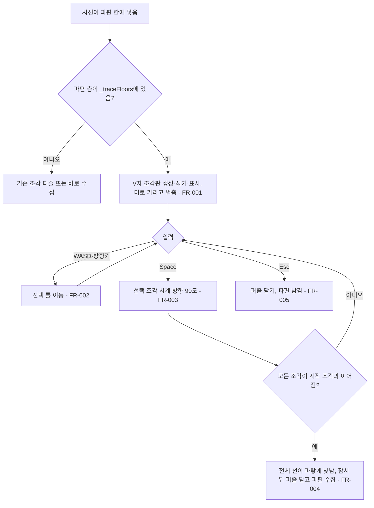

# 파편 열기 V자 선 잇기 퍼즐

## 1. 개요

- 목적: 1층(`_traceFloors`로 바꿀 수 있음) 파편을 열 때, 점 사이 칸마다 놓인 V자 조각을 돌려 모든 조각을 하나의 선 그물로 이으면 보상으로 파편을 얻게 한다. 플레이어가 판 위를 걸어 다니지 않고, 다 이어진 상태 자체가 성공 조건이다.
- 대상: 플레이어, 퍼즐 값을 조절하는 제작자

## 2. 범위

- 포함:
  - 판 생성(항상 이을 수 있는 정답 배치와 섞기), 그리기, 조각 고르기·돌리기, 성공·포기 처리를 맡는 `TracePuzzle`
  - `EyeMazeDirector`가 파편 층 번호에 따라 이 퍼즐과 기존 조각 퍼즐(스펙 037) 중 하나를 연다
  - 씬에 `선 잇기 퍼즐` 오브젝트를 `파편 퍼즐`과 같은 자리에 두고 Director에 연결
  - 기존 조각 퍼즐(`파편 퍼즐`)의 씬 값 `_backdropDiameter`를 6.4로 바꿔 퍼즐 중 뒤의 미로를 모두 가린다
- 제외:
  - 기존 조각 퍼즐(`FragmentPuzzle`) 코드 변경
  - 마우스 조작, 반시계 돌리기
  - 실패 벌칙, 시간 제한, 적
  - 퍼즐 효과음
  - 제작자가 손으로 만든 판

## 3. 기술 방향

- 사용 기술/API: `LineRenderer`(기존 `Shapes` 도우미), Input System `Keyboard`, `System.Random`
- 핵심 방식:
  - 판: 점은 4×4 격자에 놓이고 판은 홍채 안쪽을 크게 채운다. 네 점으로 둘러싸인 칸(3×3)마다 V자 조각이 하나 있다. 조각은 칸의 한 변 양 끝 두 점을 V자(꼭짓점이 칸 가운데 쪽으로 들어간 두 선)로 잇는다. 조각을 시계 방향으로 90도 돌리면 위 → 오른쪽 → 아래 → 왼쪽 변 순서로 잇는 두 점이 바뀐다.
  - 이어짐: 조각들의 선으로 점들을 묶었을 때 같은 묶음에 든 조각은 서로 이어진 것이다. 판 가운데 조각은 돌릴 수 없는 시작 조각(노란 점 표시)이고, 시작 조각과 이어진 조각은 흰색, 나머지는 회색으로 그린다.
  - 성공: 조각을 돌린 뒤 모든 조각이 시작 조각과 이어지면 성취감을 주도록 완성 빛을 보여 준다. 모든 선과 점이 `_glowFadeSeconds` 동안 파란색(`_solvedColor`)으로 바뀌고, 선마다 뒤에 두꺼운 반투명 파란 빛(`_glowColor`, 선 두께의 `_glowWidthScale`배)이 차오른 뒤 `_glowPulseSpeed`로 숨 쉬듯 밝아졌다 어두워진다. `_solveDelay`(1.8초) 뒤 퍼즐이 닫히고 파편을 얻는다. 정답 배치와 같지 않아도 모두 이어지면 성공이다.
  - 생성: 시작 조각 방향을 무작위로 정하고, 이미 이어진 점에 닿는 칸 중 하나를 무작위로 골라 그 점을 지나며 아직 쓰지 않은 변으로 조각 방향을 정하는 것을 모든 칸이 정해질 때까지 반복한다. 이렇게 만든 배치는 모든 조각이 이어져 있으므로 항상 풀 수 있다. 막히면 `GENERATE_TRIES`번까지 다시 만든다.
  - 섞기: 시작 조각을 뺀 조각을 무작위로 0~3번 돌린다. 섞은 결과가 이미 모두 이어져 있으면 다시 섞는다.
  - 조작: WASD·방향키로 노란 선택 틀을 칸 단위로 옮기고, Space로 선택한 조각을 `_rotateSeconds` 동안 시계 방향으로 90도 돌린다. 도는 동안에는 다른 입력을 받지 않는다. Esc로 그만두면 파편은 남는다. 퍼즐 중 Director의 이동·관찰 중지·처음부터 키는 받지 않는다(기존 퍼즐 중 입력 차단을 그대로 쓴다).
  - 퍼즐 고르기: Director는 파편 층 번호(1부터)가 `_traceFloors`에 있고 `_tracePuzzle`이 연결되어 있으면 이 퍼즐을, 아니면 기존 조각 퍼즐을 연다. 둘 다 없으면 기존처럼 바로 줍는다.
  - 표시: 미로 중심 위에 홍채 원판과 같은 지름(6.4)의 어두운 원판을 깔아 뒤의 미로를 모두 가리고, 점은 하늘색 작은 점으로 그린다.
- 선택하지 않은 방식: 점 사이 선을 말이 직접 따라 걷는 한붓그리기 방식은 사용자가 원하지 않아 쓰지 않는다. 처음부터 이어진 칸 수를 목표로 하지 않고 "모든 조각이 하나로 이어짐"만 성공 조건으로 쓴다.
- 외부 의존성: `EyeMazeDirector`, `MemoryFragment`, `IrisMaze`, `Shapes`, `Strings`, `DialogueLog`

## 4. 구조

| 구분 | 이름 | 역할 |
|------|------|------|
| 클래스 | TracePuzzle | V자 조각판 생성·섞기, 그리기, 조각 고르기·돌리기, 이어짐 계산, 성공·포기 판정 |
| 클래스 | EyeMazeDirector | 파편 층에 따라 열 퍼즐 고르기, 두 퍼즐의 결과로 수집·닫기 |
| 씬 | EyeMaze | `선 잇기 퍼즐` 오브젝트(눈 아래, `파편 퍼즐`과 같은 위치)와 Director 연결, `파편 퍼즐` 원판 지름 6.4 |

- 오브젝트 구성: 눈(`EyeVisual`) 아래 `파편 퍼즐` 옆에 `선 잇기 퍼즐` GameObject와 `TracePuzzle`을 둔다. 점·조각·선택 틀은 열 때 자식 오브젝트로 만들고 닫을 때 지운다. 조각은 칸 가운데에 둔 오브젝트를 돌려서 방향을 바꾼다.
- 클래스 간 관계: `EyeMazeDirector`가 `[SerializeField] TracePuzzle`을 참조해 `Open`을 부르고, 퍼즐은 `Solved`, `Cancelled` 이벤트로 결과를 알린다. Director는 이 이벤트를 기존 조각 퍼즐의 성공·포기 처리와 같은 메서드로 받는다.
- 실행 순서 의존성: 없음
- 기존 코드와의 접점: `EyeMazeDirector`의 `IsSolvingPuzzle`, `CheckFragment`, `OpenPuzzle`, `ClosePuzzle`, `OnEnable`/`OnDisable` 이벤트 구독.

## 5. 동작 플로우차트

## 6. 요구사항

- FR-001: 시선이 아직 줍지 않은 파편에 닿고 그 파편 층 번호가 `_traceFloors`에 있을 때 `EyeMazeDirector`는 `TracePuzzle.Open`으로 새 판을 열고, 퍼즐이 열린 동안 시선 이동·위험 요소·깜빡임·부담감 증가를 멈춘다. `TracePuzzle`은 홍채 크기 원판으로 뒤의 미로를 가리고, 모두 이어질 수 있는 배치를 섞어 처음에는 다 이어지지 않은 판을 보여 준다.
- FR-002: 퍼즐이 열려 있을 때 `TracePuzzle`은 WASD·방향키 입력마다 선택 틀을 그 방향 칸으로 옮긴다.
- FR-003: 퍼즐이 열려 있을 때 Space를 누르면 `TracePuzzle`은 선택한 조각(시작 조각 제외)을 `_rotateSeconds` 동안 시계 방향으로 90도 돌리고, 끝나면 시작 조각과 이어진 조각을 흰색으로 다시 칠한다.
- FR-004: 모든 조각이 시작 조각과 이어지면 `TracePuzzle`은 모든 선과 점을 파랗게 빛나게 하고 `_solveDelay` 뒤 성공을 알리며, `EyeMazeDirector`는 퍼즐을 닫고 기존과 같이 파편을 수집하고 글을 보여 준다.
- FR-005: Esc를 누르면 퍼즐이 닫히고 파편은 줍지 않은 채 남는다. 시선이 그 칸을 벗어났다가 다시 들어와야 새 판이 열린다.

### 상태와 데이터

| 이름 | 타입 | 설명 | 초기값 |
|------|------|------|--------|
| TracePuzzle._size | int | 점 격자 한 변의 점 수 | 0 |
| TracePuzzle._pieces | Piece 배열 | 칸마다 조각이 잇는 변 번호, 돈 횟수, 그리기 오브젝트 | 생성 시 |
| TracePuzzle._linked | bool 배열 | 칸마다 시작 조각과 이어졌는지 | 생성 시 |
| TracePuzzle._anchor | int | 돌릴 수 없는 시작 조각 칸(판 가운데) | 생성 시 |
| TracePuzzle._cursor | int | 선택 틀이 있는 칸 | 시작 조각 칸 |
| TracePuzzle._rotateT | float | 조각 돌리기 진행도(1이면 끝) | 1 |
| TracePuzzle._solveT | float | 다 이어진 뒤 지난 시간(음수면 아직 안 이어짐) | -1 |
| TracePuzzle._glows | LineRenderer 목록 | 완성 때 선마다 만드는 빛 선 | 비어 있음 |

### 예외 및 경계 조건

- 격자 크기는 3 이상으로 제한한다. 층 번호가 `_gridSizes` 범위를 넘으면 마지막 값을 쓴다.
- 시작 조각에서 Space를 누르면 아무 일도 하지 않는다.
- 다 이어진 뒤 닫힐 때까지는 입력을 받지 않는다.
- 대화 기록 창이 열려 있으면 퍼즐 입력을 받지 않는다.
- 퍼즐 중 Play Mode를 끄거나 들여다보기가 끝나면 퍼즐을 닫는다.

## 7. Inspector 노출값

| 필드 | 타입 | 기본값 | 설명 |
|------|------|--------|------|
| TracePuzzle._gridSizes | int[] | 4, 4, 4 | 층별 점 격자 한 변의 점 수 (조각은 한 변에 하나 적게) |
| TracePuzzle._rotateSeconds | float | 0.12 | 조각이 90도 도는 시간(초) |
| TracePuzzle._solveDelay | float | 1.8 | 다 이어진 뒤 파랗게 빛나는 모습을 보여 주는 시간(초) |
| TracePuzzle._solvedColor / _glowColor | Color | 하늘색 / 반투명 파랑 | 완성 때 선·점 색과 선 뒤 빛 색 |
| TracePuzzle._glowWidthScale / _glowFadeSeconds / _glowPulseSpeed | float | 4 / 0.35 / 1.5 | 빛 두께 배수, 차오르는 시간(초), 숨 쉬는 빠르기(초당 횟수) |
| TracePuzzle._vDepth | float | 0.7 | V자 꼭짓점이 칸 가운데 쪽으로 들어간 정도 |
| TracePuzzle._boardSize | float | 4.4 | 판 한 변 길이(월드) |
| TracePuzzle._backdropDiameter | float | 6.4 | 뒤에 까는 어두운 원판 지름 (홍채 원판과 같게 두어 미로를 가린다) |
| TracePuzzle._lineMaterial | Material | 미로 선 재질 | 선 재질 |
| TracePuzzle._backdropColor / _lineColor / _linkedColor / _pointColor / _anchorColor / _cursorColor | Color | 검정 / 회색 / 흰색 / 하늘색 / 노랑 / 노랑 | 색 |
| TracePuzzle._lineWidth / _pointSize / _frameWidth | float | 0.07 / 0.12 / 0.03 | 두께와 크기 |
| TracePuzzle._sortingOrder | int | 20 | 그리기 순서 |
| FragmentPuzzle._backdropDiameter (씬 값) | float | 6.4 | 조각 퍼즐 뒤 원판 지름. 미로를 모두 가린다 |
| EyeMazeDirector._tracePuzzle | TracePuzzle | 씬 오브젝트 | 비우면 모든 층에서 기존 조각 퍼즐을 쓴다 |
| EyeMazeDirector._traceFloors | int[] | 1 | 이 퍼즐을 쓰는 층 번호(1부터) |

## 8. 인수 조건

- FR-001: 1층 파편에 닿으면 4×4 점과 V자 조각판이 홍채 안을 크게 채워 뜨고 뒤의 미로는 보이지 않으며 탄환·장애물이 멈춘다. 처음에는 일부 조각이 회색(안 이어짐)이다. 2·3층 파편은 기존 조각 퍼즐이 뜨고 그때도 뒤의 미로가 보이지 않는다.
- FR-002: WASD·방향키로 노란 선택 틀이 칸 단위로 움직인다.
- FR-003: Space를 누르면 선택한 V자 조각이 부드럽게 90도 돌고, 시작 조각과 이어지면 흰색으로 바뀐다. 가운데 노란 점 조각은 돌지 않는다.
- FR-004: 마지막 회색 조각을 돌려 모두 이어지면 전체 선이 파랗게 빛나며 숨 쉬듯 일렁이고, 약 1.8초 뒤 퍼즐이 닫히고 파편 글이 나온다. 말을 움직일 필요가 없다.
- FR-005: Esc로 닫으면 파편은 그대로 있고, 칸을 벗어났다 돌아오면 새 판이 열린다.

## 9. 미결 사항

- 없음
