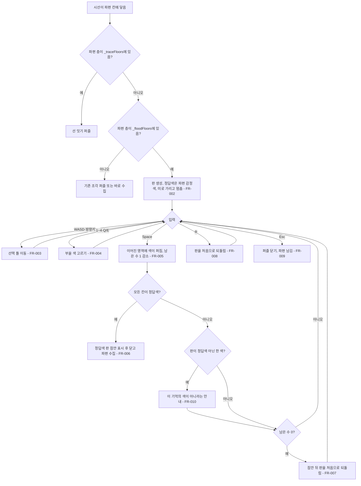

# 파편 열기 감정색 채우기 퍼즐

## 1. 개요

- 목적: 2층(`_floodFloors`로 바꿀 수 있음) 파편을 열 때, 삼각형 칸으로 된 판의 한 영역에 색을 부으면 이어진 같은 색 영역 전체가 그 색으로 퍼지는 채우기 퍼즐을 연다. 제한 수 안에 판 전체를 그 파편의 감정색(슬픔은 파랑, 분노·강렬함은 빨강, 평온·따뜻함은 초록)으로 바꾸면 파편을 얻는다.
- 대상: 플레이어, 파편 감정과 퍼즐 값을 조절하는 제작자

## 2. 범위

- 포함:
  - 파편마다 감정을 고르는 `MemoryFragment._emotion` 값 (`MemoryEmotion`: 평온·강렬·슬픔)
  - 판 생성(항상 제한 수 안에 풀 수 있는 판), 그리기, 칸 고르기, 색 고르기, 퍼지는 채우기, 남은 수 표시, 성공·실패·포기 처리를 맡는 `FloodPuzzle`
  - `EyeMazeDirector`가 파편 층 번호에 따라 선 잇기 퍼즐(스펙 046), 이 퍼즐, 기존 조각 퍼즐(스펙 037) 중 하나를 연다
  - 씬에 `색 채우기 퍼즐` 오브젝트를 `파편 퍼즐`과 같은 자리에 두고 Director에 연결, 2층 파편 4개의 감정 값 설정
  - 2층은 이 퍼즐만 기믹으로 쓴다. 씬의 2층 기존 기믹(`ThreeWayTurret`, 은재·지수 파편 묶음 아래 `Layer2Obstacles`의 왕복 장애물과 포대)을 삭제한다. 진행용 문(`문 1`)과 벽은 남긴다.
- 제외:
  - `FragmentPuzzle`, `TracePuzzle` 코드 변경
  - 마우스 조작, 되돌리기(한 수 취소)
  - 실패 벌칙(부담감 증가 등), 시간 제한, 적
  - 퍼즐 효과음
  - 제작자가 손으로 만든 판
  - 퍼즐 결과에 따른 파편 색·미로 색 변경

## 3. 기술 방향

- 사용 기술/API: `Mesh`(정점 색), `MeshFilter`/`MeshRenderer`, `LineRenderer`(기존 `Shapes` 도우미), Input System `Keyboard`, `System.Random`
- 핵심 방식:
  - 판: `_rows`줄 × `_columns`개의 삼각형 칸. (줄 + 칸 번호)가 짝수면 위를 향한 삼각형, 홀수면 아래를 향한 삼각형이다. 한 칸의 이웃은 왼쪽·오른쪽 칸과, 위를 향한 칸은 아래 줄 칸, 아래를 향한 칸은 위 줄 칸이다(최대 3개). 판은 홍채 원판 안에 들어가도록 `_boardWidth`에 맞춰 그린다.
  - 색: 흰색(원래 경로), 초록(평온), 빨강(강렬), 파랑(슬픔) 4색. 4색 모두 부을 수 있다. 정답색은 여는 파편의 `Emotion`에 맞는 색이다.
  - 영역: 이웃끼리 같은 색인 칸의 묶음. 칸에 색을 부으면 그 칸이 속한 영역 전체가 새 색이 되고, 같은 색이 된 이웃 영역과 하나로 합쳐진다(Kami 2 방식).
  - 퍼지는 연출: 부은 칸에서 영역 안을 따라 잰 칸 거리 순서로, 한 단계마다 `_fillStepSeconds` 뒤에 칸 색이 바뀐다. 색이 바뀌는 칸은 `_popSeconds` 동안 `_flashColor`로 번쩍였다가 새 색으로 돌아오고, 칸 크기가 `_popStartScale`에서 `_popOvershoot`만큼 커졌다가 원래 크기로 돌아온다. 퍼지는 동안과 마지막 칸의 연출이 끝날 때까지 입력을 받지 않는다.
  - 생성: 무작위 시작 칸 `_regionCount`개에 무작위 색을 주고, 무작위 순서로 이웃 칸을 넓혀 판을 모두 채운다. 그 뒤 영역을 점, 맞닿은 영역을 선으로 하는 영역 그래프에서 판 전체를 정답색으로 만드는 가장 적은 수(최소 수)를 반복 깊이 늘리기 탐색으로 구한다. 한 수는 한 영역을 맞닿은 영역에 있는 색 중 하나로 바꿔 합치는 것이고, 마지막에 한 영역이 정답색이 아니면 한 수를 더 쓴다. 남은 색 수와 그래프 지름으로 더 볼 필요 없는 가지를 자른다. 최소 수에 `_extraMoves`(기본 0)를 더해 제한 수로 정하므로, 기본값에서는 최소 수와 정확히 같은 수로만 풀린다. 최소 수가 `_minMoves`보다 적거나 `_maxMoves`보다 많으면 다시 만든다.
  - 정답색만 맞는 판: 정답색이 아닌 세 색(흰색 포함) 각각에 대해서도 판 전체를 그 색으로 만드는 최소 수를 구하고, 하나라도 정답색 최소 수 이하이면 그 판을 버리고 다시 만든다. 그래서 제한 수 안에 판 전체를 한 색으로 만들 수 있는 색은 정답색 하나뿐이다. `GENERATE_TRIES`(2000)번까지 이 조건을 만족하는 판을 찾는다. 시작 칸 중 `_targetSeedShare` 비율은 정답색으로 정해 두어 이런 판이 잘 나오게 한다.
  - 조작: WASD·방향키로 노란 선택 틀을 칸 단위로 옮긴다(좌우는 같은 줄 옆 칸, 위아래는 같은 칸 번호의 위·아래 줄). 1~4 키나 Q/E로 부을 색을 고른다. Space로 선택한 칸에 고른 색을 붓는다. 이미 그 색인 칸에는 붓지 않고 수도 줄지 않는다. R은 판을 처음 상태로 되돌린다. Esc로 그만두면 파편은 남는다. 퍼즐 중 Director의 이동·관찰 중지·처음부터 키는 받지 않는다(기존 퍼즐 중 입력 차단을 그대로 쓴다).
  - 칸 경계: 칸마다 삼각형을 `_cellGap` 비율만큼 줄여 그려, 틈으로 뒤 원판 색이 보이게 한다.
  - 표시: 판 아래에 4색 견본을 그리고 고른 색에 노란 테두리를 두른다. 판 위에 남은 수만큼 작은 점을 그리고, 정답색 견본 옆에 정답 표시(작은 마름모)를 그린다. 판 둘레에 정답색 두꺼운 테두리를 둘러 어떤 색으로 채워야 하는지 한눈에 보이게 한다. 퍼즐을 열 때 안내 글에 정답색 이름을 적는다. 미로 중심 위에 홍채 원판과 같은 지름(6.4)의 어두운 원판을 깔아 뒤의 미로를 가린다.
  - 성공: 채우기가 끝난 뒤 판의 모든 칸이 정답색이면, `_solveDelay` 동안 정답색으로 가득 찬 판을 보여 준 뒤 퍼즐이 닫히고 파편을 얻는다. 판이 정답색이 아닌 한 색으로 통일된 것은 성공이 아니다.
  - 실패: 남은 수가 0이 되었는데 성공하지 않았으면 `_failDelay` 동안 판을 보여 준 뒤 같은 판을 처음 상태와 처음 제한 수로 되돌린다.
  - 퍼즐 고르기: Director는 파편 층 번호(1부터)가 `_traceFloors`에 있으면 선 잇기 퍼즐을, 아니면 `_floodFloors`에 있고 `_floodPuzzle`이 연결되어 있으면 이 퍼즐을, 아니면 기존 조각 퍼즐을 연다. 셋 다 없으면 기존처럼 바로 줍는다.
- 선택하지 않은 방식: 판 전체를 아무 한 색으로 통일하면 성공하는 방식은 감정색 의미가 사라져 쓰지 않는다. 정사각형·동심원 판은 쓰지 않는다. 탐욕 풀이 수는 최소 수보다 많을 수 있어 제한 수로 쓰지 않는다. 남은 수·정답색은 글 UI를 만들지 않고 판 안의 점과 견본으로 보여 준다.
- 외부 의존성: `EyeMazeDirector`, `MemoryFragment`, `IrisMaze`, `Shapes`, `Strings`, `DialogueLog`

## 4. 구조

| 구분 | 이름 | 역할 |
|------|------|------|
| 클래스 | MemoryEmotion (enum) | 파편 감정: Calm(초록), Intense(빨강), Sad(파랑) |
| 클래스 | MemoryFragment | `_emotion` 값과 `Emotion` 프로퍼티 추가 |
| 클래스 | FloodPuzzle | 삼각형 판 생성, 그리기, 칸·색 고르기, 퍼지는 채우기, 남은 수, 성공·실패·포기 판정 |
| 클래스 | EyeMazeDirector | 파편 층에 따라 열 퍼즐 고르기, 세 퍼즐의 결과로 수집·닫기 |
| 씬 | EyeMaze | `색 채우기 퍼즐` 오브젝트(눈 아래, `파편 퍼즐`과 같은 위치)와 Director 연결, 2층 파편 감정 값 |

- 오브젝트 구성: 눈(`EyeVisual`) 아래 `파편 퍼즐` 옆에 `색 채우기 퍼즐` GameObject와 `FloodPuzzle`을 둔다. 판 메시, 선택 틀, 견본, 남은 수 점은 열 때 자식 오브젝트로 만들고 닫을 때 지운다. 칸 색은 판 메시 하나의 정점 색으로 바꾼다.
- 클래스 간 관계: `EyeMazeDirector`가 `[SerializeField] FloodPuzzle`을 참조해 `Open(layer, seed, emotion)`을 부르고, 퍼즐은 `Solved`, `Cancelled` 이벤트로 결과를 알린다. Director는 이 이벤트를 기존 퍼즐의 성공·포기 처리와 같은 메서드로 받는다.
- 실행 순서 의존성: 없음
- 기존 코드와의 접점: `MemoryFragment` 필드 추가, `EyeMazeDirector`의 `IsSolvingPuzzle`, `CheckFragment`, `OpenPuzzle`, `ClosePuzzle`, `OnEnable`/`OnDisable` 이벤트 구독.

## 5. 동작 플로우차트

## 6. 요구사항

- FR-001: 제작자가 `MemoryFragment`의 감정을 Inspector에서 고를 때 `MemoryFragment`는 그 값을 `Emotion`으로 알려 준다. 기본값은 Sad다.
- FR-002: 시선이 아직 줍지 않은 파편에 닿고 그 파편 층 번호가 `_traceFloors`에 없고 `_floodFloors`에 있을 때 `EyeMazeDirector`는 `FloodPuzzle.Open`으로 새 판을 열고, 퍼즐이 열린 동안 시선 이동·위험 요소·깜빡임·부담감 증가를 멈춘다. `FloodPuzzle`은 홍채 크기 원판으로 뒤의 미로를 가리고, 그 파편 감정색을 정답색으로 하는 판, 4색 견본, 정답 표시, 남은 수 점을 보여 준다.
- FR-003: 퍼즐이 열려 있을 때 `FloodPuzzle`은 WASD·방향키 입력마다 선택 틀을 그 방향 칸으로 옮긴다. 판 밖으로는 옮기지 않는다.
- FR-004: 퍼즐이 열려 있을 때 1~4 키를 누르면 `FloodPuzzle`은 그 번호 색(흰·초록·빨강·파랑)을, Q/E를 누르면 이전·다음 색을 부을 색으로 고르고 견본 테두리를 옮긴다.
- FR-005: 퍼즐이 열려 있을 때 Space를 누르고 선택한 칸 색이 고른 색과 다르면 `FloodPuzzle`은 남은 수를 1 줄이고, 선택한 칸이 속한 영역의 칸을 부은 칸에서 가까운 순서로 `_fillStepSeconds` 간격마다 고른 색으로 바꾸고, 바뀌는 칸마다 번쩍이며 커졌다 돌아오는 연출을 보여 준다.
- FR-006: 채우기가 끝난 뒤 모든 칸이 정답색이면 `FloodPuzzle`은 `_solveDelay` 뒤 성공을 알리고, `EyeMazeDirector`는 퍼즐을 닫고 기존과 같이 파편을 수집하고 글을 보여 준다.
- FR-007: 채우기가 끝난 뒤 성공하지 않았고 남은 수가 0이면 `FloodPuzzle`은 `_failDelay` 뒤 판을 처음 색과 처음 제한 수로 되돌린다.
- FR-008: 퍼즐이 열려 있을 때 R을 누르면 `FloodPuzzle`은 판을 처음 색과 처음 제한 수로 되돌린다.
- FR-009: Esc를 누르면 퍼즐이 닫히고 파편은 줍지 않은 채 남는다. 시선이 그 칸을 벗어났다가 다시 들어와야 새 판이 열린다.
- FR-010: 채우기가 끝난 뒤 판 전체가 정답색이 아닌 한 색이면 `FloodPuzzle`은 `WrongColor` 이벤트로 알리고, `EyeMazeDirector`는 이 기억의 색이 아니며 정답색으로 물들여야 한다는 글을 보여 준다.

### 상태와 데이터

| 이름 | 타입 | 설명 | 초기값 |
|------|------|------|--------|
| MemoryFragment._emotion | MemoryEmotion | 파편 감정 | Sad |
| FloodPuzzle._colors | int 배열 | 칸마다 현재 색 번호(0 흰, 1 초록, 2 빨강, 3 파랑) | 생성 시 |
| FloodPuzzle._startColors | int 배열 | 되돌리기에 쓰는 처음 색 | 생성 시 |
| FloodPuzzle._target | int | 정답색 번호 | 열 때 |
| FloodPuzzle._moveLimit | int | 처음 제한 수 | 생성 시 |
| FloodPuzzle._movesLeft | int | 남은 수 | 제한 수 |
| FloodPuzzle._cursor | int | 선택 틀이 있는 칸 | 판 가운데 칸 |
| FloodPuzzle._paint | int | 고른 색 번호 | 정답색 |
| FloodPuzzle._fillQueue | 칸 거리 목록 | 퍼지는 중인 칸과 바뀔 순서 | 비어 있음 |
| FloodPuzzle._resultT | float | 성공·실패 뒤 지난 시간(음수면 해당 없음) | -1 |

### 예외 및 경계 조건

- `_rows`는 2 이상, `_columns`는 3 이상, `_regionCount`는 2 이상 칸 수 이하로 제한한다.
- 층 번호가 `_regionCounts` 범위를 넘으면 마지막 값을 쓴다.
- 처음 판이 이미 모두 정답색이면 다시 만든다.
- 퍼지는 중, 성공·실패 연출 중에는 입력을 받지 않는다.
- 대화 기록 창이 열려 있으면 퍼즐 입력을 받지 않는다.
- 퍼즐 중 Play Mode를 끄거나 들여다보기가 끝나면 퍼즐을 닫는다.
- 한 층 번호가 `_traceFloors`와 `_floodFloors`에 모두 있으면 선 잇기 퍼즐을 연다.

## 7. Inspector 노출값

| 필드 | 타입 | 기본값 | 설명 |
|------|------|--------|------|
| MemoryFragment._emotion | MemoryEmotion | Sad | 파편 감정. 채우기 퍼즐의 정답색 |
| FloodPuzzle._rows / _columns | int | 7 / 12 | 판 줄 수 / 한 줄 삼각형 수 |
| FloodPuzzle._regionCounts | int[] | 10, 10, 12 | 층별 처음 영역 시작 칸 수 (0번이 1층) |
| FloodPuzzle._minMoves / _maxMoves | int | 3 / 6 | 최소 수가 이 범위 밖인 판은 다시 만든다 |
| FloodPuzzle._targetSeedShare | float | 0.3 | 시작 칸 중 정답색으로 정해 두는 비율 |
| FloodPuzzle._extraMoves | int | 0 | 최소 수에 더해 주는 여유 수. 0이면 최소 수와 정확히 같은 수로만 풀린다 |
| FloodPuzzle._fillStepSeconds | float | 0.07 | 퍼지는 한 단계 간격(초) |
| FloodPuzzle._popSeconds | float | 0.3 | 칸 하나가 번쩍이며 커졌다 돌아오는 시간(초) |
| FloodPuzzle._popStartScale / _popOvershoot | float | 0.4 / 0.18 | 색이 바뀔 때 칸이 시작하는 크기 / 원래보다 더 커지는 정도 |
| FloodPuzzle._flashColor | Color | 흰색 | 색이 바뀌는 순간 번쩍이는 색 |
| FloodPuzzle._solveDelay / _failDelay | float | 0.8 / 0.8 | 성공·실패 모습을 보여 주는 시간(초) |
| FloodPuzzle._boardWidth | float | 4.0 | 판 가로 길이(월드) |
| FloodPuzzle._cellGap | float | 0.06 | 칸 사이 틈 비율 |
| FloodPuzzle._uiGap | float | 0.55 | 판 가장자리에서 견본 줄, 남은 수 점 줄까지 거리(월드) |
| FloodPuzzle._backdropDiameter | float | 6.4 | 뒤에 까는 어두운 원판 지름 |
| FloodPuzzle._fillMaterial / _lineMaterial | Material | EyeLine / EyeLine | 칸 재질(정점 색, 양면) / 선 재질 |
| FloodPuzzle._whiteColor / _greenColor / _redColor / _blueColor | Color | 흰 / 초록 / 빨강 / 파랑 | 4색 |
| FloodPuzzle._backdropColor / _cursorColor / _moveDotColor | Color | 검정 / 노랑 / 흰색 | 그 밖의 색 |
| FloodPuzzle._swatchSize / _frameWidth / _moveDotSize | float | 0.4 / 0.04 / 0.1 | 크기와 두께 |
| FloodPuzzle._targetFrameWidth / _targetFrameMargin | float | 0.1 / 0.15 | 판 둘레 정답색 테두리 두께 / 판과의 간격 |
| FloodPuzzle._sortingOrder | int | 20 | 그리기 순서 |
| EyeMazeDirector._floodPuzzle | FloodPuzzle | 씬 오브젝트 | 비우면 이 퍼즐을 쓰지 않는다 |
| EyeMazeDirector._floodFloors | int[] | 2 | 이 퍼즐을 쓰는 층 번호(1부터) |

씬의 2층 파편 감정 초기값 (제작자가 바꿀 수 있음):

| 파편 | 감정 |
|------|------|
| 대기실의 빨간 버튼 | Intense |
| 음성 메시지 1건 (0:47) | Sad |
| 사직서_최종_진짜최종(14) | Intense |
| 매달 25일 자동이체 | Sad |

## 8. 인수 조건

- FR-001: 파편 Inspector에 감정 칸이 보이고 Calm·Intense·Sad를 고를 수 있다.
- FR-002: 2층 파편에 닿으면 흰·초록·빨강·파랑 삼각형 판이 홍채 안에 뜨고 뒤의 미로는 보이지 않으며 탄환·장애물이 멈춘다. 슬픔 파편이면 파랑 견본 옆에, 강렬 파편이면 빨강 견본 옆에 정답 표시가 있고, 판 위에 남은 수 점이 보인다. 1층은 선 잇기 퍼즐, 3층은 기존 조각 퍼즐이 뜬다.
- FR-003: WASD·방향키로 노란 선택 틀이 삼각형 칸 단위로 움직이고 판 끝에서 멈춘다.
- FR-004: 1~4, Q/E로 견본의 노란 테두리가 옮겨 간다.
- FR-005: Space를 누르면 선택 칸에서부터 이어진 같은 색 영역으로 고른 색이 물결처럼 퍼지고, 바뀌는 칸마다 번쩍이며 톡 튀어나왔다 자리 잡는다. 남은 수 점이 하나 줄어든다. 점 개수는 그 판의 최소 수와 같고, 한 수라도 헛수를 두면 풀 수 없다. 같은 색 칸에 부으면 아무 일도 없다.
- FR-006: 슬픔 파편 판을 모두 파랑으로 채우면 파랑으로 가득 찬 판을 잠깐 보여 준 뒤 퍼즐이 닫히고 파편 글이 나온다. 제한 수 안에 판 전체를 흰·초록·빨강 중 한 색으로 만드는 방법은 없다.
- FR-007: 남은 수를 다 쓰고도 풀지 못하면 잠깐 뒤 같은 판이 처음 색과 처음 남은 수로 돌아온다.
- FR-008: R을 누르면 판이 처음 색과 처음 남은 수로 돌아온다.
- FR-009: Esc로 닫으면 파편은 그대로 있고, 칸을 벗어났다 돌아오면 새 판이 열린다.
- FR-010: 슬픔 파편 판을 모두 흰색으로 채우면 "이 기억의 색이 아니다 … 파랑" 안내가 나온다. 판 둘레 테두리가 파랑이고, 열 때 안내 글에 "이 기억의 색: 파랑"이 적혀 있다.

## 9. 미결 사항

- 없음
