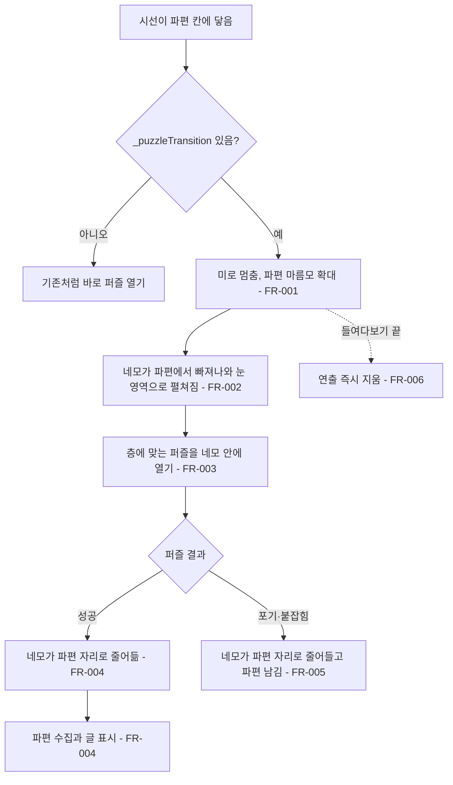

# 파편 퍼즐 진입·복귀 연출

## 1. 개요

- 목적: 파편에 닿아 퍼즐이 열릴 때 파편이 그 자리에서 커졌다가 네모 창으로 빠져나오고, 퍼즐은 눈 모양에 갇히지 않고 눈 영역을 덮는 큰 네모 창 안에서 진행한다. 퍼즐을 풀거나 그만두면 네모가 파편 자리로 줄어들며 눈으로 돌아온다.
- 대상: 플레이어, 연출 값을 조절하는 제작자

## 2. 범위

- 포함:
  - 파편 확대, 네모 펼치기, 네모 줄이기 연출과 네모 창 그리기를 맡는 `PuzzleTransition`
  - `EyeMazeDirector`가 세 퍼즐(조각 퍼즐 037, 선 잇기 046, 색 채우기 047)을 이 연출 뒤에 열고, 성공·포기·붙잡힘 뒤 이 연출로 돌아온다
  - 씬에 `퍼즐 연출` 오브젝트를 눈 아래에 두고 Director에 연결
  - 세 퍼즐의 씬 값 `_sortingOrder`를 40으로 올려 네모 창과 눈 위에 그린다
- 제외:
  - 세 퍼즐의 판 크기, 판 모양, 조작 변경
  - 화면 전체를 덮는 창, 초상화·부담감·파편 목록·대화창(uGUI) 변경
  - 효과음, 카메라 이동·확대

## 3. 기술 방향

- 사용 기술/API: `LineRenderer`(기존 `Shapes` 도우미, `MemoryFragment.DrawDiamond`)
- 핵심 방식:
  - 확대: 파편 위치에 파편 색 마름모를 그리고, `_zoomSeconds` 동안 파편 본체 지름에서 `_zoomDiameter`까지 키운다.
  - 펼치기: `_expandSeconds` 동안 네모 창(어두운 채움 + 흰 테두리)이 파편 위치·마름모 크기에서 `_panelCenter`·`_panelSize`로 커지며 옮겨 가고, 마름모는 흐려진다. 다 펼쳐지면 Director가 퍼즐을 연다.
  - 복귀: 퍼즐이 성공·포기·붙잡힘으로 닫히면 `_shrinkSeconds` 동안 네모가 처음 파편 위치·크기로 줄어들고 사라진다. 다 줄어든 뒤 성공이면 파편을 줍고 파편 글을 보여 준다.
  - 그리기 순서: 눈의 가장 위(눈꺼풀 22)보다 높은 `_sortingOrder`(30)에 네모를 그리고, 퍼즐은 그보다 높은 40에 그린다. 퍼즐 안의 둥근 원판은 네모와 같은 어두운 색이라 따로 보이지 않는다.
  - 연출 중에도 퍼즐 중과 같이 시선 이동·위험 요소·깜빡임·부담감 증가를 멈춘다.
  - 들여다보기가 끝나면 연출을 바로 지운다.
  - `_puzzleTransition`을 비우면 지금처럼 연출 없이 퍼즐을 연다.
- 선택하지 않은 방식: 카메라를 파편으로 확대하는 방식은 다른 화면 요소와 카메라 설정을 건드려 쓰지 않는다. 퍼즐 판 자체를 키우며 펼치는 방식은 세 퍼즐 코드를 모두 고쳐야 해 쓰지 않고, 네모가 다 펼쳐진 뒤 판을 연다.
- 외부 의존성: `EyeMazeDirector`, `MemoryFragment`, `Shapes`, `FragmentPuzzle`, `TracePuzzle`, `FloodPuzzle`

## 4. 구조

| 구분 | 이름 | 역할 |
|------|------|------|
| 클래스 | PuzzleTransition | 파편 확대, 네모 펼치기·줄이기, 네모 창 그리기 |
| 클래스 | EyeMazeDirector | 연출 뒤 퍼즐 열기, 퍼즐이 닫힌 뒤 연출로 복귀하고 수집 |
| 씬 | EyeMaze | 눈 아래 `퍼즐 연출` 오브젝트, Director 연결, 세 퍼즐 `_sortingOrder` 40 |

- 오브젝트 구성: 눈(`EyeVisual`) 아래 `퍼즐 연출` GameObject에 `PuzzleTransition`을 둔다. 마름모, 채움, 테두리는 연출을 시작할 때 자식으로 만들고 끝나면 지운다.
- 클래스 간 관계: `EyeMazeDirector`가 `[SerializeField] PuzzleTransition`을 참조해 `Play(파편 위치, 파편 지름, 파편 색, 다 펼쳐졌을 때 할 일)`, `Return(다 줄어들었을 때 할 일)`, `Stop()`을 부른다.
- 실행 순서 의존성: 없음
- 기존 코드와의 접점: `EyeMazeDirector`의 `IsSolvingPuzzle`, `OpenPuzzle`, `ClosePuzzle`, `OnPuzzleSolved`, `OnPuzzleCancelled`, `OnPuzzleCaught`.

## 5. 동작 플로우차트

## 6. 요구사항

- FR-001: 시선이 퍼즐을 여는 파편에 닿고 `_puzzleTransition`이 연결되어 있을 때 `PuzzleTransition`은 파편 위치에 파편 색 마름모를 그려 `_zoomSeconds` 동안 `_zoomDiameter`까지 키우고, 그동안 `EyeMazeDirector`는 미로를 멈춘다.
- FR-002: 확대가 끝나면 `PuzzleTransition`은 `_expandSeconds` 동안 네모 창을 파편 위치에서 `_panelCenter`·`_panelSize`로 펼치고 마름모를 흐리게 한다.
- FR-003: 네모가 다 펼쳐지면 `EyeMazeDirector`는 파편 층에 맞는 퍼즐을 열고 조작 안내 글을 보여 준다. 퍼즐은 네모 창 위에 그려진다.
- FR-004: 퍼즐을 풀면 `PuzzleTransition`은 `_shrinkSeconds` 동안 네모를 처음 파편 위치·크기로 줄여 지우고, 다 줄어들면 `EyeMazeDirector`는 파편을 수집하고 파편 글을 보여 준다.
- FR-005: 퍼즐을 그만두거나 붙잡히면 `PuzzleTransition`은 FR-004와 같이 네모를 줄여 지우고, 파편은 남는다.
- FR-006: 연출 중 들여다보기가 끝나면 `EyeMazeDirector`는 연출과 퍼즐을 바로 지운다.

### 상태와 데이터

| 이름 | 타입 | 설명 | 초기값 |
|------|------|------|--------|
| PuzzleTransition._phase | enum | 없음, 확대, 펼치기, 펼쳐짐, 줄이기 | 없음 |
| PuzzleTransition._t | float | 현재 단계 진행 시간(초) | 0 |
| PuzzleTransition._origin | Vector3 | 연출 기준 파편 위치(이 오브젝트 로컬) | 시작 시 |
| PuzzleTransition._originSize | float | 파편 본체 지름 | 시작 시 |
| PuzzleTransition._onDone | Action | 펼치기·줄이기가 끝나면 부를 일 | null |
| PuzzleTransition.IsBusy | bool | 연출이나 창이 남아 있는지 | false |

### 예외 및 경계 조건

- 연출 중에는 다른 파편 퍼즐을 열지 않는다.
- 펼치는 중이나 줄이는 중의 입력은 받지 않는다(퍼즐이 열리기 전이거나 이미 닫힌 뒤다).
- 시간 값이 0이면 그 단계를 바로 끝낸다.

## 7. Inspector 노출값

| 필드 | 타입 | 기본값 | 설명 |
|------|------|--------|------|
| PuzzleTransition._zoomSeconds | float | 0.35 | 파편 확대 시간(초) |
| PuzzleTransition._expandSeconds | float | 0.35 | 네모 펼치기 시간(초) |
| PuzzleTransition._shrinkSeconds | float | 0.3 | 네모 줄이기 시간(초) |
| PuzzleTransition._zoomDiameter | float | 1.2 | 확대가 끝났을 때 마름모 대각선(월드) |
| PuzzleTransition._panelCenter | Vector2 | 0, 0.19 | 네모 창 가운데(이 오브젝트 로컬). 위쪽 속눈썹까지 덮게 살짝 올린다 |
| PuzzleTransition._panelSize | Vector2 | 10.3, 7.35 | 네모 창 가로·세로(월드). 좌우 칸과 대화창 사이 눈 영역을 덮는다 |
| PuzzleTransition._panelColor / _frameColor | Color | 검정 / 흰색 | 채움 / 테두리 색 |
| PuzzleTransition._frameWidth | float | 0.06 | 테두리 두께 |
| PuzzleTransition._lineMaterial | Material | EyeLine | 선 재질 |
| PuzzleTransition._sortingOrder | int | 30 | 그리기 순서. 눈꺼풀(22)보다 높고 퍼즐(40)보다 낮게 둔다 |
| EyeMazeDirector._puzzleTransition | PuzzleTransition | 씬 오브젝트 | 비우면 연출 없이 퍼즐을 연다 |
| FragmentPuzzle / TracePuzzle / FloodPuzzle._sortingOrder (씬 값) | int | 40 | 네모 창 위에 그린다 |

## 8. 인수 조건

- FR-001: 파편에 닿으면 그 자리에서 파편이 커지고, 탄환·장애물이 멈춘다.
- FR-002: 커진 파편에서 흰 테두리 네모가 빠져나와 눈 전체를 덮는 크기로 펼쳐진다. 눈 테두리·속눈썹이 네모 밖으로 보이지 않는다.
- FR-003: 네모가 다 펼쳐지면 1층은 선 잇기, 2층은 색 채우기, 3층은 조각 퍼즐이 네모 안에 뜨고 조작 안내 글이 나온다.
- FR-004: 퍼즐을 풀면 네모가 파편 자리로 줄어들며 눈이 다시 보이고, 그 뒤 파편 글이 나온다.
- FR-005: Esc로 그만두면 네모가 파편 자리로 줄어들고 파편은 남아 있다.
- FR-006: 연출 중 관찰을 끝내면 네모와 퍼즐이 바로 사라진다.

## 9. 미결 사항

- 없음
