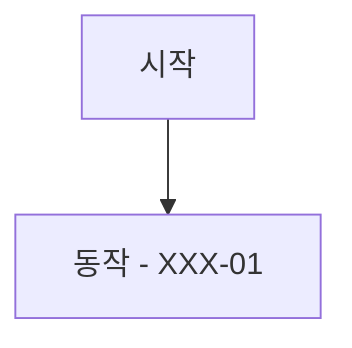

# 영역 이름 (스펙 양식)

> **먼저 읽을 것: 스펙을 고칠까, 새로 만들까**
>
> - 동작을 바꾸거나 기능을 더하면 **그 기능을 이미 다루는 영역 스펙을 고친다. 같은 기능에 대해 새 스펙 파일을 만들지 않는다.** 어느 스펙이 다루는지는 `docs/specs/ROUTER.md`에서 찾는다.
> - 새 스펙은 `ROUTER.md`에서 찾아도 맞는 스펙이 없는 **새 기능 영역**일 때만 만든다. 이 파일을 `docs/specs/영역-이름.md`(소문자 영어, 낱말은 `-`로 잇고 **번호를 붙이지 않는다**)로 복사해 채우고, `docs/specs/ROUTER.md`의 표와 `docs/specs/README.md`의 스펙 목록에 등록한다.
> - 기능이 사라지면 해당 요구사항을 `~~BLINK-07~~ (폐기: 이유)`로 남긴다. 요구사항 ID는 다른 의미로 다시 쓰지 않는다.
>
> 아래 인용 블록(`>`), `예:` 줄, "쓰기 규칙" 절은 안내이므로 채운 뒤 지운다. 완성된 스펙은 제목 다음에 "1. 목적"부터 "9. 미결 사항"까지 아홉 절을 둔다. 해당 없는 절은 지우지 않고 `해당 없음`으로 적는다.

## 쓰기 규칙

**요구사항 ID**

- 형식은 `접두어-두자리번호`다. 예: `BLINK-03`, `MEM-12`. 접두어는 스펙 한 편에 하나이며 `docs/specs/README.md`의 스펙 목록과 `docs/specs/ROUTER.md`의 접두어 표에 있다.
- 번호는 문서 전체에서 위에서 아래로 이어지고, 새 요구사항은 **그 문서의 마지막 번호 다음**을 쓴다. 소제목으로 묶어도 번호는 이어진다.
- 지우거나 폐기한 번호는 다시 쓰지 않는다. 지운 자리에는 `~~MEM-07~~ (폐기: 이유)`처럼 남긴다.
- 다른 스펙의 규칙은 ID와 파일로 가리킨다. 예: "부담감 증가는 `BURDEN-04`(`burden.md`)를 따른다".

**요구사항 상태**

- 요구사항마다 ID 뒤에 상태 하나를 붙인다: `[작성중]`, `[승인]`, `[구현완료]`, `[폐기]`.
- 사용자가 승인한 요구사항만 구현한다. 구현과 확인을 마치면 `[구현완료]`로 바꾼다.

**말투**

- 평서형 해라체로 쓴다("~한다", "~이다").
- 구현완료 요구사항은 지금 코드가 실제로 하는 일을 적는다. 의도와 달라 보이면 본문은 코드대로 쓰고 8절 "알려진 문제"에 따로 적는다.
- 추측을 사실처럼 쓰지 않는다. 코드에서 확인하지 못한 것은 "확인하지 못함"이라고 적는다.
- 화면 문구를 인용할 때는 따옴표 안에 글자 그대로 옮긴다.
- 변경 이력, 날짜, 작성자, 버전은 적지 않는다. 바뀐 내용은 덮어써서 최신 상태 하나만 둔다.

---

## 1. 목적

> 이 영역이 플레이어에게 무엇을 주는지 두세 문장. 구현 방법은 쓰지 않는다.

## 2. 요구사항

> 한 항목에 확인할 수 있는 규칙 하나("~하면 ~한다"). 수치는 숫자 대신 4절 수치 표의 이름을 가리킨다.

- **XXX-01** `[구현완료]` 예: 들여다보는 동안 `_blinkInterval`초가 지날 때마다 눈을 한 번 깜빡인다.
- **XXX-02** `[승인]` 예: 단서 말풍선을 닫을 때는 눈을 깜빡이지 않는다.

## 3. 상태와 전이

> 상태가 있는 영역은 상태 표와 Mermaid `flowchart TD` 동작 흐름을 둔다. 상태가 없으면 "상태 없음" 한 줄과 동작 흐름만 둔다. 흐름 노드에는 요구사항 ID를 적는다.

| 지금 상태 | 계기 | 다음 상태 | 관련 요구사항 |
|---|---|---|---|

## 4. 수치 표

기본값은 코드의 필드 초기값이다. 씬이나 프리팹에 저장된 값은 이와 다를 수 있으며, Play에서는 저장된 값이 쓰인다.

| 이름 | 기본값 | 필드(컴포넌트) | 뜻 |
|---|---|---|---|

## 5. 코드 위치

> 요구사항 ID → 파일과 메서드. 경로는 리포 루트 기준. 코드를 고치면 같은 변경에서 이 표를 갱신한다.

| 요구사항 | 파일 | 메서드·속성 |
|---|---|---|

## 6. 다른 영역과의 접점

- **부르는 것**: 예: `BurdenGauge.Add`(burden)
- **불리는 것**: 예: `EyeMazeDirector.Blink` ← `RestRequest`(burden)

## 7. 검증 방법

> 요구사항 ID별로, Play Mode에서 어떤 상황을 만들어 화면의 무엇을 보면 되는지 적는다. 테스트 코드는 쓰지 않는다.

## 8. 알려진 문제

> 코드와 의도가 어긋나 보이는 곳, 이름을 못 바꾸는 직렬화 필드, 단순화한 곳, 확인하지 못한 것.

## 9. 미결 사항

> 승인 전에 정해야 할 것. 없으면 `없음`.
