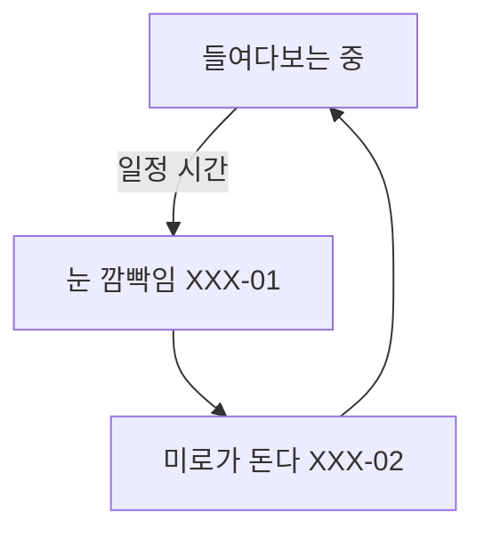

# 영역 이름

접두어 `XXX` · 다음 번호 `XXX-03`

이 영역이 플레이어에게 주는 것을 한두 문장으로 쓴다.

## 흐름

차트로 다 보이지 않는 로직만 두세 문장으로, 코드 이름 없이 덧붙인다.

## 기능

### 깜빡임 주기 (XXX-01)

들여다보는 동안 일정 시간마다 눈이 한 번 깜빡인다.

- 다음 깜빡임까지의 시간은 이전 깜빡임이 끝난 뒤부터 센다.
- 깜빡이는 동안에는 움직일 수 없다.

### 미로 회전 (XXX-02)

눈이 감기는 순간 미로가 몇 칸 돌아간다.

---

## 자세히

위쪽만 읽고 작업할 수 있게 하고, 고칠 때 필요한 것만 여기 둔다. 없는 소절은 지운다.

### 주의

- `XXX-01` 깜빡임 중 리셋하면 바로 원래 각도로 돌아간다.

### 하지 않는 것

- 카메라를 돌리지 않는다. UI 구도까지 돌아간다.

### 구성

- 씬 `눈 (Eye)` 아래 `미로 (Iris Maze)`가 층과 `시선 (Gaze)`을 자식으로 가진다. 코드만 봐서는 알 수 없는 오브젝트 구성과 연결만 쓴다.

### 코드 단서

기능을 고칠 때 먼저 볼 곳이다.

| 기능 | 찾을 곳 |
|---|---|
| XXX-01 | `EyeMazeDirector.TickBlink` |
| XXX-02 | `EyeMazeDirector.CommitBlinkRotation` |

### 메모

- 다른 영역과 얽히는 점, 정하지 못한 것, 확인하지 못한 것.
