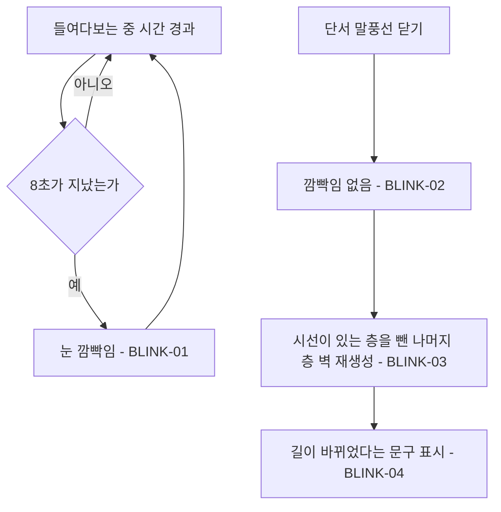
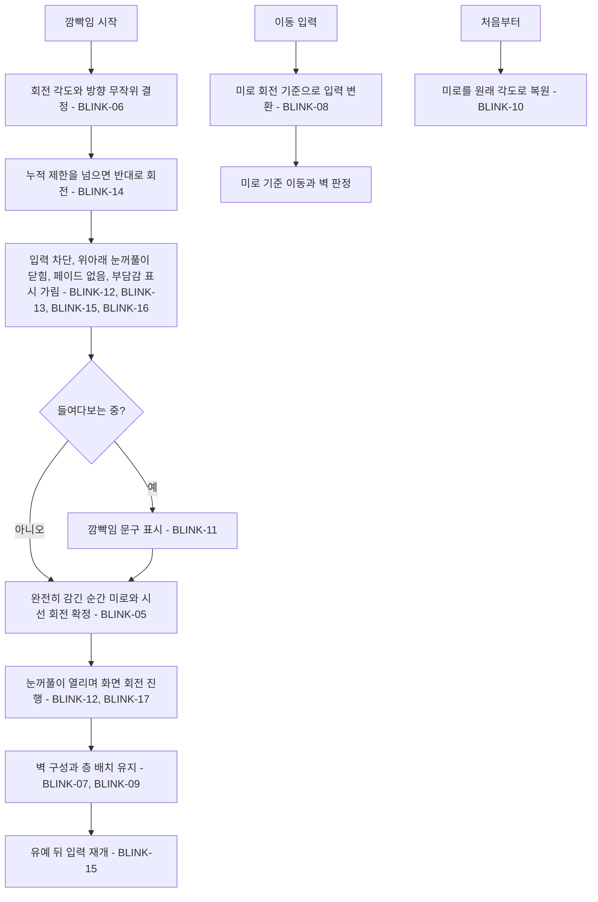
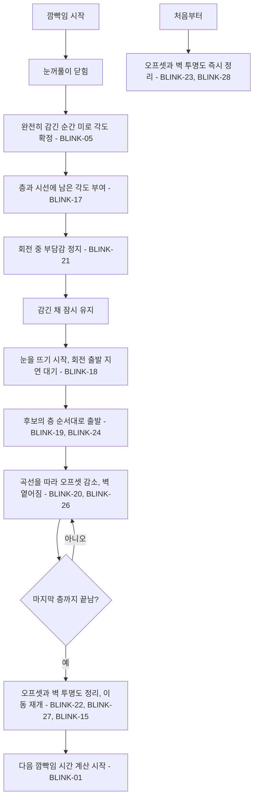
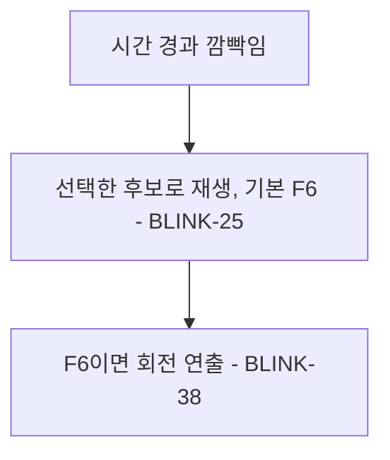
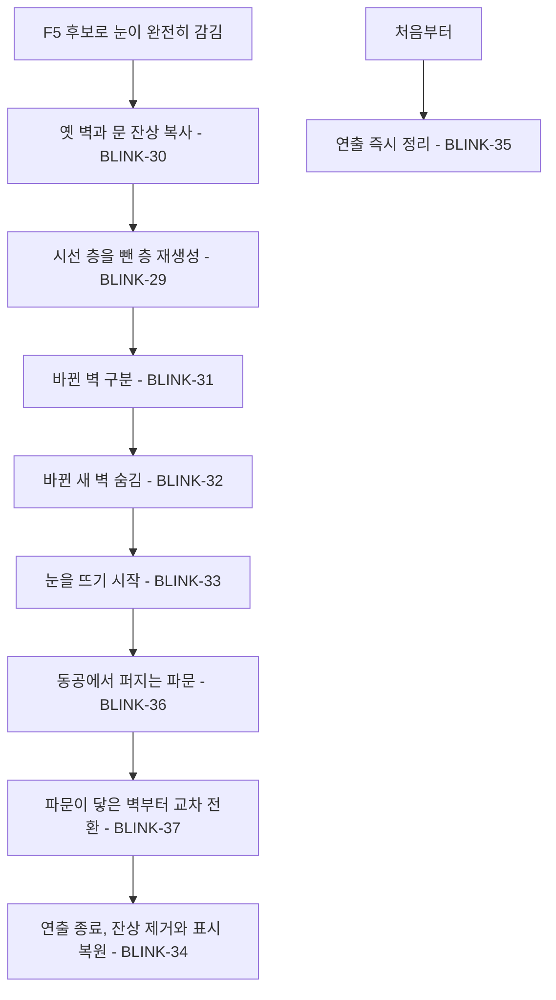
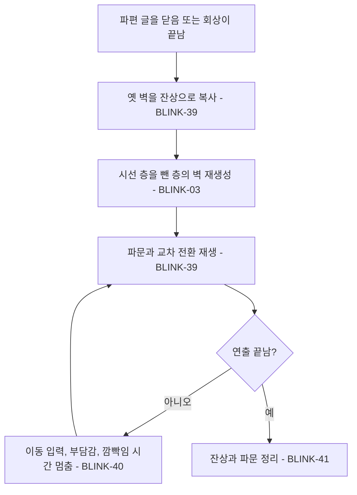

# 눈 깜빡임과 미로 변화

## 1. 목적

들여다보는 동안 일정 시간마다 눈이 깜빡이고, 그때 미로가 바뀐 것처럼 보이게 해서 플레이어가 같은 길을 외워 가지 못하게 한다. 깜빡임 뒤 미로는 맵과 시선이 함께 도는 회전, 또는 동공에서 퍼지는 파문을 따라 벽이 실제로 바뀌는 모습으로 변하며, 플레이어는 그 변화를 눈을 뜨는 동안 직접 본다. 단서 말풍선을 닫을 때는 화면이 감기지 않고 다른 층의 벽만 바뀐다.

### 범위

- 포함:
  - 깜빡임 조건을 시간 경과 하나로 단일화하고, 단서 말풍선을 닫을 때 일어나는 눈 깜빡임 제거
  - 벽 재생성 안내 문구에서 깜빡임 표현 제거
  - 깜빡임 동안 미로 전체와 시선의 무작위 회전
  - 맵이 돌아간 상태에서의 화면 기준 이동 입력
  - 층별 깜빡임 회전 제거
  - 위아래 눈꺼풀이 닫혔다가 열리는 깜빡임
  - 화면 전체 페이드 제거
  - 깜빡임 중 부담감 막대와 글 가림 (`BURDEN-05`(`burden.md`) 인수 조건)
  - 눈을 뜨기 시작하고 잠시 뒤부터 보이는 미로 회전
  - 층이 도는 동안 벽과 문의 투명도 변화
  - 층 순서, 시간, 곡선, 회전 출발 지연, 벽 옅어짐 정도를 묶은 회전 연출 후보(프리셋): 자물쇠 맞춤
  - 회전 중 부담감 정지
  - 깜빡임이 끝난 뒤부터 다음 깜빡임 시간 계산
  - 시선이 있는 층을 뺀 층의 벽과 문을 깜빡임 때 새로 만드는 동작
  - 바뀐 벽만 골라 옛 벽에서 새 벽으로 넘어가는 구조
  - F5 동공 파문 연출
  - 깜빡임 문구를 "눈이 깜빡였다."로 통일
  - 파편을 읽은 뒤와 회상이 끝난 뒤의 벽 재생성에 같은 파문 교차 전환 적용
- 제외:
  - 단서 말풍선을 닫을 때의 벽 재생성 제거 (재생성은 남긴다)
  - 깜빡임 주기와 `_blinkInterval` 값 변경
  - 미로 난이도, 벽 생성 규칙, 벽 구성 변경
  - 회전 칸 수와 방향을 정하는 규칙 변경 (`BLINK-06`, `BLINK-14` 밖의 변경)
  - 시선과 파편의 투명도 변화
  - 파편을 읽은 뒤 어느 층의 벽을 다시 만드는지에 대한 규칙 변경 (`BLINK-03`)

### 선택하지 않은 방식

- `_respawnMazeAfterReading`을 꺼서 단서 말풍선을 닫을 때의 깜빡임을 막는 방식은 벽 재생성까지 사라지므로 사용하지 않는다.
- `MazeLayer.Offset`을 바꿔 맵을 돌리는 방식은 층끼리 어긋나 실제 길이 바뀌므로 사용하지 않는다.
- 카메라를 돌리는 방식은 눈과 동공, UI 구도까지 함께 돌아가므로 사용하지 않는다.
- 회전이 끝날 때까지 미로 Transform을 돌리면서 층마다 차이를 계산하는 방식은 판정 각도가 중간값을 지나므로 사용하지 않는다.
- 튕기는 오버슈트는 긴장감을 줄 수 있어 기본 회전 곡선에서 뺀다.
- 옛 `MazeWall`을 남겨 두는 방식은 `IrisMaze.FindWall`에 함께 검색되므로 사용하지 않는다.
- 연출 도중 벽을 하나씩 판정에 반영하는 방식은 보이는 벽과 판정이 어긋나기 쉬워 사용하지 않는다.
- 벽 변화 연출에 UI 오브젝트는 만들지 않는다.

## 2. 요구사항

### 깜빡임 주기와 단서 닫기

- **BLINK-01** `[구현완료]` 들여다보는 동안 이전 깜빡임이 끝나고 `_blinkInterval`초가 지날 때마다 `EyeMazeDirector`는 눈을 한 번 깜빡인다. 깜빡임과 그 벽 변화 연출(`BLINK-29`~`BLINK-37`)이 진행되는 동안에는 `_blinkInterval` 시간을 세지 않고, 끝난 뒤부터 센다.
- **BLINK-02** `[구현완료]` 단서 말풍선을 닫을 때 `EyeMazeDirector`는 눈을 깜빡이지 않는다.
- **BLINK-03** `[구현완료]` `_respawnMazeAfterReading`이 켜진 상태에서 단서 말풍선을 닫을 때 `EyeMazeDirector`는 시선이 있는 층을 뺀 나머지 층의 벽을 무작위로 다시 만든다. 바뀌는 모습은 `BLINK-39`의 파문 교차 전환으로 보여 준다.
- **BLINK-04** `[구현완료]` `BLINK-03`의 벽 재생성이 일어날 때 `EyeMazeDirector`는 "다른 층의 길이 바뀌었다." 문구를 표시한다.

### 깜빡임 착시 회전

- **BLINK-05** `[구현완료]` 눈이 완전히 감길 때 `EyeMazeDirector`는 미로 오브젝트를 시선과 함께 이번 회전량만큼 최종 각도로 확정한다. 화면에 보이는 회전은 `BLINK-17`~`BLINK-28`을 따른다.
- **BLINK-06** `[구현완료]` 깜빡임이 시작될 때 `EyeMazeDirector`는 `_blinkTurnMinSectors`와 `_blinkTurnMaxSectors` 사이의 칸 수와 회전 방향을 무작위로 정한다.
- **BLINK-07** `[구현완료]` 깜빡임이 일어날 때 `EyeMazeDirector`는 벽, 문, 파편의 구성을 바꾸지 않는다. (F5 후보의 벽 교체는 `BLINK-29`를 따른다)
- **BLINK-08** `[구현완료]` 맵이 돌아간 상태에서 이동 입력을 받을 때 `EyeMazeDirector`는 시선을 화면 기준 입력 방향으로 움직인다.
- **BLINK-09** `[구현완료]` 깜빡임이 일어날 때 `EyeMazeDirector`는 `MazeLayer.Offset`을 바꾸지 않는다.
- **BLINK-10** `[구현완료]` `ResetAll`이 호출될 때 `EyeMazeDirector`는 미로를 깜빡임 회전 전 각도로 되돌린다.
- **BLINK-11** `[구현완료]` 들여다보는 중 F5, F6 후보의 눈이 완전히 감길 때 `EyeMazeDirector`는 후보 이름 없이 "눈이 깜빡였다." 문구를 표시한다.
- **BLINK-12** `[구현완료]` 깜빡임이 진행될 때 `EyeVisual`은 위아래 눈꺼풀로 눈 영역을 덮으며 닫았다가 다시 연다.
- **BLINK-13** `[구현완료]` 깜빡임이 진행될 때 `EyeMazeUI`는 화면 전체를 어둡게 하지 않는다.
- **BLINK-14** `[구현완료]` 이번 회전으로 누적 각도가 `_blinkTurnLimitDeg`를 넘게 될 때 `EyeMazeDirector`는 회전 방향을 반대로 바꾼다.
- **BLINK-15** `[구현완료]` 깜빡임이 진행 중일 때(`BLINK-17`~`BLINK-28`의 화면 회전과 `BLINK-29`~`BLINK-37`의 벽 변화 연출 포함)와 깜빡임이 끝난 뒤 `_blinkRecoverSeconds` 동안 `EyeMazeDirector`는 이동 입력을 받지 않는다.
- **BLINK-16** `[구현완료]` 깜빡임이 진행될 때 `EyeMazeUI`는 `_burdenGraphics`의 투명도를 눈꺼풀이 닫힌 정도만큼 낮춘다.

### 눈을 뜨며 보이는 회전

- **BLINK-17** `[구현완료]` `BLINK-05`가 일어날 때 `EyeMazeDirector`는 각 층과 시선에 이번 회전량의 반대 각도를 화면 오프셋으로 준다.
- **BLINK-18** `[구현완료]` 눈을 뜨기 시작하고 후보의 회전 출발 지연이 지날 때 `EyeMazeDirector`는 화면 오프셋을 줄이기 시작한다.
- **BLINK-19** `[구현완료]` 화면 오프셋을 줄일 때 `EyeMazeDirector`는 후보의 층 순서에 따라 층 순번마다 지연 시간만큼 늦게 시작하고, 시선은 자기가 있는 층과 같은 오프셋을 쓴다.
- **BLINK-20** `[구현완료]` 층의 화면 오프셋을 줄일 때 `EyeMazeDirector`는 후보의 회전 시간 동안 후보의 곡선 값에 따라 진행한다.
- **BLINK-21** `[구현완료]` 눈이 완전히 감겨 회전을 확정한 뒤 마지막 층의 움직임이 끝날 때까지, 또는 벽 변화 연출이 끝날 때까지 `EyeMazeDirector`는 부담감을 채우지 않는다.
- **BLINK-22** `[구현완료]` 눈 뜨기와 마지막 층의 움직임이 모두 끝날 때 `EyeMazeDirector`는 화면 오프셋을 0으로 지우고 깜빡임을 끝낸다.
- **BLINK-23** `[구현완료]` 깜빡임 중 `ResetAll`이 호출될 때 `EyeMazeDirector`는 화면 오프셋을 바로 0으로 지운다.
- **BLINK-24** `[구현완료]` 층 번갈아 돌기를 켠 후보에서 `EyeMazeDirector`는 홀수 번째 층을 반대쪽 각도에서 출발시킨다.
- **BLINK-25** `[구현완료]` 시간 경과로 깜빡일 때 `EyeMazeDirector`는 `_blinkPresetIndex`의 후보를 쓴다. 기본값은 F6 후보다.
- **BLINK-26** `[구현완료]` 층이 돌 때 `EyeMazeDirector`는 그 층의 벽과 문의 표시 투명도를 `1 - 벽 옅어짐 정도 × sin(π × 그 층의 회전 시간 비율)`로 바꾼다.
- **BLINK-27** `[구현완료]` 깜빡임이 끝날 때 `EyeMazeDirector`는 벽과 문의 표시 투명도를 1로 되돌린다.
- **BLINK-28** `[구현완료]` 깜빡임 중 `ResetAll`이 호출될 때 `EyeMazeDirector`는 벽과 문의 표시 투명도를 바로 1로 되돌린다.

### 깜빡임 벽 변화 연출

- **BLINK-29** `[구현완료]` F5 후보에서 눈이 완전히 감길 때 `EyeMazeDirector`는 시선이 있는 층을 뺀 층의 벽과 문을 새로 만든다.
- **BLINK-30** `[구현완료]` `BLINK-29` 직전에 `MazeWallChangeEffect`는 다시 만들 층의 켜진 벽과 문을 표시 전용 잔상으로 복사한다.
- **BLINK-31** `[구현완료]` `BLINK-29` 직후에 `MazeWallChangeEffect`는 종류, 고리, 칸이 같은 벽이 전후로 모두 켜져 있으면 바뀌지 않은 벽으로 보고 잔상을 지운다.
- **BLINK-32** `[구현완료]` `BLINK-29` 직후에 `MazeWallChangeEffect`는 바뀐 새 벽과 문의 `VisualAlpha`를 0으로 만든다.
- **BLINK-33** `[구현완료]` 눈을 뜨기 시작할 때 `MazeWallChangeEffect`는 연출 시간을 흐르게 한다.
- **BLINK-34** `[구현완료]` 눈 뜨기와 연출이 모두 끝날 때 `MazeWallChangeEffect`는 잔상과 파문을 지우고 새 벽의 표시값을 원래대로 되돌린다.
- **BLINK-35** `[구현완료]` 연출 중 `ResetAll`이 호출될 때 `MazeWallChangeEffect`는 `BLINK-34`의 정리를 바로 실행한다.
- **BLINK-36** `[구현완료]` 연출이 진행될 때 `MazeWallChangeEffect`는 원형 파문을 `IrisMaze.InnerRadius`에서 `IrisMaze.OuterRadius`까지 `_rippleSeconds` 동안 `_changeCurve`에 따라 넓히고 끝에서 투명하게 한다.
- **BLINK-37** `[구현완료]` 파문의 반지름이 벽 중점의 반지름에 닿을 때 `MazeWallChangeEffect`는 그 벽의 잔상과 새 벽을 `_wallFadeSeconds` 동안 교차 전환한다.
- **BLINK-38** `[구현완료]` F6 후보로 깜빡일 때 `EyeMazeDirector`는 `BLINK-17`~`BLINK-28`의 회전 연출을 그대로 재생한다.

### 파편을 읽은 뒤의 벽 재생성

- **BLINK-39** `[구현완료]` Play Mode에서 `EyeMazeDirector.RespawnMaze()`가 벽을 다시 만들 때(파편 글을 닫음, `MEM-17`(`memory-fragments.md`)의 회상이 끝남) `EyeMazeDirector`는 `BLINK-30`~`BLINK-32`와 같이 옛 벽을 잔상으로 복사하고 바뀐 벽만 골라낸 뒤, 눈꺼풀을 감지 않고 바로 `BLINK-36`, `BLINK-37`의 파문과 교차 전환을 재생한다.
- **BLINK-40** `[구현완료]` `BLINK-39`의 연출이 진행되는 동안 `EyeMazeDirector`는 이동 입력을 받지 않고, 부담감을 채우지 않으며, `_blinkInterval` 시간을 세지 않는다.
- **BLINK-41** `[구현완료]` `BLINK-39`의 연출 시간(`MazeWallChangeEffect.Duration`)이 지났을 때 `EyeMazeDirector`는 `BLINK-34`의 정리를 실행한다. 연출 중 `ResetAll`이 호출되거나 깜빡임이 시작되면 바로 정리한다.

### 예외 및 경계 조건

깜빡임 주기와 단서 닫기

- 단서를 읽는 중 또는 심연에 있는 중: 깜빡임 시간 누적이 멈춘다.
- 시간 경과 깜빡임이 진행 중일 때 말풍선을 닫음: 진행 중인 깜빡임은 그대로 끝까지 진행한다.
- 미로 회전: 깜빡임 중에만 돌므로 말풍선을 닫을 때는 돌지 않는다.

깜빡임 착시 회전

- 깜빡임 도중 시선을 거둠: 진행 중인 회전은 끝까지 진행하고, 회전한 각도는 대화 중에도 유지한다.
- 깜빡임 도중 이동 키를 누름: 입력을 무시하고, 유예가 끝난 뒤 누르고 있으면 그때부터 움직인다.
- 프레임이 길게 끊김: 구간 경계에서 시간을 멈춰 회전이 감기기나 뜨기 구간에 섞이지 않게 한다.
- 깜빡임 중 `ResetAll`: 깜빡임을 멈추고 눈을 뜬 상태로 미로를 바로 원래 각도로 되돌린다.
- 편집 화면: 회전값이 씬에 저장되지 않도록 깜빡임 버튼을 표시하지 않는다.
- `_blinkTurnLimitDeg`가 최대 회전량보다 작음: 방향을 바꾼 뒤의 각도도 제한을 넘을 수 있으므로 최대 회전량 이상으로 설정한다.

눈을 뜨며 보이는 회전

- 회전 도중 시선을 거둠: 화면 회전은 끝까지 진행하고 회전한 각도는 대화 중에도 유지한다. 표시 투명도는 `IrisMaze.WallColor`의 지금 투명도에 곱해진다.
- 회전 도중 다시 들여다봄: 깜빡임이 끝나고 유예가 지날 때까지 이동 입력을 받지 않는다.
- 회전 도중 이동 키를 누름: 입력을 무시하고, 유예가 끝난 뒤 누르고 있으면 그때부터 움직인다.
- 뜨기 시간이 층 회전 전체 시간보다 긺: 눈 뜨기가 끝날 때까지 깜빡임이 이어진다.
- 후보 곡선의 끝값이 1이 아님: 깜빡임이 끝날 때 오프셋을 지우므로 최종 위치는 어긋나지 않는다.
- 프레임이 길게 끊김: 감김 구간 경계에서 시간을 멈춰 눈을 뜨기 전에 회전이 진행되지 않게 한다.
- 벽 옅어짐 정도가 0인 후보: 벽과 문의 표시 투명도를 바꾸지 않는다.
- F5 후보 재생: 벽 옅어짐과 회전 출발 지연을 쓰지 않고, `BLINK-37`의 교차 전환이 `VisualAlpha`를 맡는다.

깜빡임 벽 변화 연출

- 바뀐 벽이 없음: 파문은 그대로 재생하고 잔상 처리만 건너뛴다.
- 층이 하나뿐이거나 다시 만들 층이 없음: 벽을 바꾸지 않고 파문만 재생한다.
- 연출 중 시선을 거둠: 연출은 끝까지 진행하고, 잔상과 파문은 `IrisMaze.WallColor`의 지금 투명도를 따른다.
- 프레임이 길게 끊김: 깜빡임 구간 경계에서 시간을 멈춰 눈을 뜨기 전에 연출이 시작되지 않게 한다.
- 씬에 이전 `_blinkPresets`가 저장되어 있음: 구현 때 Inspector 값이 F5, F6 순서의 2개가 되도록 맞춘다.

파편을 읽은 뒤의 벽 재생성

- 연출 중 시선을 거둠: 연출은 끝까지 진행한다.
- 연출 중 다른 파편에 닿을 수 없음: 이동 입력을 받지 않으므로 연출이 겹치지 않는다.
- 에디트 모드의 `RespawnMaze()`: 연출 없이 벽만 바로 바꾼다.
- `_respawnMazeAfterReading`이 꺼져 있음: 벽을 바꾸지 않으므로 연출도 없다.

## 3. 상태와 전이

| 지금 상태 | 계기 | 다음 상태 | 관련 요구사항 |
|---|---|---|---|
| 뜸 (들여다보는 중) | 이전 깜빡임이 끝나고 `_blinkInterval`초 지남 | 감기는 중 | BLINK-01, BLINK-06, BLINK-14 |
| 감기는 중 | 눈꺼풀이 완전히 닫힘 | 감김 (회전 확정, F5는 벽 교체) | BLINK-05, BLINK-11, BLINK-17, BLINK-29 |
| 감김 | 유지 시간이 지나 눈을 뜨기 시작 | 뜨는 중 (화면 회전 또는 파문) | BLINK-18, BLINK-33 |
| 뜨는 중 | 눈 뜨기와 회전 또는 연출이 모두 끝남 | 입력 유예 | BLINK-22, BLINK-27, BLINK-34 |
| 입력 유예 | `_blinkRecoverSeconds` 지남 | 뜸 | BLINK-15 |
| 감기는 중, 감김, 뜨는 중 | `ResetAll` | 뜸 (원래 각도, 표시값 복원) | BLINK-10, BLINK-23, BLINK-28, BLINK-35 |
| 뜸 | 단서 말풍선 닫기 또는 회상 끝 | 벽 재생성 연출 중 | BLINK-02, BLINK-03, BLINK-39 |
| 벽 재생성 연출 중 | `MazeWallChangeEffect.Duration` 지남, `ResetAll`, 깜빡임 시작 | 뜸 | BLINK-41 |

깜빡임 주기와 단서 닫기

깜빡임 착시 회전

눈을 뜨며 보이는 회전

후보 선택

깜빡임 벽 변화 연출 (F5)

파편을 읽은 뒤의 벽 재생성

## 4. 수치 표

기본값은 코드의 필드 초기값이다. 씬이나 프리팹에 저장된 값은 이와 다를 수 있으며, Play에서는 저장된 값이 쓰인다.

| 이름 | 기본값 | 필드(컴포넌트) | 뜻 |
|---|---|---|---|
| `_blinkInterval` | 8 | `EyeMazeDirector` | 들여다보는 동안 몇 초마다 눈을 깜빡이는지. 0이면 깜빡이지 않는다 |
| `_respawnMazeAfterReading` | true | `EyeMazeDirector` | 단서를 읽은 뒤 나머지 층의 벽을 다시 만들지 여부 |
| `_blinkTurnMinSectors` | 1 | `EyeMazeDirector` | 깜빡임 한 번에 도는 최소 칸 수 |
| `_blinkTurnMaxSectors` | 2 | `EyeMazeDirector` | 깜빡임 한 번에 도는 최대 칸 수 |
| `_blinkTurnLimitDeg` | 45 | `EyeMazeDirector` | 처음 방향에서 벗어날 수 있는 최대 각도(도) |
| `_blinkRecoverSeconds` | 0.2 | `EyeMazeDirector` | 깜빡임이 끝난 직후 이동 입력을 받지 않는 시간(초) |
| `_blinkPresets` | F5, F6 후보 (`CreateDefaultBlinkPresets()`) | `EyeMazeDirector` | 연출 후보 목록. 각 항목에서 시간, 층 순서, 곡선, 연출 종류를 조절한다 |
| `_blinkPresetIndex` | 1 (F6) | `EyeMazeDirector` | 시간 경과 깜빡임에 쓸 후보 번호 |
| `_burdenGraphics` | 빈 배열 (씬에서 막대 칸, 속지, 채움, 부담감 글을 넣음) | `EyeMazeUI` | 깜빡일 때 함께 가려지는 부담감 표시 |
| `_lidCoverColor` | 검정 | `EyeVisual` | 눈을 감을 때 눈 안쪽을 덮는 색 |
| `_changeCurve` | Ease In/Out | `MazeWallChangeEffect` | 교차 전환과 파문 진행 곡선 |
| `_wallFadeSeconds` | 0.35 | `MazeWallChangeEffect` | 파문이 닿은 벽 하나가 바뀌는 시간(초) |
| `_rippleSeconds` | 1.4 | `MazeWallChangeEffect` | 파문이 바깥까지 가는 시간(초) |

### 연출 후보

깜빡임 시간과 회전 곡선은 아래 후보 값을 따른다.

| 키 | 후보 | 감기 / 유지 / 뜨기(초) | 회전 출발 지연(초) | 층 회전(초) | 층 지연(초) | 층 순서 | 벽 옅어짐 정도 | `BlinkChangeKind` | 특징 |
|----|------|------|------|------|------|------|------|------|------|
| F5 | 동공 파문 | 0.4 / 0.08 / 0.55 | 쓰지 않음 | 쓰지 않음 | 쓰지 않음 | 쓰지 않음 | 쓰지 않음 | PupilRipple | 동공에서 퍼지는 파문을 따라 벽이 바뀐다 |
| F6 | 자물쇠 맞춤 | 0.4 / 0.08 / 0.55 | 0.2 | 1.0 | 0.12 | 바깥 먼저 | 0.9 | Rotate | 층이 서로 반대로 돌며 옅어졌다가 맞춰지며 선명해진다 |

### 상태와 데이터

| 이름 | 타입 | 설명 | 초기값 |
|------|------|------|--------|
| `_blinkPhase` | float | 깜빡임 시작 뒤 지난 시간(초). 0 미만이면 깜빡이지 않는 상태 | -1 |
| `_blinkElapsed` | float | 마지막 깜빡임 뒤 들여다본 시간(초) | 0 |
| `_mazeTurnDeg` | float | 깜빡임으로 누적된 미로 회전각(도) | 0 |
| `_blinkTurnFrom` | float | 이번 깜빡임을 시작할 때의 회전각(도) | 0 |
| `_blinkTurnDelta` | float | 이번 깜빡임에서 돌 각도(도, 부호가 방향) | 0 |
| `_blinkRecoverT` | float | 눈을 뜬 뒤 입력 유예가 남은 시간(초) | 0 |
| `EyeVisual._closed` | float | 눈꺼풀 닫힘 정도. 0은 뜸, 1은 완전히 감김 | 0 |
| `_blinkTurning` | bool | 회전을 확정한 뒤 화면 회전이 끝나기 전인지 | false |
| `_blinkLayers` | MazeLayer[] | 이번 회전에서 움직이는 층 (바깥부터) | 빈 배열 |
| `_activePreset` | BlinkTurnPreset | 지금 재생 중인 후보 | null |
| `_blinkOpenFrom` | float | 이번 깜빡임에서 눈을 뜨기 시작하는 시각(초) | 0 |
| `MazeLayer.BlinkVisualDeg` | float | 층의 화면 표시용 회전 오프셋(도) | 0 |
| `GazeCursor.BlinkVisualDeg` | float | 시선의 화면 표시용 회전 오프셋(도) | 0 |
| `MazeLayer._wallVisualAlpha` | float | 이 층의 벽과 문에 마지막으로 전달한 표시 투명도 | 1 |
| `_changeKind` | BlinkChangeKind | `BlinkTurnPreset`이 쓸 연출 종류 | Rotate |
| `MazeWall.VisualAlpha` | float | 벽의 표시용 투명도 배율 | 1 |
| `MazeGate.VisualAlpha` | float | 문의 표시용 투명도 배율 | 1 |
| `_effectTime` | float | 눈을 뜨기 시작한 뒤 지난 연출 시간(초) | 0 |
| `_ghosts` | List | 잔상 선과 원래 벽 위치, 교차 전환 시작 시각 | 빈 목록 |
| `_changedWalls` | List | 새로 나타나는 벽과 문, 교차 전환 시작 시각 | 빈 목록 |
| `EyeMazeDirector._respawnEffectT` | float | 파편을 읽은 뒤의 벽 변화 연출이 시작된 뒤 지난 시간(초). 음수면 재생 중이 아니다 | -1 |

## 5. 코드 위치

| 요구사항 | 파일 | 메서드·속성 |
|---|---|---|
| BLINK-01 | `Assets/EyeMaze/Scripts/Runtime/EyeMazeDirector.cs` | `TickBlink()`, `Blink()` |
| BLINK-02, BLINK-03, BLINK-04 | `Assets/EyeMaze/Scripts/Runtime/EyeMazeDirector.cs` | `RespawnMaze()` |
| BLINK-05, BLINK-06, BLINK-14, BLINK-17 | `Assets/EyeMaze/Scripts/Runtime/EyeMazeDirector.cs` | `Blink()`, `AdvanceBlink()`, `CommitBlinkRotation()` |
| BLINK-08 | `Assets/EyeMaze/Scripts/Runtime/EyeMazeDirector.cs` | `Steer()`, `ScreenToMaze()` |
| BLINK-10, BLINK-23, BLINK-28, BLINK-35 | `Assets/EyeMaze/Scripts/Runtime/EyeMazeDirector.cs` | `ResetAll()` |
| BLINK-11, BLINK-15, BLINK-21 | `Assets/EyeMaze/Scripts/Runtime/EyeMazeDirector.cs` | `Update()`, `AdvanceBlink()`, `HandleInput()` |
| BLINK-12 | `Assets/EyeMaze/Scripts/Runtime/EyeVisual.cs` | `Closed`, `UpperEdge()` |
| BLINK-13, BLINK-16 | `Assets/EyeMaze/Scripts/Runtime/EyeMazeUI.cs` | `Update()`, `_burdenGraphics` |
| BLINK-18 ~ BLINK-20, BLINK-22, BLINK-24, BLINK-26, BLINK-27 | `Assets/EyeMaze/Scripts/Runtime/EyeMazeDirector.cs` | `ApplyBlinkVisual()`, `ClearBlinkVisual()` |
| BLINK-17 ~ BLINK-20 | `Assets/EyeMaze/Scripts/Runtime/MazeLayer.cs`, `Assets/EyeMaze/Scripts/Runtime/GazeCursor.cs` | `BlinkVisualDeg`, `MazeLayer.SetWallVisualAlpha()` |
| BLINK-25, BLINK-38 | `Assets/EyeMaze/Scripts/Runtime/EyeMazeDirector.cs`, `Assets/EyeMaze/Scripts/Runtime/BlinkTurnPreset.cs` | `_blinkPresetIndex`, `CreateDefaultBlinkPresets()`, `BlinkTurnPreset` |
| BLINK-29 ~ BLINK-37 | `Assets/EyeMaze/Scripts/Runtime/MazeWallChangeEffect.cs`, `Assets/EyeMaze/Scripts/Runtime/EyeMazeDirector.cs` | `MazeWallChangeEffect.Tick()`, `CommitBlinkRotation()`, `IrisMaze.Generate()` |
| BLINK-26, BLINK-32, BLINK-37 | `Assets/EyeMaze/Scripts/Runtime/MazeWall.cs`, `Assets/EyeMaze/Scripts/Runtime/MazeGate.cs` | `VisualAlpha` |
| BLINK-39 ~ BLINK-41 | `Assets/EyeMaze/Scripts/Runtime/EyeMazeDirector.cs` | `RespawnMaze()`, `Update()`, `_respawnEffectT` |

### 구조

| 구분 | 이름 | 역할 |
|------|------|------|
| 클래스 | EyeMazeDirector | 들여다본 시간으로 깜빡임을 시작하고, 말풍선을 닫을 때 벽을 재생성한다. 깜빡임마다 회전량을 정하고 미로를 돌리며, 이동 입력을 미로 기준으로 바꾼다. 회전을 확정하고 층과 시선의 화면 오프셋을 곡선에 따라 줄이며, 층의 벽 투명도를 정한다. 눈이 감길 때 벽 교체를 시작하고, 눈을 뜨는 동안 연출을 진행한다 |
| 클래스 | EyeVisual | 닫힘 정도에 맞춰 눈꺼풀 선과 속눈썹을 옮기고 눈 안쪽을 덮는 메시를 그린다 |
| 클래스 | EyeMazeUI | 깜빡임 전체 화면 페이드를 처리하지 않는다 |
| 클래스 | MazeLayer | 깜빡임 회전 설정을 갖지 않는다. 칸 회전량에 화면 오프셋을 더해 표시하고, 자기 벽과 문에 표시 투명도를 전달한다 |
| 클래스 | GazeCursor | 각도에 화면 오프셋을 더해 표시한다 |
| 클래스 | BlinkTurnPreset | 연출 후보 하나의 시간, 층 순서, 곡선, 회전 출발 지연, 벽 옅어짐 정도, 쓸 `BlinkChangeKind`를 담는다 |
| 열거형 | BlinkChangeKind | `Rotate`, `PupilRipple` |
| 클래스 | MazeWallChangeEffect | 잔상 생성, 바뀐 벽 구분, 파문 표시 갱신과 정리를 맡는 직렬화 클래스 |
| 클래스 | MazeWall, MazeGate | 연출용 투명도 `VisualAlpha`를 색에 곱해 표시한다 |
| 클래스 | `EyeInspectors.cs`의 디렉터 인스펙터 | 깜빡임 버튼을 표시하지 않는다 |
| 씬 | EyeMaze | 위 컴포넌트의 Inspector 값을 가진다. 구성 변경 없음. 후보 값은 스크립트 기본값으로 들어오고 Inspector에서 조절한다. 표시 전용 오브젝트는 Play 중에 만들고 지운다 |

- 오브젝트 구성: `눈 (Eye)` 아래 `미로 (Iris Maze)`가 층과 `시선 (Gaze)`을 자식으로 가지고, `동공 (Pupil)`은 미로의 형제라 돌지 않는다. 잔상과 파문은 표시 전용 `LineRenderer` 오브젝트이며 `MazeWall`, `MazeGate`를 붙이지 않는다. 잔상은 원래 층 아래에, 파문은 미로 아래에 둔다. 눈꺼풀 덮개 오브젝트는 Play 중에 코드로 만들어 씬에 저장되지 않는다.
- 클래스 간 관계:
  - `EyeMazeDirector`가 들여다보는 동안 매 프레임 `TickBlink()`를 부르고, 시간이 차면 `Blink()`를 부른다.
  - `EyeMazeDirector`가 `IrisMaze`의 Transform을 돌리고, 미로의 부모에서 찾은 `EyeVisual.Closed`에 닫힘 정도를 전달한다.
  - `EyeMazeDirector`가 `MazeLayer.BlinkVisualDeg`와 `GazeCursor.BlinkVisualDeg`에 값을 넣고, 각 컴포넌트가 자기 `Update`에서 Transform에 반영한다. 벽 투명도는 `EyeMazeDirector`가 `MazeLayer.SetWallVisualAlpha`를 호출하고, `MazeLayer`가 자식 `MazeWall`과 `MazeGate`의 `VisualAlpha`를 바꾼다.
  - `EyeMazeDirector`가 `[SerializeField]`로 가진 `MazeWallChangeEffect`의 시작, 진행, 정리 메서드를 호출한다. `MazeWallChangeEffect`는 `IrisMaze`의 벽과 문을 읽고 `VisualAlpha`를 바꾼다.
- 실행 순서 의존성: 해당 없음

### 구현 방식

- 깜빡임 시작은 `EyeMazeDirector.TickBlink()`의 시간 경과만 남는다. `RespawnMaze()`는 `_blinkPhase`를 시작하지 않는다.
- 회전은 `IrisMaze`의 Transform만 Z축으로 돌린다. 층, 벽, 문, 파편, 시선은 그 자식이고 로컬 좌표로 판정하므로 판정은 그대로다. 이동 입력은 미로 Transform의 현재 회전 기준으로 바꾼다.
- 눈이 완전히 감긴 순간 `IrisMaze`의 Transform을 최종 각도로 한 번에 확정한다. 동시에 층과 시선에 남은 각도를 화면 표시용 오프셋으로 주어 겉모습을 유지하고, 눈을 뜨기 시작한 뒤 후보의 회전 출발 지연이 지나면 곡선을 따라 오프셋을 0으로 줄인다. 층이 도는 동안에는 `VisualAlpha`로 벽과 문을 옅게 했다가 되돌린다. 판정은 확정된 각도와 `MazeLayer.Offset`만 쓰므로 화면 오프셋과 표시 투명도의 영향을 받지 않는다.
- F5 후보는 눈이 완전히 감긴 순간 옛 벽과 문의 선을 판정 없는 표시 전용 잔상으로 복사하고, 기존 `IrisMaze.Generate(seed, keepLayer)`로 새 벽을 만든다. 벽 판정은 이 순간 새 벽으로 확정되고, 눈을 뜨는 동안에는 파문이 닿은 순서대로 잔상과 새 벽의 표시값만 바꾼다.
- 사용 기술/API: `Transform.Rotate`, `UnityEngine.Random`, `Mathf.SmoothStep`, `Mesh`, `MeshRenderer`, `AnimationCurve.EaseInOut`, `AnimationCurve.Evaluate`, `Mathf.Clamp01`, `Mathf.Sin`, `Quaternion.Euler`, `LineRenderer`, `Shapes.SetCircle`, `Shapes.SetColor`

## 6. 다른 영역과의 접점

- **부르는 것**: `IrisMaze.Generate()`, `IrisMaze.FindWall`, `IrisMaze.WallColor`, `IrisMaze.InnerRadius`, `IrisMaze.OuterRadius`, `MazeLayer`, `MazeWall`, `MazeGate`, `GazeCursor`, `Shapes`
- **불리는 것**: `EyeMazeDirector.RespawnMaze()` ← 파편 글 닫기, `MEM-17`(`memory-fragments.md`) 회상 끝
- **영향을 주는 것**: 깜빡임 회전과 벽 변화 연출 중에는 부담감이 차지 않는다 (`BLINK-21`, `BLINK-40` ↔ `BURDEN-01`(`burden.md`)). 깜빡임 중 부담감 표시를 가린다 (`BLINK-16` ↔ `BURDEN-05`(`burden.md`)).

## 7. 검증 방법

- BLINK-01: Play Mode에서 눈을 들여다본 채 기다리면 이전 깜빡임이 끝나고 8초 뒤에 화면이 한 번 감겼다 뜬다. 눈을 다 뜨고 회전이나 연출이 멈춘 시점부터 약 8초 뒤에 다음 깜빡임이 시작된다.
- BLINK-02: 단서 말풍선을 닫는 순간 화면이 감기지 않는다.
- BLINK-03: 단서 말풍선을 닫으면 시선이 있는 층의 벽은 그대로이고 나머지 층의 벽 배치가 바뀐다.
- BLINK-04: 단서 말풍선을 닫으면 "다른 층의 길이 바뀌었다." 문구가 표시된다.
- BLINK-05: Play Mode에서 눈을 들여다본 채 기다리면 눈이 감기는 도중에는 미로가 멈춰 있고, 깜빡임이 끝났을 때 미로와 붉은 시선이 함께 돌아가 있으며 시선은 칸 안의 상대 위치를 유지한다. 깜빡임이 끝난 뒤 `미로 (Iris Maze)`의 Z 회전 변화량이 22.5도 또는 45도다.
- BLINK-06: 깜빡임을 여러 번 보면 회전 방향과 칸 수가 달라지고, `미로 (Iris Maze)`의 Z 회전 변화량이 22.5도 또는 45도다.
- BLINK-07: 깜빡임 전후로 벽의 켜짐 상태와 문, 파편의 칸이 같다.
- BLINK-08: 맵이 돌아간 뒤 위쪽 키를 누르면 시선이 화면 위쪽으로 움직이고, 화면에 보이는 벽에 정상적으로 막힌다.
- BLINK-09: 깜빡임 전후로 `층 2`의 Offset이 그대로다.
- BLINK-10: 맵이 돌아간 상태에서 R을 누르면 미로의 Z 회전이 Play 시작 때 값으로 돌아온다.
- BLINK-11: F5와 F6 모두 들여다보는 중 눈이 완전히 감기는 순간 문구 줄에 "눈이 깜빡였다."만 표시된다.
- BLINK-12: 깜빡일 때 위아래 눈꺼풀이 가운데로 닫혀 흰자와 미로를 모두 가렸다가 다시 열린다.
- BLINK-13: 깜빡이는 동안 부담감 표시를 뺀 눈 바깥의 UI 글자가 어두워지지 않는다.
- BLINK-14: 깜빡임을 여러 번 봐도 `미로 (Iris Maze)`의 Z 회전이 처음 값에서 45도 넘게 벗어나지 않는다.
- BLINK-15: 깜빡임 중, F6 화면 회전 중, F5 연출 중 이동 키를 눌러도 시선이 움직이지 않고, 깜빡임이 끝나고 0.2초 뒤부터 움직인다.
- BLINK-16: 눈이 완전히 감긴 순간 부담감 막대와 `부담감` 글이 보이지 않고, 눈을 뜨면 다시 보인다.
- BLINK-17: 눈이 완전히 감겨 있는 동안 눈꺼풀이 미로를 가리고, 눈을 뜨기 시작할 때 미로는 감기기 전 모습에서 출발한다.
- BLINK-18: F6 후보의 깜빡임이 재생되면 눈이 열리기 시작하고 0.2초 뒤에 미로가 움직이기 시작한다.
- BLINK-19: F6 후보의 깜빡임이 재생되면 바깥 층이 먼저 움직이고 안쪽 층이 조금씩 늦게 따라오며, 시선은 자기가 있는 층의 벽과 어긋나지 않는다.
- BLINK-20: F6 후보의 깜빡임이 재생되면 회전이 천천히 출발해 가운데서 빨라지고 천천히 멈춘다. 후보의 곡선을 바꾸면 움직임의 느낌이 달라진다.
- BLINK-21: 화면 회전이 진행되는 동안, 그리고 F5에서 눈이 완전히 감긴 뒤 연출이 끝날 때까지 `_burden` 값이 늘지 않는다.
- BLINK-22: 깜빡임이 끝난 뒤 층의 Z 회전이 `Offset × 칸 각도`와 같다.
- BLINK-23: 회전 중 R을 누르면 층과 미로가 바로 원래 각도로 돌아온다.
- BLINK-24: F6 후보의 깜빡임이 재생되면 이웃한 층이 서로 반대 방향으로 돌아 같은 위치에서 멈춘다.
- BLINK-25: Play를 시작해 기다리면 자동 깜빡임이 F6 후보로 재생된다. 깜빡임이 끝나고 8초를 기다리면 다음 깜빡임도 `_blinkPresetIndex`의 후보로 재생된다.
- BLINK-26: F6 후보의 깜빡임이 재생되면 바깥 층부터 차례로 벽과 문이 옅어졌다가 멈추면서 선명해지고, 시선과 파편은 옅어지지 않는다.
- BLINK-27: 깜빡임이 끝난 뒤 모든 층의 벽과 문이 깜빡임 전과 같은 선명도다.
- BLINK-28: 회전 중 R을 누르면 벽과 문이 바로 원래 선명도로 돌아온다.
- BLINK-29: `_blinkPresetIndex`를 0으로 두고 깜빡임이 재생되면 깜빡임 뒤 시선이 있는 층을 뺀 층의 벽 구성이 달라지고, 시선이 있는 층의 벽은 같다.
- BLINK-30: 눈이 다시 뜨일 때 바뀌는 벽의 옛 모습이 화면에 남아 있고, Hierarchy의 잔상 오브젝트에 `MazeWall`이 없다.
- BLINK-31: F5를 재생할 때 전후로 같은 자리에 있는 벽은 깜빡이거나 흐려지지 않는다.
- BLINK-32: 눈을 뜨기 시작한 순간 새로 생길 벽이 보이지 않는다.
- BLINK-33: 눈이 감겨 있는 동안에는 연출이 진행되지 않고, 눈이 열리기 시작하면 움직임이 시작된다.
- BLINK-34: 연출이 끝난 뒤 잔상과 파문 오브젝트가 Hierarchy에 없고, 새 벽의 투명도가 원래대로다.
- BLINK-35: 연출 중 R을 누르면 잔상과 파문이 바로 사라진다.
- BLINK-36: `_blinkPresetIndex`를 0으로 두고 깜빡임이 재생되면 동공 테두리에서 시작한 원이 부드럽게 바깥까지 퍼지고 끝에서 사라진다.
- BLINK-37: F5를 재생할 때 파문이 지나간 벽부터 새 모양으로 바뀐다.
- BLINK-38: F6 후보가 재생되면 `BLINK-17`~`BLINK-28`과 같은 회전 연출이 나오고 벽 구성은 바뀌지 않는다.
- BLINK-39: 파편에 닿아 회상을 끝까지 보면, 미로가 돌아온 뒤 동공에서 파문이 퍼지며 다른 층의 벽이 옛 모양에서 새 모양으로 서서히 바뀐다. 한 프레임에 통째로 바뀌지 않는다.
- BLINK-40: `BLINK-39`의 연출 중 이동 키를 눌러도 시선이 움직이지 않고 부담감 막대가 오르지 않는다.
- BLINK-41: 연출이 끝나면 잔상과 파문이 남지 않고 시선이 다시 움직인다. 연출 중 R을 누르면 바로 사라진다.

## 8. 알려진 문제

- 옛 스펙에 적힌 `ApplyBlinkRotation()`, `MazeLayer._rotateOnBlink`, `EyeMazeUI._blinkOverlay`는 지금 코드에 없다. 지운 대상으로 적혀 있던 이름이라 5절 코드 위치에는 넣지 않았다.

## 9. 미결 사항

없음
