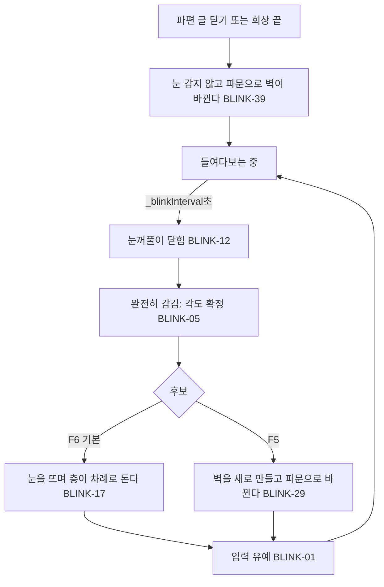

# 눈 깜빡임과 미로 변화

접두어 `BLINK` · 다음 번호 `BLINK-42`

들여다보는 동안 눈이 주기적으로 깜빡이고 그때마다 미로가 바뀌어, 같은 길을 외워 가지 못하게 한다. 플레이어는 눈을 뜨는 동안 미로가 바뀌는 모습을 직접 본다.

## 흐름

판정은 눈이 완전히 감긴 순간 최종 각도와 새 벽으로 한 번에 바뀐다. 눈을 뜨는 동안 보이는 회전과 파문은 화면 표시만 바꾸므로, 보이는 것과 판정이 어긋나지 않는다. 깜빡임과 연출 동안에는 이동, 부담감, 다음 깜빡임 시간이 모두 멈춘다.

## 진행 중

없음

## 완료

- **BLINK-01** 들여다보는 동안 이전 깜빡임이 끝나고 `_blinkInterval`초가 지날 때마다 `_blinkPresetIndex` 후보(기본 F6)로 눈을 깜빡인다. 깜빡임과 연출 동안, 그리고 끝난 뒤 `_blinkRecoverSeconds` 동안은 이동 입력을 받지 않고 부담감이 차지 않는다.
- **BLINK-03** 단서 말풍선을 닫을 때는 깜빡이지 않는다. `_respawnMazeAfterReading`이 켜져 있으면 시선이 있는 층을 뺀 층의 벽을 다시 만들고 "다른 층의 길이 바뀌었다."를 보여 준다.
- **BLINK-05** 눈이 완전히 감기는 순간 미로와 시선을 무작위 칸 수(`_blinkTurnMinSectors`~`_blinkTurnMaxSectors`)만큼 돌려 최종 각도로 확정하고 "눈이 깜빡였다."를 보여 준다. 벽 구성과 층 오프셋은 바꾸지 않고, 누적 회전이 `_blinkTurnLimitDeg`를 넘으면 방향을 바꾼다. 이동 키는 돌아간 뒤에도 화면 기준이다.
- **BLINK-10** 리셋(R)하면 진행 중인 깜빡임, 회전 표시, 벽 연출을 바로 정리하고 미로를 깜빡임 전 각도로 되돌린다.
- **BLINK-12** 깜빡일 때 위아래 눈꺼풀이 눈을 덮었다가 연다. 화면 전체는 어둡게 하지 않고, 부담감 막대만 눈꺼풀이 닫힌 만큼 흐려진다.
- **BLINK-17** F6 후보는 각도를 확정한 순간 돌기 전 모습을 그대로 보이다가, 눈을 뜨기 시작하고 출발 지연이 지나면 층마다 순서대로 곡선을 따라 최종 각도로 돈다. 도는 동안 그 층의 벽은 옅어졌다 돌아온다.
- **BLINK-29** F5 후보는 눈이 감긴 순간 시선 층을 뺀 층의 벽을 새로 만들고, 눈을 뜨는 동안 동공에서 퍼지는 파문이 닿는 벽부터 옛 벽 잔상과 새 벽을 교차 전환한다. 바뀌지 않은 벽은 그대로 둔다.
- **BLINK-39** Play 중 파편 글을 닫거나 회상이 끝나 벽을 다시 만들면, 눈을 감지 않고 바로 `BLINK-29`의 파문 전환을 보여 준다. 연출 동안 이동, 부담감, 깜빡임 시간이 멈춘다.

---

## 자세히

### 주의

- `BLINK-01` 단서를 읽는 중이나 심연에서는 깜빡임 시간을 세지 않는다. 깜빡임이 진행 중일 때 말풍선을 닫아도 그 깜빡임은 끝까지 간다.
- `BLINK-05` 판정 각도는 이 순간 한 번에 바뀐다. 눈을 뜨는 동안의 회전은 화면 오프셋일 뿐이니, 판정 코드에 오프셋을 섞지 않는다.
- `BLINK-05` `_blinkTurnLimitDeg`는 최대 회전량 이상으로 둔다. 작으면 방향을 바꾼 뒤에도 제한을 넘는다.
- `BLINK-01` 회전 중 누른 이동 키는 무시하고, 유예가 끝난 뒤에도 누르고 있으면 그때부터 움직인다.
- `BLINK-17` 깜빡임 중 시선을 거둬도 회전은 끝까지 가고, 회전한 각도는 대화 중에도 남는다.
- `BLINK-17` 후보 곡선의 끝값이 1이 아니어도, 끝날 때 오프셋을 지우므로 최종 위치는 어긋나지 않는다.
- `BLINK-17` 눈 뜨기 시간이 층 회전 전체보다 길면 눈 뜨기가 끝날 때까지 깜빡임이 이어진다.
- `BLINK-17` 옅어짐 정도가 0인 후보는 투명도를 바꾸지 않는다. F5는 옅어짐과 출발 지연을 쓰지 않는다.
- `BLINK-29` 층이 하나뿐이거나 바뀐 벽이 없어도 파문은 재생한다.
- `BLINK-01`, `BLINK-17`, `BLINK-29` 프레임이 길게 끊겨도 구간 경계에서 시간을 멈춰, 눈을 뜨기 전에 회전이나 연출이 시작되지 않게 한다.
- `BLINK-39` 에디트 모드의 벽 재생성은 연출 없이 바로 바뀐다. 연출 중에는 이동할 수 없으므로 다른 파편에 닿아 연출이 겹치지 않는다.
- 편집 화면에는 깜빡임 버튼을 두지 않는다. 회전값이 씬에 저장되기 때문이다.

### 하지 않는 것

- 층의 칸 오프셋으로 맵을 돌리지 않는다. 층끼리 어긋나 실제 길이 바뀐다.
- 카메라를 돌리지 않는다. 눈, 동공, UI까지 함께 돈다.
- 회전 중간 각도를 판정에 쓰지 않는다. 판정은 확정 순간 한 번만 바꾼다.
- 기본 회전 곡선에 튕기는 오버슈트를 넣지 않는다.
- 옛 벽 오브젝트를 남겨 두지 않는다. 벽 찾기에 함께 걸린다. 잔상은 판정 없는 표시 전용이다.
- 연출 도중 벽을 하나씩 판정에 반영하지 않는다.
- 벽 변화 연출에 UI 오브젝트를 쓰지 않는다.

### 구성

- `눈 (Eye)` 아래 `미로 (Iris Maze)`가 층과 `시선 (Gaze)`을 자식으로 가진다. `동공 (Pupil)`은 미로의 형제라 함께 돌지 않는다.
- 잔상과 파문은 판정 없는 표시 전용 `LineRenderer`이고 `MazeWall`, `MazeGate`를 붙이지 않는다. 잔상은 원래 층 아래, 파문은 미로 아래에 Play 중 만들고 지운다.
- 눈꺼풀 덮개는 Play 중 코드로 만들어 씬에 저장되지 않는다.
- 회전 후보는 디렉터의 `_blinkPresets`에 F5, F6 순서로 둘이 있다.

### 메모

- 깜빡임 중 부담감 정지는 `BURDEN-01`, 막대 가림은 `BURDEN-05`와 얽힌다.
