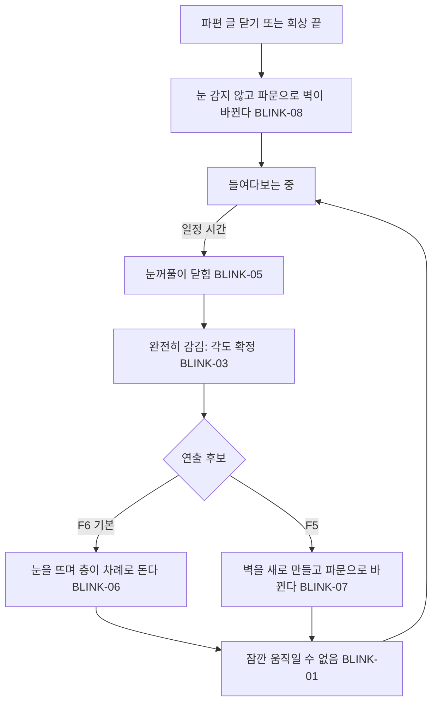

# 눈 깜빡임과 미로 변화

접두어 `BLINK` · 다음 번호 `BLINK-09`

들여다보는 동안 눈이 주기적으로 깜빡이고 그때마다 미로가 바뀌어, 같은 길을 외워 가지 못하게 한다. 플레이어는 눈을 뜨는 동안 미로가 바뀌는 모습을 직접 본다.

## 흐름

길이 실제로 바뀌는 것은 눈이 완전히 감긴 한 순간뿐이다. 눈을 뜨는 동안 보이는 회전과 파문은 그 변화를 보여 주는 연출이라, 보이는 길과 실제 길이 어긋나지 않는다.

## 진행 중

없음

## 완료

### 깜빡임 주기 (BLINK-01)

들여다보는 동안 일정 시간마다 눈이 한 번 깜빡인다.

- 다음 깜빡임까지의 시간은 이전 깜빡임이 끝난 뒤부터 센다.
- 깜빡이는 동안과 끝난 직후 잠깐은 움직일 수 없고, 부담감도 차지 않는다.
- 어떤 연출로 깜빡일지는 후보 중에서 고르며, 기본은 F6(층 회전)이다.

### 단서를 닫을 때 (BLINK-02)

단서 말풍선을 닫을 때는 깜빡이지 않고, 다른 층의 길만 바뀐다.

- 시선이 있는 층은 그대로 두고 나머지 층의 벽을 새로 만든다.
- "다른 층의 길이 바뀌었다."를 보여 준다.
- 이 기능은 Inspector에서 끌 수 있다.

### 미로 회전 (BLINK-03)

눈이 완전히 감기는 순간 미로가 시선과 함께 몇 칸 돌아간다.

- 몇 칸, 어느 방향으로 돌지는 무작위로 정한다. 한쪽으로 너무 많이 돌면 방향을 반대로 바꾼다.
- 벽, 문, 파편의 배치는 그대로고 전체가 돌기만 한다.
- 돌아간 뒤에도 이동 키는 화면 기준 방향으로 움직인다.
- "눈이 깜빡였다."를 보여 준다.

### 리셋 (BLINK-04)

R로 리셋하면 진행 중인 깜빡임과 연출을 바로 멈추고 미로를 원래 각도로 되돌린다.

### 눈꺼풀 (BLINK-05)

깜빡일 때 위아래 눈꺼풀이 눈을 덮었다가 다시 연다.

- 화면 전체를 어둡게 하지 않는다.
- 부담감 막대만 눈꺼풀이 닫힌 만큼 함께 흐려진다.

### 눈을 뜨며 보이는 회전, F6 (BLINK-06)

눈을 뜨는 동안 미로가 층마다 차례로 돌아가 바뀐 모습을 보여 준다.

- 감긴 순간에는 돌기 전 모습 그대로 보이다가, 눈을 뜨기 시작하고 잠시 뒤 돌기 시작한다.
- 층마다 조금씩 늦게 출발해 부드러운 곡선으로 돈다. 번갈아 반대쪽에서 출발하는 후보도 있다.
- 도는 동안 그 층의 벽이 옅어졌다가 돌아온다.

### 파문으로 바뀌는 벽, F5 (BLINK-07)

눈이 감긴 순간 다른 층의 벽을 새로 만들고, 눈을 뜨는 동안 동공에서 퍼지는 파문을 따라 바뀐다.

- 파문이 닿은 벽부터 옛 벽이 사라지고 새 벽이 나타난다.
- 바뀌지 않은 벽은 그대로 둔다.

### 파편을 읽은 뒤 벽 바뀜 (BLINK-08)

파편 글을 닫거나 회상이 끝나 벽이 바뀔 때도, 눈을 감지 않고 바로 F5 파문 연출을 보여 준다.

- 연출 동안 움직일 수 없고, 부담감과 깜빡임 시간도 멈춘다.

---

## 자세히

### 주의

- `BLINK-01` 단서를 읽는 중이나 심연에서는 깜빡임 시간을 세지 않는다. 깜빡임 중에 말풍선을 닫아도 그 깜빡임은 끝까지 간다.
- `BLINK-01` 깜빡임 중 누른 이동 키는 무시하고, 유예가 끝난 뒤에도 누르고 있으면 그때부터 움직인다.
- `BLINK-01`, `BLINK-06`, `BLINK-07` 프레임이 길게 끊겨도 구간 경계에서 시간을 멈춰, 눈을 뜨기 전에 회전이나 연출이 시작되지 않게 한다.
- `BLINK-03` 판정 각도는 감긴 순간 한 번에 바뀐다. 눈을 뜨는 동안의 회전은 화면 표시일 뿐이니 판정에 섞지 않는다.
- `BLINK-03` 회전 제한 각도는 최대 회전량 이상으로 둔다. 작으면 방향을 바꾼 뒤에도 제한을 넘는다.
- `BLINK-06` 깜빡임 중 시선을 거둬도 회전은 끝까지 가고, 돌아간 각도는 대화 중에도 남는다.
- `BLINK-06` 곡선의 끝값이 1이 아니어도 끝날 때 표시 각도를 지우므로 최종 위치는 어긋나지 않는다. 눈 뜨기가 층 회전보다 길면 눈 뜨기가 끝날 때까지 깜빡임이 이어진다.
- `BLINK-07` 층이 하나뿐이거나 바뀐 벽이 없어도 파문은 재생한다.
- `BLINK-08` 에디트 모드에서는 연출 없이 벽만 바로 바뀐다. 연출 중에는 이동할 수 없으므로 다른 파편에 닿아 연출이 겹치지 않는다.
- 편집 화면에는 깜빡임 버튼을 두지 않는다. 회전값이 씬에 저장되기 때문이다.

### 하지 않는 것

- 층의 칸 오프셋으로 맵을 돌리지 않는다. 층끼리 어긋나 실제 길이 바뀐다.
- 카메라를 돌리지 않는다. 눈, 동공, UI까지 함께 돈다.
- 회전 중간 각도를 판정에 쓰지 않는다.
- 기본 회전 곡선에 튕기는 오버슈트를 넣지 않는다.
- 옛 벽 오브젝트를 남겨 두지 않는다. 잔상은 판정 없는 표시 전용이다.
- 연출 도중 벽을 하나씩 판정에 반영하지 않는다.
- 벽 변화 연출에 UI 오브젝트를 쓰지 않는다.

### 구성

- `눈 (Eye)` 아래 `미로 (Iris Maze)`가 층과 `시선 (Gaze)`을 자식으로 가진다. `동공 (Pupil)`은 미로의 형제라 함께 돌지 않는다.
- 잔상과 파문은 판정 없는 표시 전용 `LineRenderer`이고 Play 중 만들고 지운다. 눈꺼풀 덮개도 Play 중 코드로 만든다.
- 연출 후보는 디렉터의 `_blinkPresets`에 F5, F6 순서로 둘이 있다.

### 코드 단서

기능을 고칠 때 먼저 볼 곳이다.

| 기능 | 찾을 곳 |
|---|---|
| BLINK-01 | `EyeMazeDirector.TickBlink`, `EyeMazeDirector.AdvanceBlink` |
| BLINK-02 | `EyeMazeDirector.RespawnMaze` |
| BLINK-03 | `EyeMazeDirector.CommitBlinkRotation` |
| BLINK-04 | `EyeMazeDirector.ResetAll` |
| BLINK-05 | `EyeVisual.Closed` |
| BLINK-06 | `EyeMazeDirector.ApplyBlinkVisual`, `BlinkTurnPreset` |
| BLINK-07 | `MazeWallChangeEffect`, `EyeMazeDirector.CommitBlinkWallChange` |
| BLINK-08 | `EyeMazeDirector.TickRespawnEffect` |

### 메모

- 깜빡임 중 부담감 정지는 `BURDEN-01`, 막대 가림은 `BURDEN-05`와 얽힌다.
