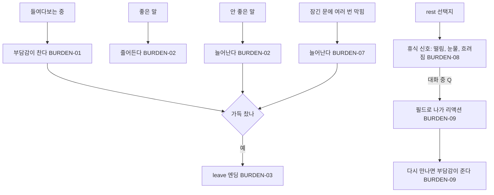

# 부담감과 쉬어 주기

접두어 `BURDEN` · 다음 번호 `BURDEN-11`

들여다보는 동안 내담자의 부담감이 차오르고, 끝까지 차면 상담이 끝난다. 감정이 크게 흔들린 순간에는 눈에 신호가 나타나고, 플레이어가 알아채고 쉬어 줄 때만 부담감이 준다.

## 흐름

부담감은 들여다보는 동안에만 차고, 신뢰가 높을수록 느리게 찬다. 일반 벽에 부딪히는 것으로는 오르지 않는다. 내담자는 주인공이 마음속에 있는 것을 모르기 때문이다. 벽에 부딪혀 밀려나는 연출은 지금 꺼 두었다.

## 기능

### 부담감 차오름 (BURDEN-01)

손님의 눈을 들여다보는 동안 부담감이 조금씩 찬다.

- 신뢰가 높을수록 천천히 찬다.
- 대화 중, 심연 안, 파편을 읽는 중, 깜빡이는 중에는 차지 않는다.

### 말에 따른 증감 (BURDEN-02)

좋은 말을 처음 하면 부담감이 줄고, 안 좋은 말을 하면 는다.

- 결과에 "(부담이 조금 줄었다.)" 또는 "(부담이 조금 늘었다.)"가 붙는다.
- 같은 좋은 말을 다시 해도 더 줄지 않는다.

### 부담감이 가득 참 (BURDEN-03)

부담감이 가득 차면 손님이 상담을 그만두는 leave 엔딩으로 끝난다.

- 가득 찬다고 보는 기준은 회차마다 대사 CSV에서 정한다(기본은 끝까지 참).
- leave 엔딩이 없는 손님이면 같은 문구와 함께 시선을 거두게 한다.

### 부담감 유지와 초기화 (BURDEN-04)

Q로 자리를 떠났다 돌아와도 부담감은 그대로 남는다. 리셋(R)하거나 다른 손님을 부르면 처음으로 돌아간다.

### 부담감 막대 (BURDEN-05)

만남 화면에 "부담감" 글과 막대가 보이고, 막대가 부담감만큼 찬다.

- 대화로 값이 갑자기 바뀌면 막대가 부드럽게 따라 오르내린다.
- 디렉터 인스펙터 상태 줄에도 부담감 %가 보인다.

### 벽에 부딪혀 밀려남 (BURDEN-06)

벽이나 잠긴 문에 세게 부딪히면 반대쪽으로 튕겨 나가고 화면이 지지직 흔들린다. 지금은 꺼 두었다.

- 밀려나는 동안은 조작할 수 없고, 한 번 부딪힌 뒤 잠깐은 다시 부딪히지 않는다.
- 일반 벽에 부딪히는 것만으로는 부담감이 오르지 않는다.

### 잠긴 문 반복 부딪힘 (BURDEN-07)

짧은 시간 안에 잠긴 문에 여러 번 막히면 손님이 이질감을 느껴 부담감이 오른다. 밀려남을 꺼도 동작한다.

### 휴식 신호 (BURDEN-08)

손님이 감정적으로 크게 흔들리는 말을 처음 들으면, 눈에 쉬고 싶다는 신호가 나타난다.

- 동공이 떨리고 눈물이 차오르며 눈과 미로가 흐려진다.
- 대화 화면에 쉬자는 대사와 "(잠시 쉴 시간이 필요한 거 같다.)"가 보인다.
- 들여다보는 중에는 "…하고 싶은 말이 있는 거 같다. 잠시 관찰을 멈춰보자."가 보인다.

### 쉬어 주기 (BURDEN-09)

신호가 보일 때 Q를 누르면 손님을 쉬게 해 주고 필드로 나간다.

- 필드에서 손님이 고맙다는 리액션을 보인다.
- 다시 만나면 부담감이 줄고 신호가 가라앉는다.
- 신호가 없을 때 Q를 누르면 부담감은 그대로다.

### 지수의 휴식 대사 (BURDEN-10)

지수의 대사 CSV에 쉬자는 대사(`jisu_autopay_25` 선택지)와 쉬어 준 뒤의 리액션이 들어 있다.

---

## 자세히

### 주의

- `BURDEN-01` 대화 중, 엔딩 중, 에디트 모드에서는 차지 않는다. 엔딩이 시작되면 값은 1로 남는다. 같은 프레임에 신뢰가 바뀌면 다음 프레임부터 새 속도로 찬다.
- `BURDEN-02` 이미 한 좋은 말을 다시 고르면 줄지 않는다. 0 아래로는 내려가지 않는다.
- `BURDEN-05` 들여다보는 동안의 차오름은 이 속도보다 느려 그대로 따라간다. 에디트 모드에서는 바로 맞춘다.
- `BURDEN-02` 안 좋은 말 판정은 `IsHiddenChoice()`와 같은 조건이다. 같은 선택으로 신뢰 leave(`leave_trust`)도 충족되면 `_burdenEndLine` 대신 그 선택지 반응을 앞줄로 leave 엔딩을 시작한다.
- `BURDEN-06` 벽을 따라 미끄러질 때는 벽 쪽 속도가 `_bumpMinSpeed`보다 작아 반응하지 않는다.
- `BURDEN-06` 모서리에서 두 축이 같은 프레임에 막히면 두 방향을 더해 대각선으로 밀려난다. 원호 벽과 잠긴 문은 안쪽·바깥쪽, 칸막이 벽은 둘레 방향이다.
- `BURDEN-06` 이동은 기존 벽 판정을 거치고 고리 띠와 심연을 넘지 않는다. 밀려나는 중에 벽에 닿아도 새 부딪힘은 시작하지 않는다. 밀려난 끝에 파편이 있으면 줍고 밀려남을 멈춘다.
- `BURDEN-06` 요동 중 새로 부딪히면 남은 비율만 다시 채우고 기준 초점은 처음 값을 쓴다. 요동 동안 벽 약 190개가 매 프레임 다시 그려진다.
- `BURDEN-07` 잠긴 문에 붙어 있는 동안은 1회다. `_gatePushGap`초 이상 떨어졌다 다시 막혀야 다음 회다. 서로 다른 잠긴 문은 합쳐 세고, 일반 벽과 감정 사물(`EMO-04`)은 세지 않는다. 시선을 거두거나 리셋하면 0이 된다. `_bumpEnabled`와 무관하다.
- `BURDEN-08` 안 좋은 말은 한 번 고르면 목록에서 빠지므로(`DLG-05`) 같은 말로 두 번 오르지 않는다. 이미 한 좋은 말을 다시 골라도 신호는 다시 켜지지 않는다.
- `BURDEN-08` 신호를 무시하고 장면이 바뀌어도 Q를 누를 때까지 쉬자는 대사가 남는다. 신호 중 부담감이 다 차면 leave 엔딩이 시작된다.
- `BURDEN-09` `rest` 묶음이 없는 손님은 리액션 없이 돌아온다.
- `BURDEN-09` 부담감이 이미 0이어도 문구는 보인다.

### 하지 않는 것

- 막대에 `Image.Type.Filled`를 쓰지 않는다. 스프라이트가 있어야 한다.
- 막대 높이를 앵커로 줄이지 않는다. 0 근처에서 얇은 띠가 그려진다.
- 부담감을 별도 컴포넌트로 나누지 않는다. 대화 결과, 엔딩, 리셋과 모두 맞물려 있다.
- 입력이나 이동 방향의 반대로 밀지 않는다. 벽을 타다 부딪히면 왔던 길로 끌려간다.
- 밀려날 때 위치를 한 번에 옮기지 않는다. 벽을 뚫을 수 있다.
- 지지직 연출에 카메라 셰이더나 uGUI 노이즈를 쓰지 않는다. 미로 초점으로 충분하다.
- 휴식 신호와 동시에 자동으로 필드로 내보내지 않는다. 플레이어가 알아채는 과정이 없어진다.
- Q를 누른 순간 부담감을 줄이지 않는다. 암전 때문에 줄어드는 모습이 보이지 않는다.

### 구성

- 만남 UI의 `부담감 막대 칸`(칸 > 속지 > 채움)과 그 위 `부담감` 글. 채움은 피벗이 아래쪽이고 `localScale.y`로 찬다. `깜빡임` 오버레이보다 먼저 그려지도록 `파편들 칸` 바로 뒤에 둔다.
- 벽 부딪힘은 새 오브젝트 없이 디렉터의 `벽 부딪힘` 헤더 필드만 쓴다. 밀려남과 초점 요동은 `Update()`에서 깜빡임 처리 뒤, 부담감 처리 앞에 한다.
- 눈물 메시는 눈 아래에 Play 중 한 번 만들고 씬에 저장하지 않는다. 떨림, 눈물, 흐려짐은 `ClientTearCue`가 맡는다.

### 코드 단서

기능을 고칠 때 먼저 볼 곳이다.

| 기능 | 찾을 곳 |
|---|---|
| BURDEN-01 | `EyeMazeDirector.TickBurden` |
| BURDEN-02 | `EyeMazeDirector.ChooseOption` |
| BURDEN-03 | `EyeMazeDirector.EndByBurden` |
| BURDEN-04 | `EyeMazeDirector.ResetAll` |
| BURDEN-05 | `EyeMazeUI` |
| BURDEN-06 | `EyeMazeDirector.TryStartBump`, `EyeMazeDirector.TickKnockback` |
| BURDEN-07 | `EyeMazeDirector.CountGatePush` |
| BURDEN-08 | `ClientTearCue`, `EyeMazeUI` |
| BURDEN-09 | `GameFlow.LeaveTalk`, `EyeMazeDirector.AcceptRest` |
| BURDEN-10 | `Dialogue/Jisu_Day1.csv` |

### 메모

- 휴식 신호 대사는 지수만 있다. 은재 회차 CSV의 `rest` 칸은 비어 있다.
- 감정 표현과 겹치는 떨림·눈물은 `EMO-02`이 큰 값을 고른다.
