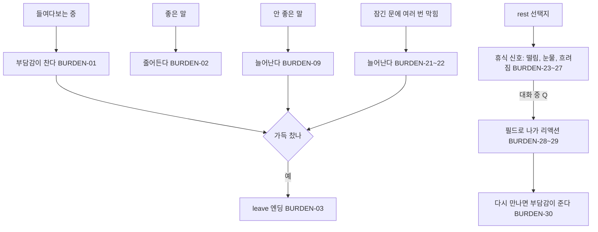

# 부담감과 쉬어 주기

접두어 `BURDEN` · 다음 번호 `BURDEN-37`

들여다보는 동안 내담자의 부담감이 차오르고, 끝까지 차면 상담이 끝난다. 감정이 크게 흔들린 순간에는 눈에 신호가 나타나고, 플레이어가 알아채고 쉬어 줄 때만 부담감이 준다.

## 흐름

부담감은 들여다보는 동안에만 차고, 신뢰가 높을수록 느리게 찬다. 일반 벽에 부딪히는 것으로는 오르지 않는다. 내담자는 주인공이 마음속에 있는 것을 모르기 때문이다. 벽에 부딪혀 밀려나는 연출은 `_bumpEnabled`로 꺼 두었다.

## 진행 중

없음

## 완료

### 부담감 게이지

- **BURDEN-01** 들여다보는 중이고 심연 밖이며 파편을 읽지 않고 깜빡임 회전 중이 아닐 때 부담감이 찬다. 다 차는 시간은 `_burdenFillSeconds`에 신뢰 1마다 `_burdenSecondsPerTrust`초가 더해진다.
- **BURDEN-02** 좋은 말을 처음 고르면 부담감이 `_burdenRelief`만큼 줄고 "(부담이 조금 줄었다.)"가 붙는다.
- **BURDEN-03** 부담감이 leave 기준값(회차 CSV `burden_limit`, 기본 1)에 닿으면 `_burdenEndLine`으로 leave 엔딩을 시작한다. leave 엔딩이 없으면 같은 문구로 시선을 거두게 한다.
- **BURDEN-04** Q로 자리를 떠났다 돌아와도 부담감은 남는다. 리셋(R)과 손님 전환은 0으로 되돌린다.
- **BURDEN-05** 부담감 막대의 채움이 부담감 값을 따른다.
- **BURDEN-06** 디렉터 인스펙터 상태 줄에 `부담감 N%`가 보인다.
- **BURDEN-07** 막대 바로 위에 "부담감" 글이 보인다.
- **BURDEN-08** 부담감이 갑자기 바뀌면 막대가 `_burdenAnimSpeed` 속도로 따라가며 차오르거나 떨어진다.
- **BURDEN-09** 안 좋은 말을 고르면 부담감이 `_burdenWrongChoice`만큼 오르고 "(부담이 조금 늘었다.)"가 붙는다.

### 벽 부딪힘 밀려남

- **BURDEN-10** `_bumpEnabled`(기본 꺼짐)가 꺼져 있으면 `BURDEN-11`~`BURDEN-19`는 동작하지 않는다.
- **BURDEN-11** 벽이나 잠긴 문에 `_bumpMinSpeed` 이상으로 부딪히면 부딪힘이 시작된다.
- **BURDEN-12** 막힌 면의 반대 방향으로 밀려난다.
- **BURDEN-13** `_knockbackSeconds` 동안 `_knockbackDistance`만큼 감속하며 밀려난다.
- **BURDEN-14** 밀려나는 동안 이동 입력을 무시한다.
- **BURDEN-15** 부딪힌 뒤 `_bumpCooldown`초 동안은 새로 부딪히지 않는다.
- **BURDEN-16** 일반 벽에 부딪혀도 부담감은 바뀌지 않는다.
- **BURDEN-17** 부딪히면 `_glitchSeconds` 동안 미로 초점이 지지직 흔들렸다가 돌아온다.
- **BURDEN-18** 일반 벽에 부딪혀도 잠긴 문처럼 시선 색이 번쩍인다.
- **BURDEN-19** 잠긴 문에 부딪히면 잠김 문구와 번쩍임에 더해 밀려남이 적용된다.
- **BURDEN-20** 시선을 거두거나 엔딩, 리셋, 깜빡임, 파편 읽기가 시작되면 밀려남과 초점 흔들림을 바로 멈춘다.
- **BURDEN-21** 잠긴 문에 막힐 때마다 접촉 1회로 센다. 첫 접촉 뒤 `_gatePushWindow`초가 지나면 다시 센다.
- **BURDEN-22** 접촉이 `_gatePushCount`회에 닿으면 부담감이 `_gatePushBurden`만큼 오른다.

### 내담자의 휴식 신호

- **BURDEN-23** `rest` 칸이 있는 선택지를 처음 고르면 휴식 신호가 켜진다.
- **BURDEN-24** 신호 동안 동공이 떨린다.
- **BURDEN-25** 신호 동안 눈 아래부터 눈물이 `_tearRiseSeconds`에 걸쳐 차오른다.
- **BURDEN-26** 신호 동안 눈과 미로가 `_tearBlurFocus`까지 흐려진다.
- **BURDEN-27** 신호 중 대화에서는 상황 칸에 `rest` 대사와 "(잠시 쉴 시간이 필요한 거 같다.)"가 보인다.
- **BURDEN-28** 신호 중 Q를 누르면 쉬어 주기를 승낙하고 바로 필드로 나간다.
- **BURDEN-29** 승낙하고 필드로 돌아오면 그 손님 회차 CSV의 `rest` talk 묶음을 보여 준다.
- **BURDEN-30** 승낙 뒤 다시 만나면 부담감이 `_burdenRestRelief`만큼 줄고 `_restReturnMessage`가 보인다.
- **BURDEN-31** 그 뒤 떨림, 눈물, 흐려짐이 `_tearFallSeconds`에 걸쳐 가라앉는다.
- **BURDEN-32** 신호가 없을 때 Q는 부담감을 바꾸지 않고 필드로 나간다.
- **BURDEN-33** 리셋하면 휴식 신호와 그 표현을 바로 끈다.
- **BURDEN-34** 지수 `home` 장면의 `jisu_autopay_25` 선택지에 쉬자는 대사가 있다. (데이터)
- **BURDEN-35** 지수 회차 CSV의 `rest` talk 묶음에 쉬어 준 뒤의 리액션이 있다. (데이터)
- **BURDEN-36** 신호 중 들여다보면 눈 속 표시 아래에 "{name}가 하고 싶은 말이 있는 거 같다. 잠시 관찰을 멈춰보자."가 보인다.

---

## 자세히

### 주의

- `BURDEN-01` 대화 중, 엔딩 중, 에디트 모드에서는 차지 않는다. 엔딩이 시작되면 값은 1로 남는다. 같은 프레임에 신뢰가 바뀌면 다음 프레임부터 새 속도로 찬다.
- `BURDEN-02` 이미 한 좋은 말을 다시 고르면 줄지 않는다. 0 아래로는 내려가지 않는다.
- `BURDEN-08` 들여다보는 동안의 차오름은 이 속도보다 느려 그대로 따라간다. 에디트 모드에서는 바로 맞춘다.
- `BURDEN-09` 안 좋은 말 판정은 `IsHiddenChoice()`와 같은 조건이다. 같은 선택으로 신뢰 leave(`leave_trust`)도 충족되면 `_burdenEndLine` 대신 그 선택지 반응을 앞줄로 leave 엔딩을 시작한다.
- `BURDEN-11` 벽을 따라 미끄러질 때는 벽 쪽 속도가 `_bumpMinSpeed`보다 작아 반응하지 않는다.
- `BURDEN-12` 모서리에서 두 축이 같은 프레임에 막히면 두 방향을 더해 대각선으로 밀려난다. 원호 벽과 잠긴 문은 안쪽·바깥쪽, 칸막이 벽은 둘레 방향이다.
- `BURDEN-13` 이동은 기존 벽 판정을 거치고 고리 띠와 심연을 넘지 않는다. 밀려나는 중에 벽에 닿아도 새 부딪힘은 시작하지 않는다. 밀려난 끝에 파편이 있으면 줍고 `BURDEN-20`대로 멈춘다.
- `BURDEN-17` 요동 중 새로 부딪히면 남은 비율만 다시 채우고 기준 초점은 처음 값을 쓴다. 요동 동안 벽 약 190개가 매 프레임 다시 그려진다.
- `BURDEN-21` 잠긴 문에 붙어 있는 동안은 1회다. `_gatePushGap`초 이상 떨어졌다 다시 막혀야 다음 회다. 서로 다른 잠긴 문은 합쳐 세고, 일반 벽과 감정 사물(`EMO-06`)은 세지 않는다. 시선을 거두거나 리셋하면 0이 된다. `_bumpEnabled`와 무관하다.
- `BURDEN-23` 안 좋은 말은 한 번 고르면 목록에서 빠지므로(`DLG-16`) 같은 말로 두 번 오르지 않는다. 이미 한 좋은 말을 다시 골라도 신호는 다시 켜지지 않는다.
- `BURDEN-27` 신호를 무시하고 장면이 바뀌어도 Q를 누를 때까지 쉬자는 대사가 남는다. 신호 중 부담감이 다 차면 leave 엔딩이 시작된다.
- `BURDEN-29` `rest` 묶음이 없는 손님은 리액션 없이 돌아온다.
- `BURDEN-30` 부담감이 이미 0이어도 문구는 보인다.

### 하지 않는 것

- 막대에 `Image.Type.Filled`를 쓰지 않는다. 스프라이트가 있어야 한다.
- 막대 높이를 앵커로 줄이지 않는다. 0 근처에서 얇은 띠가 그려진다.
- 부담감을 별도 컴포넌트로 나누지 않는다. 대화 결과, 엔딩, 리셋과 모두 맞물려 있다.
- 입력이나 이동 방향의 반대로 밀지 않는다. 벽을 타다 부딪히면 왔던 길로 끌려간다.
- 밀려날 때 위치를 한 번에 옮기지 않는다. 벽을 뚫을 수 있다.
- 지지직 연출에 카메라 셰이더나 uGUI 노이즈를 쓰지 않는다. 미로 초점으로 충분하다.
- 휴식 신호와 동시에 자동으로 필드로 내보내지 않는다. 플레이어가 알아채는 과정이 없어진다.
- Q를 누른 순간 부담감을 줄이지 않는다. 암전 때문에 줄어드는 모습이 보이지 않는다.

### 구성

- 만남 UI의 `부담감 막대 칸`(칸 > 속지 > 채움)과 그 위 `부담감` 글. 채움은 피벗이 아래쪽이고 `localScale.y`로 찬다. `깜빡임` 오버레이보다 먼저 그려지도록 `파편들 칸` 바로 뒤에 둔다.
- 벽 부딪힘은 새 오브젝트 없이 디렉터의 `벽 부딪힘` 헤더 필드만 쓴다. 밀려남과 초점 요동은 `Update()`에서 깜빡임 처리 뒤, 부담감 처리 앞에 한다.
- 눈물 메시는 눈 아래에 Play 중 한 번 만들고 씬에 저장하지 않는다. 떨림, 눈물, 흐려짐은 `ClientTearCue`가 맡는다.

### 메모

- 휴식 신호 대사는 지수만 있다. 은재 회차 CSV의 `rest` 칸은 비어 있다.
- 감정 표현과 겹치는 떨림·눈물은 `EMO-11`이 큰 값을 고른다.
