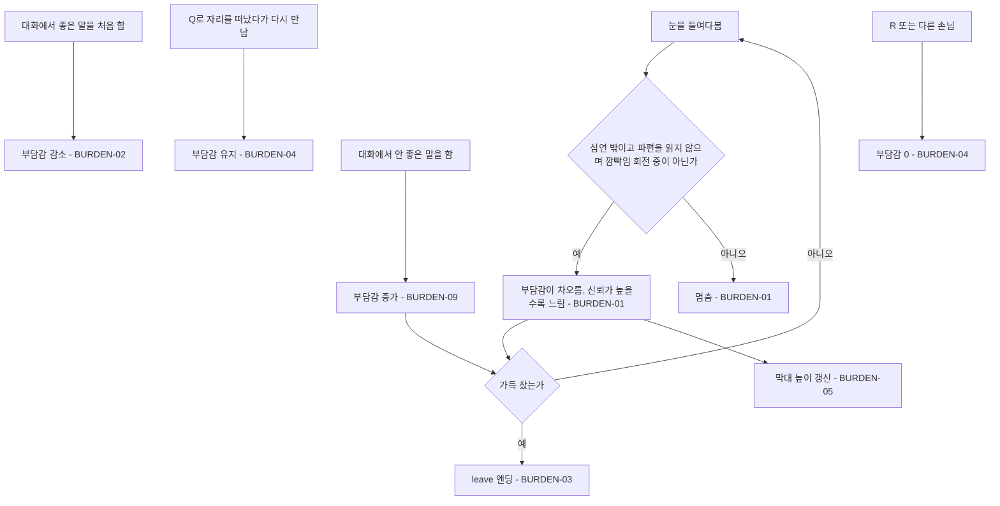
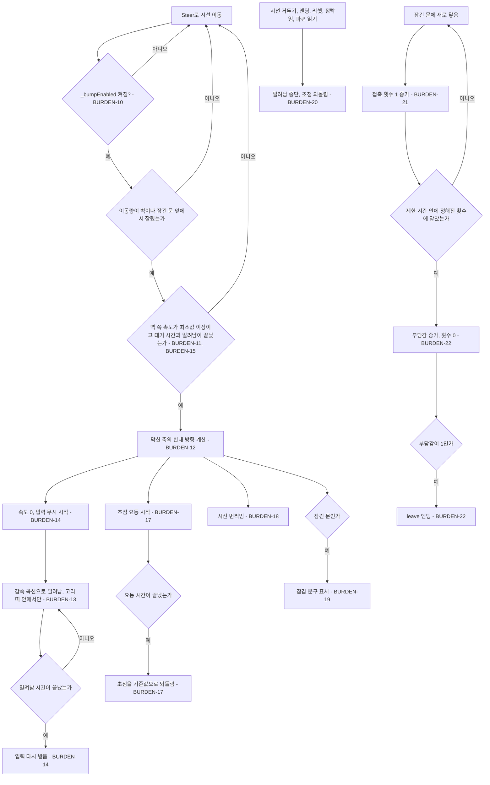
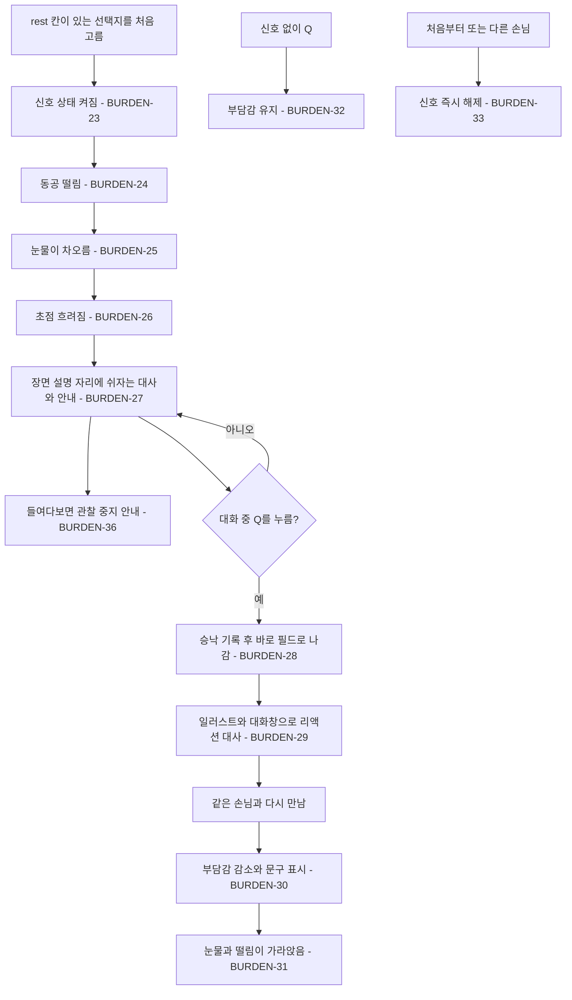

# 부담감과 쉬어 주기

## 1. 목적

눈을 들여다보는 동안 내담자의 부담감이 차오르고, 끝까지 차면 상담이 끝나게 해서 들여다보는 시간에 긴장감을 준다. 내담자는 주인공이 마음속에 들어온 것을 모르므로 벽에 한 번 닿는 것으로는 반응하지 않지만, 잠긴 문에 짧은 시간 안에 여러 번 부딪히면 이질감을 느껴 부담감이 오른다. 감정이 크게 흔들린 순간에는 내담자의 눈에 신호가 나타나고, 플레이어가 그 신호를 알아채고 쉬어 줄 때만 부담감이 준다.

### 범위

- 포함:
  - 들여다보는 동안 차오르는 부담감 값 (0~1)
  - 신뢰가 높을수록 느리게 차오르는 속도
  - 좋은 말을 처음 했을 때 부담감 감소
  - 안 좋은 말을 했을 때 부담감 증가
  - 끝까지 차면 leave 엔딩
  - 만남 UI 눈 왼쪽(예전 태엽 막대 자리)의 세로 부담감 막대, 디렉터 인스펙터 표시
  - 일반 벽(원호 벽, 칸막이 벽)과 잠긴 문에 부딪힘 판정
  - 벽에 수직인 방향으로 일정 거리만큼 부드럽게 밀려남
  - 밀려나는 동안 이동 입력 무시, 다시 부딪힘 대기 시간
  - 잠긴 문에 반복해서 부딪힐 때 부담감 증가
  - 미로 초점(`IrisMaze.Focus`)을 요동치게 하는 지지직 연출
  - 일반 벽에 부딪혀도 시선 색이 번쩍임
  - 대화 CSV의 `rest` 칸으로 휴식 신호와 대사를 지정하는 기능
  - 동공 떨림, 눈물이 차오름, 초점 흐려짐으로 보여 주는 휴식 신호
  - 신호 중 장면 설명 자리에 내담자가 쉬자고 말하는 대사
  - 쉬어 주고 상담실로 돌아온 직후 내담자의 일러스트와 대화창으로 보여 주는 리액션 대사
  - 쉬고 돌아왔을 때의 부담감 감소와 문구
- 제외:
  - 대화 중 시간에 따른 부담감 자연 감소
  - 부담감에 따른 눈 연출(떨림, 화면 어두워짐). 휴식 신호의 떨림과 흐려짐은 포함한다
  - 새 엔딩 추가, 엔딩 대사 수정
  - 소리
  - 눈 그림의 초점(`EyeVisual.Focus`)을 벽 부딪힘으로 바꾸는 것
  - 화면 전체 셰이더나 uGUI 노이즈 오버레이
  - 심연 안 동공 테두리에 닿았을 때의 반응
  - 에디트 모드 이동 버튼(`Nudge`)으로 벽에 닿았을 때의 반응
  - 깜빡임 미로 회전(`BLINK-05`(`blink-maze.md`))으로 벽이 다가오는 경우 (시선도 함께 돌아서 생기지 않는다)
  - 신호가 없을 때 Q를 눌렀을 때의 부담감 변화 (줄지 않는다)
  - 은재 대화의 휴식 신호
  - 조작 안내 문구로 휴식을 알리는 방식
  - Q로 필드에 나갔다 돌아오는 화면 전환 변경

### 선택하지 않은 방식

- 부담감 막대에 `Image.Type.Filled`를 쓰는 방식은 스프라이트가 있어야 동작하므로 사용하지 않는다.
- 부담감을 별도 컴포넌트로 분리하는 방식은 대화 결과, 엔딩, 리셋과 모두 맞물려 있어 사용하지 않는다.
- 막대 높이를 앵커로 줄이는 방식은 0 근처에서 높이가 음수가 되어 얇은 띠가 그려지므로 사용하지 않는다.
- 벽에 부딪혔을 때 입력이나 이동 방향의 반대로 미는 방식은 비스듬히 벽을 타다 부딪혔을 때 왔던 길로 끌려가므로 사용하지 않는다.
- 밀려날 때 위치를 한 번에 옮기는 방식은 어지럽고 벽을 뚫을 수 있으므로 사용하지 않는다.
- 카메라 셰이더와 uGUI 노이즈 오버레이는 미로 초점 값으로 충분히 표현되므로 사용하지 않는다.
- 휴식 신호와 동시에 자동으로 필드로 내보내는 방식은 플레이어가 알아채는 과정을 없애므로 사용하지 않는다.
- Q를 누른 순간 부담감을 줄이는 방식은 암전 때문에 막대가 줄어드는 모습이 보이지 않으므로 사용하지 않는다.
- 눈물은 UI가 아니라 눈 모양에 맞춘 메시로 그린다.

## 2. 요구사항

### 부담감 게이지

- **BURDEN-01** `[승인]` Play Mode에서 들여다보는 중이고 심연 밖이며 파편을 읽지 않고 깜빡임 회전 중(`BLINK-21`(`blink-maze.md`))이 아닐 때 `EyeMazeDirector`는 부담감을 초당 `1 / (_burdenFillSeconds + _burdenSecondsPerTrust × 신뢰)`씩 채운다. 신뢰가 0보다 작으면 0으로 계산한다.
- **BURDEN-02** `[승인]` 좋은 말(신뢰 또는 동공이 오르는 선택지)을 처음 고를 때 `EyeMazeDirector`는 부담감을 `_burdenRelief`만큼 줄이고(0 아래로는 내려가지 않음), 실제로 줄었으면 결과 문구에 `(부담이 조금 줄었다.)`를 붙인다. 이미 한 좋은 말을 다시 고를 때는 줄이지 않는다.
- **BURDEN-03** `[승인]` 부담감이 leave 부담 기준값(`_burdenLimit`, 회차 CSV `burden_limit`, 기본 1)에 닿을 때 `EyeMazeDirector`는 `_burdenEndLine`을 첫 줄로 leave 엔딩을 시작한다. 지금 손님에게 leave 엔딩이 없으면 같은 문구로 시선을 거두게 한다.
- **BURDEN-04** `[승인]` 같은 손님과 다시 만날 때(Q로 자리를 떠났다가 돌아옴) 부담감은 그대로 남는다. 내담자의 휴식 신호를 보고 쉬어 준 경우만 `BURDEN-30`을 따른다. `ResetAll()`(R, 다른 손님 불러오기)은 부담감을 0으로 되돌린다.
- **BURDEN-05** `[승인]` `EyeMazeUI`는 부담감 막대의 `채움` 높이를 부담감 값(0~1)에 맞춘다.
- **BURDEN-06** `[승인]` 디렉터 인스펙터 상태 줄은 `부담감 N%`를 함께 보여준다.
- **BURDEN-07** `[승인]` 만남 UI는 부담감 막대 바로 위에 `부담감`이라는 글을 보여준다.
- **BURDEN-08** `[승인]` Play Mode에서 부담감 값이 갑자기 바뀔 때(대화, 리셋) `EyeMazeUI`는 막대를 초당 `_burdenAnimSpeed`만큼 실제 값 쪽으로 움직여, 차오르거나 떨어지는 모습을 보여준다. 들여다보는 동안의 차오름은 이 속도보다 느리므로 그대로 따라간다. 에디트 모드에서는 바로 맞춘다.
- **BURDEN-09** `[승인]` 안 좋은 말(신뢰 또는 동공이 내려가고 오르는 값이 없는 선택지)을 고를 때 `EyeMazeDirector`는 부담감을 `_burdenWrongChoice`만큼 올리고(1을 넘지 않음) 결과 문구에 `(부담이 조금 늘었다.)`를 붙인다. 기준값에 닿으면 `BURDEN-03`과 같이 leave 엔딩을 시작한다. 안 좋은 말의 판정은 `EyeMazeDirector.IsHiddenChoice()`가 쓰는 조건과 같다. 같은 선택으로 신뢰가 `leave_trust` 이하가 되어 기존 신뢰 leave 판정도 충족되면 `_burdenEndLine` 대신 기존처럼 그 선택지의 반응 대사를 앞줄로 leave 엔딩을 시작한다.

### 벽 부딪힘 밀려남

`_bumpEnabled`(기본 꺼짐)가 꺼져 있어 `BURDEN-11`~`BURDEN-19`의 밀려남과 연출은 지금 동작하지 않는다. 벽과 잠긴 문에서는 이 기능 이전처럼 멈추거나 미끄러지고, 잠긴 문은 잠김 문구와 번쩍임만 보인다. 잠긴 문 반복 부딪힘의 부담감(`BURDEN-21`, `BURDEN-22`)은 `_bumpEnabled`와 무관하게 동작한다.

- **BURDEN-10** `[승인]` `_bumpEnabled`가 꺼져 있을 때 `EyeMazeDirector`는 부딪힘을 시작하지 않는다. `BURDEN-11`~`BURDEN-19`는 `_bumpEnabled`가 켜져 있을 때만 적용한다.
- **BURDEN-11** `[승인]` Play Mode에서 `Steer`로 움직이다가 이동량이 일반 벽 또는 잠긴 문 앞에서 잘리고, 막힌 축의 벽 쪽 속도가 `_bumpMinSpeed` 이상일 때 `EyeMazeDirector`는 부딪힘을 시작한다.
- **BURDEN-12** `[승인]` 부딪힘이 시작될 때 `EyeMazeDirector`는 미로 기준으로 막힌 축의 반대 방향을 밀려나는 방향으로 정한다. 원호 벽과 잠긴 문은 안쪽/바깥쪽 방향, 칸막이 벽은 둘레 방향이다. 두 축이 같은 프레임에 막히면 두 방향을 더해 정규화한다.
- **BURDEN-13** `[승인]` 밀려나는 동안 `EyeMazeDirector`는 `_knockbackSeconds`에 걸쳐 감속 곡선으로 총 `_knockbackDistance`만큼 시선을 옮긴다. 이동은 기존 벽 판정을 거치고, 지금 고리 띠 밖으로 나가지 않으며, 심연에 들어가지 않는다. 밀려나는 중에 벽에 닿아도 새 부딪힘을 시작하지 않는다.
- **BURDEN-14** `[승인]` 부딪힘이 시작될 때 `EyeMazeDirector`는 `_velocity`를 0으로 만들고, 밀려나는 동안 이동 입력을 무시한다. 밀려남이 끝나면 기존 가속도로 다시 움직일 수 있다.
- **BURDEN-15** `[승인]` 부딪힘이 시작된 뒤 `_bumpCooldown`초 동안 `EyeMazeDirector`는 새 부딪힘을 시작하지 않는다. 이 동안 벽에 닿으면 기존처럼 멈추거나 미끄러지기만 한다.
- **BURDEN-16** `[승인]` 일반 벽에 부딪힐 때 `EyeMazeDirector`는 부담감을 바꾸지 않는다.
- **BURDEN-17** `[승인]` 부딪힘이 시작될 때 `EyeMazeDirector`는 그 순간의 `IrisMaze.Focus`를 기준값으로 저장하고, `_glitchSeconds` 동안 초점을 `기준값 - _glitchStrength × 남은비율 × 무작위(0~1)`로 바꾼다(0~1로 제한). 무작위 값은 초당 `_glitchRate`번 새로 뽑고, 끝나면 초점을 기준값으로 되돌린다. 요동 중에 새 부딪힘이 시작되면 남은비율만 1로 다시 채우고 기준값은 처음 값을 유지한다.
- **BURDEN-18** `[승인]` 일반 벽에 부딪힘이 시작될 때도 `EyeMazeDirector`는 잠긴 문과 같이 `_bumpFlash`를 0.6 이상으로 올려 시선 색을 번쩍이게 한다.
- **BURDEN-19** `[승인]` 잠긴 문에 부딪힐 때 `EyeMazeDirector`는 기존처럼 잠김 문구를 보여주고 번쩍인다. 부딪힘 조건(`BURDEN-11`)을 만족하면 일반 벽과 같이 `BURDEN-12`~`BURDEN-17`을 적용한다.
- **BURDEN-20** `[승인]` 시선을 거두거나, 엔딩이 시작되거나, `ResetAll()`, 깜빡임이 시작되거나, 파편을 읽기 시작할 때 `EyeMazeDirector`는 밀려남을 즉시 멈추고 초점을 기준값으로 되돌린다.
- **BURDEN-21** `[승인]` Play Mode에서 시선이 잠긴 문에 막혔고 마지막으로 잠긴 문에 막힌 뒤 `_gatePushGap`초 이상 지났을 때 `EyeMazeDirector`는 접촉 횟수를 1 올린다. 첫 접촉 뒤 `_gatePushWindow`초가 지나면 횟수를 0으로 되돌리고 다시 센다. `_bumpEnabled`가 꺼져 있어도 센다. 판정 자리는 잠긴 문에 막힐 때 불리는 `EyeMazeDirector.GateBlocked()`다.
- **BURDEN-22** `[승인]` 접촉 횟수가 `_gatePushCount`에 닿았을 때 `EyeMazeDirector`는 부담감을 `_gatePushBurden`만큼 올리고(1을 넘지 않음) 횟수를 0으로 되돌린다. `BURDEN-03`의 기준값에 닿으면 그와 같이 `_burdenEndLine`으로 leave 엔딩을 시작한다.

### 내담자의 휴식 신호

- **BURDEN-23** `[구현완료]` `rest` 칸이 채워진 선택지를 처음 고를 때 `EyeMazeDirector`는 신호 상태를 켠다.
- **BURDEN-24** `[구현완료]` 신호 상태일 때 `Pupil`은 제자리 주변에서 떨린다.
- **BURDEN-25** `[구현완료]` 신호 상태일 때 `EyeVisual`은 눈 아래쪽부터 눈물을 `_tearRiseSeconds`에 걸쳐 차오르게 한다.
- **BURDEN-26** `[구현완료]` 신호 상태일 때 `ClientTearCue`는 눈과 미로의 초점을 `_tearBlurFocus`까지 낮춘다.
- **BURDEN-27** `[구현완료]` 신호 상태에서 대화 중일 때 `EyeMazeUI`는 장면 설명 자리에 `rest` 대사와 그 아래 `(잠시 쉴 시간이 필요한 거 같다.)`를 표시한다.
- **BURDEN-28** `[구현완료]` 신호 상태에서 대화 중 Q를 누를 때 `GameFlow`는 승낙을 기록하고 바로 필드로 나간다.
- **BURDEN-29** `[구현완료]` 승낙 상태로 필드에 돌아올 때 `GameFlow`는 그 손님의 대화 CSV `talk` 행 중 `rest` 묶음을 일러스트와 대화창으로 보여 준다.
- **BURDEN-30** `[구현완료]` 승낙 상태로 같은 손님과 다시 만날 때 `EyeMazeDirector`는 부담감을 `_burdenRestRelief`만큼 줄이고(0 아래로는 내려가지 않음) `_restReturnMessage`를 표시한다.
- **BURDEN-31** `[구현완료]` `BURDEN-30` 뒤 `ClientTearCue`는 떨림, 눈물, 초점을 `_tearFallSeconds`에 걸쳐 원래대로 되돌린다.
- **BURDEN-32** `[구현완료]` 신호 상태가 아닐 때 Q를 누르면 `GameFlow`는 바로 필드로 나가고 부담감은 바뀌지 않는다.
- **BURDEN-33** `[구현완료]` `ResetAll`이 호출될 때 `EyeMazeDirector`는 휴식 상태를 끄고 `ClientTearCue`는 떨림, 눈물, 초점을 바로 되돌린다.
- ~~**BURDEN-34**~~ `[폐기]` (폐기: 2026-11-27 지수 제거)
- ~~**BURDEN-35**~~ `[폐기]` (폐기: 2026-11-27 지수 제거)
- **BURDEN-36** `[구현완료]` 신호 상태에서 눈을 들여다볼 때 `EyeMazeUI`는 눈 속 표시 아래에 `{name}가 하고 싶은 말이 있는 거 같다. 잠시 관찰을 멈춰보자.`를 표시한다.

### 예외 및 경계 조건

부담감 게이지

- 심연 안, 파편을 읽는 중, 깜빡임 회전 중, 대화 중, 엔딩 중: 부담감이 시간에 따라 차오르지 않는다.
- 안 좋은 말은 한 번 고르면 목록에서 빠지므로(`DLG-16`(`dialogue.md`)) 같은 말로 부담감이 두 번 오르지 않는다.
- 잠긴 문에 반복해서 부딪힐 때의 부담감 증가는 `BURDEN-21`, `BURDEN-22`를 따른다.
- 에디트 모드: 시간이 흐르지 않으므로 차오르지 않는다. Inspector에서 `_burden`을 직접 바꿔 막대를 확인한다.
- 같은 프레임에 신뢰가 바뀜: 다음 프레임부터 새 속도로 찬다.
- 엔딩이 시작된 뒤: 부담감 값은 1로 남고 더 이상 바뀌지 않는다.

벽 부딪힘 밀려남

- 벽을 따라 미끄러짐: 막힌 축의 벽 쪽 속도가 `_bumpMinSpeed`보다 작으면 반응하지 않는다.
- 벽 쪽으로 계속 누르고 있음: 밀려난 뒤 다시 가속해 벽 쪽 속도가 `_bumpMinSpeed`를 넘고 대기 시간이 지났으면 다시 부딪힌다.
- 모서리에서 두 축이 동시에 막힘: 대각선으로 밀려난다 (`BURDEN-12`).
- `_knockbackDistance`가 통로 폭보다 큼: 반대편 벽 앞에서 멈추고 새 부딪힘은 시작하지 않는다 (`BURDEN-13`).
- 밀려난 끝에 파편이 있는 칸에 닿음: 기존 `CheckFragment()`대로 파편을 줍고, 밀려남은 `BURDEN-20`대로 멈춘다.
- `_glitchStrength`가 0: 초점은 바뀌지 않고 밀려남만 일어난다.
- `_knockbackDistance`가 0: 밀려나지 않고 연출만 적용된다.
- 잠긴 문에 붙어 계속 누르고 있음: 막힌 상태가 이어지는 동안은 접촉 1회로 센다. `_gatePushGap`초 이상 떨어졌다 다시 막혀야 다음 1회다.
- 서로 다른 잠긴 문에 번갈아 부딪힘: 문을 구분하지 않고 합쳐서 센다.
- 일반 벽에 닿음: 접촉 횟수에 넣지 않는다.
- 시선을 거두거나 `ResetAll()`이 호출됨: 접촉 횟수를 0으로 되돌린다.
- 에디트 모드: 부딪힘을 시작하지 않는다.
- 초점이 요동하는 동안 벽, 문, 파편이 매 프레임 다시 그려진다 (현재 씬 벽 약 190개). 연출 시간 동안만 일어난다.

내담자의 휴식 신호

- 신호를 무시하고 눈을 들여다봄: 신호는 Q를 누를 때까지 유지되고, 들여다보는 동안에도 눈물과 흐려짐이 보인다.
- 신호 중 부담감이 가득 참: 기존대로 leave 엔딩이 시작되고 신호는 가라앉는다.
- 이미 한 좋은 말을 다시 고름: 기존 규칙대로 결과가 반복되지 않으므로 신호도 다시 켜지지 않는다.
- 부담감이 이미 0임: 0으로 유지하고 문구는 표시한다.
- 신호 중 다른 장면으로 넘어감: Q를 누를 때까지 장면 설명 자리에 쉬자는 대사를 유지한다.
- 신호 중 눈을 들여다봄: 장면 설명 자리는 기존 눈 속 표시와 `BURDEN-36`의 안내를 쓴다. 파편을 읽는 중과 심연에서는 안내 없이 기존 표시를 쓴다.
- `rest` 묶음이 없는 손님: 리액션 없이 필드로 돌아온다.

## 3. 상태와 전이

| 지금 상태 | 계기 | 다음 상태 | 관련 요구사항 |
|---|---|---|---|
| 부담감 차오름 (들여다보는 중) | 부담감이 `_burdenLimit`에 닿음 | leave 엔딩 | BURDEN-01, BURDEN-03 |
| 부딪힘 없음 | 벽 쪽 속도 `_bumpMinSpeed` 이상으로 벽이나 잠긴 문에 막힘 (`_bumpEnabled` 켜짐) | 밀려나는 중 | BURDEN-10, BURDEN-11 |
| 밀려나는 중 | `_knockbackSeconds` 지남 | 대기 시간 (`_bumpCooldown`) | BURDEN-13, BURDEN-15 |
| 밀려나는 중 | 시선 거둠, 엔딩, `ResetAll()`, 깜빡임, 파편 읽기 | 부딪힘 없음 | BURDEN-20 |
| 접촉 0회 | 잠긴 문에 새로 막힘 | 접촉 세는 중 | BURDEN-21 |
| 접촉 세는 중 | `_gatePushCount`에 닿음 | 접촉 0회 (부담감 증가) | BURDEN-22 |
| 접촉 세는 중 | `_gatePushWindow` 지남 | 접촉 0회 | BURDEN-21 |
| 신호 없음 | `rest` 칸이 있는 선택지를 처음 고름 | 신호 상태 | BURDEN-23 |
| 신호 상태 | 대화 중 Q | 승낙 (필드) | BURDEN-28 |
| 승낙 | 같은 손님과 다시 만남 | 신호 가라앉는 중 (부담감 감소) | BURDEN-30, BURDEN-31 |
| 신호 상태, 승낙 | `ResetAll` | 신호 없음 | BURDEN-33 |

부담감 게이지

벽 부딪힘 밀려남

내담자의 휴식 신호

## 4. 수치 표

기본값은 코드의 필드 초기값이다. 씬이나 프리팹에 저장된 값은 이와 다를 수 있으며, Play에서는 저장된 값이 쓰인다.

| 이름 | 기본값 | 필드(컴포넌트) | 뜻 |
|---|---|---|---|
| `_burdenFillSeconds` | 85.8 (씬 저장값 100) | `EyeMazeDirector` | 신뢰 0일 때 0에서 가득까지 걸리는 들여다보기 시간(초) |
| `_burdenSecondsPerTrust` | 17.2 | `EyeMazeDirector` | 신뢰 1당 늘어나는 시간(초) |
| `_burdenRelief` | 0.25 | `EyeMazeDirector` | 좋은 말을 처음 했을 때 줄어드는 양 (0~1) |
| `_burdenWrongChoice` | 0.1 | `EyeMazeDirector` | 안 좋은 말을 했을 때 늘어나는 양 (0~1) |
| `_burdenLimit` | 1 | `EyeMazeDirector` | leave 엔딩이 시작되는 부담감 기준값. 회차 CSV `burden_limit`로 바뀐다 |
| `_burdenEndLine` | `은재가 시선을 피했다. 더는 마주 보기 힘든 것 같다.` | `EyeMazeDirector` | 가득 찼을 때 엔딩 앞에 보이는 한 줄 (이름은 손님에 맞게 바뀐다) |
| `_burdenAnimSpeed` | 0.5 | `EyeMazeUI` | 막대가 실제 값을 따라가는 속도 (초당 비율) |
| `_burdenFill` | 없음 (씬에서 `부담감 막대 칸/속지/채움`을 넣음) | `EyeMazeUI` | 높이를 맞출 채움 오브젝트 |
| `_bumpEnabled` | false | `EyeMazeDirector` (`벽 부딪힘` 헤더) | 벽 부딪힘 반응 전체를 켜고 끈다. 끄면 밀려남, 지지직 연출, 일반 벽 번쩍임이 모두 일어나지 않는다 |
| `_bumpMinSpeed` | 0.8 | `EyeMazeDirector` (`벽 부딪힘` 헤더) | 반응하는 최소 벽 쪽 속도 (초당 거리, 최고 이동 속도 1.6의 절반) |
| `_knockbackDistance` | 0.09 | `EyeMazeDirector` (`벽 부딪힘` 헤더) | 밀려나는 거리 (통로 폭 약 0.21의 절반 이하 권장) |
| `_knockbackSeconds` | 0.18 | `EyeMazeDirector` (`벽 부딪힘` 헤더) | 밀려나는 데 걸리는 시간(초), 이 동안 입력을 무시한다 |
| `_bumpCooldown` | 0.45 | `EyeMazeDirector` (`벽 부딪힘` 헤더) | 다음 부딪힘까지 기다리는 시간(초) |
| `_gatePushCount` | 3 | `EyeMazeDirector` (`벽 부딪힘` 헤더) | 부담감이 오르는 잠긴 문 접촉 횟수 |
| `_gatePushWindow` | 10 | `EyeMazeDirector` (`벽 부딪힘` 헤더) | 접촉 횟수를 세는 제한 시간(초) |
| `_gatePushGap` | 0.4 | `EyeMazeDirector` (`벽 부딪힘` 헤더) | 새 접촉으로 세기 위해 문에서 떨어져 있어야 하는 시간(초) |
| `_gatePushBurden` | 0.1 | `EyeMazeDirector` (`벽 부딪힘` 헤더) | 횟수에 닿았을 때 오르는 부담감 (0~1) |
| `_glitchSeconds` | 0.3 | `EyeMazeDirector` (`벽 부딪힘` 헤더) | 지지직 연출 시간(초) |
| `_glitchStrength` | 0.6 | `EyeMazeDirector` (`벽 부딪힘` 헤더) | 초점이 가장 크게 떨어지는 양 (0~1). 0이면 연출 없음 |
| `_glitchRate` | 20 | `EyeMazeDirector` (`벽 부딪힘` 헤더) | 초당 초점이 튀는 횟수 |
| `_burdenRestRelief` | 0.4 | `EyeMazeDirector` | 쉬어 주고 돌아왔을 때 줄어드는 부담감 (0~1) |
| `_restReturnMessage` | `은재의 얼굴이 조금 편해졌다.\n(부담이 줄었다.)` | `EyeMazeDirector` | 돌아왔을 때 문구. '은재'는 지금 손님 이름으로 바뀐다 |
| `_tearRiseSeconds` | 3 | `ClientTearCue` | 신호가 끝까지 차오르는 시간(초) |
| `_tearFallSeconds` | 1.5 | `ClientTearCue` | 신호가 가라앉는 시간(초) |
| `_tearBlurFocus` | 0.35 | `ClientTearCue` | 눈물이 가득 찼을 때의 초점 (0~1) |
| `_trembleDistance` | 0.05 | `Pupil` | 동공이 떨리는 거리 |
| `_trembleSpeed` | 28 | `Pupil` | 동공이 떨리는 빠르기 |
| `_tearColor` | (0.62, 0.8, 1, 0.45) | `EyeVisual` | 눈물 색 |
| `_tearMaxHeight` | 0.55 | `EyeVisual` | 가득 찼을 때 눈 높이 대비 수위 (0~1) |
| `_tearWaveHeight` | 0.06 | `EyeVisual` | 눈물 수면의 일렁임 높이 |
| `_tearWaveSpeed` | 2 | `EyeVisual` | 눈물 수면의 일렁임 빠르기 |

### 부담감 막대 배치

`만남 UI/부담감 막대 칸/속지/채움`과 그 위의 `만남 UI/부담감 글`의 저장값이다.

| 오브젝트 | AnchorMin | AnchorMax | SizeDelta | 색 |
|----------|-----------|-----------|-----------|-----|
| 부담감 글 | (0.231, 0.935) | (0.28, 0.977) | (0, 0) | 상태 글과 같음 (회색 0.6) |
| 부담감 막대 칸 | (0.231, 0.368) | (0.28, 0.93) | (0, 0) | 예전 칸과 같음 |
| 속지 | (0, 0) | (1, 1) | (-20, -20) | 예전 속지와 같음 |
| 채움 | (0, 0) | (1, 1) | (-12, -12) | 붉은색 (1, 0.3, 0.25, 0.9), 피벗 (0.5, 0), 세로 스케일 = 부담감 |

### 상태와 데이터

| 이름 | 타입 | 설명 | 초기값 |
|------|------|------|--------|
| `_burden` | float | 지금 부담감 (0~1). Inspector에서 확인과 조절이 가능하다 | 0 |
| `_knockbackDir` | Vector2 | 미로 기준 밀려나는 방향 (안쪽/바깥쪽, 둘레) | (0, 0) |
| `_knockbackT` | float | 밀려남 경과 시간. 음수면 밀려나는 중이 아니다 | -1 |
| `_bumpCooldownT` | float | 다음 부딪힘까지 남은 시간 | 0 |
| `_glitchT` | float | 초점 요동 남은 시간 | 0 |
| `_glitchBaseFocus` | float | 요동 전 `IrisMaze.Focus` 기준값 | 1 |
| `_gatePushes` | int | 제한 시간 안에 잠긴 문에 닿은 횟수 | 0 |
| `_gatePushWindowT` | float | 첫 접촉 뒤 지난 시간 | 0 |
| `_gateIdleT` | float | 마지막으로 잠긴 문에 막힌 뒤 지난 시간 | 0 |
| `DialogueScript.Choice.Rest` | string | 쉬자는 대사. 비어 있으면 신호 없음 | 빈 문자열 |
| `_restRequested` | bool | 신호가 나타난 상태인지 | false |
| `_restLine` | string | 신호 동안 장면 설명 자리에 보여 줄 대사 | null |
| `_restAccepted` | bool | 쉬어 주어 돌아왔을 때 부담감을 줄일지 | false |
| `ClientTearCue._amount` | float | 신호 진행도 (0~1) | 0 |
| `Pupil.Tremble` | float | 동공 떨림 세기 (0~1) | 0 |
| `EyeVisual.TearLevel` | float | 눈물 수위 (0~1) | 0 |

## 5. 코드 위치

| 요구사항 | 파일 | 메서드·속성 |
|---|---|---|
| BURDEN-01 | `Assets/EyeMaze/Scripts/Runtime/EyeMazeDirector.cs` | `Update()`, `TickBurden()` |
| BURDEN-02, BURDEN-09 | `Assets/EyeMaze/Scripts/Runtime/EyeMazeDirector.cs` | `ChooseOption()`, `IsWrongChoice()`, `IsHiddenChoice()` |
| BURDEN-03 | `Assets/EyeMaze/Scripts/Runtime/EyeMazeDirector.cs` | `EndByBurden()`, `StartEnding()` |
| BURDEN-04, BURDEN-33 | `Assets/EyeMaze/Scripts/Runtime/EyeMazeDirector.cs` | `ResetAll()` |
| BURDEN-05, BURDEN-08 | `Assets/EyeMaze/Scripts/Runtime/EyeMazeUI.cs` | `Update()`, `_burdenFill` |
| BURDEN-06 | `Assets/EyeMaze/Scripts/Editor/EyeInspectors.cs` | `EyeMazeDirectorEditor.OnInspectorGUI()` |
| BURDEN-07 | `EyeMaze` 씬 | `만남 UI/부담감 글` |
| BURDEN-10, BURDEN-11, BURDEN-12, BURDEN-14, BURDEN-15, BURDEN-18, BURDEN-19 | `Assets/EyeMaze/Scripts/Runtime/EyeMazeDirector.cs` | `Steer()`, `TryStartBump()`, `ResolveRadial()`, `ResolveAngular()`, `CanCrossArc()` |
| BURDEN-13 | `Assets/EyeMaze/Scripts/Runtime/EyeMazeDirector.cs` | `TickKnockback()`, `MoveKnockback()` |
| BURDEN-17 | `Assets/EyeMaze/Scripts/Runtime/EyeMazeDirector.cs` | `StartGlitch()`, `TickGlitch()`, `StopGlitch()` |
| BURDEN-20 | `Assets/EyeMaze/Scripts/Runtime/EyeMazeDirector.cs` | `StopBump()`, `ExitGaze()`, `StartEnding()`, `ResetAll()`, `Blink()`, `CheckFragment()` |
| BURDEN-21, BURDEN-22 | `Assets/EyeMaze/Scripts/Runtime/EyeMazeDirector.cs` | `GateBlocked()`, `CountGatePush()` |
| BURDEN-23 | `Assets/EyeMaze/Scripts/Runtime/EyeMazeDirector.cs`, `Assets/EyeMaze/Scripts/Runtime/DialogueScript.cs` | `ChooseOption()`, `DialogueScript.Choice.Rest`, `DialogueScript.Parse()` |
| BURDEN-24 | `Assets/EyeMaze/Scripts/Runtime/Pupil.cs` | `Tremble` |
| BURDEN-25 | `Assets/EyeMaze/Scripts/Runtime/EyeVisual.cs` | `TearLevel`, `CreateTear()`, `DrawTear()` |
| BURDEN-26, BURDEN-31 | `Assets/EyeMaze/Scripts/Runtime/ClientTearCue.cs` | `Tick()` |
| BURDEN-27, BURDEN-36 | `Assets/EyeMaze/Scripts/Runtime/EyeMazeUI.cs` | `Update()` (`RestRequested`, `RestLine`) |
| BURDEN-28, BURDEN-32 | `Assets/EyeMaze/Scripts/Runtime/GameFlow.cs` | `Update()`의 Q 처리, `EyeMazeDirector.AcceptRest()` |
| BURDEN-29 | `Assets/EyeMaze/Scripts/Runtime/GameFlow.cs`, `Assets/EyeMaze/Scripts/Runtime/TalkScript.cs` | `ReturnToFieldNow()`, `FieldNPC.TryTalk()`, `TalkScript.Rest` |
| BURDEN-30 | `Assets/EyeMaze/Scripts/Runtime/EyeMazeDirector.cs` | `ShowEncounterGuide()` |

### 구조

| 구분 | 이름 | 역할 |
|------|------|------|
| 클래스 | EyeMazeDirector | 부담감 값을 채우고 줄이며, 가득 차면 leave 엔딩을 시작한다. 부딪힘 판정, 밀려남 진행, 잠긴 문 접촉에 따른 부담감 증가, 초점 요동, 번쩍임을 맡는다. 휴식 신호, 대사, 승낙 상태를 관리하고 돌아왔을 때 부담감을 줄인다 |
| 클래스 | EyeMazeUI | 부담감 막대의 채움 높이를 맞추고, 신호 중 장면 설명 자리에 쉬자는 대사를 보여 준다 |
| 클래스 | EyeMazeDirectorEditor | 상태 줄에 부담감 %를 보여준다 |
| 클래스 | IrisMaze | 바뀐 `Focus`로 벽 굵기와 투명도를 그린다 (수정 없음) |
| 클래스 | ClientTearCue | 신호 진행도를 올리고 내리며 동공, 눈물, 초점 값을 바꾸는 직렬화 클래스 |
| 클래스 | DialogueScript.Choice | `rest` 칸의 대사를 `Rest`로 담는다 |
| 클래스 | EyeVisual | 눈 아래쪽부터 차오르는 눈물을 메시로 그린다 |
| 클래스 | Pupil | 동공을 떨리게 한다 |
| 클래스 | GameFlow | 신호 중 Q로 승낙을 기록해 필드로 나가고, 돌아오면 리액션 대화를 연다 |
| 클래스 | TalkScript | `rest`를 예약 묶음으로 두어 평소 말을 걸 때는 고르지 않는다 |
| 씬 | EyeMaze | `만남 UI/부담감 막대 칸/속지/채움`과 그 위의 `만남 UI/부담감 글`을 가진다. `EyeMazeDirector`에 `벽 부딪힘` 헤더의 Inspector 값을 저장한다. 눈물 메시는 Play 중에 만든다 |

- 오브젝트 구성:
  - 예전 `태엽 막대 칸` 구성(칸 → 속지 → 채움)을 같은 자리에 `부담감 막대 칸`으로 되살렸다. 칸과 속지의 모양은 다른 칸과 같고, 파란 목표선은 넣지 않는다. 위에 있던 톱니 칸 자리에는 `부담감`이라는 글을 두고, 막대 칸은 그 아래(0.93)까지 늘린다. 글은 상태 글과 같은 글꼴, 크기, 색으로 가운데 정렬한다. `깜빡임` 오버레이보다 먼저 그려지도록 `파편들 칸` 바로 뒤에 둔다.
  - 벽 부딪힘에는 새 오브젝트나 컴포넌트가 없다. 기존 `EyeMazeDirector`에 `벽 부딪힘` 헤더의 필드를 둔다.
  - 눈물 메시 오브젝트는 눈 아래에 Play 중 한 번 만들며 씬에 저장하지 않는다.
- 클래스 간 관계:
  - `EyeMazeUI` → `EyeMazeDirector.Burden`
  - `EyeMazeDirector` → `IrisMaze.Focus` (쓰기), `EyeMazeDirector` → `MazeGate.CanPass` (기존)
  - `GameFlow`가 `EyeMazeDirector.AcceptRest()`와 `FieldNPC.TryTalk()`를 호출한다. `EyeMazeDirector`가 `ClientTearCue.Tick()`을 호출하고, `ClientTearCue`가 눈, 동공, 미로의 값을 바꾼다.
- 실행 순서 의존성: 밀려남 진행과 초점 요동은 `Update()`에서 깜빡임 처리 뒤, 부담감 처리 앞에서 한다.

### 구현 방식

- `EyeMazeDirector`가 `_burden`을 가지고, 깜빡임과 같은 조건(들여다보는 중, 심연 밖, 파편을 읽지 않는 중)에서만 매 프레임 채운다. 막대는 아래에서 위로 차오르며, 채움 오브젝트의 피벗을 아래쪽에 두고 `localScale.y`를 부담감 값으로 맞춘다.
- 부딪힘은 `ResolveRadial`, `ResolveAngular`, `CanCrossArc`에서 이동량이 벽 앞에서 잘렸을 때 감지한다. 어느 축(안쪽/바깥쪽, 둘레)에서 어느 쪽으로 막혔는지 기록한다.
- 밀려나는 방향은 미로 기준으로 막힌 축의 반대 방향이다. 입력이나 이동 방향의 반대로 밀지 않는다.
- 벽 쪽 속도는 `_velocity`를 `ScreenToMaze`로 바꾼 값에서 막힌 축 성분의 크기로 계산한다. 벽을 타고 미끄러지거나 살짝 닿는 경우를 거르기 위해 이 값이 `_bumpMinSpeed` 이상일 때만 반응한다.
- 밀려나는 이동은 `_knockbackSeconds` 동안 감속 곡선(ease-out)으로 나눠 매 프레임 기존 `ResolveRadial`, `ResolveAngular`를 거쳐 적용한다. 순간이동하지 않는다.
- 지지직 연출은 초점이 바뀌면 벽, 문, 파편이 굵고 흐릿해졌다 돌아오기를 반복하는 성질을 쓴다.
- 선택지의 `Rest` 대사가 있으면 신호 상태를 켠다. `ClientTearCue`가 진행도를 올리며 `Pupil.Tremble`, `EyeVisual.TearLevel`, `EyeVisual.Focus`, `IrisMaze.Focus`를 바꾼다. 신호 동안 장면 설명 자리에 대사를 보여 주고, 신호 중 Q를 누르면 바로 필드로 나간다. 필드에 돌아오면 대화 CSV의 `rest` 묶음을 기존 대화창으로 보여 준다. 같은 손님과 다시 만날 때 부담감을 줄이고 신호를 거둔다.
- 사용 기술/API: uGUI `Image`, `RectTransform`, `IrisMaze.Focus`, 기존 `Csv`, `DialogueScript`, `Mesh`, `Mathf.PerlinNoise`, `Mathf.MoveTowards`

## 6. 다른 영역과의 접점

- **부르는 것**: `IrisMaze.Focus`, `MazeGate.CanPass`, `EyeVisual.Focus`, `EyeVisual.TearLevel`, `Pupil.Tremble`, `FieldNPC.TryTalk()`, `StartEnding()` (leave 엔딩)
- **불리는 것**: `EyeMazeDirector.AcceptRest()` ← `GameFlow.Update()`의 Q 처리, `EyeMazeDirector.ShowEncounterGuide()` ← 만남 시작
- **영향을 받는 것**: 깜빡임 회전과 벽 변화 연출 중에는 부담감이 차지 않는다 (`BURDEN-01` ↔ `BLINK-21`, `BLINK-40`(`blink-maze.md`)). 깜빡일 때 부담감 막대와 글이 함께 가려진다 (`BURDEN-05` ↔ `BLINK-16`(`blink-maze.md`)). 안 좋은 말이 목록에서 빠지는 규칙은 `DLG-16`(`dialogue.md`)을 따른다.

## 7. 검증 방법

- BURDEN-01: 신뢰 0에서 깜빡임 회전 시간을 빼고 약 100초 동안 들여다보면 가득 찬다. 신뢰 2에서는 약 134초가 걸린다. 파편을 읽는 동안, 깜빡임 회전 중, 심연 안에서는 막대가 멈춰 있다.
- BURDEN-02: 부담감이 있을 때 좋은 말을 처음 고르면 막대가 1/4만큼 줄고 `(부담이 조금 줄었다.)`가 보인다. 같은 말을 다시 고르면 줄지 않는다.
- BURDEN-03: 가득 차는 순간 시선이 풀리고 `은재가 시선을 피했다. 더는 마주 보기 힘든 것 같다.` 뒤로 leave 엔딩 대사가 이어진다.
- BURDEN-04: 막대가 절반쯤 찬 상태에서 Q로 나갔다가 다시 말을 걸면 막대가 그대로다. R을 누르면 0이 된다.
- BURDEN-05: 들여다보는 동안 눈 왼쪽의 붉은 막대가 아래에서 위로 차오른다. 눈을 깜빡일 때 막대도 함께 가려진다.
- BURDEN-06: 디렉터 인스펙터 상태 줄에 `부담감 N%`가 보인다.
- BURDEN-07: 만남 화면에서 붉은 막대 칸 바로 위에 `부담감` 글이 보인다.
- BURDEN-08: 부담감이 있을 때 좋은 말을 고르면 막대가 한 번에 바뀌지 않고 약 0.5초에 걸쳐 1/4만큼 내려간다. R을 누르면 0까지 같은 속도로 내려간다.
- BURDEN-09: 안 좋은 말을 고르면 막대가 1/10만큼 오르고 `(부담이 조금 늘었다.)`가 보인다. 부담감이 90% 이상일 때 고르면 leave 엔딩이 시작된다.
- BURDEN-10: 기본 설정으로 Play 후 미로에서 벽과 잠긴 문에 최고 속도로 부딪혀도 밀려나거나 흐려지지 않고, 일반 벽에서 번쩍이지 않으며, 일반 벽으로는 부담감 막대가 오르지 않는다. 잠긴 문에서는 잠김 문구와 번쩍임만 보인다. `_bumpEnabled`를 켜면 아래 조건대로 반응한다.
- BURDEN-11: 통로 끝 벽을 향해 최고 속도로 달려가 부딪히면 반응한다. 벽에서 아주 가까운 곳에서 살짝 밀거나 벽을 따라 미끄러지면 반응하지 않는다.
- BURDEN-12: 바깥 원호 벽에 부딪히면 안쪽으로만, 칸막이 벽에 부딪히면 둘레 방향으로만 밀려난다. 비스듬히 벽을 타다 부딪혀도 왔던 길로 끌려가지 않는다. 깜빡임으로 미로가 돌아간 뒤에도 같다.
- BURDEN-13: 약 0.2초 동안 처음엔 빠르고 끝은 느리게 밀려난다. 좁은 통로에서도 반대편 벽을 뚫거나 다시 튕기지 않고, 가장 안쪽 고리에서 밀려나도 심연에 들어가지 않는다.
- BURDEN-14: 밀려나는 동안 방향키를 눌러도 움직이지 않는다. 밀려남이 끝나면 다시 서서히 가속한다.
- BURDEN-15: 벽 쪽으로 방향키를 계속 누르고 있으면 약 0.45초보다 짧은 간격으로는 반응하지 않는다.
- BURDEN-16: `_bumpEnabled`를 켜고 일반 벽에 여러 번 부딪혀도 부담감 막대가 오르지 않는다.
- BURDEN-17: 부딪히면 약 0.3초 동안 미로 벽, 문, 파편이 굵고 흐릿해졌다 돌아오기를 불규칙하게 반복하며 점점 잦아든다. 끝나면 인스펙터의 `IrisMaze` Focus 값이 부딪히기 전 값과 같다.
- BURDEN-18: 일반 벽에 부딪히면 붉은 시선이 잠깐 흰색으로 번쩍인다.
- BURDEN-19: 잠긴 문에 부딪히면 잠김 문구가 보이고, 일반 벽과 같이 밀려나고 흐려진다.
- BURDEN-20: 밀려나거나 흐려지는 도중 Q로 시선을 거두거나 R을 누르면 바로 멈추고, `IrisMaze` Focus 값이 부딪히기 전 값으로 돌아와 있다.
- BURDEN-21: 기본 설정(`_bumpEnabled` 꺼짐)에서 잠긴 문에 한 번 또는 두 번 닿았다 떨어져도 부담감 막대가 오르지 않는다. 문에 붙어 방향키를 계속 누르고 있어도 오르지 않는다. 10초가 지난 뒤 다시 닿으면 1회부터 다시 센다.
- BURDEN-22: 10초 안에 잠긴 문에서 떨어졌다 닿기를 세 번 하면 세 번째에 부담감 막대가 1/10만큼 오른다. 부담감이 90% 이상일 때 세 번째로 닿으면 leave 엔딩이 시작된다.
- BURDEN-23: `rest` 칸이 채워진 선택지를 고르면 신호가 시작되고, `rest` 칸이 빈 선택지에서는 시작되지 않는다.
- BURDEN-24: `BURDEN-23` 뒤 동공이 제자리에서 떨린다.
- BURDEN-25: `BURDEN-23` 뒤 눈 아래쪽부터 눈물이 약 3초에 걸쳐 차오른다.
- BURDEN-26: 눈물이 차오르는 동안 눈과 미로가 흐려진다.
- BURDEN-27: 신호가 시작되면 `▶` 장면 설명이 쉬자는 대사로 바뀌고, 그 아래에 `(잠시 쉴 시간이 필요한 거 같다.)`가 보인다.
- BURDEN-28: 신호 중 Q를 한 번 누르면 바로 상담실로 돌아간다.
- BURDEN-29: 상담실로 돌아오면 그 손님의 일러스트와 대화창에 리액션 대사가 나오고 Z로 넘길 수 있다.
- BURDEN-30: 돌아와서 그 손님에게 말을 걸면 부담감 막대가 0.4만큼 내려가고 돌아왔을 때 문구가 보인다.
- BURDEN-31: `BURDEN-30` 뒤 약 1.5초에 걸쳐 눈물이 빠지고 눈과 미로가 선명해지며 동공이 멈춘다.
- BURDEN-32: 신호 전에 Q로 나갔다 돌아오면 부담감 막대가 그대로다.
- BURDEN-33: 신호 중 R을 누르면 눈물과 떨림이 바로 사라지고 초점이 원래대로 돌아온다.
- BURDEN-36: 신호 중 Space로 들여다보면 눈 속 표시 아래에 `{name}`이 지금 손님 이름으로 바뀐 `{name}가 하고 싶은 말이 있는 거 같다. 잠시 관찰을 멈춰보자.`가 보인다.

## 8. 알려진 문제

- 벽 부딪힘 밀려남과 지지직 연출(`BURDEN-11`~`BURDEN-19`)은 `_bumpEnabled` 기본값이 꺼져 있어 지금 게임에서 보이지 않는다.
- 옛 스펙은 은재의 대화 CSV에 `rest` 칸이 없다고 적었으나, 지금 `Eunjae_Day1.csv`는 통합 CSV 머리글에 `rest` 칸을 가진다. 칸은 모두 비어 있고 `talk` 행 `rest` 묶음도 없다.
- 휴식 신호와 부담감 관련 화면 문구 일부는 `Strings.Get`의 기본 문구로 들어 있다. 문자열 표에서 바꿨는지는 확인하지 못함.

## 9. 미결 사항

없음
