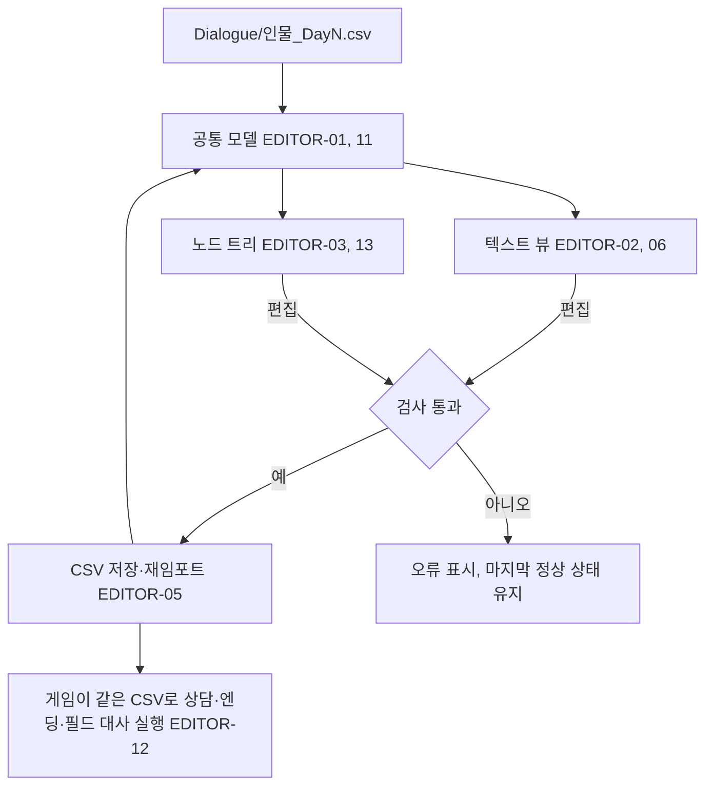

# 대사 편집기

접두어 `EDITOR` · 다음 번호 `EDITOR-39`

제작자가 한 인물·회차의 등장 대화, 상담 선택지, 결말을 CSV 하나와 두 뷰(텍스트, 노드 트리)에서 함께 편집하고 흐름을 확인한다. 엔딩 조건, 선택지 수치, 파편 문구도 같은 창에서 고친다.

## 흐름

CSV 하나가 유일한 원본이다. `section`으로 Talk·Dialogue·Ending 행을, `actor`로 말하는 인물을 나눈다. 텍스트와 트리는 같은 모델을 그리므로 어느 쪽에서 고쳐도 같은 검사와 저장을 거친다. 노드 위치와 크기 같은 화면 설정은 CSV에 쓰지 않는다.

## 진행 중

없음

## 완료

### 창과 두 뷰

- **EDITOR-01** `EyeMaze/대사 편집기`에서 인물·회차 CSV를 열면 Talk·Dialogue·Ending의 모든 열을 한 모델로 읽는다. 공용 `Strings.csv`도 따로 열 수 있다.
- **EDITOR-02** 텍스트 뷰의 SUDS식 표기와 `[eye ...]`를 고치면 대사, 순서, 연결, 메타데이터에 반영된다.
- **EDITOR-03** 노드 뷰는 Talk·Dialogue·Ending을 위에서 아래로 놓고 단계 연결과 선택지 화살표, 합류·되돌아감 선을 그린다.
- **EDITOR-04** 연결선 끝을 다른 Dialogue 노드에 놓으면 `goto`가 바뀌고, 카드를 다른 그룹이나 순서로 옮기면 CSV 소속과 행 순서가 바뀐다. 노드 위치만 옮긴 것은 저장하지 않는다.
- **EDITOR-05** 올바른 편집은 두 뷰를 갱신하고 CSV를 바로 저장·재임포트한다. 오류가 있으면 줄과 이유를 보이고 마지막 정상 상태를 유지하며 저장하지 않는다.
- **EDITOR-06** 텍스트 뷰는 라벨, 선택지, 대사, `[eye]`, `[goto]`, 오류 줄을 색으로 구분한다.
- **EDITOR-07** Tab·Shift+Tab은 그 줄의 들여쓰기를 탭 한 단계 늘리거나 줄인다.
- **EDITOR-08** 그룹이나 행을 우클릭해 선택지·대사·문구를 끝이나 그 행 뒤에 넣는다.
- **EDITOR-09** Ctrl+Z·Ctrl+Y로 그 파일의 유효한 편집을 되돌리고 다시 한다.
- **EDITOR-10** 노드 뷰에서 Ctrl+휠로 포인터 기준 확대·축소한다.
- **EDITOR-15** 두 뷰 사이 분할선을 끌어 너비를 바꾸고, 다시 열어도 비율이 남는다.
- **EDITOR-16** 그룹·엔딩 상자를 오른쪽 아래 모서리로 끌어 크기를 바꾸고, 다시 열어도 남는다.
- **EDITOR-17** 노드나 엔딩 카드를 클릭하면 선택되고 텍스트 뷰가 그 위치로 간다.
- **EDITOR-18** 그룹을 선택하고 F2로 ID를 고치면 CSV의 ID와 연결 참조가 함께 바뀐다.
- **EDITOR-19** 대사 행을 Enter나 더블 클릭으로 바로 고치면 모델, 텍스트 뷰, CSV에 함께 반영된다.

### 회차 CSV와 게임 연결

- **EDITOR-11** `Dialogue/<인물>_DayN.csv`는 `section`·`actor`·`id`로 행을 구분하고 값과 순서를 보존한다.
- **EDITOR-12** 씬의 상담(`ClientCase`)과 필드 인물(`FieldNPC`)은 연결된 회차 CSV로 상담, 엔딩, actor별 필드 대사를 실행한다.
- **EDITOR-13** 노드 뷰는 등장 Talk에서 상담 시작, 분기, 엔딩까지 이어서 보여 준다.

### 수치와 엔딩 조건

- **EDITOR-20** 선택지 아래에 0이 아닌 `trust`·`dilation` 변화가 보이고, 둘 다 0이면 "수치 변화 없음"이다. 0이 아닌 `spring`은 실행에 쓰이지 않는다고 표시한다.
- **EDITOR-21** `truth`·`leave` 엔딩 첫 행의 기준값과 열쇠 파편(`key_flag`)이 엔딩 판정에 쓰인다.
- **EDITOR-22** 엔딩으로 들어가는 선마다 실행 조건이 보인다.
- **EDITOR-23** `truth`·`half`·`leave` 조건 수치를 고치면 회차 CSV의 기준값이 바뀐다.
- **EDITOR-24** `truth`의 열쇠 파편을 고르면 `key_flag`가 바뀐다.
- **EDITOR-25** 선택지에서 바로 이어지는 엔딩 선의 조건을 고치면 그 선택지의 `need`가 바뀐다.
- **EDITOR-26** 선택지 수치 줄을 클릭해 `trust`·`dilation`·`spring`을 고치고, 형식을 검사한다.
- **EDITOR-35** 엔딩 진입선 조건을 우클릭해 `Flags.csv` 플래그를 더하거나 빼고, 새 플래그를 만들어 더한다.
- **EDITOR-37** 조건 속 수치 플래그(예: `trust_3`)를 클릭해 비교와 수치를 고친다. 그 선택지 조건만 바뀐다.
- **EDITOR-38** 선택지의 `ending_need`가 모두 켜지면 `ending`으로, 아니면 결과와 `goto`로 간다. `need`는 고를 수 있는 조건이다. 트리는 둘을 "해금"과 "엔딩 조건"으로 따로 보인다.

### 파편과 추가·삭제

- **EDITOR-27** 열린 씬에서 이 회차를 쓰는 손님의 파편을 트리 왼쪽에 보이고, `need`·`key_flag`에 쓰인 파편은 의존선을 그린다.
- **EDITOR-28** Talk 대사를 추가하거나 우클릭할 때 화자(기본, 서술, `???`, 씬 인물, 기존 화자)를 고른다.
- **EDITOR-29** 엔딩 `after` 카드를 바로 고치고, 비우면 지우며, 없으면 우클릭으로 더한다.
- **EDITOR-30** 파편 노드의 획득 문구를 바로 고치면 `Flags.csv` `text`에 저장되고 같은 Undo 기록에 들어간다.
- **EDITOR-31** 빈 곳 우클릭으로 상담 장면, Talk 대화, 엔딩 그룹을 더하고 바로 ID를 고친다.
- **EDITOR-32** 선택지 결과 줄을 더하고 지우고 고친다. 여러 줄은 `response` 한 칸에 `\n`으로 잇는다.
- **EDITOR-33** 게임에서 결과가 여러 줄인 선택지는 한 줄씩 보인 뒤 `goto`로 간다. 낮은 신뢰 leave면 그 줄들이 엔딩 앞줄이 된다.
- **EDITOR-34** 빈 곳 우클릭 `기억 파편 추가/<층>`은 `Flags.csv` 줄과 씬 파편 오브젝트를 만들고 문구 편집을 시작한다.
- **EDITOR-36** 노드를 선택하고 Delete로 지운다(그룹 전체, 결과, `after`).

---

## 자세히

### 주의

- `EDITOR-03` Dialogue의 첫 노드가 상담 시작 노드다. 순서를 바꾸면 CSV 순서도 바뀐다. Talk에서 상담으로 가는 선은 안내선일 뿐 CSV에 `goto`를 만들지 않는다. `again`, `@intro`, `@idle`, `@abyss`는 보조 카드다.
- `EDITOR-04` 연결선 끝을 노드에 놓으면 그 선택지의 `ending`을 지운다. 다른 section이나 actor로 잇거나 옮기는 것은 거절한다. 자동 뒤로가기는 CSV 행이 아니라 연결 대상이 아니다.
- `EDITOR-05` 오류만 저장을 막고 경고(켜는 곳 없는 `need` 등)는 저장한다. 텍스트는 입력이 0.75초 멈추면 검사한다. 초안에 오류가 있거나 검사 대기 중이면 트리 편집, 우클릭 추가, F2, Enter 편집을 막는다. 저장은 UTF-8 BOM, CRLF이고 내용이 같으면 다시 쓰지 않는다.
- `EDITOR-05` Dialogue 노드의 선택지는 최대 3개다. `goto`와 `ending`을 함께 쓰거나, 없는 대상을 가리키거나, 필수 ID가 비거나 겹치면 오류다.
- `EDITOR-09` Ctrl+Z는 검사 전이나 오류 초안을 먼저 마지막 정상 글로 되돌린다. 취소 뒤 새로 편집하면 다시 실행 기록이 지워진다. 파일을 바꾸면 기록이 새로 시작한다.
- `EDITOR-11` `id`는 같은 section·actor 안에서만 고유하다. `goto`는 같은 상담 actor의 Dialogue에서, `ending`은 Ending에서 찾는다. 저장은 알려진 열과 `memo`를 지키고, 주석이나 원래 서식은 지키지 않는다.
- `EDITOR-18` 예약 ID(`enter`, `reveal`, `rest`, `truth`, `half`, `leave`, `@`로 시작)와 `Strings.csv` key는 이름을 바꾸거나 지울 수 없다. 중복, 빈 값, 공백·쉼표·따옴표가 든 ID는 확정하지 않는다.
- `EDITOR-21` `truth`는 `trust >= truth_trust`이고 `key_flag` 파편을 주웠을 때, `half`는 그 반대다. `leave`는 선택 뒤 `trust <= leave_trust` 또는 들여다보는 동안 `burden >= burden_limit`이다. 선택지의 직접 엔딩은 낮은 신뢰 판정보다 먼저 실행된다.
- `EDITOR-21` `truth_trust`, `leave_trust`는 정수, `burden_limit`은 0 초과 1 이하 실수다. `key_flag`는 그 손님 파편의 Flag ID이거나 비어야 하고, 아니면 저장 오류다.
- `EDITOR-26` 트리의 부담 기준은 백분율, 동공은 `%p`로 보이지만 CSV에는 0~1 실수로 저장한다.
- `EDITOR-32` `response` 안의 빈 결과 줄은 저장 오류다. 마지막 결과 줄을 지우면 `response`를 비운다.
- `EDITOR-33` 결과 줄을 넘기는 동안 선택지 버튼을 숨기고 들여다보기와 숫자 선택을 받지 않는다. 수치 안내 문구는 마지막 줄 뒤에 붙인다.
- `EDITOR-34` 씬에 그 손님이나 파편 묶음이 없거나 Play 중이면 메뉴를 끈다. 새 Flag ID는 `<인물>_fragment_N`이고, 같은 묶음의 기존 파편을 복제한다. 씬은 변경 표시만 하고 저장하지 않는다. 씬 추가는 Unity Undo, `Flags.csv` 변경은 창 Undo다.
- `EDITOR-35` 새 조건 변수 ID는 영문 소문자, 숫자, `_`만 쓴다.
- `EDITOR-36` 그룹을 지우면 그 그룹을 가리키던 `goto`와 `ending`을 비운다. 파편 카드와 판정 카드는 지우지 않는다.
- `EDITOR-37` 대상은 `trust`, `dilation`, `spring`과 숫자의 비교 하나인 계산 플래그다. 맞는 플래그가 없으면 `trust_3`, `trust_le_m2`, `dilation_0_5` 같은 ID로 `Flags.csv`에 더한다.
- `EDITOR-38` `ending`이 없는 선택지에 `ending_need`를 쓰면 오류다. 판정은 그 선택지의 수치와 `set`을 반영한 뒤 한다.

### 하지 않는 것

- SUDS 런타임이나 임포터를 들이지 않고 `.sud`를 두 번째 원본으로 저장하지 않는다. SUDS 표기만 참고한다.
- Graph Toolkit, UI Toolkit을 쓰지 않는다. 에디터 창은 IMGUI다(uGUI 규칙의 허용된 예외).
- 노드 화면 좌표를 CSV에 저장하지 않는다. 분할 너비와 노드 크기는 `EditorPrefs`에 둔다.
- 날짜에 따른 회차 전환은 하지 않는다. Day2 이후 파일도 같은 형식으로 편집만 할 수 있다.

### 구성

- 에디터 전용 창이라 씬이나 프리팹 오브젝트를 만들지 않는다. 예외는 `EDITOR-34`의 파편 추가다.
- 씬의 `ClientCase._dialogueCsv`가 회차 CSV를 가리키고, 그 손님의 `FieldNPC._talkCsv`가 같은 파일을, `_dialogueActorId`로 자기 Talk 행을 고른다.

### 메모

- EDITOR-21, 33, 38은 편집기가 아니라 게임 실행 동작이다.
- `half`는 열 없이 `truth`의 반대로 계산한다.
