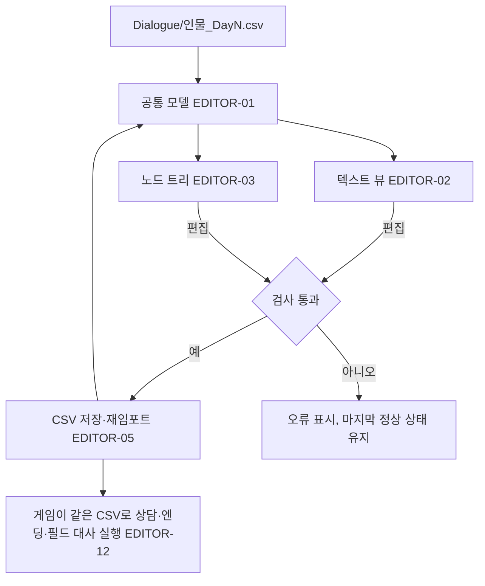

# 대사 편집기

접두어 `EDITOR` · 다음 번호 `EDITOR-39`

제작자가 한 인물·회차의 등장 대화, 상담 선택지, 결말을 CSV 하나와 두 뷰(텍스트, 노드 트리)에서 함께 편집하고 흐름을 확인한다. 엔딩 조건, 선택지 수치, 파편 문구도 같은 창에서 고친다.

## 흐름

CSV 하나가 유일한 원본이다. `section`으로 Talk·Dialogue·Ending 행을, `actor`로 말하는 인물을 나눈다. 텍스트와 트리는 같은 모델을 그리므로 어느 쪽에서 고쳐도 같은 검사와 저장을 거친다. 노드 위치와 크기 같은 화면 설정은 CSV에 쓰지 않는다.

## 진행 중

없음

## 완료

- **EDITOR-01** `EyeMaze/대사 편집기`에서 인물·회차 CSV(`Dialogue/<인물>_DayN.csv`)를 열면 `section`·`actor`·`id`로 Talk·Dialogue·Ending 행을 나눠 한 모델로 읽고, 값과 순서를 보존한다. 공용 `Strings.csv`도 따로 열 수 있다.
- **EDITOR-02** 텍스트 뷰는 SUDS식 표기와 `[eye ...]`를 쓰고, 라벨·선택지·대사·명령·오류 줄을 색으로 구분하며, Tab으로 들여쓴다.
- **EDITOR-03** 노드 트리(`DialogueEditorGraph`)는 등장 Talk에서 상담, 분기, 엔딩까지 위에서 아래로 잇고, 이 회차 손님의 파편을 왼쪽에 의존선과 함께 보인다.
- **EDITOR-04** 트리에서 연결선과 카드를 끌어 `goto`와 순서를 바꾸고, 우클릭으로 선택지·대사·그룹·`after`를 더하며, F2와 Enter로 ID·본문·화자·파편 문구를 바로 고치고, Delete로 지운다.
- **EDITOR-05** `DialogueEditorFormat.Validate`를 통과한 편집은 두 뷰를 갱신하고 CSV를 바로 저장·재임포트한다. 오류가 있으면 줄과 이유를 보이고 마지막 정상 상태를 유지한다.
- **EDITOR-09** Ctrl+Z·Ctrl+Y(`UndoEdit`, `RedoEdit`)로 그 파일의 편집을 되돌리고 다시 한다.
- **EDITOR-10** Ctrl+휠로 트리를 확대·축소하고, 분할선과 상자 크기를 끌어 바꾼다. 화면 설정은 `EditorPrefs`에 저장되어 다시 열어도 남는다.
- **EDITOR-12** 씬의 상담(`ClientCase`)과 필드 인물(`FieldNPC`)은 연결된 회차 CSV로 상담, 엔딩, actor별 필드 대사를 실행한다.
- **EDITOR-20** 선택지 아래에 `trust`·`dilation` 변화가 보이고(둘 다 0이면 "수치 변화 없음"), 클릭해 고친다.
- **EDITOR-21** `truth`·`half`·`leave` 엔딩 조건(신뢰 기준, 부담 기준, 열쇠 파편 `key_flag`)과 선택지의 직접 엔딩 조건(`need`, `ending_need`)을 트리의 진입선에 보이고 고친다. 게임은 이 값으로 엔딩을 판정한다.
- **EDITOR-32** 선택지 결과(`response`)는 `\n`으로 여러 줄을 두고, 트리에서 줄을 더하고 지운다. 게임은 결과를 한 줄씩 보인 뒤 `goto`로 간다.
- **EDITOR-34** 빈 곳 우클릭 `기억 파편 추가/<층>`은 `Flags.csv` 줄과 씬 파편 오브젝트를 만들고 문구 편집을 시작한다.

---

## 자세히

### 주의

- `EDITOR-03` Dialogue의 첫 노드가 상담 시작 노드다. 순서를 바꾸면 CSV 순서도 바뀐다. Talk에서 상담으로 가는 선은 안내선일 뿐 CSV에 `goto`를 만들지 않는다. `again`, `@intro`, `@idle`, `@abyss`는 보조 카드다.
- `EDITOR-04` 연결선 끝을 노드에 놓으면 그 선택지의 `ending`을 지운다. 다른 section이나 actor로 잇거나 옮기는 것은 거절한다. 자동 뒤로가기는 CSV 행이 아니라 연결 대상이 아니다.
- `EDITOR-05` 오류만 저장을 막고 경고(켜는 곳 없는 `need` 등)는 저장한다. 텍스트는 입력이 0.75초 멈추면 검사한다. 초안에 오류가 있거나 검사 대기 중이면 트리 편집, 우클릭 추가, F2, Enter 편집을 막는다. 저장은 UTF-8 BOM, CRLF이고 내용이 같으면 다시 쓰지 않는다.
- `EDITOR-05` Dialogue 노드의 선택지는 최대 3개다. `goto`와 `ending`을 함께 쓰거나, 없는 대상을 가리키거나, 필수 ID가 비거나 겹치면 오류다.
- `EDITOR-09` Ctrl+Z는 검사 전이나 오류 초안을 먼저 마지막 정상 글로 되돌린다. 취소 뒤 새로 편집하면 다시 실행 기록이 지워진다. 파일을 바꾸면 기록이 새로 시작한다.
- `EDITOR-01` `id`는 같은 section·actor 안에서만 고유하다. `goto`는 같은 상담 actor의 Dialogue에서, `ending`은 Ending에서 찾는다. 저장은 알려진 열과 `memo`를 지키고, 주석이나 원래 서식은 지키지 않는다.
- `EDITOR-04` 예약 ID(`enter`, `reveal`, `rest`, `truth`, `half`, `leave`, `@`로 시작)와 `Strings.csv` key는 이름을 바꾸거나 지울 수 없다. 중복, 빈 값, 공백·쉼표·따옴표가 든 ID는 확정하지 않는다.
- `EDITOR-21` `truth`는 `trust >= truth_trust`이고 `key_flag` 파편을 주웠을 때, `half`는 그 반대다. `leave`는 선택 뒤 `trust <= leave_trust` 또는 들여다보는 동안 `burden >= burden_limit`이다. 선택지의 직접 엔딩은 낮은 신뢰 판정보다 먼저 실행된다.
- `EDITOR-21` `truth_trust`, `leave_trust`는 정수, `burden_limit`은 0 초과 1 이하 실수다. `key_flag`는 그 손님 파편의 Flag ID이거나 비어야 하고, 아니면 저장 오류다.
- `EDITOR-20` 트리의 부담 기준은 백분율, 동공은 `%p`로 보이지만 CSV에는 0~1 실수로 저장한다.
- `EDITOR-32` `response` 안의 빈 결과 줄은 저장 오류다. 마지막 결과 줄을 지우면 `response`를 비운다.
- `EDITOR-32` 결과 줄을 넘기는 동안 선택지 버튼을 숨기고 들여다보기와 숫자 선택을 받지 않는다. 수치 안내 문구는 마지막 줄 뒤에 붙인다.
- `EDITOR-34` 씬에 그 손님이나 파편 묶음이 없거나 Play 중이면 메뉴를 끈다. 새 Flag ID는 `<인물>_fragment_N`이고, 같은 묶음의 기존 파편을 복제한다. 씬은 변경 표시만 하고 저장하지 않는다. 씬 추가는 Unity Undo, `Flags.csv` 변경은 창 Undo다.
- `EDITOR-21` 새 조건 변수 ID는 영문 소문자, 숫자, `_`만 쓴다.
- `EDITOR-04` 그룹을 지우면 그 그룹을 가리키던 `goto`와 `ending`을 비운다. 파편 카드와 판정 카드는 지우지 않는다.
- `EDITOR-21` 대상은 `trust`, `dilation`, `spring`과 숫자의 비교 하나인 계산 플래그다. 맞는 플래그가 없으면 `trust_3`, `trust_le_m2`, `dilation_0_5` 같은 ID로 `Flags.csv`에 더한다.
- `EDITOR-21` `ending`이 없는 선택지에 `ending_need`를 쓰면 오류다. 판정은 그 선택지의 수치와 `set`을 반영한 뒤 한다.

### 하지 않는 것

- SUDS 런타임이나 임포터를 들이지 않고 `.sud`를 두 번째 원본으로 저장하지 않는다. SUDS 표기만 참고한다.
- Graph Toolkit, UI Toolkit을 쓰지 않는다. 에디터 창은 IMGUI다(uGUI 규칙의 허용된 예외).
- 노드 화면 좌표를 CSV에 저장하지 않는다. 분할 너비와 노드 크기는 `EditorPrefs`에 둔다.
- 날짜에 따른 회차 전환은 하지 않는다. Day2 이후 파일도 같은 형식으로 편집만 할 수 있다.

### 구성

- 에디터 전용 창이라 씬이나 프리팹 오브젝트를 만들지 않는다. 예외는 `EDITOR-34`의 파편 추가다.
- 씬의 `ClientCase._dialogueCsv`가 회차 CSV를 가리키고, 그 손님의 `FieldNPC._talkCsv`가 같은 파일을, `_dialogueActorId`로 자기 Talk 행을 고른다.

### 메모

- EDITOR-21, EDITOR-32, 38은 편집기가 아니라 게임 실행 동작이다.
- `half`는 열 없이 `truth`의 반대로 계산한다.
