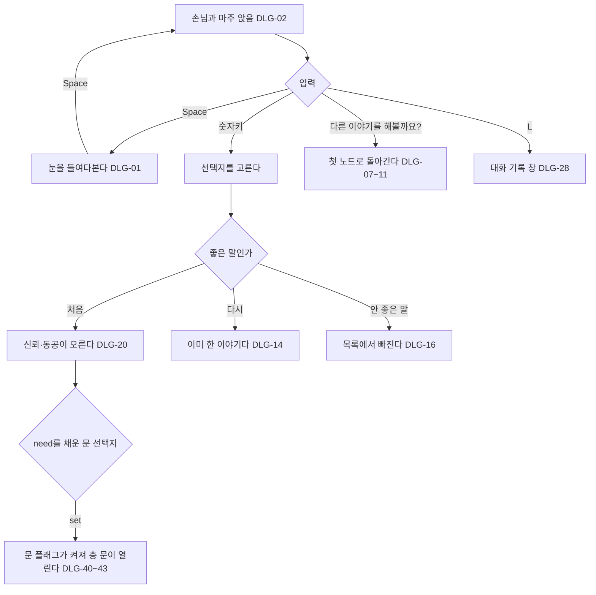

# 대화

접두어 `DLG` · 다음 번호 `DLG-45`

손님과 마주 앉아 선택지로 이야기하고, 눈을 들여다보고, 처음 이야기로 돌아가고, 지난 대화를 다시 읽는다. 선택지로 신뢰를 얻거나 단서를 모아 눈 속 층 문을 연다.

## 흐름

선택지는 신뢰와 동공을 바꾸고, 대화 CSV의 `need`·`set` 칸으로 플래그를 읽고 켠다. 문 플래그가 있는 인물의 층 문은 신뢰가 아니라 플래그로만 열린다. 대화 기록은 대사가 화면에 나가는 곳에서 직접 남기고, 기록 창이 열리면 게임 시간이 멈춘다. 컷신 빨리감기는 시작 독백과 필드 컷신에서만 Ctrl로 쓴다.

## 진행 중

없음

## 완료

### 들여다보기와 만남 시작

- **DLG-01** 대화 중 Space(패드 A)를 누르면 바로 눈을 들여다본다. 입력을 받기 시작한 첫 프레임의 누름은 무시한다.
- **DLG-02** 처음 만나면 `_firstGuide`, 다시 만나면 `_againGuide`를 보여 준다.
- **DLG-03** 선택지는 신뢰와 동공만 바꾼다. 좋은 말은 신뢰나 동공이 오르는 선택지다.

### 처음 이야기로 돌아가기

- **DLG-07** 첫 노드가 아니고 뒤로가기가 없는 장면에서는 보이는 선택지 바로 다음 번호에 "다른 이야기를 해볼까요?"가 보인다. 첫 노드, 들여다보는 중, 엔딩 중에는 숨긴다.
- **DLG-08** 그 번호 키나 버튼을 누르면 처음 이야기로 돌아간다.
- **DLG-09** 돌아가면 대화가 첫 노드로 간다.
- **DLG-10** 돌아가도 신뢰, 동공, 주운 파편, 층 회전, "이미 한 이야기다" 기록은 그대로다.
- **DLG-11** 돌아가면 `_returnMessage` 문구를 보여 준다.
- **DLG-12** 대화 중 하단 안내는 "Space = 마음 읽기 · 숫자키 대화 · Q 잠시 휴식하기"다.
- **DLG-13** 디렉터 인스펙터에도 같은 조건에서 "다른 이야기를 해볼까요?" 버튼이 보이고, Undo할 수 있다.

### 고른 말의 처리

- **DLG-14** 이미 한 좋은 말을 다시 고르면 수치를 바꾸지 않고 "이미 한 이야기다."를 보이며, 다음 노드로 가는 선택지면 넘어간다.
- **DLG-15** 안 좋은 말(신뢰나 동공이 내려가고 오르는 값이 없는 말)은 결과를 적용하고 고른 것으로 기록한다.
- **DLG-16** 고른 안 좋은 말과, 고른 적 있고 수치만 바꾸는 좋은 말은 목록에서 빠지고 번호가 당겨진다.
- **DLG-17** 숫자키와 버튼은 화면에 보이는 번호의 선택지를 고른다.
- **DLG-18** 안 좋은 말 기록은 뒤로가기, 처음으로 돌아가기, Q에도 남고 리셋에서만 지워진다.
- **DLG-19** 선택지가 빠져도 "다른 이야기를 해볼까요?" 표시 조건은 바뀌지 않는다.

### 신뢰와 층 문

- **DLG-20** 신뢰가 오르는 선택지를 처음 고르면 그 값이 얻은 신뢰에 더해진다.
- **DLG-21** 문 플래그가 없는 문은 얻은 신뢰와 기본 신뢰 중 큰 값으로 통과를 판단한다.
- **DLG-22** 신뢰가 오르면 `msg.trust_up_no_gate`, 지나갈 수 있는 문이 늘면 `msg.gate_open`을 결과에 붙인다.
- **DLG-23** 리셋하면 얻은 신뢰를 0으로 되돌린다.

### 대화 기록

- **DLG-24** 대화 기록은 최대 개수를 넘으면 오래된 줄부터 지운다. 빈 줄은 남기지 않는다. 손님이 바뀌거나 리셋해도 Play가 끝날 때까지 남는다.
- **DLG-25** 필드 대사창에 나온 줄을 말한 사람과 함께 기록한다. 말한 사람이 없으면 서술이다.
- **DLG-26** 만남에서는 새 장면의 상황 문구(서술), 고른 선택지(플레이어 말), 손님 반응을 기록한다. 수치 변화 문구는 남기지 않는다.
- **DLG-27** 엔딩 대사를 서술로 기록한다.
- **DLG-28** L 또는 패드 Select로 기록 창을 열고 닫는다. Esc나 패드 B로도 닫는다. 시작 독백 중에는 열지 않는다.
- **DLG-29** 기록 창이 열린 동안 게임 시간이 멈추고 다른 입력을 받지 않는다.
- **DLG-30** 창을 열면 맨 아래(최근)로 간다. 플레이어 말은 오른쪽 말풍선, 상대 말은 왼쪽에 얼굴·이름과 말풍선, 서술은 가운데 글이다. W/S, ↑/↓, 왼쪽 스틱, 휠, 스크롤바로 스크롤한다.
- **DLG-31** 기록 창은 `DialogueLogCanvas` 프리팹이고 씬 최상위에 있다.

### 컷신 빨리감기

- **DLG-32** 시작 독백과 필드 컷신 중에만 빨리감기를 쓸 수 있다.
- **DLG-33** Ctrl을 누르고 있는 동안 배속으로 진행하고, 떼거나 구간이 끝나면 돌아온다.
- **DLG-34** 빨리감기 중에는 찍히는 글을 바로 끝까지 보여 준다.
- **DLG-35** 빨리감기 중 줄이 다 보이고 잠시 지나면 자동으로 넘긴다.
- **DLG-36** 빨리감기 중 독백의 줄 간격과 암전 해제도 빨라진다.
- **DLG-37** 컷신 중 필드 안내에 빨리감기 안내가 함께 보인다. 대사창이 있으면 "Space 다음 · Ctrl 빨리감기", 없으면 "Ctrl 빨리감기"다.
- **DLG-38** 빨리감기 중 흰색·회색 가로줄이 오른쪽에서 왼쪽으로 지나가는 오버레이가 보이고, 끝나면 사라진다.
- **DLG-39** 빨리감기 중 화면 가운데 `▶▶`가 깜빡인다.

### 선택지로 여는 층 문

- **DLG-40** 문 플래그가 있는 문은 신뢰를 보지 않고 그 플래그가 켜져야 통과한다. 동공 조건이 함께 있으면 둘 다 채워야 한다.
- **DLG-41** 손님을 불러오면 그 인물의 문 플래그 목록이 층 문에 차례로 들어간다. 자리가 비면 그 층은 신뢰 조건을 쓴다.
- **DLG-42** 문을 여는 선택지는 그 층의 파편 플래그를 모두 `need`에 적어, 다 모아야 고를 수 있다. (데이터)
- **DLG-43** 문을 여는 선택지는 `set`으로 문 플래그를 켠다. (데이터)
- **DLG-44** 인물별 문 선택지는 다음과 같다. (데이터)

  | 인물 | 문 | 문 플래그 | `need` | 여는 선택지 |
  |---|---|---|---|---|
  | 지수 | 0→1층 | `jisu_gate_1` | `jisu_messenger_0312`, `jisu_elevator_mirror` | `smile` "대답이 빠른 편이시네요…" |
  | 지수 | 1→2층 | `jisu_gate_2` | `jisu_resignation`, `jisu_autopay_25` | `work` "떠나고 싶은 마음이랑 붙잡는 마음이…" |
  | 은재 | 0→1층 | `eunjae_gate_1` | `eunjae_piano_hands`, `eunjae_closed_piano` | `window` "쇼팽 녹턴 20번…" |
  | 은재 | 1→2층 | `eunjae_gate_2` | `eunjae_red_button`, `eunjae_voicemail`, `eunjae_phone_flipped` | `red_eyes` "그날 일, 다들 아는 이야기랑…" |

---

## 자세히

### 주의

- `DLG-01` 필드에서 만남으로 넘어오는 프레임에 Space가 눌려 있어도 들여다보지 않는다. 들여다보는 중 Space는 시선을 거두고, 거둔 프레임에 다시 들어가지 않는다. 심연과 엔딩 중에는 거둘 수 없다.
- `DLG-07` 뒤로가기가 있는 장면에서는 보이지 않고, 뒤로가기를 끈 장면(`back` 칸 `-`)에서는 보인다. 들여다보는 중, 첫 노드, 엔딩 중에는 그 번호 키가 아무 일도 하지 않는다. 뒤로가기까지 합쳐 선택지가 4개인 장면은 키 4가 네 번째 선택지다.
- `DLG-09` 손님이 바뀌면 그 손님 대화의 첫 노드로 돌아간다.
- `DLG-15` 안 좋은 말의 감점은 leave 엔딩과 진엔딩 판정에 그대로 들어가고, 문 판정에만 쓰이지 않는다.
- `DLG-16` 흐름에 필요한 좋은 말(`goto`, `ending`, `set`, `rest`, `emotion` 중 하나라도 있음)은 고른 뒤에도 남는다. 선택지가 모두 빠지면 뒤로가기와 "다른 이야기를 해볼까요?"만 남고, 시작 장면이면 들여다보기와 Q만 남는다.
- `DLG-21` 문 플래그가 없는 인물만 신뢰로 문을 연다. 플래그가 있으면 신뢰가 높아도 닫혀 있고, 낮아도 플래그만 켜지면 열린다.
- `DLG-24` 같은 사람의 같은 대사가 바로 앞 기록과 같으면 더하지 않는다. 에디트 모드에서는 기록하지 않는다. 보관 수는 프리팹의 줄 칸 수(100)와 같다.
- `DLG-29` 창을 닫은 프레임에도 `DialogueLog.BlocksInput`이 참이라, 패드 B(만남에서 자리 떠나기)가 게임으로 새지 않는다. 창이 열린 채 Play가 끝나면 시간 배율을 되돌린다. 타자 효과는 실제 시간으로 돌아 창 뒤에서도 계속 찍힌다.
- `DLG-32` 구간이 끝나면(예: 혼잣말 B를 넘겨 문 대기가 됨) 같은 프레임에 배속을 1로 되돌리고, 문 상호작용을 대신 하지 않는다.
- `DLG-33` 컴포넌트가 꺼지거나 파괴되면 배속을 1로 되돌린다. 대화 기록 창이 열려 있으면 빨리감기는 아무것도 하지 않는다. 키는 넘기기·기록·이동 키와 겹치지 않는 Left Ctrl이다.
- `DLG-35` 줄을 넘기거나 대사창이 닫히면 자동 넘김 시간을 처음부터 다시 센다. 대사창 없이 이동만 진행 중이면 배속만 적용한다.
- `DLG-41` 문 플래그는 미로를 새로 만들기 전에 넘긴다. 깜빡임으로 문이 새로 생겨도 같은 플래그를 받아 연 문은 열린 채다. 리셋하면 플래그가 지워져 다시 닫힌다.
- `DLG-43` 문을 여는 선택지를 다시 골라도 `DLG-14`대로 반응이 반복되지 않는다.

### 하지 않는 것

- "다른 이야기를 해볼까요?"를 노드마다 선택지로 넣지 않는다. 같은 데이터를 반복하고 선택지 칸이 모자란다. 디렉터가 따로 처리한다.
- 신뢰 기준값을 올려 문을 덜 열리게 하지 않는다. 단서를 다 모으면 문이 저절로 열리게 하지도 않는다. 문은 대화의 결과로 열린다.
- 대화 기록 전체를 `Text` 하나에 넣지 않는다. 줄마다 정렬을 나눌 수 없다.
- 기록 줄 칸을 실행 중에 만들지 않는다. 프리팹에 미리 둔다. 매 프레임 화면 글을 비교해 기록하지도 않는다.
- 기록 창을 기존 `UI (Canvas)` 아래에 두지 않는다. 별도 Canvas를 쓴다.
- 빨리감기에서 단계별 시간을 줄이거나 목표 단계로 건너뛰지 않는다. 기존 흐름을 배속으로 돌린다.
- 빨리감기 가로줄을 Image 여러 개로 옮기지 않는다. 셰이더 하나로 그린다.

### 구성

- "다른 이야기를 해볼까요?"는 `선택지 3`을 복제한 `선택지 4` 버튼이다.
- 대화 기록 창은 별도 Canvas 프리팹 `DialogueLogCanvas`이고 씬 최상위에 있다. 루트는 항상 켜져 있고 `창`만 켜고 끈다. 줄 칸 100개를 `_rows`에 연결한다. 글은 Galmuri11 uGUI `Text`다.
- 빨리감기: `GameFlow` 오브젝트에 `CutsceneFastForward`, `UI (Canvas)`의 마지막 자식으로 `빨리감기 연출`(`CanvasGroup`, `FastForwardOverlay`) 아래 `가로줄`(`RawImage`, `FastForwardLines.mat`)과 `빨리감기 표시`(`▶▶`)가 있다. 시작 독백 화면보다 위에 그려진다.
- 가로줄 셰이더 시간은 실제 시간으로 넘겨 배속과 관계없이 일정하다.
