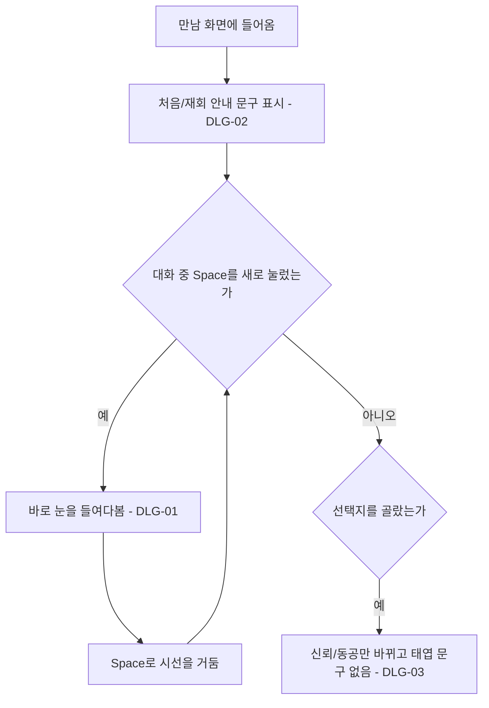
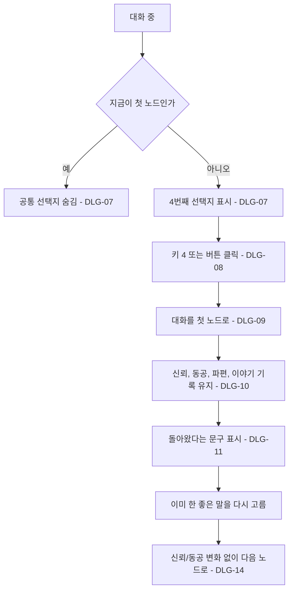
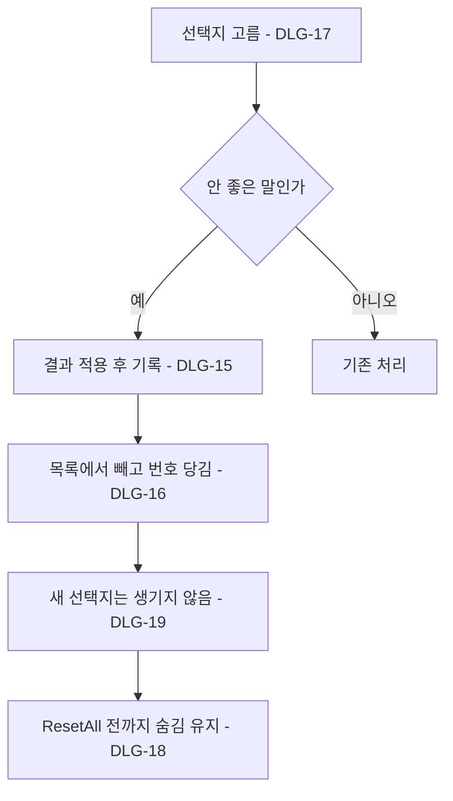
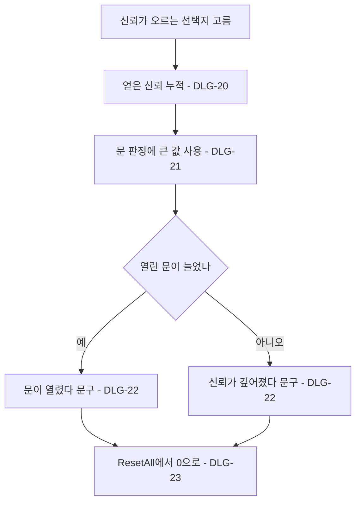
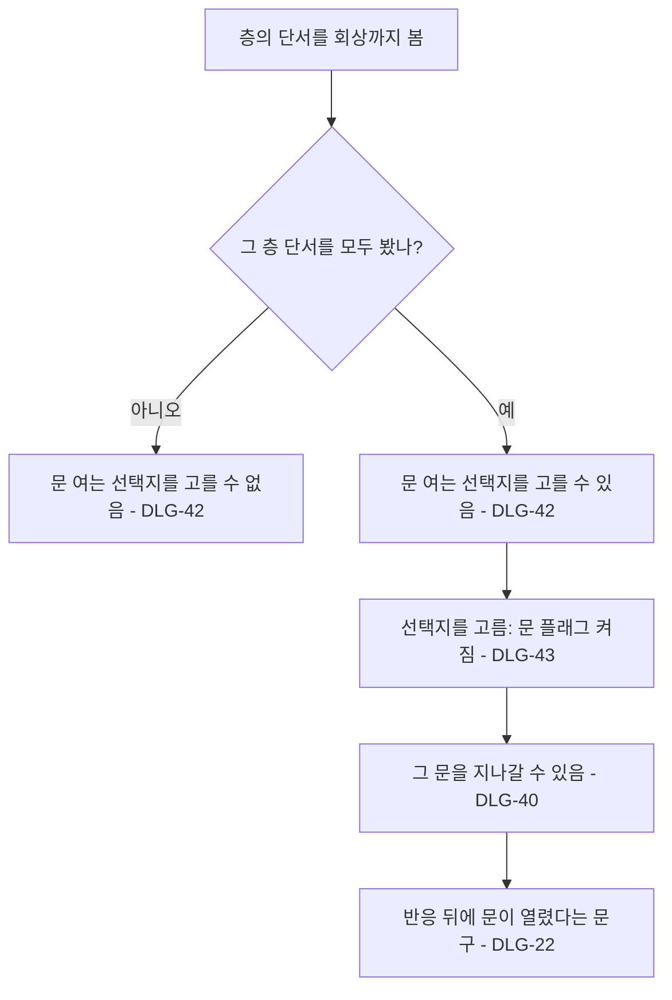
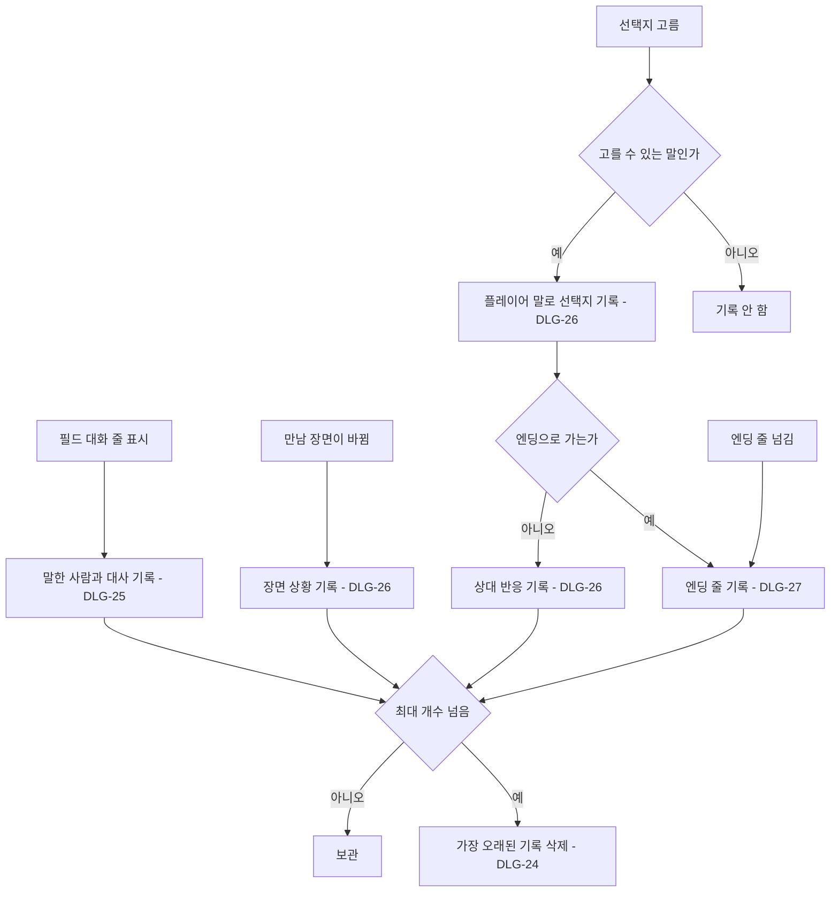
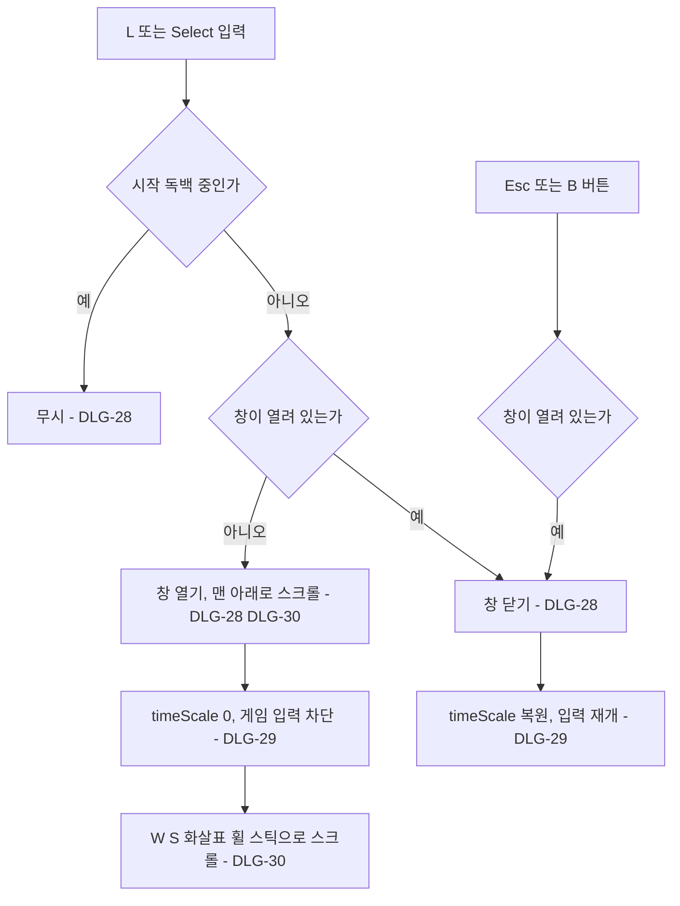
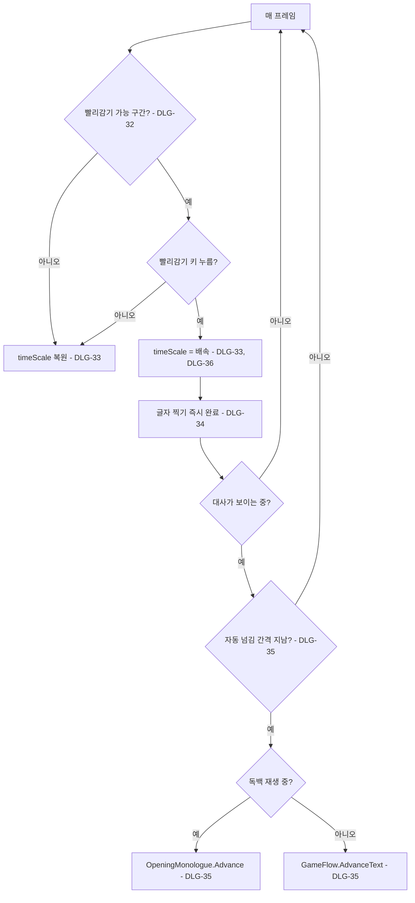
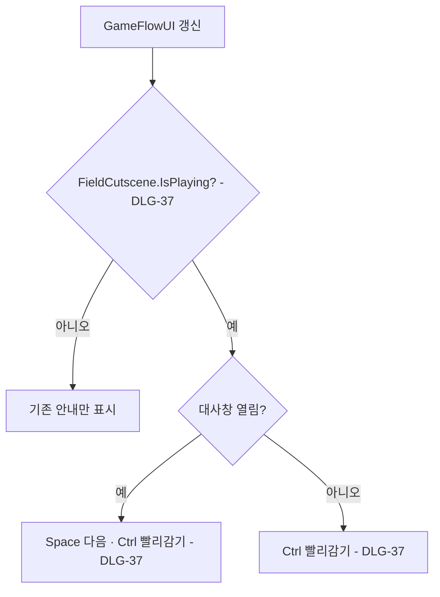
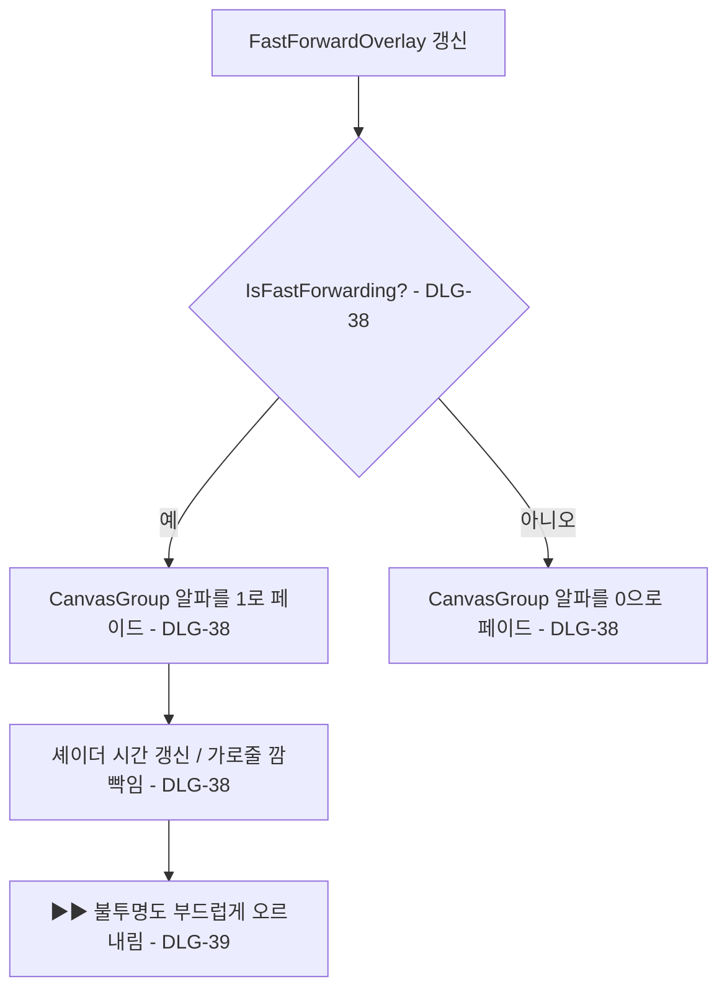

# 대화

## 1. 목적

만남에서 플레이어는 Space로 내담자의 눈을 들여다보고 숫자키로 말을 골라 대화를 이어 간다. 언제든 첫 이야기로 돌아갈 수 있고, 한 번 고른 안 좋은 말은 다시 보이지 않으며, 층 사이 문은 그 층의 단서를 모두 본 뒤 고르는 정해진 선택지로만 열린다. 지나간 대사는 대화 기록 창에서 다시 읽을 수 있고, 조작 없는 컷신과 대사 구간은 키를 누르는 동안 빨리 감을 수 있다.

### 범위

- 포함:
  - 대화 중 Space 들여다보기와 만남 안내 문구 (`EyeMazeDirector`)
  - 신뢰·동공·반응·엔딩만 갖는 선택지와 태엽 언급이 없는 화면 문구, 툴팁, 주석, 인스펙터 표시
  - 첫 노드가 아닐 때 보이는 공통 선택지 `다른 이야기를 해볼까요?`와 키·버튼 선택, 만남 UI의 4번째 선택지 버튼과 선택지 버튼 4개 배치, 디렉터 인스펙터의 같은 버튼, 대화 안내 문구
  - 한 번 고른 안 좋은 말을 선택지 목록에서 빼기, 안 좋은 말의 감점이 문을 막지 않게 하기
  - 층 사이 문을 플래그로 여는 조건, 인물별로 문마다 여는 플래그 설정, 문을 여는 선택지의 `need`(그 층 단서 전부)와 `set`(문 플래그) 데이터, 선택지 반응 뒤 신뢰 안내와 문 안내 문구의 분리
  - 필드 글 상자에 나온 대사(말한 사람 + 대사), 만남 대화의 장면 상황 문구·고른 선택지·상대 반응, 엔딩 마음의 소리 대사 기록
  - L 키, 게임패드 Select(View) 버튼으로 여닫는 대화 기록 창. 메신저처럼 플레이어가 고른 말은 오른쪽, 상대의 말은 왼쪽 말풍선, 상대 말 왼쪽에 말한 사람 얼굴(초상화), 목록 오른쪽 세로 스크롤바, 창이 열린 동안 게임 일시정지와 입력 차단
  - 대화 기록 전용 Canvas 프리팹 `DialogueLogCanvas`와 그 인스턴스를 `EyeMaze` 씬에 배치
  - 컷신 빨리감기 구간: 시작 독백부터 문 앞 혼잣말 B가 닫힐 때까지(`OpeningMonologue` 재생, `FieldCutscene`의 `CallFirst`, `CallTalking`), 문 상호작용 직후부터 은재 착석 뒤 서술이 끝날 때까지(`FieldCutscene`의 `Arrive`부터 `Reveal`까지), 상담이 끝난 뒤 앞 손님 퇴장부터 다음 손님 착석·첫마디까지(`FieldCutscene`의 `ClientOut`부터 `ClientGreet`까지)
  - 위 구간에서의 연출 시간 배속, 글자 찍기 즉시 완료, 대사 자동 넘김, 필드 컷신 중 조작 안내 자리의 빨리감기 안내, 빨리감기 중 화면 전체를 지나가는 흰색·회색 가로줄과 화면 가운데의 큰 `▶▶` 표시
- 제외:
  - 신뢰, 동공, 깜빡임 동작 변경과 만남 UI의 다른 칸 배치 변경, 태엽과 상관없는 대사 수정
  - 좋은 말을 선택지 목록에서 빼기(신뢰와 동공만 바꾸는 좋은 말은 DLG-16에 따라 뺀다)
  - 고른 기록을 디스크에 저장하기
  - 신뢰, 동공, 파편, 층 회전, `이미 한 이야기다` 기록 되돌리기
  - 한 단계씩 이전 노드로 돌아가기
  - 게임패드로 선택지 고르기 (1~3번 선택지에도 패드 입력이 없다)
  - 동공 입구(가장 안쪽 문)의 조건. 동공 열림으로 연다.
  - 신뢰 수치의 계산과 엔딩 판정(`truth_trust`, `leave_trust`)
  - 선택지 문장 수정
  - 시작 독백 기록, 만남 중 시스템 문구 기록(들여다보기, 깊은 층 진입, 파편, 깜빡임, 잠긴 선택지, 이미 한 이야기 등)
  - 대화 기록의 파일 저장, 다음 플레이로 이어지는 기록, 기록에서 대사 다시 듣기, 특정 지점으로 되돌아가기
  - 문 상호작용을 기다리는 구간(`WaitDoor`). 플레이어가 직접 문을 열어야 한다.
  - 상담(눈 속 미로, `GameFlow.State.Encounter`)과 줌 인·줌 아웃 구간의 빨리감기
  - 플레이어가 직접 말을 걸어 연 필드 대화의 빨리감기
  - 한 번 눌러 목표 지점으로 바로 건너뛰는 기능
  - 시작 독백 화면의 빨리감기 안내 표시

### 선택하지 않은 방식

- 태엽 시스템을 담당하던 `WindingIntro`를 이름만 바꿔 남기는 방식은 남는 역할이 입력 한 줄과 문구 두 개뿐이라 쓰지 않는다.
- 공통 선택지를 노드마다 선택지 하나씩 추가하는 방식은 노드가 늘 때마다 같은 데이터를 반복해서 넣어야 하고, 선택지 칸(1~3번)을 이미 다 쓰고 있어서 쓰지 않는다.
- 신뢰 기준값을 올려 문이 덜 열리게 하는 방식은 쓰지 않는다(여전히 무관한 선택지가 문을 연다). 단서를 모두 모으면 선택지 없이 문이 저절로 열리는 방식은 쓰지 않는다(문은 대화의 결과로 열려야 한다).
- 대화 기록 전체를 `Text` 하나에 넣는 방식은 줄마다 왼쪽, 오른쪽 정렬을 나눌 수 없어 쓰지 않는다.
- 대화 기록 줄 칸을 런타임에 `Instantiate`로 늘리는 방식은 UI를 코드로 만들지 않는 규칙 때문에 쓰지 않는다. 칸은 프리팹에 미리 둔다.
- `TextMeshPro`는 기존 UI가 모두 uGUI `Text`이므로 쓰지 않는다.
- 대화 기록 창을 기존 `UI (Canvas)` 아래에 넣는 방식은 쓰지 않는다. 기존 Canvas에는 `PixelCamera`, `GameFlowUI`, `EyeMazeUI`가 붙어 있어 독립적으로 편집하기 어렵다. 대화 기록은 별도 Canvas를 쓴다.
- UI 오브젝트를 런타임 코드(`new GameObject`, `AddComponent`)로 만드는 방식은 쓰지 않는다. 창은 프리팹 애셋으로 저장하고, 스크립트는 `[SerializeField]`로 참조만 한다. 빨리감기 연출도 씬에 저장된 오브젝트를 참조만 한다.
- 대화 기록에서 매 프레임 화면 글을 비교하는 방식은 쓰지 않는다. 대사가 화면에 나가는 메서드에서 직접 기록한다.
- 빨리감기에서 각 단계의 시간을 직접 줄이는 방식은 쓰지 않는다. 기존 `FieldCutscene` 흐름을 그대로 빠르게 돌린다.
- 빨리감기에서 목표 단계로 상태를 직접 점프시키는 방식은 쓰지 않는다.
- 빨리감기 가로줄 Image를 여러 개 두고 코드로 옮기는 방식은 쓰지 않는다. 오브젝트가 많아지고 모양이 단조롭다.

## 2. 요구사항

### 들여다보기와 만남 시작

- **DLG-01** `[구현완료]` 대화 중 Space(패드 A)를 누를 때 `EyeMazeDirector`는 바로 눈을 들여다본다. 입력을 받기 시작한 첫 프레임의 누름은 무시한다.
- **DLG-02** `[구현완료]` 만남을 시작할 때 `EyeMazeDirector`는 처음 만나면 `_firstGuide`, 다시 만나면 `_againGuide`를 문구로 보여 준다.
- **DLG-03** `[구현완료]` 대화 선택지를 고를 때 `EyeMazeDirector`는 신뢰와 동공만 바꾸고, 태엽 결과 문구를 붙이지 않는다. 좋은 말 판정은 신뢰 또는 동공이 오르는 선택지로 한다.
- **DLG-04** `[구현완료]` 플레이어에게 보이는 문구는 태엽을 언급하지 않는다. 바뀐 문구는 다음과 같다.
  - `시선을 거뒀다. 남은 태엽은 그대로다.` → `관찰을 잠시 멈추고 생각에 잠긴다.`
  - `{Name}의 눈을 들여다본다. 태엽이 풀리는 동안만 볼 수 있다.` → `{Name}의 눈을 들여다본다.`
  - `시선이 파편에 머문다. 태엽이 잠시 멈췄다.` → `시선이 파편에 머문다.`
  - `Space / Z  계속 (읽는 동안 태엽이 멈춤)` → `Space / Z  계속`
- **DLG-05** `[구현완료]` 스크립트의 툴팁, 주석, 인스펙터 표시와 버튼은 태엽을 언급하지 않는다. (`태엽 가득` 버튼, 상태 줄의 태엽 수치, 도움말 문장 삭제)
- **DLG-06** `[구현완료]` `EyeMaze` 씬의 `EyeVisual`과 `IrisMaze`는 초점(`_focus`) 1로 저장되어, 초점을 조절하는 코드 없이도 눈과 미로가 선명하게 보인다. 초점 값과 흐림 표현은 나중 연출을 위해 남긴다.

### 처음 이야기로 돌아가기

- **DLG-07** `[구현완료]` 대화 중이고 지금 노드가 첫 노드가 아니며 그 장면에 뒤로가기가 없을 때 `EyeMazeUI`는 보이는 선택지 바로 다음 번호와 자리에 `다른 이야기를 해볼까요?`를 보여 준다. 마지막 노드를 지나 다른 선택지가 없을 때도 보여 준다. 첫 노드, 들여다보는 중, 엔딩 중에는 숨긴다.
- **DLG-08** `[구현완료]` 공통 선택지가 보일 때 그 번호의 숫자키를 누르거나 버튼을 누르면 `EyeMazeDirector.ReturnToStart()`가 실행된다.
- **DLG-09** `[구현완료]` `ReturnToStart()`가 실행될 때 `EyeMazeDirector`는 대화를 첫 노드로 되돌린다.
- **DLG-10** `[구현완료]` `ReturnToStart()`는 신뢰, 동공, 주운 파편, 층 회전, `이미 한 이야기다` 기록을 바꾸지 않는다.
- **DLG-11** `[구현완료]` `ReturnToStart()`가 실행될 때 `EyeMazeDirector`는 문구를 `_returnMessage`로 바꾼다.
- **DLG-12** `[구현완료]` 대화 중 화면 안내는 `Space = 마음 읽기   ·   숫자키 대화   ·   Q 잠시 휴식하기`로 표시한다.
- **DLG-13** `[구현완료]` 디렉터 인스펙터는 공통 선택지가 보일 조건에서 보이는 선택지 다음 번호의 `다른 이야기를 해볼까요?` 버튼을 보여 주고, 누르면 `ReturnToStart()`를 Undo 가능한 조작으로 실행한다.

### 고른 말의 처리

- **DLG-14** `[구현완료]` 이미 한 좋은 말(신뢰 또는 동공이 오르는 선택지)을 다시 고를 때 `EyeMazeDirector`는 신뢰와 동공을 바꾸지 않고 `이미 한 이야기다.` 문구를 보여 주며, 그 선택지가 `Advance`면 다음 노드로 넘어간다. 첫 노드로 돌아온 뒤에도 대화를 다시 진행할 수 있게 하기 위해서다.
- **DLG-15** `[구현완료]` 안 좋은 말(신뢰 또는 동공이 내려가고 오르는 값이 없는 선택지)을 고를 때 `EyeMazeDirector`는 평소처럼 결과를 적용하고 그 선택지를 고른 것으로 기록한다.
- **DLG-16** `[구현완료]` 고른 기록이 있는 안 좋은 말과, 고른 기록이 있고 신뢰와 동공만 바꾸는 좋은 말(`goto`, `ending`, `set`, `rest`, `emotion`이 모두 빈 선택지)을 `EyeMazeDirector.CurrentChoices()`는 목록에서 빼고, 남은 선택지의 번호를 앞으로 당긴다.
- **DLG-17** `[구현완료]` 숫자키나 버튼으로 선택지를 고를 때 `EyeMazeDirector.ChooseOption()`은 화면에 보이는 번호의 선택지를 고른다.
- **DLG-18** `[구현완료]` 안 좋은 말의 기록은 뒤로가기, `ReturnToStart()`, Q로 자리를 떠났다 돌아옴에도 유지되고, `ResetAll()`에서만 지워진다.
- **DLG-19** `[구현완료]` 안 좋은 말을 숨겨 선택지 수가 줄어들 때 `EyeMazeDirector.CanReturnToStart`의 결과는 바뀌지 않는다.

### 신뢰와 층 문

- **DLG-20** `[구현완료]` 신뢰가 오르는 선택지를 처음 고를 때 `EyeMazeDirector`는 오른 값을 `Person.EarnedTrust`에 더한다.
- **DLG-21** `[구현완료]` 문을 지나갈 수 있는지 판단할 때 `MazeGate`는 `Person.EarnedTrust`와 `Person.Trust` 중 큰 값을 기준으로 삼는다. 문 플래그가 적힌 문은 DLG-40에 따라 신뢰를 보지 않고 플래그로만 판단한다.
- **DLG-22** `[승인]` 선택지를 고른 뒤 `EyeMazeDirector`는 신뢰가 올랐으면 `msg.trust_up_no_gate`(`(신뢰가 깊어졌다.)`)를 붙이고, 그와 별개로 지나갈 수 있는 문 수가 늘었으면 `msg.gate_open`(`(눈 속 어딘가의 문이 열렸다.)`)을 붙인다.
- **DLG-23** `[구현완료]` `ResetAll()`이 호출될 때 `EyeMazeDirector`는 `Person.EarnedTrust`를 0으로 되돌린다.

### 대화 기록

- **DLG-24** `[구현완료]` `DialogueLog.Add(speaker, text, isPlayer, portrait)`가 불릴 때 `DialogueLog`는 기록 끝에 한 줄을 더하고, 개수가 `MaxEntries`를 넘으면 가장 오래된 줄부터 지운다. text가 비어 있으면 더하지 않는다. 기록은 Play Mode가 끝날 때까지 손님이 바뀌거나 R로 리셋해도 남는다.
- **DLG-25** `[구현완료]` 필드 글 상자에 대사 한 줄이 나올 때(`ShowConversation`의 첫 줄, `AdvanceText`로 넘긴 줄. 모두 `ShowConvLine`을 거친다) `GameFlow`는 그 줄의 말한 사람과 대사를 기록한다. 말한 사람이 없으면 서술로 기록한다.
- **DLG-26** `[구현완료]` 만남 대화에서 `EyeMazeDirector`는 다음을 기록한다.
  - 만남 중(`AcceptInput`이 켜짐, 엔딩 아님) 지금 장면이 마지막으로 기록한 장면과 다를 때 그 장면의 상황 문구를 서술로 기록한다. (`Personalize` 적용)
  - 고를 수 있는 선택지를 고를 때 선택지 글을 플레이어 말(`isPlayer`)로 기록한다.
  - 그 선택지가 엔딩으로 이어지지 않으면 손님 이름으로 반응(`Response`, `Personalize` 적용)을 기록한다. 신뢰, 동공, 부담감 변화 문구는 기록하지 않는다.
- **DLG-27** `[구현완료]` 엔딩 대사 한 줄이 나올 때(`ShowHeartLine`) `EyeMazeDirector`는 그 줄을 서술로 기록한다.
- **DLG-28** `[구현완료]` L 키 또는 게임패드 Select(View) 버튼을 누를 때 `DialogueLogUI`는 창을 열거나 닫는다. 창이 열려 있을 때 Esc 키 또는 게임패드 B(East) 버튼을 누르면 닫는다. 시작 독백 중에는 열지 않는다.
- **DLG-29** `[구현완료]` 창이 열려 있는 동안 `Time.timeScale`은 0이고, `GameFlow`와 `EyeMazeDirector`는 키 입력을 처리하지 않는다. 창을 닫으면 `Time.timeScale`을 열기 전 값으로 되돌린다.
- **DLG-30** `[구현완료]` 창이 열릴 때 `DialogueLogUI`는 최근 기록을 줄 칸에 채우고 맨 아래(가장 최근)로 스크롤한다. 플레이어 말은 이름 없이 오른쪽 `_playerBubbleColor` 말풍선에, 상대 말은 왼쪽에 얼굴을, 그 옆 위에 이름을 두고 `_otherBubbleColor` 말풍선에, 서술은 말풍선 없이 가운데 `_narrationTextColor` 글로 보여 준다. 말풍선은 글 길이에 맞춰 좁아지고 `_bubbleMaxWidth`에서 줄을 바꾼다. 열린 동안 W/S, ↑/↓, 게임패드 왼쪽 스틱은 초당 `_scrollSpeed` 픽셀로 스크롤하고, 마우스 휠과 오른쪽 스크롤바 끌기는 ScrollRect 기본 동작으로 스크롤한다. 스크롤바 손잡이는 지금 보이는 위치와 비율을 보여 준다.
- **DLG-31** `[구현완료]` `DialogueLogCanvas` 프리팹은 5절 "대화 기록 창 구성" 표의 구성을 가지며, 루트의 `DialogueLogUI`에 `_window`, `_scrollRect`, `_rows`(줄 칸 100개)가 연결되어 있다. `EyeMaze` 씬은 최상위에 이 프리팹 인스턴스를 가진다. 기존 `UI (Canvas)`는 바꾸지 않는다.

### 컷신 빨리감기

- **DLG-32** `[구현완료]` `OpeningMonologue.IsPlaying` 또는 `FieldCutscene.IsPlaying`이 true일 때만 `CutsceneFastForward`는 빨리감기를 허용한다.
- **DLG-33** `[구현완료]` 빨리감기 가능 구간에서 빨리감기 키를 누르고 있는 동안 `CutsceneFastForward`는 `Time.timeScale`을 배속 값으로 두고, 키를 떼거나 구간이 끝나면 1로 되돌린다.
- **DLG-34** `[구현완료]` 빨리감기 중일 때 `CutsceneFastForward`는 찍히고 있는 글을 바로 끝까지 보여 준다.
- **DLG-35** `[구현완료]` 빨리감기 중 한 줄이 끝까지 보인 뒤 자동 넘김 간격(실제 시간)이 지나면 `CutsceneFastForward`는 그 줄을 넘긴다. 독백 재생 중이면 `OpeningMonologue.Advance()`, 아니면 필드 대사창이 열려 있을 때 `GameFlow.AdvanceText()`를 부른다.
- **DLG-36** `[구현완료]` 빨리감기 중일 때 `OpeningMonologue`의 줄 사이 간격과 암전 해제는 배속만큼 빨라진다.
- **DLG-37** `[구현완료]` `FieldCutscene.IsPlaying`이 true일 때 `GameFlowUI`는 필드 조작 안내 자리에 빨리감기 안내 문구를 함께 표시한다. 대사창이 열려 있으면 `Space  다음   ·   Ctrl  빨리감기`, 대사창 없이 이동만 진행 중이면 `Ctrl  빨리감기`만 보인다.
- **DLG-38** `[구현완료]` 빨리감기 중일 때 `FastForwardOverlay`는 화면 곳곳의 흰색·회색 가로줄이 오른쪽에서 왼쪽으로 지나가며 흐려져 사라지기를 반복하는 오버레이를 보이고, 빨리감기가 끝나면 페이드로 숨긴다.
- **DLG-39** `[구현완료]` 빨리감기 중일 때 `FastForwardOverlay`는 화면 가운데의 큰 `▶▶` 표시의 불투명도를 일정 주기로 부드럽게 오르내린다.

### 선택지로 여는 층 문

- **DLG-40** `[승인]` `_requiredFlag`가 비어 있지 않은 `MazeGate`를 시선이 지나가려 할 때 `MazeGate.CanPass()`는 그 플래그가 켜져 있으면 통과시키고, 꺼져 있으면 막는다. 이때 신뢰는 보지 않는다. 동공 조건(`_requiredDilation`)이 함께 있으면 둘 다 채워야 한다.
- **DLG-41** `[승인]` 손님을 불러올 때와 씬에 저장된 상담으로 Play를 시작할 때 `EyeMazeDirector`는 그 인물의 `ClientCase._gateFlags`를 `IrisMaze.SetGateFlags()`로 넘긴다. `IrisMaze.Generate()`는 층 번호 N(1부터)의 문을 만들 때 목록의 N-1번째 플래그를 `_requiredFlag`로 넣고 신뢰 조건을 끈다. 목록에 그 자리가 없거나 비어 있으면 신뢰 N을 조건으로 넣는다.
- **DLG-42** `[승인]` 문을 여는 선택지는 대화 CSV의 `need` 칸에 그 층의 파편 플래그를 모두 적는다. `need`의 플래그가 모두 켜져야 그 선택지를 고를 수 있다.
- **DLG-43** `[승인]` 문을 여는 선택지는 대화 CSV의 `set` 칸에 문 플래그를 적는다. 선택지를 고르면 그 플래그가 켜진다.
- **DLG-44** `[승인]` 은재의 문 플래그와 문을 여는 선택지는 아래 표와 같다.

| 인물 | 문 | 문 플래그 | `need` (모두 필요) | 문을 여는 선택지 |
|------|----|-----------|--------------------|------------------|
| 은재 | 0층 → 1층 | `eunjae_gate_1` | `eunjae_piano_hands`, `eunjae_closed_piano` | `window` 장면의 "쇼팽 녹턴 20번…" |
| 은재 | 1층 → 2층 | `eunjae_gate_2` | `eunjae_red_button`, `eunjae_voicemail`, `eunjae_phone_flipped` | `red_eyes` 장면의 "그날 일, 다들 아는 이야기랑…" |

### 예외 및 경계 조건

들여다보기와 만남 시작

- 필드에서 만남으로 넘어오는 프레임에 Space가 눌려 있음: 그 프레임에는 들여다보지 않는다.
- 들여다보는 중 Space: 시선을 거둔다. 거둔 그 프레임에 다시 들어가지 않는다.
- 심연과 엔딩 중 Space: 시선을 거둘 수 없다.

처음 이야기로 돌아가기와 고른 말

- 들여다보는 중에 키 4: 아무 일도 일어나지 않는다.
- 첫 노드에서 키 4: 아무 일도 일어나지 않는다.
- 뒤로가기까지 합쳐 보이는 선택지가 4개인 장면: 키 4는 네 번째 선택지를 고른다.
- 엔딩 중: 공통 선택지를 숨기고 입력을 무시한다.
- 손님(케이스)이 바뀜: 그 손님 대화의 첫 노드로 돌아간다.
- 뒤로가기가 있는 장면: 공통 선택지를 보여 주지 않는다.
- 뒤로가기를 끈 장면(back 칸 `-`): 공통 선택지를 보여 준다.
- 안 좋은 말의 감점: `leave` 엔딩과 진엔딩 판정에는 그대로 반영되고 문 판정에만 쓰이지 않는다.
- 이야기 흐름에 필요한 좋은 말(`goto`, `ending`, `set`, `rest`, `emotion` 중 하나라도 있는 선택지)과 값이 없는 말: 고른 뒤에도 그대로 보이고, 좋은 말을 다시 고르면 DLG-14를 따른다.
- 신뢰와 동공만 바꾸는 좋은 말: 한 번 고르면 DLG-16에 따라 사라지므로 DLG-14의 `이미 한 이야기다.` 문구가 나오지 않는다. 기록은 안 좋은 말과 같이 `ResetAll()`에서만 지워진다.
- 장면의 선택지가 모두 숨겨짐: 뒤로가기와 공통 선택지만 보이고, 시작 장면이면 선택지 없이 눈 들여다보기와 Q만 남는다.

층 문

- 문 플래그는 켜졌는데 신뢰가 낮음: 문은 열린다. 신뢰는 문과 무관하다.
- 신뢰는 높은데 문 플래그가 꺼짐: 문은 닫혀 있다.
- 깜빡임으로 문이 새로 만들어짐: 새 문도 같은 플래그를 받으므로 이미 연 문은 열린 채다.
- `ResetAll()`: 플래그가 지워지므로 문도 다시 닫힌다.
- 문 플래그가 없는 인물: 신뢰로 열린다.
- 막혔을 때 문구: `gate.first`(첫 문), `gate.deep`(그 안쪽 문)을 쓰고, 문 번호로 가린다.
- 문을 여는 선택지를 이미 고른 뒤 다시 고름: DLG-14대로 반응이 반복되지 않고, 문은 이미 열려 있다.

대화 기록

- 같은 대사가 연속으로 나옴: 같은 말한 사람, 같은 대사가 바로 앞 기록과 같으면 더하지 않는다. (`ShowConversationLines`가 첫 줄을 두 번 보여 주는 경우 포함)
- 닫는 키가 게임 입력으로 새어 나감: 게임패드 B는 만남에서 자리 떠나기이기도 하다. 창을 닫은 프레임에는 `BlocksInput`이 true라 `GameFlow`, `EyeMazeDirector`가 그 입력을 쓰지 않는다.
- 에디트 모드: `DialogueLog.Add`는 Play Mode에서만 기록한다. 에디트 모드 인스펙터 버튼으로 장면을 바꿔도 기록하지 않는다.
- 창이 열린 채 Play Mode 종료: `OnDisable`에서 창이 열려 있으면 timeScale을 되돌리고 `IsOpen`을 false로 한다.
- 줄 칸 수보다 기록이 많음: 보관 수가 줄 칸 수와 같으므로 가장 최근 기록만 남고 보인다. 보관 수를 늘리려면 프리팹에서 줄을 복제해 `_rows`에 추가한다.
- 타자 효과 중 창 열기: Typewriter는 unscaled time을 쓰므로 창 뒤에서 계속 찍힌다. 기록에는 처음부터 전체 대사가 들어간다.
- 전환 중(줌인, 줌아웃, 암전) 창 열기: timeScale 0으로 전환이 멈추고, 닫으면 이어서 진행한다.

컷신 빨리감기

- 빨리감기 중 구간이 끝남 (예: 혼잣말 B를 자동으로 넘겨 `WaitDoor`가 됨): 같은 프레임에 `timeScale`을 1로 되돌리고 자동 넘김을 멈춘다. 문 상호작용을 대신 실행하지 않는다.
- 줄 중간에 키를 뗌: 이미 다 보인 줄은 그대로 두고 넘기기 입력을 기다린다.
- 줄을 넘기거나 대사창이 닫힘: `_advanceTimer`를 0으로 되돌려 다음 줄도 간격만큼 보여 준 뒤 넘긴다.
- 대사창 없이 이동·대기만 진행 중 (`Arrive`, `Pause`, `MotherOut`, `Between`, `DaughterIn`, `Sitting`, `ClientOut`, `ClientBetween`, `ClientIn`, `ClientSitting`): 배속만 적용하고 넘기기는 하지 않는다.
- 컴포넌트가 비활성화되거나 파괴됨: `timeScale`을 1로 되돌린다.
- 대화 기록 창(`DialogueLog.IsOpen`)이 열려 있음: `CutsceneFastForward`는 아무것도 하지 않는다. `timeScale`은 대화 기록 창의 일시정지를 따르고, 자동 넘김도 멈춘다. 창이 닫히면 키가 눌려 있으면 배속을 이어 가고, 떼어져 있으면 1로 되돌린다.
- 빨리감기 키는 넘기기 키(X, Enter, Space), 대화 기록 키(L)나 이동 키와 겹치지 않는 `Left Ctrl`을 기본값으로 한다.

## 3. 상태와 전이

| 지금 상태 | 계기 | 다음 상태 | 관련 요구사항 |
|---|---|---|---|
| 대화 중 | Space(패드 A) | 들여다보는 중 | DLG-01 |
| 들여다보는 중 | Space | 대화 중 | DLG-01 |
| 대화 기록 창 닫힘 | L 또는 Select (시작 독백 중 아님) | 대화 기록 창 열림 | DLG-28, DLG-29 |
| 대화 기록 창 열림 | L, Select, Esc 또는 B | 대화 기록 창 닫힘 | DLG-28, DLG-29 |
| 빨리감기 아님 | 빨리감기 가능 구간에서 키 누름 | 빨리감기 중 | DLG-32, DLG-33 |
| 빨리감기 중 | 키를 뗌, 구간 끝남 | 빨리감기 아님 | DLG-33 |
| 층 문 닫힘 | 문 플래그 켜짐 | 층 문 열림 | DLG-40, DLG-43 |
| 층 문 열림 | `ResetAll()` | 층 문 닫힘 | DLG-23, DLG-40 |

들여다보기와 만남 시작

처음 이야기로 돌아가기

고른 말 숨기기

신뢰와 층 문

대화 기록

컷신 빨리감기

## 4. 수치 표

기본값은 코드의 필드 초기값이다. 씬이나 프리팹에 저장된 값은 이와 다를 수 있으며, Play에서는 저장된 값이 쓰인다.

### Inspector 값

| 이름 | 기본값 | 필드(컴포넌트) | 뜻 |
|---|---|---|---|
| 처음 안내 | `Space를 누르면 은재의 눈을 들여다본다.` | `_firstGuide` (`EyeMazeDirector`) | 처음 만날 때의 안내 문구 |
| 재회 안내 | `다시 마주 앉았다. Space를 누르면 눈을 들여다본다.` | `_againGuide` (`EyeMazeDirector`) | 다시 만날 때의 안내 문구 |
| 공통 선택지 글 | `다른 이야기를 해볼까요?` | `_returnText` (`EyeMazeDirector`) | 공통 선택지에 보이는 글 |
| 돌아온 뒤 문구 | `화제를 돌렸다.` | `_returnMessage` (`EyeMazeDirector`) | 공통 선택지를 고른 뒤 보이는 문구 |
| 공통 선택지 버튼 | `선택지 4` | `_returnButton` (`EyeMazeUI`) | 공통 선택지 버튼 (Button) |
| 공통 선택지 글 칸 | `선택지 4`의 글 | `_returnLabel` (`EyeMazeUI`) | 공통 선택지 글 (Text) |
| 문 플래그 | 빈 배열 | `_gateFlags` (`ClientCase`) | 층 문을 여는 플래그(`string[]`). 0번이 1층으로 들어가는 문 |
| 창 | 씬에서 연결 | `_window` (`DialogueLogUI`) | 여닫는 창 (GameObject) |
| 목록 스크롤 | 씬에서 연결 | `_scrollRect` (`DialogueLogUI`) | 목록 스크롤 (ScrollRect) |
| 줄 칸 | 프리팹에서 연결 (100칸) | `_rows` (`DialogueLogUI`) | 줄 칸들(`LogRow[]`: 줄, 레이아웃, 얼굴, 이름, 말풍선, 글, 글 레이아웃). 칸 수가 보관 수 |
| 말풍선 최대 너비 | 1000 | `_bubbleMaxWidth` (`DialogueLogUI`) | 말풍선 안 글의 최대 너비 |
| 플레이어 말풍선 색 | (0.3, 0.3, 0.34, 1) | `_playerBubbleColor` (`DialogueLogUI`) | 플레이어 말풍선 색 |
| 플레이어 글 색 | (0.95, 0.95, 0.95, 1) | `_playerTextColor` (`DialogueLogUI`) | 플레이어 말 글 색 |
| 상대 말풍선 색 | (0.92, 0.92, 0.92, 1) | `_otherBubbleColor` (`DialogueLogUI`) | 상대 말풍선 색 |
| 상대 글 색 | (0.1, 0.1, 0.1, 1) | `_otherTextColor` (`DialogueLogUI`) | 상대 말 글 색 |
| 서술 글 색 | (0.65, 0.65, 0.65, 1) | `_narrationTextColor` (`DialogueLogUI`) | 서술 글 색 |
| 스크롤 속도 | 600 | `_scrollSpeed` (`DialogueLogUI`) | 키, 스틱 스크롤 속도 (초당 픽셀) |
| 일시정지 | true | `_pauseGame` (`DialogueLogUI`) | 열린 동안 timeScale을 0으로 둘지 |
| 필드 흐름 | 씬 연결 | `_flow` (`CutsceneFastForward`) | 필드 대사창 넘기기에 쓴다 (`GameFlow`) |
| 독백 | 씬 연결 | `_monologue` (`CutsceneFastForward`) | 시작 독백 넘기기에 쓴다 (`OpeningMonologue`) |
| 빨리감기 키 | `LeftCtrl` | `_key` (`CutsceneFastForward`) | 누르고 있는 동안 빨리감는 키보드 키 (`Key`) |
| 빨리감기 패드 버튼 | `RightShoulder` | `_padButton` (`CutsceneFastForward`) | 누르고 있는 동안 빨리감는 게임패드 버튼 (`GamepadButton`) |
| 배속 | 4 | `_timeScale` (`CutsceneFastForward`) | 빨리감기 중 연출 배속. 1 이상 |
| 자동 넘김 간격 | 0.15 | `_autoAdvanceInterval` (`CutsceneFastForward`) | 한 줄이 끝까지 보인 뒤 자동으로 넘기기까지의 실제 시간(초). 0 이상 |
| 빨리감기 안내 | `Ctrl  빨리감기` | `_hintText` (`CutsceneFastForward`) | 빨리감기 안내 문구. `Strings.csv`의 `hint.fast_forward`가 있으면 그걸 쓴다 |
| 오버레이 그룹 | 씬 연결 | `_group` (`FastForwardOverlay`) | 오버레이 전체 페이드 (`CanvasGroup`) |
| `▶▶` 표시 | 씬 연결 | `_mark` (`FastForwardOverlay`) | `▶▶` 표시 (`Text`) |
| 페이드 시간 | 0.15 | `_fadeSeconds` (`FastForwardOverlay`) | 나타나고 사라지는 시간(초, 실제 시간) |
| `▶▶` 주기 | 1.2 | `_markPulseSeconds` (`FastForwardOverlay`) | `▶▶`가 흐려졌다 다시 밝아지는 한 주기(초, 실제 시간) |
| `▶▶` 최소 불투명도 | 0.25 | `_markMinAlpha` (`FastForwardOverlay`) | `▶▶`가 가장 흐려졌을 때의 불투명도 |
| 가로 행 수 | 120 | `_Rows` (`FastForwardLines.mat`) | 화면을 나누는 가로 행 수. 클수록 줄이 얇다 |
| 줄 밀도 | 0.12 | `_Density` (`FastForwardLines.mat`) | 주기마다 켜지는 행의 비율 (0~1) |
| 줄 빈도 | 1.5 | `_Rate` (`FastForwardLines.mat`) | 행 하나에서 줄이 초당 지나가는 횟수 |
| 이동 거리 | 3.6 | `_Travel` (`FastForwardLines.mat`) | 줄 하나가 한 주기 동안 왼쪽으로 이동하는 거리 (화면 너비 비율) |
| 줄 길이 | 0.15 / 0.45 | `_MinLength` / `_MaxLength` (`FastForwardLines.mat`) | 줄 길이 범위 (화면 너비 비율) |
| 머리 흐림 폭 | 0.08 | `_EdgeSoftness` (`FastForwardLines.mat`) | 줄 머리(왼쪽 끝)를 흐리게 하는 폭 (줄 길이 비율) |
| 최소 밝기 | 0.5 | `_MinBrightness` (`FastForwardLines.mat`) | 가장 어두운 줄의 밝기. 1이면 모두 흰색 |
| 최대 불투명도 | 0.35 | `_MaxAlpha` (`FastForwardLines.mat`) | 줄의 최대 불투명도 |

### 상태와 데이터

| 이름 | 기본값 | 필드(컴포넌트) | 뜻 |
|---|---|---|---|
| 이전 프레임 입력 | false | `_acceptedLastFrame` (`EyeMazeDirector`) | 이전 프레임에 입력을 받고 있었는지 (bool) |
| 공통 선택지 표시 | 계산값 | `CanReturnToStart` (`EyeMazeDirector`) | 대화 중이고 시작 장면이 아니며 그 장면에 뒤로가기가 없는지 (bool) |
| 얻은 신뢰 | 0 | `Person.EarnedTrust` | 옳은 대답으로 얻은 신뢰의 합(int). 안 좋은 말의 감점이 들어가지 않는다 |
| 고른 선택지 | 비어 있음 | `_usedOptions` (`EyeMazeDirector`) | 고른 선택지의 `장면 id:CSV 순번` 기록(`HashSet<string>`). 게임을 끄면 사라진다 |
| 문 여는 플래그 | 빈 값 | `_requiredFlag` (`MazeGate`) | 이 문을 여는 플래그(string). 비어 있으면 플래그 조건 없음. 문을 만들 때 채워진다 |
| 문 순서 | 1 | `_order` (`MazeGate`) | 바깥에서 몇 번째 층 문인지(int). 막혔을 때 문구를 고르는 데 쓴다 |
| 기록 목록 | 빈 목록 | `DialogueLog.Entries` | 기록 목록(`IReadOnlyList<Entry>`). Entry는 `Speaker`, `Text`, `IsPlayer`, `Portrait`. IsPlayer가 아니고 Speaker가 비면 서술 |
| 최대 기록 수 | 100 | `DialogueLog.MaxEntries` | 최대 기록 수(int). `DialogueLogUI`가 Awake에서 줄 칸 수(`_rows.Length`)로 정한다 |
| 기록 변경 번호 | 0 | `DialogueLog.Version` | 기록이 바뀔 때마다 1씩 오른다(int). UI가 다시 그릴지 판단한다 |
| 창 열림 | false | `DialogueLog.IsOpen` | 창이 열려 있는지 (bool) |
| 창 닫은 프레임 | -1 | `DialogueLog.ClosedFrame` | 창을 닫은 프레임 번호 (int) |
| 입력 차단 | false | `DialogueLog.BlocksInput` | `IsOpen`이거나 이번 프레임에 닫혔으면 true. `GameFlow`, `EyeMazeDirector`가 입력 차단에 쓴다 |
| 기록한 장면 | null | `_loggedNode` (`EyeMazeDirector`) | 마지막으로 상황을 기록한 장면(`DialogueScript.Node`, NonSerialized). 손님이 바뀌면 다른 장면 객체가 되므로 같은 id라도 다시 기록한다 |
| 열기 전 timeScale | 1 | `_savedTimeScale` (`DialogueLogUI`) | 창을 열기 전 timeScale |
| 그린 기록 번호 | -1 | `_drawnVersion` (`DialogueLogUI`) | 마지막으로 그린 기록 Version |
| 빨리감기 적용 | false | `_active` (`CutsceneFastForward`) | 이번 프레임에 빨리감기가 적용 중인지 |
| 자동 넘김 타이머 | 0 | `_advanceTimer` (`CutsceneFastForward`) | 줄이 끝까지 보인 뒤 흐른 실제 시간 |
| 빨리감기 중 | false | `IsFastForwarding` (`CutsceneFastForward`, public static) | 빨리감기 중인지 |
| 안내 문구 | null | `Hint` (`CutsceneFastForward`, public static) | 필드 컷신 중이면 안내 문구, 아니면 null |

## 5. 코드 위치

| 요구사항 | 파일 | 메서드·속성 |
|---|---|---|
| DLG-01 | `Assets/EyeMaze/Scripts/Runtime/EyeMazeDirector.cs` | `HandleInput()`, `ToggleGaze()` |
| DLG-02 | `Assets/EyeMaze/Scripts/Runtime/EyeMazeDirector.cs`, `Assets/EyeMaze/Scripts/Runtime/GameFlow.cs` | `ShowEncounterGuide()`, `GameFlow.EnterEncounterNow()` |
| DLG-03 | `Assets/EyeMaze/Scripts/Runtime/EyeMazeDirector.cs` | `ChooseOption()` |
| DLG-04, DLG-05 | `Assets/EyeMaze/Scripts/Runtime/EyeMazeDirector.cs`, `Assets/EyeMaze/Scripts/Runtime/EyeMazeUI.cs`, `Assets/EyeMaze/Scripts/Editor/EyeInspectors.cs`, `Assets/EyeMaze/Scripts/Editor/FieldInspectors.cs` | 화면 문구, `EyeMazeDirectorEditor`, `GameFlowEditor` |
| DLG-06 | `Assets/Scenes/EyeMaze.unity` | `EyeVisual._focus`, `IrisMaze._focus` |
| DLG-07 | `Assets/EyeMaze/Scripts/Runtime/EyeMazeUI.cs`, `Assets/EyeMaze/Scripts/Runtime/EyeMazeDirector.cs` | `EyeMazeUI.Update()`, `CanReturnToStart`, `ReturnText` |
| DLG-08 ~ DLG-11 | `Assets/EyeMaze/Scripts/Runtime/EyeMazeDirector.cs` | `HandleInput()`, `ReturnToStart()` |
| DLG-12 | `Assets/EyeMaze/Scripts/Runtime/EyeMazeUI.cs` | 대화 중 안내 문구 |
| DLG-13 | `Assets/EyeMaze/Scripts/Editor/EyeInspectors.cs` | `EyeMazeDirectorEditor.OnInspectorGUI()` |
| DLG-14 ~ DLG-20 | `Assets/EyeMaze/Scripts/Runtime/EyeMazeDirector.cs` | `ChooseOption()`, `CurrentChoices()`, `CanReturnToStart`, `_usedOptions` |
| DLG-21, DLG-40 | `Assets/EyeMaze/Scripts/Runtime/MazeGate.cs` | `CanPass()` |
| DLG-22 | `Assets/EyeMaze/Scripts/Runtime/EyeMazeDirector.cs` | `ChooseOption()`의 선택 뒤 문구 |
| DLG-23 | `Assets/EyeMaze/Scripts/Runtime/EyeMazeDirector.cs` | `ResetAll()` |
| DLG-24 | `Assets/EyeMaze/Scripts/Runtime/DialogueLog.cs` | `Add()` |
| DLG-25 | `Assets/EyeMaze/Scripts/Runtime/GameFlow.cs` | `ShowConvLine()` |
| DLG-26, DLG-27 | `Assets/EyeMaze/Scripts/Runtime/EyeMazeDirector.cs` | `Update()`, `LogSituation()`, `ChooseOption()`, `ShowHeartLine()` |
| DLG-28 ~ DLG-30 | `Assets/EyeMaze/Scripts/Runtime/DialogueLogUI.cs`, `Assets/EyeMaze/Scripts/Runtime/GameFlow.cs`, `Assets/EyeMaze/Scripts/Runtime/EyeMazeDirector.cs` | `DialogueLogUI`, `DialogueLog.BlocksInput` 확인 |
| DLG-31 | `Assets/EyeMaze/Prefabs/DialogueLogCanvas.prefab`, `Assets/Scenes/EyeMaze.unity` | `대화 기록 (Canvas)` |
| DLG-32 ~ DLG-35 | `Assets/EyeMaze/Scripts/Runtime/CutsceneFastForward.cs` | `CutsceneFastForward` |
| DLG-36 | `Assets/EyeMaze/Scripts/Runtime/OpeningMonologue.cs` | `Update()`, `Advance()`, `CanAdvance` |
| DLG-37 | `Assets/EyeMaze/Scripts/Runtime/GameFlowUI.cs` | `Update()`의 `_fieldHint` |
| DLG-38, DLG-39 | `Assets/EyeMaze/Scripts/Runtime/FastForwardOverlay.cs`, `Assets/EyeMaze/Shaders/FastForwardLines.shader`, `Assets/EyeMaze/Materials/FastForwardLines.mat` | `FastForwardOverlay` |
| DLG-41 | `Assets/EyeMaze/Scripts/Runtime/EyeMazeDirector.cs`, `Assets/EyeMaze/Scripts/Runtime/IrisMaze.cs`, `Assets/EyeMaze/Scripts/Runtime/ClientCase.cs`, `Assets/EyeMaze/Scripts/Runtime/MazeGate.cs` | `RebuildMaze()`, `IrisMaze.SetGateFlags()`, `IrisMaze.Generate()`, `MazeGate.Setup()`, `ClientCase._gateFlags` |
| DLG-42 ~ DLG-44 | `Assets/EyeMaze/Data/Dialogue/Eunjae_Day1.csv`, `Flags.csv` | 문을 여는 선택지의 `need`, `set`, 문 플래그 정의 |

### 구조

| 구분 | 이름 | 역할 |
|------|------|------|
| 클래스 | `EyeMazeDirector` | 대화 중 Space로 들여다보기를 시작하고, 만남 시작 시 안내 문구를 보여 준다. 공통 선택지를 보여 줄지 판단하고, 고르면 대화를 첫 노드로 되돌린다. 장면 상황, 선택지, 반응, 엔딩 대사를 기록하고, 대화 기록 창이 열린 동안 입력을 받지 않는다. 손님을 불러올 때 문 플래그를 미로에 넘기고, 선택 뒤 문구를 정한다 |
| 클래스 | `GameFlow` | 만남에 들어갈 때 `EyeMazeDirector.ShowEncounterGuide()`를 부른다. 필드 대사를 기록하고, 대화 기록 창이 열린 동안 입력을 받지 않는다 |
| 클래스 | `EyeMazeUI` | 상황과 안내 문구를 표시한다. 4번째 버튼을 보이거나 숨기고, 글을 표시한다 |
| 클래스 | `EyeMazeDirectorEditor` | 에디트 모드에서 공통 선택지를 버튼으로 보여 준다 |
| 클래스 | `MazeGate` | 여는 플래그가 있으면 플래그로, 없으면 신뢰 조건으로 통과를 판단한다 |
| 클래스 | `ClientCase` | 인물의 문 플래그 목록(`_gateFlags`)을 가진다 |
| 클래스 | `IrisMaze` | 문 플래그 목록을 받아 두고 층 문을 만들 때 넣는다 |
| 클래스 | `DialogueLog` (static) | 기록 목록, 최대 개수, 열림 상태, 변경 번호를 가진다 |
| 클래스 | `DialogueLogUI` | 키 입력으로 창을 여닫고, 일시정지하고, 기록을 줄 칸에 채우고 스크롤한다 |
| 클래스 | `CutsceneFastForward` | 구간 판정, 키 입력 확인, `timeScale` 변경, 글자 완료, 대사 자동 넘김, 안내 문구 제공 |
| 클래스 | `OpeningMonologue` | 넘기기 동작을 `Advance()`로, 넘길 수 있는 상태를 `CanAdvance`로 공개하고, 줄 간격·암전 해제 타이머를 `Time.deltaTime` 기준으로 둔다 |
| 클래스 | `GameFlowUI` | 필드 컷신 중 `_fieldHint`에 `CutsceneFastForward.Hint`를 덧붙인다 |
| 클래스 | `FastForwardOverlay` | 빨리감기 중 오버레이를 페이드로 보이고, 셰이더 시간을 넘기고, `▶▶`의 불투명도를 부드럽게 오르내린다 |
| 셰이더 | `EyeMaze/FastForwardLines` (`Assets/EyeMaze/Shaders/FastForwardLines.shader`) | 무작위 가로줄 노이즈를 그리는 UI 셰이더 |
| 재질 | `FastForwardLines.mat` (`Assets/EyeMaze/Materials/`) | 가로줄 셰이더 설정값(행 수, 밀도, 바뀌는 빈도, 밝기, 투명도, 길이 변화) |
| 데이터 | `Flags.csv` | 문 플래그 정의 |
| 데이터 | `Eunjae_Day1.csv` | 문을 여는 선택지의 `need`, `set` |
| 프리팹 | `DialogueLogCanvas` | `Assets/EyeMaze/Prefabs/DialogueLogCanvas.prefab`. 대화 기록 전용 Canvas와 창 구성 |
| 씬 | `EyeMaze` | 태엽 오브젝트와 태엽 UI 칸이 없다. `대화 칸/속지/선택지 4` 버튼을 가진다. 최상위에 `DialogueLogCanvas` 프리팹 인스턴스 `대화 기록 (Canvas)`를 가진다. `게임 흐름 (Game Flow)` 오브젝트에 `CutsceneFastForward`가 붙어 있고, `UI (Canvas)` 마지막 자식으로 `빨리감기 연출` 오브젝트를 둔다 |

- 클래스 간 관계:
  - `GameFlow` → `EyeMazeDirector.ShowEncounterGuide(first)`
  - `EyeMazeUI` → `EyeMazeDirector.CanReturnToStart`, `ReturnText`
  - `EyeMazeDirector`가 `ClientCase._gateFlags`를 `IrisMaze.SetGateFlags()`로 넘기고, `IrisMaze`가 문을 만들 때 `MazeGate.Setup()`에 플래그를 넣는다. `MazeGate`는 `Flags`만 읽는다.
  - `GameFlow`, `EyeMazeDirector` → `DialogueLog.Add`. `DialogueLogUI` → `DialogueLog`(읽기, `IsOpen`, `ClosedFrame` 쓰기). `GameFlow`, `EyeMazeDirector` → `DialogueLog.BlocksInput`(읽기).
  - `CutsceneFastForward`가 `GameFlow`, `OpeningMonologue`를 Inspector 참조로 들고 한 방향으로 호출한다. `GameFlowUI`는 `CutsceneFastForward.Hint`만, `FastForwardOverlay`는 `CutsceneFastForward.IsFastForwarding`만 읽는다. `FieldCutscene`과 `OpeningMonologue`는 `CutsceneFastForward`를 알지 못한다.
- 실행 순서 의존성:
  - 문 플래그는 미로를 새로 만들기 전에 넘긴다(`RebuildMaze()` 안에서 `Generate()` 앞).
  - `DialogueLog`는 정적 클래스라 초기화 순서에 묶이지 않는다.
  - 빨리감기 구간 판정은 매 프레임 정적 프로퍼티를 읽는다.

### 구현 방식

- 공통 선택지는 대화 데이터에 넣지 않고 `EyeMazeDirector.ReturnToStart()`로 처리한다. UI는 별도 버튼 하나로 표시한다.
- 층 문: `MazeGate`에 여는 플래그(`_requiredFlag`)가 있다. 플래그가 적힌 문은 `Flags.IsOn()`이 참일 때만 지나갈 수 있고 신뢰는 보지 않는다. 플래그는 대화 CSV의 `set` 칸으로 선택지가 켠다. 문을 여는 선택지는 `need` 칸에 그 층의 파편 플래그를 `|`로 모두 적어, 전부 켜져야 고를 수 있게 한다. 층 문은 `IrisMaze`가 벽 묶음 아래에 만든다.
- 대화 기록:
  - 사용 기술: uGUI `Canvas`(Screen Space - Overlay), `CanvasScaler`, `GraphicRaycaster`, `ScrollRect`, `RectMask2D`, `Scrollbar`, `Text`, `Image`, `VerticalLayoutGroup`, `HorizontalLayoutGroup`, `LayoutElement`, `ContentSizeFitter`, Unity Input System `Keyboard`, `Gamepad`
  - 기록은 정적 클래스 `DialogueLog`가 `List<Entry>`로 들고 있다. `OpeningMonologue.IsPlaying`, `FieldCutscene.IsPlaying`처럼 정적 상태 `DialogueLog.IsOpen`을 두어 다른 시스템이 창이 열렸는지 확인한다.
  - 정적 상태는 `[RuntimeInitializeOnLoadMethod(SubsystemRegistration)]`로 Play 시작 때 비운다 (Domain Reload를 꺼도 이전 기록이 남지 않게).
  - 기록 지점은 대사가 화면에 나가는 메서드에 직접 `DialogueLog.Add`를 넣는다.
  - 만남 장면 상황은 `EyeMazeDirector.Update()`에서 지금 장면 id가 마지막으로 기록한 장면 id와 다를 때 한 번 기록한다. (장면이 바뀌는 곳이 `GoTo`, `GoBack`, `ReturnToStart`, `ResetAll`, `LoadCase` 등 여러 곳이라 한 곳에서 처리한다)
  - 창 내용은 프리팹에 미리 만들어 둔 줄 칸(기본 100개)에 최근 기록을 하나씩 넣는다. 기록이 없는 칸은 끈다. 기록이 바뀌었을 때만 다시 채운다.
  - 줄 칸은 `HorizontalLayoutGroup`(얼굴, 말)이고, `childAlignment`로 플레이어 말은 오른쪽, 상대 말은 왼쪽, 서술은 가운데에 붙인다.
  - 얼굴은 기록할 때 함께 저장한다. 필드 대화는 글 상자에 쓰인 초상화(`_fieldPortrait`)를, 만남 반응은 손님 이름으로 `FieldNPC.PortraitOf`(public)가 찾은 초상화를 쓴다. 얼굴이 없으면 칸은 남기고 그림만 끈다.
  - 스크롤바는 `ScrollRect.verticalScrollbar`에 연결하고 `AutoHide`로 둔다. 내용이 짧아 스크롤할 필요가 없으면 숨는다.
  - 말풍선 너비는 글의 한 줄 너비(`Text.preferredWidth`)와 `_bubbleMaxWidth` 중 작은 값을 `LayoutElement.preferredWidth`에 넣어 맞춘다. 긴 글은 최대 너비에서 줄을 바꾼다.
  - 말풍선 그림은 Unity 기본 `UISprite`(Sliced)를 쓴다.
  - 창이 열리면 `Time.timeScale`을 0으로 두고, 닫으면 열기 전 값으로 되돌린다.
- 컷신 빨리감기:
  - 사용 기술: Unity Input System (`Keyboard`, `Gamepad`), `Time.timeScale`, uGUI `RawImage`·`Text`·`CanvasGroup`, UI 셰이더, `Shader.SetGlobalFloat`
  - `CutsceneFastForward`가 매 프레임 빨리감기 가능 구간인지와 빨리감기 키가 눌려 있는지를 확인한다.
  - 빨리감기 가능 구간은 `OpeningMonologue.IsPlaying || FieldCutscene.IsPlaying`으로 판정한다. `FieldCutscene.IsPlaying`은 `WaitDoor`, `WaitResolved`, `AllDone`에서 false이므로 범위와 일치한다.
  - 빨리감기 중에는 `Time.timeScale`을 배속 값으로 올린다. `FieldCutscene`, `FieldNPC`, 문 호출 글씨, 카메라 추적은 `Time.deltaTime`/`Time.time` 기준이라 함께 빨라진다.
  - `Typewriter`는 `unscaledDeltaTime` 기준이라 배속이 듣지 않는다. 빨리감기 중에는 `Typewriter.SkipAll()`로 글을 바로 끝까지 보여 준다.
  - 대사는 줄이 끝까지 보인 뒤 실제 시간(`unscaledDeltaTime`)으로 자동 넘김 간격이 지나면 넘긴다. 필드 대사창은 `GameFlow.AdvanceText()`, 시작 독백은 `OpeningMonologue.Advance()`를 부른다.
  - `OpeningMonologue`의 줄 사이 간격과 암전 해제 타이머는 `Time.deltaTime`을 쓴다. 평소에는 `timeScale`이 1이라 실제 시간과 같다.
  - 가로줄은 화면 전체를 덮는 `RawImage` 하나에 전용 UI 셰이더 `EyeMaze/FastForwardLines`를 쓴 재질을 붙여 그린다. 셰이더가 화면을 가로 행으로 나누고, 행마다 어긋난 주기로 켜질지, 밝기(회색~흰색), 길이, 출발 위치를 정한다. 켜진 줄은 한 주기 동안 오른쪽에서 왼쪽으로 이동하며, 왼쪽 머리가 가장 밝고 오른쪽 꼬리로 갈수록 흐리다. 줄은 짧게 나타난 뒤 이동하는 동안 점점 흐려져 사라진다.
  - 셰이더 시간은 `FastForwardOverlay`가 매 프레임 `Shader.SetGlobalFloat("_FastForwardTime", Time.unscaledTime)`으로 넘긴다. 배속과 상관없이 깜빡임 속도가 일정하고, 재질 애셋을 실행 중에 고치지 않는다.
  - 오버레이 전체는 `CanvasGroup` 알파로 나타나고 사라진다. `UI (Canvas)`의 마지막 자식으로 두어 시작 독백 화면보다 위에 그린다.
  - `FieldCutscene`, `GameFlow`, `Typewriter`는 빨리감기를 위해 고치지 않고 공개 API만 쓴다.

### 선택지 버튼 배치

`선택지 4`는 `선택지 3`을 복제해 만들고, 클릭 시 `EyeMazeDirector.ReturnToStart()`를 부른다. 선택지 1~4의 세로 앵커는 다음과 같다. 가로 배치는 그대로다.

| 버튼 | AnchorMin.y | AnchorMax.y |
|------|-------------|-------------|
| 선택지 1 | 0.75 | 0.95 |
| 선택지 2 | 0.52 | 0.72 |
| 선택지 3 | 0.29 | 0.49 |
| 선택지 4 | 0.06 | 0.26 |

### 대화 기록 창 구성

프리팹 루트 `대화 기록 (Canvas)`는 별도 Canvas이며 항상 켜져 있고, `창`만 켜고 끈다. 아래 값은 프리팹을 처음 만들 때의 기준값이며, 이후 제작자가 편집한 값을 따른다.

| 오브젝트 | 컴포넌트 | AnchorMin | AnchorMax | SizeDelta | 비고 |
|----------|----------|-----------|-----------|-----------|------|
| 대화 기록 (Canvas) | Canvas, CanvasScaler, GraphicRaycaster, DialogueLogUI | - | - | - | Screen Space - Overlay, Sort Order 100 (기존 UI Canvas 0보다 위). Scaler는 기존과 같이 Scale With Screen Size 1920x1080, Match 0.5 |
| 창 | Image | (0, 0) | (1, 1) | (0, 0) | 검정 (0, 0, 0, 0.95), Raycast Target 켬, 기본 꺼짐 |
| 제목 | Text | (0.1, 0.9) | (0.9, 0.97) | (0, 0) | `대화 기록`, 가운데 정렬, 크기 40 |
| 목록 | ScrollRect, Image | (0.1, 0.1) | (0.9, 0.88) | (0, 0) | 세로만, 세로 스크롤바 AutoHide, Image 투명 (0, 0, 0, 0) |
| 보기 | RectMask2D | (0, 0) | (1, 1) | (-48, -24) | 목록의 Viewport. 오른쪽 스크롤바 자리만큼 좁힘 |
| 스크롤바 | Image, Scrollbar | (1, 0) | (1, 1) | (10, -24) | 목록 오른쪽 끝, 피벗 (1, 0.5). 트랙 흰색 0.08, 아래에서 위 방향, 키보드 탐색 없음 |
| 스크롤바/미끄럼 영역/손잡이 | Image | (0, 0) | (1, 1) | (0, 0) | UISprite Sliced, 흰색 0.5 |
| 내용 | VerticalLayoutGroup, ContentSizeFitter | (0, 1) | (1, 1) | (0, 0) | 피벗 (0.5, 1), 목록의 Content. 위아래 여백 8, 줄 간격 18, 자식 너비 펼침, 세로 Preferred Size |
| 줄 001~100 | HorizontalLayoutGroup | - | - | - | 내용의 자식, 기본 꺼짐. 간격 12, 자식 너비 펼치지 않음 (정렬은 스크립트가 정함) |
| 줄/얼굴 | Image, LayoutElement | - | - | - | 72x72, 비율 유지. 상대 말일 때만 켬 |
| 줄/말 | VerticalLayoutGroup | - | - | - | 간격 6 |
| 줄/말/이름 | Text | - | - | - | 크기 24, 회색 0.75. 상대 말일 때만 켬 |
| 줄/말/말풍선 | Image, VerticalLayoutGroup | - | - | - | UISprite Sliced, 안쪽 여백 좌우 20 위아래 12 |
| 줄/말/말풍선/글 | Text, LayoutElement | - | - | - | 크기 30, 줄바꿈 |
| 안내 | Text | (0.1, 0.03) | (0.9, 0.08) | (0, 0) | `L / Esc  닫기   ·   W S / ↑ ↓  스크롤`, 가운데 정렬, 크기 26, 회색 0.6 |

글은 모두 uGUI `Text`, 글꼴 `Galmuri11`, 줄 간격 1.15로 필드 UI 텍스트 상자와 맞춘다.

### 빨리감기 연출 구성

- `GameFlow` 오브젝트에 `CutsceneFastForward`가 붙어 있다.
- `UI (Canvas)` / `빨리감기 연출` (RectTransform 전체 채움, `CanvasGroup`, `FastForwardOverlay`)
  - `가로줄` (RectTransform 전체 채움, `RawImage` + `FastForwardLines.mat`, 레이캐스트 끔)
  - `빨리감기 표시` (화면 가운데, 560×224, `Text` `▶▶`, Galmuri11 폰트 154)

## 6. 다른 영역과의 접점

- **부르는 것**: `GameFlow.AdvanceText`, `OpeningMonologue.Advance`(opening), `Typewriter.SkipAll`, `Flags.IsOn`, `IrisMaze.SetGateFlags`·`IrisMaze.Generate`의 층 문 생성, `FieldNPC.PortraitOf`
- **불리는 것**: `EyeMazeDirector.ShowEncounterGuide` ← `GameFlow.EnterEncounterNow`, `DialogueLog.Add` ← `GameFlow`·`EyeMazeDirector`, `DialogueLog.BlocksInput` ← `GameFlow`·`EyeMazeDirector`, `CutsceneFastForward.Hint` ← `GameFlowUI`, `CutsceneFastForward.IsFastForwarding` ← `FastForwardOverlay`
- **읽는 상태**: `OpeningMonologue.IsPlaying`, `FieldCutscene.IsPlaying`(opening)
- **다른 스펙의 데이터**: 문을 여는 선택지의 `need`는 `MEM-06`~`MEM-24`(`memory-fragments.md`)의 파편 플래그(회상을 본 뒤 켜짐)를 쓴다. 선택지의 `emotion` 칸은 `EMO-02`(`emotion-maze.md`), `rest` 칸은 `BURDEN-23`(`burden.md`)을 따른다. 대화 CSV 형식은 `dialogue-editor.md`의 EDITOR 요구사항을 따른다.

## 7. 검증 방법

- **DLG-01**: Play Mode 대화 중 Space를 누르는 순간 눈을 들여다보고, 다시 누르면 시선을 거둔 채 대화로 돌아온다.
- **DLG-02**: 처음 만나면 첫 안내 문구가, 필드로 나갔다 다시 만나면 재회 안내 문구가 보인다.
- **DLG-03**: 선택지를 골라도 `태엽이 N칸` 문구가 나오지 않는다. 신뢰나 동공이 오르는 선택지는 두 번째부터 `이미 한 이야기다.`가 나온다.
- **DLG-04**: Play Mode에서 들여다보기, 시선 거두기, 파편 읽기 화면에 `태엽`이라는 말이 보이지 않는다.
- **DLG-05**: `Assets/EyeMaze/Scripts`에서 `태엽`이 검색되지 않는다.
- **DLG-06**: 에디트 모드와 Play Mode 모두에서 미로 벽이 가늘고 선명하며, 눈이 어둡게 번지지 않는다.
- **DLG-07**: Play Mode 첫 노드와 뒤로가기가 있는 장면에서는 `다른 이야기를 해볼까요?`가 보이지 않고, back 칸이 `-`인 장면에서는 보이는 선택지 바로 다음 번호와 자리에 보인다.
- **DLG-08**: 그 번호의 숫자키와 버튼 클릭이 각각 첫 노드로 돌려보낸다.
- **DLG-09**: 고른 직후 첫 노드의 상황 문구와 선택지가 보인다.
- **DLG-10**: 고르기 전후로 상단의 신뢰, 동공 값과 파편 목록이 같다. 이미 한 좋은 말을 다시 고르면 `이미 한 이야기다.`가 나온다.
- **DLG-11**: 고른 직후 `화제를 돌렸다.`가 보인다.
- **DLG-12**: 대화 중 하단 안내에 `숫자키 대화`가 보인다.
- **DLG-13**: 에디트 모드에서 두 번째 노드로 넘긴 뒤 인스펙터 버튼으로 첫 노드로 돌아가고, Ctrl+Z로 되돌릴 수 있다.
- **DLG-14**: 01 노드에서 2번으로 넘어간 뒤 뒤로가기로 돌아와 다시 2번을 고르면, 신뢰와 동공은 그대로이고 `이미 한 이야기다.`가 보이며 02 노드로 넘어간다.
- **DLG-15**: 안 좋은 말을 고르면 신뢰가 내려가고 반응 문구가 보인다.
- **DLG-16**: DLG-15 직후 그 선택지가 사라지고 나머지가 1번부터 다시 번호가 매겨진다.
- **DLG-17**: DLG-16 뒤 숫자키 1과 첫 번째 버튼이 화면의 1번 선택지를 고른다.
- **DLG-18**: 숨긴 뒤 다른 장면에 갔다 돌아오거나 Q로 나갔다 돌아와도 숨겨져 있고, R을 누르면 다시 보인다.
- **DLG-19**: 안 좋은 말을 골라도 새 선택지가 생기지 않고, 남은 선택지와 뒤로가기만 보인다.
- **DLG-20**: 은재 `window`에서 안 좋은 말을 고른 뒤 단서 선택지를 고르면 Inspector의 `Trust`는 0이지만 첫 문이 열린다.
- **DLG-21**: DLG-20 상태에서 노란 문이 열린 색으로 바뀌고 지나갈 수 있으며, 두 번째 문은 잠겨 있다.
- **DLG-22**: 문을 여는 선택지를 고르면 `(눈 속 어딘가의 문이 열렸다.)`가 나오고, 신뢰만 오르는 선택지에서는 `(신뢰가 깊어졌다.)`만 나온다.
- **DLG-23**: DLG-20 뒤 R을 누르면 첫 문이 다시 잠긴다.
- **DLG-24**: `_rows`를 3칸으로 줄이고 대사 5줄을 본 뒤 창을 열면 마지막 3줄만 보인다. R로 리셋하거나 다른 손님을 만나도 이전 기록이 남아 있다.
- **DLG-25**: 필드에서 NPC에게 말을 걸어 여러 줄 대화를 넘긴 뒤 창을 열면 각 줄이 말한 사람 이름과 함께 순서대로, 중복 없이 보인다.
- **DLG-26**: 만남에서 선택지를 하나 고른 뒤 창을 열면 `가운데 상황 → 오른쪽 선택지 말풍선 → 왼쪽 손님 이름과 반응 말풍선 → 가운데 다음 장면 상황` 순서로 보인다. 신뢰/동공 변화 문구와 잠긴 선택지 안내는 보이지 않는다.
- **DLG-27**: 엔딩에 들어가 마음의 소리를 끝까지 넘긴 뒤 창을 열면 모든 엔딩 줄이 이름 없이 순서대로 보인다.
- **DLG-28**: 필드, 만남, 엔딩 중 L 또는 Select로 창이 열리고 다시 누르면 닫힌다. 열린 상태에서 Esc 또는 B로 닫힌다. 시작 독백 중에는 L을 눌러도 열리지 않는다.
- **DLG-29**: 들여다보기 중 창을 열고 몇 초 기다렸다 닫으면 부담감 막대가 그동안 오르지 않았다. 창이 열린 동안 Z, 1~4, WASD, Q를 눌러도 게임이 반응하지 않는다.
- **DLG-30**: 창을 열면 가장 최근 기록이 아래에 보이고, 내 말은 오른쪽 어두운 회색 말풍선(흰 글), 상대 말은 왼쪽 얼굴, 이름과 함께 밝은 회색 말풍선, 서술은 가운데 회색 글로 보인다. 짧은 말은 말풍선이 좁고, 긴 말은 줄이 바뀐다. W/S, ↑/↓, 휠, 스틱, 스크롤바 끌기로 위아래 스크롤되고, 오른쪽 스크롤바 손잡이가 위치를 따라 움직인다. 기록이 짧아 스크롤할 필요가 없으면 스크롤바가 숨는다.
- **DLG-31**: `EyeMaze` 씬을 열면 최상위에 `대화 기록 (Canvas)` 프리팹 인스턴스가 있고, `DialogueLogUI` Inspector의 `_window`, `_scrollRect`, `_rows`가 비어 있지 않다. `창`은 기본으로 꺼져 있다. 창을 열면 필드 UI, 만남 UI, 암전보다 위에 그려진다.
- **DLG-32**: Play 후 문 앞 안내 문구가 떠 있을 때와 은재 착석 서술이 끝난 뒤 빨리감기 키를 눌러도 이동 속도와 대사에 변화가 없다.
- **DLG-33**: 어머니가 걸어 들어오는 동안 키를 누르면 이동이 눈에 띄게 빨라지고, 키를 떼면 원래 속도로 돌아온다. 구간이 끝난 뒤 Time Scale이 1이다.
- **DLG-34**: 독백이나 어머니 대사가 찍히는 도중 키를 누르면 그 줄이 바로 끝까지 보인다.
- **DLG-35**: 시작 독백 첫 줄에서 키를 계속 누르고 있으면 독백 7줄, 혼잣말 A·B가 자동으로 넘어가고 문 앞 안내 문구에서 멈춘다. 문을 연 뒤 다시 누르고 있으면 어머니 10줄, 퇴장, 은재 입장·착석, 서술 3줄까지 자동으로 진행하고 서술이 끝나면 멈춘다. 상담 뒤 손님 교대도 같은 방식으로 진행하고 다음 손님의 첫마디가 끝나면 멈춘다.
- **DLG-36**: 독백 줄 사이 공백과 마지막 줄 뒤 암전 해제가 키를 누르고 있을 때 평소보다 짧다.
- **DLG-37**: 혼잣말 A가 떠 있을 때 오른쪽 위 안내에 `Space  다음   ·   Ctrl  빨리감기`가 보이고, 문 앞 안내 문구가 뜨면 빨리감기 안내가 사라진다. 플레이어가 직접 말을 건 대화에서는 빨리감기 안내가 보이지 않는다.
- **DLG-38**: Play 중 컷신에서 `Left Ctrl`을 누르고 있으면 흰색·회색 가로줄이 서로 다른 때에 오른쪽에서 왼쪽으로 지나가며 흐려져 사라지고, 시작 독백의 검은 화면 위에서도 보인다. 키를 떼면 짧게 사라진다. 에디트 모드와 평소 플레이에서는 보이지 않는다.
- **DLG-39**: 빨리감기 중 화면 가운데의 큰 `▶▶`가 꺼지지 않고 흐려졌다 밝아지기를 부드럽게 반복하고, 빨리감기가 끝나면 함께 사라진다.
- **DLG-40**: 문 플래그가 꺼진 동안에는 신뢰를 아무리 올려도 그 문에서 막힌다. 문 플래그가 켜지면 신뢰가 0이어도 지나간다.
- **DLG-41**: 깜빡임으로 미로가 바뀐 뒤에도 연 문은 열려 있고, 안 연 문은 닫혀 있다.
- **DLG-42**: 은재의 0층 단서를 하나만 본 상태에서는 "쇼팽 녹턴 20번…" 선택지를 고를 수 없고, 둘 다 보면 고를 수 있다.
- **DLG-43**: 그 선택지를 고르면 1층으로 가는 문이 열린다.
- **DLG-44**: 은재는 표의 선택지 두 개로만 층 문이 열린다.

## 8. 알려진 문제

- 태엽 시스템은 제거됨. `WindingIntro`, `_wound`, 용량(`Capacity`), `_editStepUnwind`, 씬의 `태엽 (Mainspring)`, `눈 (Eye)/태엽 톱니 (Crown)`, `UI (Canvas)/만남 UI/태엽 막대 칸`, `UI (Canvas)/만남 UI/톱니 칸`, `gear_white.png`가 없다.
- DLG-21의 신뢰 기준 문 판정과 DLG-40의 플래그 문 판정이 함께 있다. 문 플래그가 있는 인물은 DLG-40만 쓰고, 문 플래그가 없는 인물만 DLG-21의 신뢰 판정을 쓴다.
- DLG-03의 검증 문장("두 번째부터 `이미 한 이야기다.`가 나온다")은 DLG-16에 따라 신뢰와 동공만 바꾸는 좋은 말이 사라진 뒤에는 맞지 않고, 흐름에 필요한 좋은 말에만 맞는다.
- DLG-29 검증에 쓰는 부담감 막대는 다른 영역(`BURDEN-01`~`BURDEN-09`(`burden.md`)) 기능이다.

## 9. 미결 사항

없음
