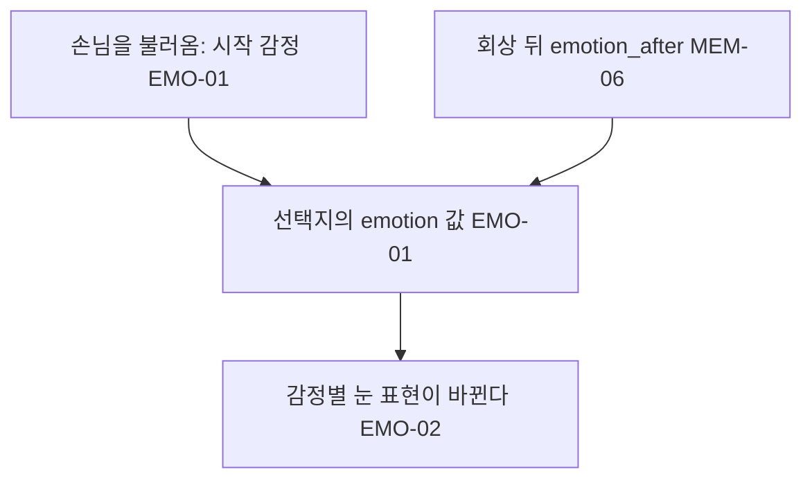

# 감정 상태와 눈 표현

접두어 `EMO` · 다음 번호 `EMO-14`

선택지에 따라 내담자의 감정이 바뀌고, 그 감정이 눈 표현으로 드러난다.

## 흐름

감정은 수치가 아니라 다섯 가지 중 하나다. 눈 모양은 인물마다 따로 정해져 있어, 같은 감정이라도 사람마다 눈이 다르게 변한다.

## 기능

### 손님의 감정 (EMO-01)

손님은 평온, 경계, 불안, 슬픔, 안도 중 한 감정을 갖고, 고른 말에 따라 바뀐다.

- 손님마다 시작 감정이 정해져 있다.
- 들여다보거나 다시 만나도 감정은 남고, 리셋하면 시작 감정으로 돌아간다.

### 감정이 드러나는 눈 (EMO-02)

감정이 바뀌면 손님의 눈 모양이 천천히 바뀐다.

- 눈꺼풀, 홍채 색, 동공 떨림, 눈물, 시선 피함이 감정과 사람마다 다르다.
- 들여다보는 동안은 시선을 피하지 않는다.

### 편집기의 감정 열 (EMO-05)

대사 편집기에서 선택지마다 바뀔 감정을 적고 고칠 수 있다.

---

## 자세히

개발자용: 고칠 때 볼 것 (주의, 하지 않는 것, 구성, 코드 단서, 메모)

### 주의

- `EMO-01` 이미 한 좋은 말을 다시 고르면 감정도 바꾸지 않는다. `emotion` 열에 정해지지 않은 값은 검사 오류이고 감정을 바꾸지 않는다. 전환 연출 중 다시 바뀌면 진행 중인 전환을 끝 상태로 건너뛰고 새로 시작한다.
- `EMO-02` 인물에 그 감정의 `EmotionLook`이 없으면 기본값(모두 0)을 쓴다. 감정 눈꺼풀과 깜빡임(`BLINK-05`)은 큰 값으로 그린다. 동공 떨림은 위치만 흔들고 크기와 심연 판정에는 쓰지 않는다.
- `EMO-02` 감정 값은 `ClientTearCue`가 매 프레임 덮어쓰는 `Pupil.Tremble`, `EyeVisual.TearLevel`에 쓰지 않는다. 따로 둔 감정용 입력(`EmotionTrembleDistance`, `EmotionClosed` 등)에 쓰고 그릴 때 합친다.
- `EMO-02` 시선 피함(`_gazeShift`)은 `_gazeShiftMax`를 넘지 않는다. 동공이 홍채 가운데에서 조금만 비켜나게 쓴다.
- 에디트 모드에서는 감정 전환이 일어나지 않는다.

### 하지 않는 것

- 감정을 0~1 게이지로 두지 않는다. 감정 이름을 화면에 글자로 보이지 않는다.
- 감정으로 미로 벽 자체를 다시 만들지 않는다. 벽 변화는 깜빡임(`BLINK-07`)에만 둔다.
- 눈 표현 값을 디렉터 한 곳에 두지 않는다. 인물마다 다르다.

### 구성

- `emotion` 열을 더하거나 바꾸면 편집기 열 목록 세 곳(`DialogueEditorFormat`의 전체 열과 `ItemColumns`, `DialogueData`의 새 파일 열)을 함께 고친다.

### 코드 단서

기능을 고칠 때 먼저 볼 곳이다.

| 기능 | 찾을 곳 |
|---|---|
| EMO-01 | `EyeMazeDirector.ChangeEmotion`, `ClientEmotion` |
| EMO-02 | `EyeMazeDirector.ApplyEmotionLook`, `EmotionLook` |
| EMO-05 | `DialogueEditorFormat` |

