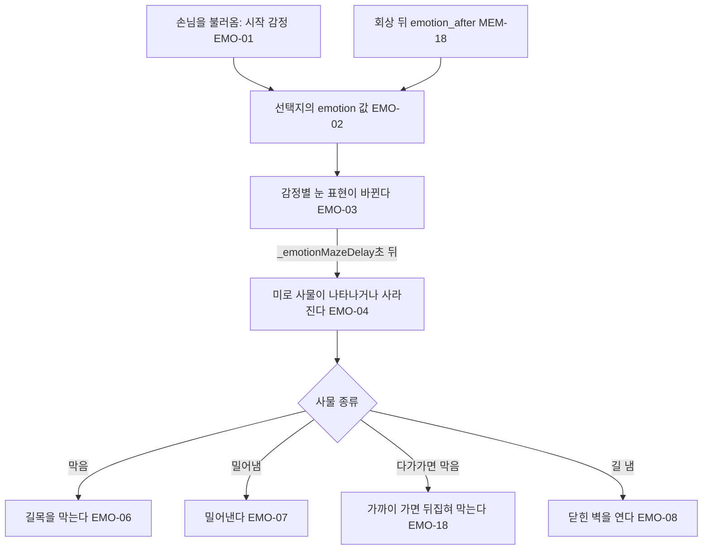

# 감정 상태와 미로 사물

접두어 `EMO` · 다음 번호 `EMO-21`

선택지에 따라 내담자의 감정이 바뀌고, 그 감정이 눈 표현과 미로 속 사물·장애물로 드러나 대화와 미로를 잇는다.

## 흐름

감정은 수치가 아니라 열거형 상태 하나다. 눈 표현 값은 인물마다 `ClientCase`의 감정별 `EmotionLook`에 있어, 같은 감정이라도 인물마다 눈이 다르게 변한다. 막는 사물은 칸이 아니라 두 칸 사이의 면(길목) 하나를 맡고, 둘레에 항상 돌아갈 길이 남게 배치된다.

## 진행 중

없음

## 완료

### 감정과 눈 표현

- **EMO-01** 손님을 불러오면 감정이 그 인물의 `_startEmotion`이 된다. 들여다보거나 Q로 다시 만나도 감정은 남는다.
- **EMO-02** 고른 선택지의 `emotion` 값이 지금 감정과 다르면 감정이 바뀐다.
- **EMO-03** 감정이 바뀌면 그 인물의 감정별 눈 표현(눈꺼풀, 홍채 색, 동공 떨림, 눈물, 시선 피함)이 `_emotionEyeSeconds`에 걸쳐 적용된다.
- **EMO-10** 리셋하면 감정을 시작 감정으로 되돌린다.
- **EMO-11** 감정과 휴식 신호(`BURDEN-24`, `BURDEN-25`)가 같은 값을 바꾸면 큰 값을 쓴다.
- **EMO-12** 들여다보는 동안은 시선을 피하지 않고, 대화로 돌아오면 다시 감정대로 피한다.
- **EMO-15** 대사 편집기는 `emotion` 열을 선택지 속성으로 읽고 보존한다.

### 미로 사물

- **EMO-04** 눈 표현이 시작되고 `_emotionMazeDelay`초 뒤, 사물이 새 감정에 맞춰 `_propFadeSeconds`에 걸쳐 나타나거나 사라진다.
- **EMO-05** 사라지기 시작한 사물은 길을 막지 않는다.
- **EMO-06** "막음" 사물과 뒤집힌 "다가가면 막음" 사물은 맡은 길목을 막는다.
- **EMO-07** "밀어냄" 사물에 부딪히면 밀려남과 번쩍임(`BURDEN-12`~`BURDEN-14`, `BURDEN-18`)이 일어난다. `_bumpEnabled`와 무관하며 부담감은 바뀌지 않는다.
- **EMO-08** "길 냄" 사물이 보이면 맡은 벽이 열리고 그 자리에 오선 다섯 줄이 그려진다. 사라지면 벽이 돌아온다.
- **EMO-09** 보일 감정 목록이 빈 사물은 항상 보인다.
- **EMO-13** 사물이 나타나거나 사라질 때와 그 뒤 `_propRevealSeconds` 동안은 미로가 흐려도 선명하게 보인다.
- **EMO-14** 손님을 불러오면 그 인물의 사물 묶음만 켠다.
- **EMO-16** Play를 시작하거나 손님을 불러오면 미로를 새로 만들고, 막는 사물마다 둘레에 `_maxDetourCells`칸 이하의 우회로가 있는 길목을 맡긴다. 없으면 벽 하나를 열어 우회로를 만든다. 가장 바깥 고리의 원호 면은 맡기지 않는다. "길 냄" 사물에는 기준 칸 근처의 닫힌 벽을 맡긴다.
- **EMO-17** 사물은 맡은 면 가운데에 놓인다. `_fitToPassage`가 켜지면 통로를 가로지르게 돌고 통로 폭에 맞춰 크기가 정해지며, 막는 동안 길목 전체에 막힘 선을 긋는다. 길목을 맡지 못한 막는 사물은 그리지 않는다.
- **EMO-18** "다가가면 막음" 사물은 처음엔 길목 옆에 작게 비켜 있다가, 시선이 `_flipDistance` 안에 오면 뒤집히며 길목을 막는다. 사라지거나 다시 놓일 때까지 뒤집힌 채다.
- **EMO-19** `_dizzyRadius`가 있는 사물 가까이 시선이 가면 주변 벽이 흔들려 보인다. 판정은 바뀌지 않는다.
- **EMO-20** 막는 사물에 막혔을 때 그 사물의 `_blockedKey` 문구를 보여 준다. 문구는 그 사물이 무엇이고 내담자가 왜 그 너머를 보여 주지 않는지 한두 문장이다.

---

## 자세히

### 주의

- `EMO-02` 이미 한 좋은 말을 다시 고르면 감정도 바꾸지 않는다. `emotion` 열에 정해지지 않은 값은 검사 오류이고 감정을 바꾸지 않는다. 전환 연출 중 다시 바뀌면 진행 중인 전환을 끝 상태로 건너뛰고 새로 시작한다.
- `EMO-03` 인물에 그 감정의 `EmotionLook`이 없으면 기본값(모두 0)을 쓴다. 감정 눈꺼풀과 깜빡임(`BLINK-12`)은 큰 값으로 그린다. 동공 떨림은 위치만 흔들고 크기와 심연 판정에는 쓰지 않는다.
- `EMO-03` 감정 값은 `ClientTearCue`가 매 프레임 덮어쓰는 `Pupil.Tremble`, `EyeVisual.TearLevel`에 쓰지 않는다. 따로 둔 감정용 입력(`EmotionTrembleDistance`, `EmotionClosed` 등)에 쓰고 그릴 때 합친다.
- `EMO-12` 시선 피함(`_gazeShift`)은 `_gazeShiftMax`를 넘지 않는다. 동공이 홍채 가운데에서 조금만 비켜나게 쓴다. 지금은 경계 감정에만 값이 있다.
- `EMO-06` 시선이 서 있는 칸에 막음 사물이 새로 나타나도 시선은 그대로 두고, 그 칸에서 나가는 이동은 허용한다. 사물에 막혀도 부담감은 오르지 않고 `BURDEN-21` 접촉에도 세지 않는다.
- `EMO-16` 기준 칸 주변 면을 다른 사물이 다 맡았으면 그 사물은 길목 없이 칸 가운데에 놓여 막지 않고 경고를 남긴다. 막음 사물과 파편은 같은 칸에 둘 수 없다(기획 데이터 검사 오류).
- `EMO-16` 맡은 면은 자기 층 기준 칸으로 저장하고, 층 오프셋을 더해 비교한다. 사물은 자기 층의 깜빡임 회전을 따라간다.
- `EMO-20` 길 냄 사물과 뒤집히기 전 다가가면 막음 사물은 막지 않으므로 글을 보이지 않는다. 같은 사물에 계속 막혀 있으면 글을 다시 쓰지 않는다. key가 없으면 글을 보이지 않는다.
- 에디트 모드에서는 사물이 모두 보이고 감정 전환은 일어나지 않는다.

### 하지 않는 것

- 감정을 0~1 게이지로 두지 않는다. 감정 이름을 화면에 글자로 보이지 않는다.
- 감정으로 미로 벽 자체를 다시 만들지 않는다. 벽 변화는 깜빡임(`BLINK-29`)에만 둔다.
- 사물로 시간 제한을 걸지 않는다.
- 눈 표현 값을 디렉터 한 곳에 두지 않는다. 인물마다 다르다.
- 은재의 피아노 같은 막음 사물을 가장 바깥 고리(0번)에 두지 않는다. 시작하자마자 걷는 길이 막힌 것처럼 보인다.

### 구성

- 인물마다 층별 사물 묶음 오브젝트를 그 `MazeLayer` 아래에 두고 `ClientCase._propGroups`에 등록한다. `MazeProp`은 묶음의 자식에 붙는다. 파편 묶음(`_fragmentGroups`)과 따로 둔다.
- 사물은 `SpriteRenderer`로 그리고 `sortingOrder` 6(파편 7보다 아래)이다.
- `emotion` 열을 더하거나 바꾸면 편집기 열 목록 세 곳(`DialogueEditorFormat`의 전체 열과 `ItemColumns`, `DialogueData`의 새 파일 열)을 함께 고친다.

### 메모

- `_thicknessFill`, `_barrierColor`, `_barrierWidth`의 기본값은 확인하지 못함.
