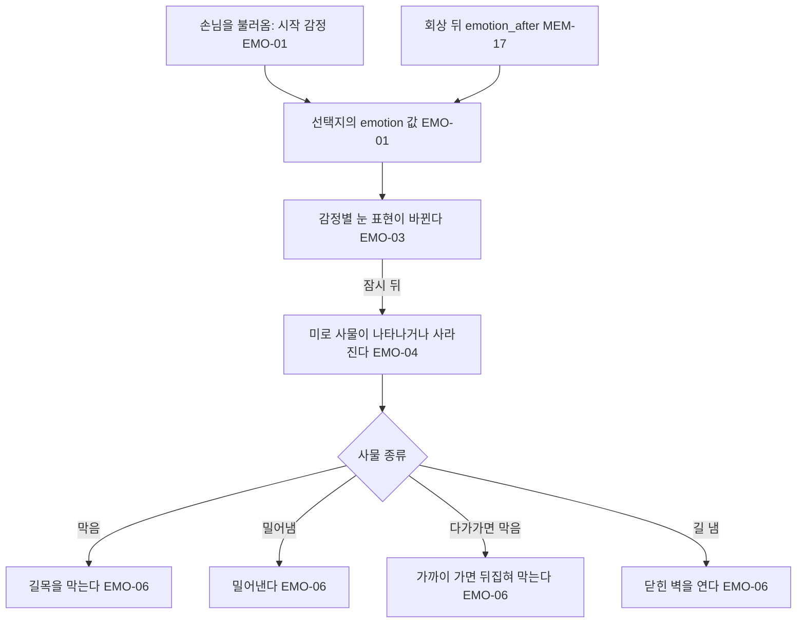

# 감정 상태와 미로 사물

접두어 `EMO` · 다음 번호 `EMO-21`

선택지에 따라 내담자의 감정이 바뀌고, 그 감정이 눈 표현과 미로 속 사물·장애물로 드러나 대화와 미로를 잇는다.

## 흐름

감정은 수치가 아니라 다섯 가지 중 하나다. 눈 모양은 인물마다 따로 정해져 있어, 같은 감정이라도 사람마다 눈이 다르게 변한다. 막는 사물은 칸이 아니라 두 칸 사이의 면(길목) 하나를 맡고, 둘레에 항상 돌아갈 길이 남게 배치된다.

## 진행 중

없음

## 완료

### 손님의 감정 (EMO-01)

손님은 평온, 경계, 불안, 슬픔, 안도 중 한 감정을 갖고, 고른 말에 따라 바뀐다.

- 손님마다 시작 감정이 정해져 있다.
- 들여다보거나 다시 만나도 감정은 남고, 리셋하면 시작 감정으로 돌아간다.

### 감정이 드러나는 눈 (EMO-03)

감정이 바뀌면 손님의 눈 모양이 천천히 바뀐다.

- 눈꺼풀, 홍채 색, 동공 떨림, 눈물, 시선 피함이 감정과 사람마다 다르다.
- 들여다보는 동안은 시선을 피하지 않는다.

### 감정에 따라 바뀌는 미로 (EMO-04)

눈이 바뀐 뒤 잠시 후, 미로 속 사물이 새 감정에 맞춰 나타나거나 사라진다.

- 나타나고 사라지는 동안은 미로가 흐려도 사물이 선명하게 보인다.
- 감정과 상관없이 늘 있는 사물도 있다.

### 사물의 종류 (EMO-06)

사물은 종류마다 길을 다르게 다룬다.

- 막음: 길목을 막는다.
- 밀어냄: 부딪히면 튕겨 낸다(부담감은 그대로).
- 길 냄: 막힌 벽을 열고 그 자리에 오선을 그린다.
- 다가가면 막음: 옆에 비켜 있다가 가까이 가면 뒤집히며 길을 막는다.

### 편집기의 감정 열 (EMO-15)

대사 편집기에서 선택지마다 바뀔 감정을 적고 고칠 수 있다.

### 사물 배치 (EMO-16)

미로를 만들 때 사물을 길목에 놓되, 그 둘레에 항상 돌아갈 길이 남게 한다.

- 사물 그림은 통로 폭에 맞춰 놓이고, 막는 동안 막힌 범위에 선이 그어진다.

### 어지러운 사물 (EMO-19)

어떤 사물은 가까이 가면 주변 벽이 흔들려 보인다. 실제 길은 바뀌지 않는다.

### 사물에 막혔을 때의 글 (EMO-20)

사물에 막히면 그 사물이 무엇이고 손님이 왜 그 너머를 보여 주지 않는지 한두 문장이 나온다.

---

## 자세히

### 주의

- `EMO-01` 이미 한 좋은 말을 다시 고르면 감정도 바꾸지 않는다. `emotion` 열에 정해지지 않은 값은 검사 오류이고 감정을 바꾸지 않는다. 전환 연출 중 다시 바뀌면 진행 중인 전환을 끝 상태로 건너뛰고 새로 시작한다.
- `EMO-03` 인물에 그 감정의 `EmotionLook`이 없으면 기본값(모두 0)을 쓴다. 감정 눈꺼풀과 깜빡임(`BLINK-12`)은 큰 값으로 그린다. 동공 떨림은 위치만 흔들고 크기와 심연 판정에는 쓰지 않는다.
- `EMO-03` 감정 값은 `ClientTearCue`가 매 프레임 덮어쓰는 `Pupil.Tremble`, `EyeVisual.TearLevel`에 쓰지 않는다. 따로 둔 감정용 입력(`EmotionTrembleDistance`, `EmotionClosed` 등)에 쓰고 그릴 때 합친다.
- `EMO-03` 시선 피함(`_gazeShift`)은 `_gazeShiftMax`를 넘지 않는다. 동공이 홍채 가운데에서 조금만 비켜나게 쓴다. 지금은 경계 감정에만 값이 있다.
- `EMO-06` 시선이 서 있는 칸에 막음 사물이 새로 나타나도 시선은 그대로 두고, 그 칸에서 나가는 이동은 허용한다. 사물에 막혀도 부담감은 오르지 않고 `BURDEN-21` 접촉에도 세지 않는다.
- `EMO-16` 기준 칸 주변 면을 다른 사물이 다 맡았으면 그 사물은 길목 없이 칸 가운데에 놓여 막지 않고 경고를 남긴다. 막음 사물과 파편은 같은 칸에 둘 수 없다(기획 데이터 검사 오류).
- `EMO-16` 맡은 면은 자기 층 기준 칸으로 저장하고, 층 오프셋을 더해 비교한다. 사물은 자기 층의 깜빡임 회전을 따라간다.
- `EMO-20` 길 냄 사물과 뒤집히기 전 다가가면 막음 사물은 막지 않으므로 글을 보이지 않는다. 같은 사물에 계속 막혀 있으면 글을 다시 쓰지 않는다. key가 없으면 글을 보이지 않는다.
- 에디트 모드에서는 사물이 모두 보이고 감정 전환은 일어나지 않는다.

### 하지 않는 것

- 감정을 0~1 게이지로 두지 않는다. 감정 이름을 화면에 글자로 보이지 않는다.
- 감정으로 미로 벽 자체를 다시 만들지 않는다. 벽 변화는 깜빡임(`BLINK-29`)에만 둔다.
- 사물로 시간 제한을 걸지 않는다.
- 눈 표현 값을 디렉터 한 곳에 두지 않는다. 인물마다 다르다.
- 은재의 피아노 같은 막음 사물을 가장 바깥 고리(0번)에 두지 않는다. 시작하자마자 걷는 길이 막힌 것처럼 보인다.

### 구성

- 인물마다 층별 사물 묶음 오브젝트를 그 `MazeLayer` 아래에 두고 `ClientCase._propGroups`에 등록한다. `MazeProp`은 묶음의 자식에 붙는다. 파편 묶음(`_fragmentGroups`)과 따로 둔다.
- 사물은 `SpriteRenderer`로 그리고 `sortingOrder` 6(파편 7보다 아래)이다.
- `emotion` 열을 더하거나 바꾸면 편집기 열 목록 세 곳(`DialogueEditorFormat`의 전체 열과 `ItemColumns`, `DialogueData`의 새 파일 열)을 함께 고친다.

### 코드 단서

기능을 고칠 때 먼저 볼 곳이다.

| 기능 | 찾을 곳 |
|---|---|
| EMO-01 | `EyeMazeDirector.ChangeEmotion`, `ClientEmotion` |
| EMO-03 | `EyeMazeDirector.ApplyEmotionLook`, `EmotionLook` |
| EMO-04 | `EyeMazeDirector.FadeProps`, `MazeProp.FadeTo` |
| EMO-06 | `MazePropKind`, `EyeMazeDirector.PropBlocksFace` |
| EMO-15 | `DialogueEditorFormat` |
| EMO-16 | `IrisMaze.AssignProps`, `MazeProp.PlaceOnPassage` |
| EMO-19 | `EyeMazeDirector.CollectWobble`, `MazeWall.SetWobble` |
| EMO-20 | `EyeMazeDirector.ShowPropBlockedText` |

### 메모

- `_thicknessFill`, `_barrierColor`, `_barrierWidth`의 기본값은 확인하지 못함.
