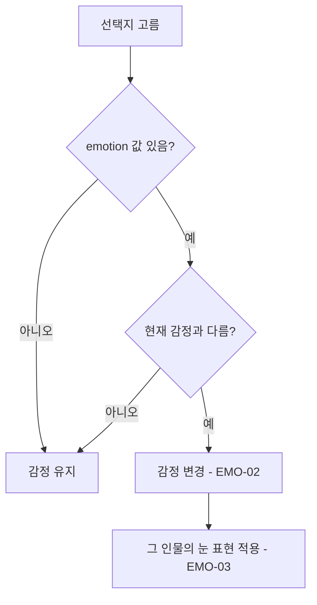

# 감정 상태와 눈 표현

## 1. 목적

선택지에 따라 내담자의 감정이 바뀌고, 그 감정이 인물마다 다른 눈 표현으로 드러나게 하여 대화와 눈을 잇는다.

- 대상: 플레이어, 제작자(대사 CSV와 씬에 감정과 눈 표현 값을 넣는 사람)

### 범위

- 포함:
  - 내담자의 현재 감정 상태 하나를 보관하고 선택지로 바꾸는 기능
  - 인물마다 따로 정하는 감정별 눈 표현(눈꺼풀, 홍채 색조, 동공 떨림, 눈물, 시선 피함)
  - 대사 CSV의 `emotion` 열
- 제외:
  - 회상 재연과 회상 뒤 감정 변화(`MEM-06`~`MEM-24`, `memory-fragments.md`)
  - 신뢰와 동공으로 열리는 기존 문(`MazeGate`)의 조건 변경
  - 감정에 따른 동공 크기 변화. 동공 크기는 기존 `dilation` 수치만 바꾼다.
  - 은재의 감정별 눈 표현 값, 선택지의 `emotion` 값. 이 스펙의 기능을 구현한 뒤 콘텐츠 작업으로 만든다. 팀원이 쓴 대사 글은 바꾸지 않고 `emotion` 칸만 채운다.

### 선택하지 않은 방식

- 감정을 0~1 게이지로 두지 않는다.
- 감정 이름을 화면에 글자로 표시하지 않는다.
- 감정에 따라 미로 벽 자체를 다시 만들지 않는다(벽 변화는 `BLINK-29`~`BLINK-41`(`blink-maze.md`)의 깜빡임에만 둔다).
- 모든 인물이 같은 감정 표현을 쓰도록 표현 값을 `EyeMazeDirector` 한 곳에 두지 않는다.

## 2. 요구사항

- **EMO-01** `[승인]` 손님을 불러올 때(`LoadCase()`) `EyeMazeDirector`는 현재 인물의 감정을 그 인물의 `_startEmotion`으로 둔다. 들여다보기를 시작하거나 Q로 자리를 떠났다 같은 손님과 다시 만날 때는 감정을 유지한다.
- **EMO-02** `[승인]` 선택지를 고르고 그 선택지의 `emotion` 값이 현재 감정과 다를 때 `EyeMazeDirector`는 현재 감정을 그 값으로 바꾼다.
- **EMO-03** `[승인]` 감정이 바뀔 때 `EyeMazeDirector`는 현재 인물 `ClientCase`의 그 감정 `EmotionLook` 값(눈꺼풀 닫힘, 홍채 색조, 동공 떨림 거리와 빠르기, 눈물 수위, 시선 피함)을 `_emotionEyeSeconds`초에 걸쳐 `EyeVisual`과 `Pupil`에 적용한다.
- ~~**EMO-04**~~ `[폐기]` (폐기: 2026-11-27 감정 미로 사물 제거)
- ~~**EMO-05**~~ `[폐기]` (폐기: 2026-11-27 감정 미로 사물 제거)
- ~~**EMO-06**~~ `[폐기]` (폐기: 2026-11-27 감정 미로 사물 제거)
- ~~**EMO-07**~~ `[폐기]` (폐기: 2026-11-27 감정 미로 사물 제거)
- ~~**EMO-08**~~ `[폐기]` (폐기: 2026-11-27 감정 미로 사물 제거)
- ~~**EMO-09**~~ `[폐기]` (폐기: 2026-11-27 감정 미로 사물 제거)
- **EMO-10** `[승인]` `ResetAll()`이 호출될 때 `EyeMazeDirector`는 감정을 `_startEmotion`으로 되돌리고 눈 표현을 그에 맞춘다.
- **EMO-11** `[승인]` 감정의 눈 표현과 `BURDEN-24`~`BURDEN-25`(`burden.md`)의 휴식 신호가 같은 값(동공 떨림, 눈물 수위)을 함께 바꾸려 할 때 `EyeMazeDirector`는 두 값 중 큰 값을 적용한다.
- **EMO-12** `[승인]` 눈을 들여다보는 동안 `EyeMazeDirector`는 시선 피함을 0으로 적용하고, 대화로 돌아오면 `_emotionEyeSeconds`초에 걸쳐 현재 감정의 값으로 되돌린다.
- ~~**EMO-13**~~ `[폐기]` (폐기: 2026-11-27 감정 미로 사물 제거)
- ~~**EMO-14**~~ `[폐기]` (폐기: 2026-11-27 감정 미로 사물 제거)
- **EMO-15** `[승인]` 대사 편집기는 `emotion` 열을 dialogue 단계의 선택지 속성으로 읽고 쓰며, 저장할 때 그 값을 지우지 않는다.
- ~~**EMO-16**~~ `[폐기]` (폐기: 2026-11-27 감정 미로 사물 제거)
- ~~**EMO-17**~~ `[폐기]` (폐기: 2026-11-27 감정 미로 사물 제거)
- ~~**EMO-18**~~ `[폐기]` (폐기: 2026-11-27 감정 미로 사물 제거)
- ~~**EMO-19**~~ `[폐기]` (폐기: 2026-11-27 감정 미로 사물 제거)
- ~~**EMO-20**~~ `[폐기]` (폐기: 2026-11-27 감정 미로 사물 제거)

구현 순서: 묶음 1 (`EMO-01`, `EMO-02`, `EMO-10`, `EMO-15`, 감정 상태와 데이터) → 묶음 2 (`EMO-03`, `EMO-11`, `EMO-12`, 눈 표현)

### 예외 및 경계 조건

- 감정 전환 연출 중 다시 감정이 바뀜: 진행 중인 전환을 끝 상태로 건너뛰고 새 전환을 시작한다.
- 이미 한 좋은 말을 다시 고름: `DLG-14`(`dialogue.md`)처럼 반응이 반복되지 않으므로 감정도 바꾸지 않는다.
- `emotion` 열에 정해지지 않은 값: CSV 검사 오류로 보고하고 감정을 바꾸지 않는다.
- 인물의 `_emotionLooks`에 현재 감정의 항목이 없음: 눈 표현을 기본값(눈꺼풀 닫힘 0, 색조 없음, 떨림 0, 눈물 0, 시선 피함 0)으로 적용한다.
- 감정의 눈꺼풀 닫힘과 깜빡임(`BLINK-12`(`blink-maze.md`)): 깜빡임이 진행되는 동안은 두 값 중 큰 값으로 그리고, 깜빡임이 끝나면 감정의 값으로 돌아온다.
- 감정의 동공 떨림과 `dilation`: 떨림은 동공의 위치만 흔들고 크기는 바꾸지 않는다.
- 시선 피함의 크기: `_gazeShift`의 길이가 `_gazeShiftMax`를 넘으면 `_gazeShiftMax`로 줄여 적용한다. 주인공이 동공을 마주 보는 것이 조작이므로 동공이 홍채 가운데에서 조금 비켜난 정도로만 쓴다.
- 시선 피함을 쓰는 감정: 콘텐츠 작업에서 경계 감정에만 값을 넣고 나머지 감정은 (0, 0)으로 둔다.
- 휴식 신호(`BURDEN-23`~`BURDEN-36`(`burden.md`))와 감정의 눈물이 함께 보임: 휴식 신호는 `BURDEN-27`의 대사와 안내 문구로 구분한다.
- 에디트 모드: 감정 전환은 일어나지 않는다.

## 3. 상태와 전이

| 지금 상태 | 계기 | 다음 상태 | 관련 요구사항 |
|---|---|---|---|
| 감정 없음(손님 불러오기 전) | `LoadCase()` | 그 인물의 `_startEmotion` | EMO-01 |
| 현재 감정 | 현재 감정과 다른 `emotion` 값을 가진 선택지를 고름 | 그 `emotion` 값 | EMO-02 |
| 현재 감정 | 회상이 끝나고 `emotion_after` 값이 있음 | 그 `emotion_after` 값 | EMO-02, `MEM-18`(`memory-fragments.md`) |
| 현재 감정 | `ResetAll()` | `_startEmotion` | EMO-10 |

## 4. 수치 표

기본값은 코드의 필드 초기값이다. 씬이나 프리팹에 저장된 값은 이와 다를 수 있으며, Play에서는 저장된 값이 쓰인다.

### 상태와 데이터

| 이름 | 타입 | 설명 | 초기값 |
|------|------|------|--------|
| `_emotion` | `ClientEmotion` | 현재 인물의 감정 | 인물의 `_startEmotion` |
| 대사 CSV `emotion` 열 | 문자열 | `calm`, `guarded`, `anxious`, `sad`, `relieved` 중 하나. 비우면 감정을 바꾸지 않는다 | 빈 값 |

### Inspector 노출값

| 필드 | 타입 | 기본값 | 설명 |
|------|------|--------|------|
| `ClientCase._startEmotion` | `ClientEmotion` | 평온 | 상담 시작 때의 감정 |
| `ClientCase._emotionLooks` | `EmotionLook[]` | 빈 배열 | 이 인물의 감정별 눈 표현 |
| `EyeMazeDirector._gazeShiftMax` | `float` | 0.05 | 시선 피함으로 동공이 비켜날 수 있는 최대 거리 |
| `EmotionLook._emotion` | `ClientEmotion` | 평온 | 이 표현이 쓰이는 감정 |
| `EmotionLook._lidClosed` | `float` (0~1) | 0 | 눈꺼풀이 닫힌 정도 |
| `EmotionLook._irisTint` | `Color` | 투명 | 홍채에 섞는 색. 알파가 섞는 세기다 |
| `EmotionLook._trembleDistance` | `float` | 0 | 동공이 떨리는 거리. 0이면 떨지 않는다 |
| `EmotionLook._trembleSpeed` | `float` | 28 | 동공이 떨리는 빠르기 |
| `EmotionLook._tearLevel` | `float` (0~1) | 0 | 눈물 수위 |
| `EmotionLook._gazeShift` | `Vector2` | (0, 0) | 동공이 한쪽으로 쏠리는 거리와 방향 |
| `EyeMazeDirector._emotionEyeSeconds` | `float` | 1.0 | 눈 표현이 바뀌는 시간 |

## 5. 코드 위치

### 구조

| 구분 | 이름 | 역할 |
|------|------|------|
| 열거형 | `ClientEmotion` | 평온, 경계, 불안, 슬픔, 안도 |
| 클래스 | `EmotionLook` | 한 감정의 눈 표현 값 묶음(직렬화 클래스) |
| 클래스 | `ClientCase` | 시작 감정과 감정별 `EmotionLook` 목록을 가진다 |
| 클래스 | `EyeMazeDirector` | 현재 감정을 보관하고 전환 순서를 진행한다 |
| 클래스 | `EyeVisual`, `Pupil` | 전달받은 눈 표현 값을 그린다 |
| 클래스 | `DialogueScript` | 선택지의 `emotion` 값을 읽어 보관한다 |

- 클래스 간 관계: `EyeMazeDirector`가 `ClientCase`에서 현재 감정의 `EmotionLook`을 받아 `EyeVisual`과 `Pupil`에 값을 전달한다.
- 실행 순서 의존성: 눈 표현 값은 `ClientTearCue.Tick()` 뒤에 합쳐 전달한다.
- 기존 코드와의 접점: `EyeMazeDirector`의 선택지 적용 처리, `LoadCase()`, `ResetAll()`. 다른 영역과의 접점은 6절에 둔다.

### 구현 방식

- 사용 기술/API: Unity `MonoBehaviour`, 기존 CSV 로더(`Csv`, `DialogueScript`)
- 핵심 방식: 감정은 수치가 아닌 열거형 상태 하나로 둔다. 선택지 행의 `emotion` 열 값이 있으면 그 감정으로 바꾼다. 감정이 바뀌면 `EyeMazeDirector`가 그 인물의 `ClientCase`에 저장된 감정별 눈 표현(`EmotionLook`)을 적용한다. 같은 감정이라도 인물마다 `EmotionLook` 값이 달라 눈이 다르게 변한다.
- 눈 표현 전달: `ClientTearCue`가 매 프레임 `Pupil.Tremble`과 `EyeVisual.TearLevel`을 덮어쓰므로 감정 값은 같은 프로퍼티에 쓰지 않는다. `Pupil`에 감정용 입력(`EmotionTrembleDistance`, `EmotionTrembleSpeed`, `EmotionShift`)을, `EyeVisual`에 감정용 입력(`EmotionClosed`, `EmotionTint`, `EmotionTearLevel`)을 추가한다. `Pupil`과 `EyeVisual`은 그릴 때 기존 값과 감정용 값 중 큰 쪽을 쓴다. 떨림과 시선 피함은 기존 떨림처럼 `Transform` 위치에만 더하고 심연 판정에는 쓰지 않는다.

## 6. 다른 영역과의 접점

- **외부 의존성**: `EyeMazeDirector`, `EyeVisual`, `Pupil`, `GazeCursor`, `ClientCase`, `ClientTearCue`, `DialogueScript`, 눈물과 동공 떨림(`BURDEN-23`~`BURDEN-36`(`burden.md`)), 대사 편집기의 열 목록(`EDITOR-01`~`EDITOR-38`(`dialogue-editor.md`))
- **부르는 것**:
  - `EyeVisual`, `Pupil`의 감정용 입력(눈 그리기). `ClientTearCue`(`BURDEN-23`~`BURDEN-36`(`burden.md`))가 쓰는 `Pupil.Tremble`, `EyeVisual.TearLevel`과 합쳐 그린다.
- **불리는 것**:
  - 감정 변경 ← 회상 뒤 감정 적용 `MEM-18`(`memory-fragments.md`)
- **데이터 접점**: `DialogueScript`의 CSV 읽기. 대사 편집기의 열 목록 세 곳(`DialogueEditorFormat.cs`의 전체 열 목록과 dialogue 단계의 `ItemColumns`, `DialogueData.cs`의 새 파일 열 목록)과 `dialogue-editor.md` 4절의 머리글 목록(`EDITOR-01`~`EDITOR-38`).

## 7. 검증 방법

- EMO-01: Play Mode에서 은재를 처음 만나 눈을 들여다보면 `_emotion`이 은재의 `_startEmotion` 값이다. 선택지로 감정을 바꾼 뒤 다시 들여다봐도 바뀐 감정이 유지된다.
- EMO-02: `emotion`이 `anxious`인 선택지를 고르면 Inspector의 `_emotion`이 불안으로 바뀐다. `emotion`이 빈 선택지를 고르면 바뀌지 않는다.
- EMO-03: 감정이 바뀌면 눈 표현이 1초에 걸쳐 그 인물의 `EmotionLook` 값으로 바뀐다. 두 인물의 불안 `EmotionLook` 값을 다르게 넣으면 같은 불안에서 두 눈이 서로 다르게 보인다.
- EMO-10: R로 리셋하면 감정과 눈 표현이 상담 시작 때 상태로 돌아온다.
- EMO-11: 눈물 수위 0.3인 슬픔 상태에서 휴식 신호가 시작되면 눈물이 휴식 신호의 수위까지 차오르고, 휴식 신호가 가라앉으면 0.3으로 돌아온다.
- EMO-12: 시선 피함 값이 있는 감정에서 대화 중에는 동공이 조금 비켜나 있고, Space로 들여다보면 동공이 미로 한가운데에 있다. 시선을 거두면 1초에 걸쳐 다시 비켜난다.
- EMO-15: `emotion` 값이 있는 대사 CSV를 대사 편집기에서 열어 다른 칸을 고치고 저장해도 `emotion` 값이 남아 있다.

## 8. 알려진 문제

해당 없음

## 9. 미결 사항

없음
