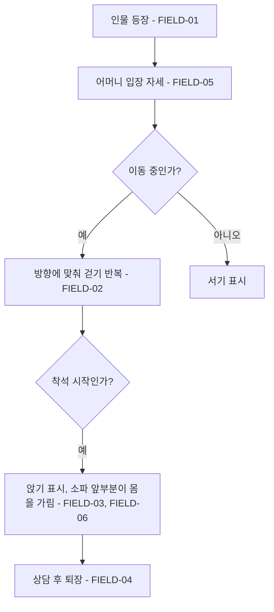
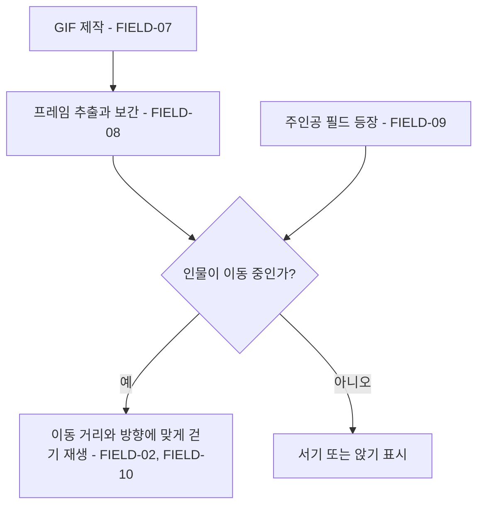
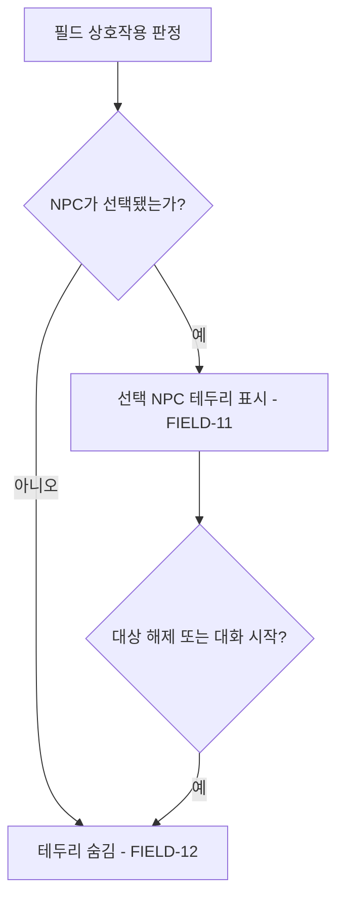

# 필드 인물 표시

## 1. 목적

상담실 필드에서 은재 어머니, 은재, 지수와 주인공이 초상화의 특징을 살린 흑백 전신 모습으로 보이고, 걷고 앉고 나가는 모습이 자연스럽게 이어지게 한다. 말을 걸 수 있는 손님은 실루엣 테두리로 바로 알아볼 수 있게 한다.

### 범위

- 포함:
  - 세 인물의 흑백 픽셀풍 전신 스프라이트와 서기, 걷기, 앉기 표현
  - 기존 필드 컷신과 캐릭터의 모습 연결
  - 세 손님의 차분하고 짧은 보폭의 반복 걷기 GIF, 프레임 추출과 중간 동작 보간
  - 주인공의 임시 흑백 전신 외형과 서기·걷기 표시
  - 필드 씬 연결과 실제 입력을 사용하는 Play Mode 확인
  - 대화 대상 NPC의 스프라이트 외곽에 색상 테두리 표시
  - 상호작용 대상이 바뀌거나 대화와 컷신이 시작될 때 테두리 표시 갱신
- 제외:
  - 대사, 컷신 순서, 플레이어 조작 변경
  - 주인공 충돌 판정 변경
  - 대화 내용, 상호작용 거리, NPC 이동 변경
  - 문과 단서의 표시 변경

### 선택하지 않은 방식

- 기존 캡슐의 크기 변경만으로 인물의 동작을 표현하지 않는다.
- 두 장의 걷기 이미지와 서기 이미지만 반복하는 방식은 사용하지 않는다.
- 상호작용 대상을 캐릭터 전체의 색을 바꾸거나 별도의 사각형으로 표시하지 않는다.

## 2. 요구사항

### 필드 캐릭터 걷기와 앉기

- **FIELD-01** `[구현완료]` 세 인물이 필드에 등장할 때 각 초상화의 특징을 반영한 전신 캐릭터가 표시된다. 은재는 성인 인물보다 조금 작은 크기로 표시한다.
- **FIELD-02** `[승인]` 손님 또는 주인공이 이동할 때 이동 방향에 맞는 걷기 동작이 반복된다.
- **FIELD-03** `[구현완료]` 인물이 기존 컷신에서 자리에 앉을 때 앉은 자세로 전환되고 자리에 머무른다.
- **FIELD-04** `[구현완료]` 인물이 기존 컷신에서 퇴장할 때 서서 걷는 모습으로 전환되고 퇴장 후 표시되지 않는다.
- **FIELD-05** `[구현완료]` 은재 어머니가 처음 들어와 대화할 때 한 팔을 반대쪽 손으로 감싸 쥔 긴장된 자세를 표시한다.
- **FIELD-06** `[구현완료]` 손님이 소파에 앉을 때 씬에서 지정한 자리의 캐릭터 중심 Y를 -1.8로 맞추고, 소파 앞부분이 몸 일부를 가린다.

### 걷기 애니메이션과 주인공 외형

- **FIELD-07** `[승인]` 손님별 걷기 애셋을 제작할 때 짧은 보폭의 반복 걷기 GIF를 제공한다.
- **FIELD-08** `[승인]` GIF를 게임용 애셋으로 변환할 때 프레임을 추출하고 중간 동작을 보간해 발 기준점을 맞춘다.
- **FIELD-09** `[승인]` 주인공이 필드에 표시될 때 다른 인물과 어울리는 임시 전신 외형이 보인다.
- **FIELD-10** `[승인]` 인물의 이동 속도가 달라질 때 걷기 주기는 실제 이동 거리에 비례해 진행된다.

### NPC 상호작용 테두리

- **FIELD-11** `[구현완료]` 필드에서 NPC가 현재 상호작용 대상으로 선택되면 해당 NPC의 외곽에 테두리를 표시한다.
- **FIELD-12** `[구현완료]` NPC가 현재 상호작용 대상이 아니거나 대화·컷신 중이면 해당 NPC의 테두리를 숨긴다.

### 예외 및 경계 조건

필드 캐릭터 걷기와 앉기

- 인물이 표시되지 않는 동안에는 스프라이트도 표시하지 않는다.
- 기존 인물 중 스프라이트가 연결되지 않은 경우 기존 표시를 유지한다.

걷기 애니메이션과 주인공 외형

- 걷기가 중단되면 서기 이미지로 돌아간다.
- 손님이 앉을 때 기존 좌석 위치와 착석 방향을 유지한다.
- 표시 애셋이 없는 기존 오브젝트는 기존 표시를 유지한다.

NPC 상호작용 테두리

- NPC가 화면에 없거나 비활성 상태면 테두리를 표시하지 않는다.
- NPC가 아닌 문과 단서는 기존 표시를 유지한다.

## 3. 상태와 전이

| 지금 상태 | 계기 | 다음 상태 | 관련 요구사항 |
|---|---|---|---|
| 표시 안 됨 | 컷신에서 인물 등장 | 서기 | FIELD-01 |
| 서기 | 이동 시작 | 걷기 | FIELD-02, FIELD-10 |
| 걷기 | 이동 멈춤 | 서기 | FIELD-02 |
| 걷기 | 컷신에서 착석 | 앉기 | FIELD-03, FIELD-06 |
| 앉기 | 상담 뒤 퇴장 시작 | 걷기 | FIELD-04 |
| 걷기 (퇴장) | 퇴장 끝 | 표시 안 됨 | FIELD-04 |
| 어머니 입장 자세 | 퇴장 | 기존 서기·걷기 모습 | FIELD-05 |
| 테두리 숨김 | NPC가 상호작용 대상으로 선택됨 | 테두리 표시 | FIELD-11 |
| 테두리 표시 | 대상 해제, 대화 또는 컷신 시작 | 테두리 숨김 | FIELD-12 |

필드 캐릭터 걷기와 앉기

걷기 애니메이션과 주인공 외형

NPC 상호작용 테두리

## 4. 수치 표

기본값은 코드의 필드 초기값이다. 씬이나 프리팹에 저장된 값은 이와 다를 수 있으며, Play에서는 저장된 값이 쓰인다. 기본값은 `feature/charactrers-model-add` 브랜치의 코드 기준이다.

| 이름 | 기본값 | 필드(컴포넌트) | 뜻 |
|---|---|---|---|
| `_characterRenderer` | 비어 있음 | `FieldNPC`, `FieldPlayer` | 인물의 필드 모습을 표시하는 SpriteRenderer |
| `_standingSprite` | 비어 있음 | `FieldNPC`, `FieldPlayer` | 서기 이미지 |
| `_walkingSprites` | 비어 있음 | `FieldNPC`, `FieldPlayer` | 걷기 프레임 이미지 |
| `_sittingSprite` | 비어 있음 | `FieldNPC` | 앉기 이미지 |
| `_entryStandingSprite` | 비어 있음 | `FieldNPC` | 어머니의 긴장된 입장 서기 이미지 |
| `_entryWalkingSprites` | 비어 있음 | `FieldNPC` | 어머니의 긴장된 입장 걷기 프레임 |
| `_walkCycleDistance` | 0.65 | `FieldNPC`, `FieldPlayer` | 걷기 한 주기 동안 이동할 거리 |
| `_sitFacingLeft` | false | `FieldNPC` | 앉았을 때 왼쪽을 보는지 |
| `_walkBobHeight` | 0.01 | `FieldNPC` | 걷는 동안 위아래로 흔들리는 높이 |
| `_seatPoint` | 비어 있음 | `FieldNPC` | 소파에 앉을 자리. 몸 중심 Y는 이 자리 위로 앉은 키의 절반만큼 올린 값이다 |
| `_outlineFlow` | 비어 있음 | `FieldNPC` | 상호작용 대상을 확인할 `GameFlow` |
| `_outlineColor` | (0.3, 0.95, 1, 1) 밝은 청록색 | `FieldNPC` | 선택된 NPC의 외곽 색 |
| `_outlineWidth` | 2 | `FieldNPC` | 월드 렌더링 화면 기준 테두리 두께(픽셀) |
| `_foreground` | 비어 있음 | `SofaForeground` | 손님이 앉았을 때 몸 일부를 가리는 소파 앞부분 |
| `_occupants` | 비어 있음 | `SofaForeground` | 소파에 앉는 손님 목록 |

### 상태와 데이터

| 이름 | 타입 | 설명 | 초기값 |
|------|------|------|--------|
| 표시 상태 | 내부 상태 | 서기, 걷기, 앉기 중 현재 모습 | 서기 |
| 걷기 프레임 | 정수 | 걷기 주기의 현재 프레임 | 0 |
| `_walkDistance` | float | 현재 걷기 주기에서 이동한 거리 | 0 |
| `_sitting` | bool | 앉아 있는지 | true |
| 대상 여부 | bool | 현재 NPC가 상호작용 대상으로 선택되었는지 | false |

## 5. 코드 위치

아래 경로와 메서드는 `feature/charactrers-model-add` 브랜치 기준이다 (8절 참고).

| 요구사항 | 파일 | 메서드·속성 |
|---|---|---|
| FIELD-01, FIELD-02, FIELD-04 | `Assets/EyeMaze/Scripts/Runtime/FieldNPC.cs` | `StandAt()`, `WalkTo()`, `WalkToIn()`, `Animate()`, `UpdateCharacterSprite()` |
| FIELD-02, FIELD-09, FIELD-10 | `Assets/EyeMaze/Scripts/Runtime/FieldPlayer.cs` | `Update()`, `LateUpdate()`, `_walkCycleDistance` |
| FIELD-03, FIELD-06 | `Assets/EyeMaze/Scripts/Runtime/FieldNPC.cs` | `SitDown()`, `SaveSeat()`, `SeatTarget()`, `SeatPosition`, `IsSeated` |
| FIELD-05 | `Assets/EyeMaze/Scripts/Runtime/FieldNPC.cs`, `Assets/EyeMaze/Scripts/Runtime/FieldCutscene.cs` | `SetEntryPose()` |
| FIELD-06 | `Assets/EyeMaze/Scripts/Runtime/SofaForeground.cs`, `Assets/EyeMaze/Art/SofaForeground.shader`, `Assets/EyeMaze/Art/SofaForeground.mat` | `LateUpdate()` |
| FIELD-07, FIELD-08 | `Assets/EyeMaze/Arts/FieldCharacters/WalkCycles/` | `*Walk.gif`, `*WalkAtlas.png`, `*Source.png` |
| FIELD-01, FIELD-05 | `Assets/EyeMaze/Arts/FieldCharacters/` | 인물별 전신 스프라이트 |
| FIELD-11, FIELD-12 | `Assets/EyeMaze/Scripts/Runtime/FieldNPC.cs`, `Assets/EyeMaze/Art/NpcInteractionOutline.shader`, `Assets/EyeMaze/Art/NpcInteractionOutline.mat` | `LateUpdate()`, `_OutlineEnabled`, `_OutlineColor`, `_OutlineWidth` |

### 구조

| 구분 | 이름 | 역할 |
|------|------|------|
| 클래스 | FieldNPC | 기존 이동 및 착석 상태와 캐릭터 표시를 연결한다. 손님의 이동 방향과 걷기 상태를 스프라이트에 반영하고, 현재 선택 상태에 맞춰 자신의 테두리를 표시한다 |
| 클래스 | FieldPlayer | 주인공의 이동과 방향을 스프라이트에 반영한다 |
| 클래스 | GameFlow | 기존 상호작용 대상 선택 결과(`Nearest`)를 제공한다 |
| 클래스 | SofaForeground | 손님이 앉아 있을 때만 소파 앞부분을 보인다 |
| 셰이더와 머티리얼 | NpcInteractionOutline | 스프라이트의 알파 경계에 색상을 표시한다 |
| 애셋 | 인물별 스프라이트 | 서기, 걷기, 앉기 이미지를 제공한다 |
| 애셋 | 인물별 걷기 GIF와 프레임 | 확인 가능한 걷기 원본과 게임에서 사용할 프레임을 제공한다 |
| 씬 | 기존 필드 씬 | 캐릭터별 스프라이트, 표시 설정, NPC의 테두리 설정을 보관한다 |

- 오브젝트 구성: 기존 인물 오브젝트에 SpriteRenderer를 연결하고 프레임과 표시 설정을 Inspector에서 지정한다. 주인공의 SpriteRenderer와 이미지 참조를 씬에 지정한다. 기존 NPC의 SpriteRenderer에 테두리 머티리얼을 연결한다.
- 클래스 간 관계: FieldCutscene은 기존처럼 FieldNPC의 이동과 착석을 호출하고 FieldNPC가 해당 모습을 표시한다. 기존 조작은 FieldPlayer의 이동을 호출한다. FieldNPC는 GameFlow의 상호작용 대상 상태를 확인해 테두리 표시를 바꾼다.
- 실행 순서 의존성: 기존 컷신과 FieldNPC, 필드의 초기화 순서를 유지한다. 대상 판정 뒤에 테두리 표시를 갱신한다(`LateUpdate`).

### 구현 방식

- 기존 초상화의 머리 모양과 복장을 유지해 인물별 전신 이미지를 만들고, 이동 상태에 따라 걷기 프레임을 반복하며 착석 시 앉은 모습을 표시한다. 좌우 이동 방향에 맞게 스프라이트를 반전한다.
- 인물별 연속 걷기 이미지를 제작해 반복 GIF로 만든 뒤 프레임을 추출한다. OpenCV 광학 흐름으로 인접 프레임 사이의 중간 동작을 보간하고 발 기준점을 정렬한 스프라이트로 임포트한다. 실제 이동 거리에 비례해 걷기 프레임을 진행하고 이동 방향을 반영한다. 주인공도 같은 화면에 어울리는 임시 캐릭터를 사용한다.
- 기존 상호작용 대상으로 선택된 NPC의 스프라이트 알파 경계를 따라 테두리를 표시하고, 선택이 해제되면 일반 표시로 돌아간다. 각 스프라이트의 실제 실루엣을 따른다.
- 사용 기술/API: Unity SpriteRenderer와 스프라이트 프레임, 애니메이션 GIF, 스프라이트용 머티리얼과 셰이더, `MaterialPropertyBlock`, 기존 `FieldNPC`, `FieldPlayer`, `FieldCutscene`, `GameFlow.Nearest`
- 애셋 제작 도구: 이미지 생성 도구, gifenc, OpenCV.js, pngjs

## 6. 다른 영역과의 접점

- **부르는 것**: `GameFlow.Nearest`, `GameFlow.CurrentState`, `GameFlow.ShowingText`, `OpeningMonologue.IsPlaying`, `FieldCutscene.IsPlaying`
- **불리는 것**: `FieldNPC.SetEntryPose()`, `WalkTo()`, `SitDown()`, `StandAt()` ← `FieldCutscene` (어머니 입장은 `OPEN-04`, `OPEN-05`(`opening.md`))
- **영향을 받는 것**: 컷신 중에는 테두리를 숨긴다. 컷신 판정은 빨리감기와 같은 `FieldCutscene.IsPlaying`을 쓴다 (`DLG-32`(`dialogue.md`)).

## 7. 검증 방법

- FIELD-01: Play Mode에서 각 인물의 외형이 구별되고 은재가 성인보다 조금 작게 보인다.
- FIELD-02: 입장과 퇴장 중 걷기 프레임이 반복되고 좌우 이동 방향이 맞는다. 손님 입장과 주인공 좌우 이동을 직접 조작해 방향과 걷기 동작을 확인한다.
- FIELD-03: 은재와 지수가 지정된 좌석에 도착해 앉은 자세로 머문다.
- FIELD-04: 상담을 마친 손님이 서서 문 쪽으로 걸어 나간 뒤 화면에서 사라진다.
- FIELD-05: 어머니가 문에서 들어와 대화하는 동안 한 손으로 반대 팔을 잡은 모습이 표시되고, 퇴장하면 기존 모습으로 돌아간다.
- FIELD-06: 은재와 지수가 소파에 앉았을 때 캐릭터 중심 Y가 -1.8이고 소파 앞부분이 몸 일부를 가린다.
- FIELD-07: 세 손님의 GIF가 각각 짧은 보폭으로 반복되는 것을 확인한다.
- FIELD-08: 추출 및 보간된 프레임을 확인하고 움직이는 동안 발 높이가 크게 흔들리지 않는지 확인한다.
- FIELD-09: Play Mode에서 주인공의 임시 외형과 정지 상태를 확인한다.
- FIELD-10: 서로 다른 속도로 같은 거리를 이동할 때 걷기 주기가 같은 비율로 진행되는지 확인한다.
- FIELD-11: 필드에서 NPC에 가까이 가 상호작용 안내가 나타나면 그 NPC의 실루엣에 테두리가 표시된다.
- FIELD-12: NPC에게서 멀어지거나 대화·컷신을 시작하면 테두리가 사라진다.

## 8. 알려진 문제

- 이 영역의 코드와 애셋은 아직 dev에 합쳐지지 않았다. 5절 코드 위치와 4절 기본값은 `feature/charactrers-model-add` 브랜치 기준이며, 지금 작업 브랜치의 `FieldNPC.cs`, `FieldPlayer.cs`에는 이 필드와 메서드가 없을 수 있다.
- 옛 스펙 009의 Inspector 표에 있던 "걷기 프레임 간격 0.12초"는 그 브랜치 코드에 없다. 옛 스펙 010이 걷기 진행을 시간 간격에서 이동 거리(`_walkCycleDistance`)로 바꾸면서 없어진 것으로 보이며, 4절에는 넣지 않았다.
- `FIELD-02`는 옛 스펙 009 FR-002(`[구현완료]`)와 010 FR-003(`[승인]`, 주인공 포함)을 합친 것이라 낮은 쪽 상태인 `[승인]`을 붙였다.
- `FIELD-06`의 Y -1.8은 코드 상수가 아니라 씬의 `_seatPoint` 위치와 앉은 키로 정해진다. 씬 저장값이 -1.8이 되는지는 확인하지 못함.

## 9. 미결 사항

없음
