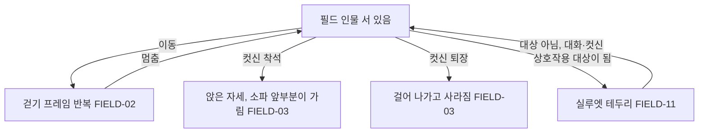

# 필드 인물 표시

접두어 `FIELD` · 다음 번호 `FIELD-13`

상담실 필드의 인물이 흑백 전신 모습으로 보이고, 걷고 앉고 나가는 모습이 자연스럽게 이어진다. 말을 걸 수 있는 손님은 테두리로 알아본다.

## 흐름

인물마다 초상화 특징을 살린 전신 스프라이트를 쓰고, 이동 방향에 맞게 좌우를 뒤집는다. 걷기 프레임은 시간이 아니라 이동한 거리만큼 넘어간다. 테두리는 스프라이트 알파 경계를 따라 그린다.

## 진행 중

`feature/charactrers-model-add` 브랜치에서 작업 중이다. 그 브랜치를 합치면 구현된 줄을 "완료"로 옮긴다.

- **FIELD-01** `[개발중]` 세 인물과 주인공이 초상화 특징을 살린 흑백 전신 스프라이트(`FieldNPC`, `FieldPlayer`)로 보인다. 은재는 어른보다 조금 작고, 은재 어머니는 첫 대화 때 한 팔을 감싸 쥔 긴장된 자세다.
  - 확인: 필드에서 네 인물의 전신과 크기 차이, 어머니의 자세가 보인다.
- **FIELD-02** `[개발중]` 인물이 움직이면 방향에 맞는 걷기 동작이 반복되고, 걷기 주기는 이동 거리(`_walkCycleDistance`)에 비례한다. 걷기 애셋은 GIF에서 프레임을 뽑고 중간 동작을 보간해 발 기준점을 맞춘다.
  - 확인: 느리게 움직이면 걸음도 느려지고 발이 미끄러지지 않는다.
- **FIELD-03** `[개발중]` 컷신에서 앉으면 앉은 자세로 머물며 소파 앞부분(`SofaForeground`)에 몸 일부가 가려지고, 퇴장하면 걸어 나간 뒤 사라진다.
  - 확인: 은재가 소파에 앉아 다리 일부가 가려지고, 어머니가 걸어 나가 사라진다.
- **FIELD-11** `[개발중]` 지금 상호작용 대상인 NPC의 외곽에 실루엣 테두리(`NpcInteractionOutline`)가 보이고, 대상이 아니거나 대화·컷신 중이면 숨긴다.
  - 확인: NPC에 다가가면 테두리가 생기고, 멀어지거나 대화를 시작하면 사라진다.

## 완료

없음

---

## 자세히

### 주의

- `FIELD-01` 인물이 보이지 않는 동안에는 스프라이트도 보이지 않는다. 스프라이트를 연결하지 않은 인물은 기존 표시를 유지한다.
- `FIELD-02` 걷기가 멈추면 서기 이미지로 돌아간다.
- `FIELD-03` 앉을 때 기존 좌석 위치와 방향을 유지한다. 앉은 높이는 씬의 `_seatPoint`와 앉은 키로 정해진다.
- `FIELD-11` 테두리 갱신은 대상 판정 뒤(`LateUpdate`)에 한다. 화면에 없거나 꺼진 NPC, 문과 단서에는 테두리를 그리지 않는다.

### 하지 않는 것

- 기존 캡슐 크기만 바꿔 동작을 표현하지 않는다.
- 걷기 두 장과 서기 한 장만 반복하지 않는다.
- 상호작용 대상을 캐릭터 전체 색이나 별도 사각형으로 표시하지 않는다.

### 구성

- 기존 인물 오브젝트에 `SpriteRenderer`를 연결하고 프레임과 표시 설정을 Inspector에서 지정한다. 주인공도 씬에서 지정한다.
- NPC의 `SpriteRenderer`에 테두리 머티리얼(`NpcInteractionOutline.mat`)을 연결한다. 소파 앞부분 가림은 `SofaForeground`가 맡는다.
- 걷기 애셋은 GIF에서 프레임을 뽑고 OpenCV 광학 흐름으로 중간 동작을 보간해 발 기준점을 맞춘 스프라이트다.
