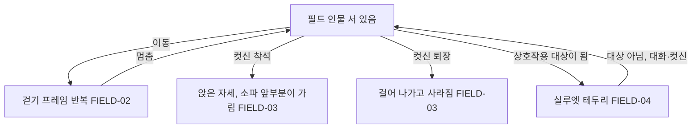

# 필드 인물 표시

접두어 `FIELD` · 다음 번호 `FIELD-05`

상담실 필드의 인물이 흑백 전신 모습으로 보이고, 걷고 앉고 나가는 모습이 자연스럽게 이어진다. 말을 걸 수 있는 손님은 테두리로 알아본다.

## 흐름

인물마다 초상화 특징을 살린 전신 그림을 쓰고, 이동 방향에 맞게 좌우를 뒤집는다. 걸음은 시간이 아니라 이동한 거리만큼 넘어간다. 테두리는 인물 실루엣을 따라 그린다.

## 기능

아직 없다. 지금 [작업 문서](../tasks/FIELD-01-field-characters.md)에서 만들고 있다.

---

## 자세히

개발자용: 고칠 때 볼 것 (주의, 하지 않는 것, 구성, 코드 단서, 메모)

### 주의

- `FIELD-01` 인물이 보이지 않는 동안에는 스프라이트도 보이지 않는다. 스프라이트를 연결하지 않은 인물은 기존 표시를 유지한다.
- `FIELD-02` 걷기가 멈추면 서기 이미지로 돌아간다.
- `FIELD-03` 앉을 때 기존 좌석 위치와 방향을 유지한다. 앉은 높이는 씬의 `_seatPoint`와 앉은 키로 정해진다.
- `FIELD-04` 테두리 갱신은 대상 판정 뒤(`LateUpdate`)에 한다. 화면에 없거나 꺼진 NPC와 문에는 테두리를 그리지 않는다.

### 하지 않는 것

- 기존 캡슐 크기만 바꿔 동작을 표현하지 않는다.
- 걷기 두 장과 서기 한 장만 반복하지 않는다.
- 상호작용 대상을 캐릭터 전체 색이나 별도 사각형으로 표시하지 않는다.

### 구성

- 기존 인물 오브젝트에 `SpriteRenderer`를 연결하고 프레임과 표시 설정을 Inspector에서 지정한다. 주인공도 씬에서 지정한다.
- NPC의 `SpriteRenderer`에 테두리 머티리얼(`NpcInteractionOutline.mat`)을 연결한다. 소파 앞부분 가림은 `SofaForeground`가 맡는다.
- 걷기 애셋은 GIF에서 프레임을 뽑고 OpenCV 광학 흐름으로 중간 동작을 보간해 발 기준점을 맞춘 스프라이트다.

