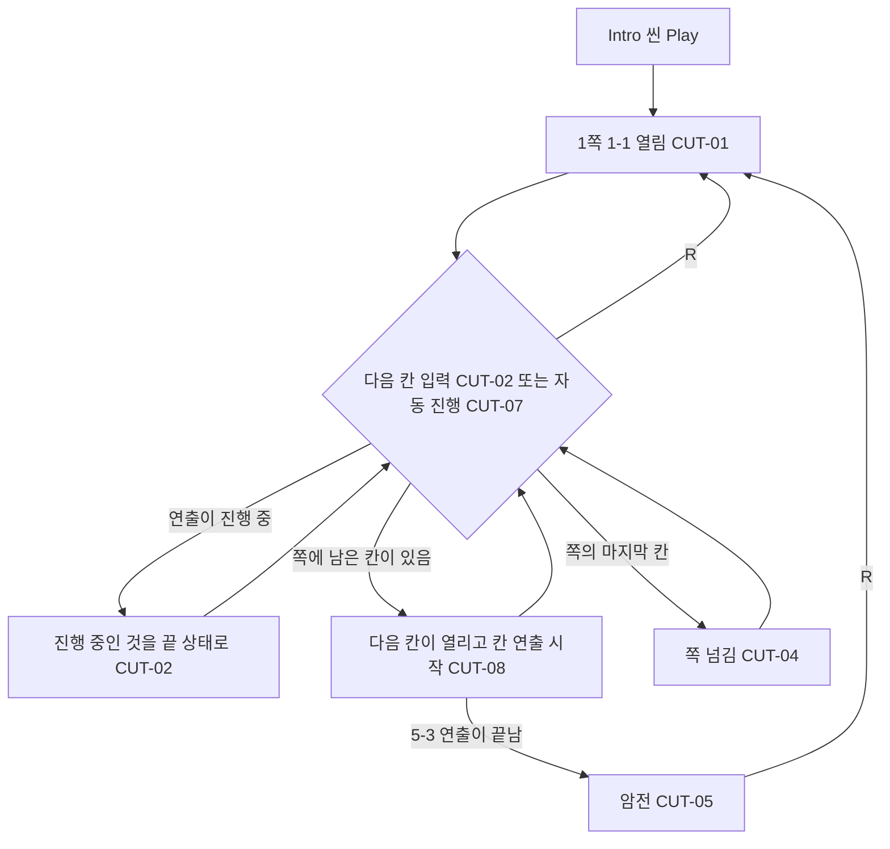

# 인트로 컷툰

접두어 `CUT` · 다음 번호 `CUT-40`

게임을 시작하기 전에, 운석 충돌로 지구가 무너지고 우주선 한 척이 떠나 주인공이 수면 캡슐 안에서 눈을 감기까지를 만화 칸이 차례로 열리는 컷툰으로 보여 준다. 지금은 아트 없이 회색 도형과 회색 3D 세트로 칸 배치, 순서, 연출 시간을 확인하는 그레이 박스다.

## 흐름

5쪽 14칸이 번호 순서대로 열린다. 1쪽과 2쪽은 칸마다 따로 찍는 회색 3D 장면이고, 3~5쪽은 회색 2D 도형이다. 본편과 이어지지 않는 단독 씬이라 암전 뒤에는 R로 다시 보는 것만 할 수 있다.

## 기능

### 시작과 칸 나타나기 (CUT-01)

인트로 씬을 Play하면 검은 배경 위에 1쪽이 보이고 1-1 칸이 바로 열린다.

- 칸은 조금 떨어진 자리에서 제자리로 들어오며 서서히 나타난다.

### 다음 칸 넘기기 (CUT-02)

Space, Enter, 마우스 왼쪽 클릭 중 하나를 누르면 다음 칸이 열린다.

- 칸이 나타나는 중이거나 칸 연출이 진행 중이면 그 입력은 진행 중인 것을 끝 상태로 맞추기만 하고, 다음 입력에서 다음 칸을 연다.

### 쪽 넘김 (CUT-04)

한 쪽의 칸이 모두 열린 뒤 다음 칸을 누르면 지금 쪽이 사라지고 다음 쪽의 첫 칸이 열린다.

- 쪽이 사라지는 동안 들어온 입력은 무시한다.

### 끝의 암전 (CUT-05)

마지막 칸(5-3)의 연출이 끝나면 입력 없이 잠시 뒤 화면 전체가 검게 덮인다.

- 기다리는 동안과 암전 중의 입력은 무시한다.

### 처음부터 다시 (CUT-06)

R을 누르면 진행 상태와 관계없이 모든 쪽, 칸, 연출, 암전을 처음 상태로 되돌리고 1-1부터 다시 연다.

### 자동 진행 (CUT-07)

자동 진행을 켜면 진행 중인 것이 없어진 뒤 일정 시간마다 입력 없이 다음 칸으로 넘어간다. 기본은 꺼져 있다.

### 쪽 바로 가기 (CUT-33)

확인용 임시 기능이다. 편집기와 개발 빌드의 Play 중 숫자패드 1~5를 누르면 처음 상태로 되돌린 뒤 그 쪽의 첫 칸을 연다.

- 연출 도중, 쪽 넘김 도중, 암전 뒤에도 된다. 하단 쪽 번호도 바뀐다.
- 정식 빌드에는 들어가지 않고 하단 안내에도 적지 않는다.

### 칸 연출 (CUT-08)

칸이 열리면 칸마다 정해 둔 연출이 기다렸다가 정해진 시간 동안 시작 값에서 끝 값으로 바뀐다.

- 2D 도형의 이동, 크기, 투명도와 3D 물체의 위치, 회전, 크기, 색을 바꾼다.
- 카메라가 중심점 둘레를 돌며 멀어지는 궤도 연출, 새의 날갯짓 연출이 있다.
- 기다리는 동안은 시작 값에 머문다. 칸별 연출은 "자세히 > 구성"의 칸 구성 표를 따른다.

### 충돌 번쩍임 (CUT-10)

3-1이 열리면 화면 전체가 하얗게 덮였다가 걷힌다.

### 눈 감김 (CUT-11)

5-3이 열리면 뜬 눈, 반쯤 감은 눈, 감은 눈이 차례로 하나씩 보인다.

### 그레이 박스 화면 (CUT-12)

칸은 회색 판에 흰 테두리를 두르고, 칸 밖으로 나간 도형은 잘라 낸다.

- 사람은 원 머리와 둥근 몸통, 운석·지구·눈동자는 원, 우주선은 삼각형, 캡슐은 둥근 상자, 눈은 타원이다.
- 불길과 타는 지구만 흐린 붉은색, 2-2 운석 가장자리의 달아오른 공기 띠만 옅은 살구빛을 쓴다.
- 칸 왼쪽 위 어두운 상자에 칸 번호와 이름, 내용을 적는다.

### 하단 안내 (CUT-13)

화면 아래 왼쪽에 "Space·Enter·클릭: 다음    R: 처음부터", 오른쪽에 "쪽 1 / 5" 같은 쪽 번호가 보인다.

- 암전 위에도 보인다. 안내를 끄면 사라진다.

### 그레이 박스 씬 만들기 (CUT-14)

메뉴 `IntroCuttoon/그레이박스 씬 만들기`가 5쪽 14칸 배치를 새 씬에 깔아 인트로 씬 파일로 저장한다.

- 도형 그림이 없을 때만 새로 만든다.
- 씬 파일이 이미 있으면 덮어쓸지 묻고, 취소하면 아무것도 바꾸지 않는다. 열린 씬에 저장하지 않은 변경이 있으면 먼저 저장할지 묻는다.
- 만든 뒤에는 씬에 저장된 칸 위치, 크기, 연출 값을 쓴다.

### 1·2쪽 3D 칸 (CUT-15)

1쪽과 2쪽 칸은 칸마다 따로 있는 카메라가 회색 3D 세트를 찍은 그림을 칸에 꽉 채워 보여 준다.

- 칸 카메라 위치, 각도, 시야각은 씬 값을 쓴다. 1-3 카메라만 카메라 빠지기 연출 값이 정한다.
- 세트끼리는 서로의 카메라에 보이지 않게 멀리 떨어져 있고, 화면 UI와 3D 세트가 서로 섞여 보이지 않는다.

### 1쪽 거리와 그림자 (CUT-16)

1-1은 대각선 거리를 높은 곳에서 내려다보고, 시민이 왼쪽에서 오른쪽으로 걸어가 멈춘다. 1-2는 같은 각도로 시민을 크게 보여 주고 운석 그림자가 덮쳐 온다.

- 1-2가 다 나타나면 흰 새 떼가 카메라 가까이를 오른쪽 아래에서 왼쪽 위로 날갯짓하며 지나가고, 새 사이로 시민이 보인다.
- 새가 모두 벗어나고 한 박자 뒤 보이지 않는 운석의 그림자가 칸 오른쪽 위 모서리 밖에서 들어와 점점 빨라지며 땅, 건물, 시민을 덮는다. 그림자 가장자리는 선명하다.
- 그림자가 다가오는 동안 칸 전체가 해를 가리듯 한 단계 어두워진다. 라벨은 어두워지지 않는다.
- 1-1 칸에는 새와 그림자가 없다.

### 1-3 올려다보기 (CUT-19)

1-3에서 인물이 고개를 위로 들고, 머리 옆에 작은 `?`가 나타난 뒤 카메라가 옆으로 돌며 뒤로 빠진다.

- 처음에는 가까운 정면 구도에서 고개가 좌우로 돌지 않고 몸이 향한 방향 그대로 들린다.
- 고개를 다 든 뒤 카메라가 머리 둘레를 돌며 빠져, 몸이 오른쪽으로 비스듬히 서고 오른쪽 어깨가 칸 왼쪽 끝에 걸린 최종 구도에서 멈춘다. 그동안 머리는 칸 화면에서 곧은 선으로 움직인다.
- `?`는 머리와 함께 작아지고, 화면 비율이 달라도 머리 옆에 같은 간격으로 붙어 있다.

### 2-1 시민의 얼굴 (CUT-28)

2-1은 위를 올려다보는 시민의 얼굴을 정면에서 가까이 찍어, 눈썹부터 턱까지 표정이 칸을 꽉 채운다.

- 칸이 열릴 때는 한쪽 눈썹만 올라간 호기심 어린 표정이다. 눈썹, 눈과 시선, 동공, 입 순서로 조금씩 늦게 시작해 겹치며 경악한 표정으로 바뀐다.
- 끝에는 흰자가 홍채 둘레로 다 보이게 눈을 크게 뜨고, 두 눈썹이 치켜 오르고, 동공이 커지고, 입을 세로로 크게 벌린다. 시선은 카메라가 아니라 다음 칸 쪽 위를 본다.
- 두 동공 가운데에 2-2 처음 모습과 같은 운석이 비쳐 있고, 동공보다 더 오래 커진다.

### 2-2 다가오는 운석 (CUT-29)

2-2는 시민이 올려다본 하늘이다. 양옆 높은 건물 실루엣 사이 하늘 가운데의 운석이 묵직하게 떠나 점점 빨라지며 다가와 하늘을 닫는다.

- 운석은 내내 건물 꼭대기보다 높아 앞쪽 건물에 가려진다. 충돌은 3-1 번쩍임에서 일어난다.
- 멀 때는 하늘빛에 묻혀 흐리다가 다가올수록 짙어지고 구덩이가 또렷해진다. 가장자리의 달아오른 공기 띠가 운석에 붙은 채 커지며 흰빛에서 옅은 살구빛이 되고, 아래 구름 쪽이 더 세게 빛나며 일그러진다.
- 구름은 바람에 아주 천천히 흐른다. 운석은 가장자리를 가리던 구름을 지나 앞으로 나오고, 띠가 아래 구름에 닿는 순간 그 구름의 가장자리가 한 번 뜯겨 나간다.

---

## 자세히

개발자용: 고칠 때 볼 것 (주의, 하지 않는 것, 구성, 코드 단서, 메모)

### 주의

- `CUT-01` 칸 나타나기는 `_appearDuration`초 동안 투명도 0에서 1, `_slideOffset`만큼 떨어진 자리에서 제자리로 들어온다(옛 CUT-03).
- `CUT-08` 3D 이동·회전 연출(`CuttoonTransformTween`)은 켜 둔 항목(로컬 위치, 회전, 크기)만 바꾼다(옛 CUT-20). 궤도 연출(`CuttoonOrbitTween`)은 좌우 각도, 중심점까지 거리, 중심점의 칸 화면 위치를 함께 바꾸고 내려다보는 각도는 그대로 둔다(옛 CUT-25). 날갯짓(`CuttoonFlap`)은 두 날개를 거울처럼 사인 곡선으로 오르내린다(옛 CUT-27). 색 연출(`CuttoonColorTween`)은 그 Renderer의 `_BaseColor`만 바꾸고 재질 애셋은 바꾸지 않는다(옛 CUT-36).
- `CUT-08` 연출의 시작·끝 상태는 `_curve` 값으로 정해진다. 곡선 끝점을 0과 1이 아닌 값으로 고치면 시작·끝 상태도 지정 값과 달라진다.
- `CUT-15` Main Camera는 UI 레이어만, 칸 카메라는 UI 레이어를 빼고 찍는다. RenderTexture 크기는 씬을 만들 때의 칸 크기(1920x1080 기준)로 정해져 칸 크기를 바꿔도 따라 바뀌지 않는다. Game 창이 16:9가 아니면 칸 그림이 늘어나 보인다.
- `CUT-16` 1-2는 1-1과 같은 모양의 줌인용 거리 세트를 따로 두고, 1-1 카메라와 같은 위치·각도에서 시야각만 좁혀 찍는다(옛 CUT-17). 1-1 세트에는 운석이 없다. 칸 어두워짐은 라벨보다 아래 그려지는 검은 막의 투명도 0→0.35다(옛 CUT-21). 새는 9마리, 카메라에서 8~14m, 그림자를 드리우지 않는다(옛 CUT-26).
- `CUT-16` 그림자와 어두워짐의 기다림(1.4초)은 새 떼가 모두 칸을 벗어난 뒤(약 1.9초) 한 박자 쉬고 그림자가 들어오게(약 2.0초) 맞춘 값이다. 새 출발, 거리, 운석 경로나 시간을 바꾸면 함께 고친다.
- `CUT-19` 정면 구도에서는 고개를 최종 각도보다 더 높이 들었다가 카메라가 빠지는 동안 최종 각도로 내려온다. `?`는 고개를 다 든 순간부터 이즈 인으로 나타난다.
- `CUT-19` 카메라 시작 자리·방향과 최종 구도는 궤도 연출 값으로 저장되고, 빌더가 최종 구도를 카메라 위치·방향과 같게 넣는다(옛 CUT-23). 편집기에서 카메라만 옮기면 Play에서 연출 값 자리로 돌아간다. 구도를 바꾸려면 빌더 값을 고쳐 씬을 다시 만든다.
- `CUT-19` `?` 따라붙기(`CuttoonScreenFollow`)는 매 프레임 머리 화면 범위 오른쪽 끝에서 같은 간격, 머리 높이의 위쪽 4분의 1 지점에 붙인다(옛 CUT-24). 켜기 값의 기본은 꺼짐이고 씬 만들기가 1-3 `?`에 켜서 넣는다. 간격은 `?` 상자 왼쪽 끝 기준이라 보이는 빈칸은 약 1.4픽셀 좁다.
- `CUT-28` 표정 부위는 눈썹 0.6초, 눈 0.7초, 동공 0.8초, 입 1초부터 시작해 2.6초에 끝난다(옛 CUT-32). 위쪽 입술 자리, 턱, 볼은 움직이지 않는다. 눈꺼풀이 없어 눈 커짐은 흰자 타원의 세로 크기로 보인다.
- `CUT-28` 동공에 비친 운석은 동공의 자식이라 동공과 함께 커지고, 열리자마자 고르게 커져 약 3.2초에 끝 크기가 된다(옛 CUT-37). 2-2에 맞춰 더 커지지 않는다.
- `CUT-29` 운석은 반지름 150m 그대로 거리만 1,067m에서 230m로 줄인다(옛 CUT-30). 운석은 2-2 카메라 시선 축을 따라 다가오므로 카메라 각도만 바꾸면 화면 가운데를 벗어난다. 다 다가왔을 때 운석 바닥은 건물 꼭대기보다 약 5m 높다.
- `CUT-29` 띠는 운석 중심을 지나 시민을 향한 판이라 운석 몸체 위에는 그려지지 않는다. 판 위 운석 윤곽 자리가 거리에 따라 반지름의 1.01~1.10배로 바뀌어, 띠 그림은 1~1.125배를 가장 진하게 칠한다. 카메라 시야각이나 운석 거리를 크게 바꾸면 띠가 옅어지거나 하늘 틈이 생길 수 있다.
- `CUT-29` 하늘색 막과 띠 판은 중심이 같은 투명 재질이고, 막 재질의 그리기 순서를 띠보다 하나 늦게 두어 막이 띠 위에 그려진다(옛 CUT-34).
- `CUT-29` 구름 가장자리가 뜯기는 때(2.32초)는 운석 크기, 거리, 곡선과 아래 구름 자리로 맞춘 값이다(옛 CUT-35). 이 값들을 바꾸면 함께 다시 맞춘다.
- `CUT-33` 확인이 끝나면 `CuttoonPlayer`의 `#if UNITY_EDITOR || DEVELOPMENT_BUILD` 묶음 두 곳과 이 기능을 지운다.

### 하지 않는 것

- 2쪽 전체나 1-2 칸을 흔들지 않는다. 운석이 부딪히기 전 흔들림은 이유 없는 강조로 보였다(옛 CUT-09, CUT-22). 흔들림 컴포넌트(`CuttoonShake`)는 남겨 두었지만 지금 쓰는 칸이 없다.
- 1-2에서 칸 테두리를 넘는 반투명 그림자를 쓰지 않는다. 칸 안 3D 그림자와 겹쳐 이중으로 보였다(옛 CUT-18).
- 2-2에 효과음 글자를 찍지 않는다(옛 CUT-31).
- 2-1과 2-2를 함께 움직이지 않는다. 시선이 갈린다.

### 구성

- 칸 구성. 쪽 안에서 칸은 번호 순서대로 열리고, 우주선은 모든 칸에서 왼쪽에서 오른쪽으로 나아간다.

| 쪽 | 칸 | 칸 이름 | 그림 | 연출 |
|---|---|---|---|---|
| 1 | 1-1 | 도시 거리 | 3D 부감: 대각선 거리, 건물 상자, 작은 시민 | 시민이 왼쪽에서 오른쪽으로 걷는다(3D 위치) |
| 1 | 1-2 | 그림자 | 줌인용 세트, 멈춘 시민, 카메라 가까이의 흰 새 떼 | 새 떼가 날아간다(3D 위치, 날갯짓), 운석 그림자가 덮쳐 오고(3D 위치) 칸이 어두워진다(투명도) |
| 1 | 1-3 | 올려다보기 | 3D 상반신, 머리 옆의 작은 `?` | 고개 들기(3D 회전), `?` 나타남(투명도), 카메라 빠지기(궤도), `?` 작아짐(크기)과 따라붙기(위치) |
| 2 | 2-1 | 시민의 얼굴 | 3D 얼굴 정면 클로즈업, 두 동공에 비친 운석 | 표정이 바뀐다(3D 위치·회전·크기), 비친 운석이 커진다(3D 크기) |
| 2 | 2-2 | 운석 | 3D 시민 시점: 건물 실루엣 사이 하늘의 운석, 구름, 달아오른 공기 띠 | 운석 다가옴(3D 위치), 흐림 걷힘과 띠 색(색, 3D 회전), 구름 흐름과 뜯김(3D 위치·크기) |
| 3 | 3-1 | 충돌 | 흰 띠 칸 | 화면 번쩍임 |
| 3 | 3-2 | 멸망과 출발 | 별, 지구, 지구 위 불길, 작은 우주선 | 불길이 번진다(크기), 우주선이 오른쪽 위로 빠져나간다(위치) |
| 3 | 3-3 | 우주선 | 우주선 옆모습, 엔진 불꽃 | 우주선이 오른쪽으로 나아간다(위치) |
| 4 | 4-1 | 창 너머 지구 | 창, 타는 지구, 창가의 뒷모습들 | 지구가 작아진다(크기) |
| 4 | 4-2 | 우는 사람들 | 옆얼굴 넷과 눈물, 그중 제복 입은 주인공 | 눈물이 흐른다(위치) |
| 4 | 4-3 | 주인공의 눈 | 크게 뜬 눈, 동공에 비친 타는 지구, 눈물 | 눈물이 흐른다(위치) |
| 5 | 5-1 | 수면 캡슐 | 멀어지는 캡슐 줄, 사람들 | 한 사람이 캡슐 쪽으로 걷는다(위치) |
| 5 | 5-2 | 뚜껑이 닫힘 | 캡슐에 누운 주인공, 유리 뚜껑, 서리 | 뚜껑이 닫힌다(위치), 서리가 낀다(투명도) |
| 5 | 5-3 | 눈을 감다 | 유리 너머 주인공의 눈 | 눈 감김 단계, 끝나면 암전 |

- 씬 만들기가 처음 넣는 칸별 연출 값이다. 씬에서 고치면 씬 값이 쓰인다.

| 칸 | 연출 | 기다림(초) | 시간(초) | 값 |
|---|---|---|---|---|
| 1-1 | 시민 걷기 | 0 | 3.2 | 거리를 따라 5.5m, 고른 속도 |
| 1-2 | 운석 다가옴(3D 그림자) | 1.4 | 2.2 | 그림자 중심이 시민에서 오른쪽 위로 24.4m에서 9.4m까지, 이즈 인 |
| 1-2 | 칸 어두워짐 | 1.4 | 2.2 | 검은 막 투명도 0에서 0.35, 이즈 인 |
| 1-2 | 새 떼 날아가기 | 0.5 + 새마다 0~0.4 | 카메라 거리 × 0.082 (0.7~1.15) | 흰색(회색 0.92) 9마리, 칸 화면 가로 1.25에서 -0.25까지, 세로로 1.1 오름, 고른 속도 |
| 1-2 | 새 날갯짓 | 새 날아가기와 같음 | 새 날아가기와 같음 | 1초에 4.6~5.6번, 최대 50도, 새마다 시작 자리 다름 |
| 1-3 | 고개 들기 | 0.4 | 2.7 | 아래 8도에서 1초 동안 위 40도, 0.1초 머문 뒤 1.6초 동안 위 32도. 몸은 오른쪽으로 30도 돌아선 채 |
| 1-3 | 카메라 빠지기(궤도) | 1.5 | 1.6 | 중심점은 숙였을 때와 40도 들었을 때 머리 중심 평균. 시작은 최종보다 좌우 30도 돌리고 0.5m 가깝게, 중심점을 칸 가로 가운데·세로 0.39에 둔다 |
| 1-3 | `?` 나타남 | 1.4 | 0.9 | 투명도 0에서 1, 이즈 인(글자 크기 60, 상자 80x90) |
| 1-3 | `?` 작아지기 | 1.5 | 1.6 | 빌더가 계산한 비율(1.107)에서 1배로 |
| 1-3 | `?` 머리 옆 붙이기 | 0 | 계속 | 머리 화면 범위 오른쪽 끝에서 26픽셀, 머리 높이의 0.75 지점 |
| 2-1 | 눈썹 올라감 | 0.6 | 1.2 | 왼쪽 1.06m·-3도, 오른쪽 1.11m·6도에서 둘 다 1.15m, 왼쪽 14도·오른쪽 -14도 |
| 2-1 | 눈 커짐 | 0.7 | 1.2 | 흰자와 테의 세로 배율 0.56에서 1 |
| 2-1 | 시선 올라감 | 0.7 | 1.2 | 홍채 묶음이 위로 0.04m |
| 2-1 | 동공 확장 | 0.8 | 1.4 | 동공 지름 0.055m에서 0.11m |
| 2-1 | 비친 운석 커짐 | 0 | 3.2 | 동공에 견준 크기 0.46배에서 1배, 고른 속도 |
| 2-1 | 입 벌어짐 | 1 | 1.6 | 가로 0.28m·세로 0.035m·0.1m 위에서 가로 0.34m·세로 0.32m·제자리 |
| 2-2 | 운석 다가옴 | 0.2 | 2.6 | 시선 방향 1,067m에서 230m, 이즈 인(곡선 끝 기울기 1.3) |
| 2-2 | 운석 흐림 걷힘(색) | 0.2 | 2.6 | 하늘색(밝기 0.5) 막 투명도 0.425에서 0, 이즈 인 |
| 2-2 | 달아오른 공기 띠(색) | 0.2 | 2.6 | 흰색(투명도 0.3)에서 살구색(0.93, 0.81, 0.7, 투명도 1), 이즈 인 |
| 2-2 | 띠의 뜨거운 쪽(색) | 1.5 | 1 | 투명도 0에서 0.75(1, 0.96, 0.9) |
| 2-2 | 띠의 뜨거운 쪽 흐름(3D 회전) | 1.5 | 1.3 | 12도, 시계 반대 방향, 고른 속도 |
| 2-2 | 구름 흐름 | 0 | 2.8 | 모든 구름이 칸 왼쪽으로 5m, 고른 속도 |
| 2-2 | 구름 가장자리 뜯김 | 2.32 | 0.3 | 아래 구름 왼쪽 공이 195도로 14m 떨어져 나가며 작아지고, 숨은 조각이 185도로 26m 날아가며 생긴다 |
| 3-1 | 화면 번쩍임 | 0 | 0.9 | 세기 1 |
| 3-2 | 불길 번짐 | 0.2 | 2.6 | 크기 0.2에서 1.4 |
| 3-2 | 우주선 빠져나감 | 0.4 | 3 | 오른쪽 360, 위 210픽셀 |
| 3-3 | 우주선 나아감 | 0 | 2.8 | 왼쪽 140픽셀에서 오른쪽 60픽셀 |
| 4-1 | 지구 작아짐 | 0.3 | 4.5 | 크기 1에서 0.4 |
| 4-2 | 눈물 둘 | 0.4, 1.0 | 2.4 | 아래로 40픽셀 |
| 4-3 | 눈물 | 0.5 | 2.2 | 아래로 70픽셀 |
| 5-1 | 한 사람 걷기 | 0.2 | 1.8 | 오른쪽으로 70픽셀 |
| 5-2 | 뚜껑 닫힘 | 0.3 | 1.4 | 오른쪽 1100픽셀에서 제자리 |
| 5-2 | 서리 | 1.7 | 1.8 | 투명도 0에서 1 |
| 5-3 | 눈 감김 | 0.6 | 1.8 | 세 단계, 간격 0.9 |

- 2쪽 세트와 카메라의 처음 값이다.

| 칸 | 항목 | 값 |
|---|---|---|
| 2-1 | 얼굴 | 1-3 상반신과 같은 크기, 고개를 뒤로 25도. 흰자 0.3x0.34m, 홍채 지름 0.17m(칸 오른쪽으로 0.02m), 비친 운석은 몸체(밝기 0.3)와 띠 판(흰색 투명도 0.65) |
| 2-1 | 카메라 | 시야각 30도, 표정 가운데에서 정면, 칸 가로에 0.8m가 담기는 거리, 표정 가운데를 칸 세로 0.24에 둠, 배경 밝기 0.5 |
| 2-2 | 카메라 | 눈높이 1.7m, 길 방향 위 60도, 시야각 66도, 배경 밝기 0.5, 원평면 1,400m |
| 2-2 | 건물 | 길 가운데에서 양옆 20m(정면 16m), 가로·세로 8m, 높이 20~46m, 밝기 0.32 |
| 2-2 | 운석 | 반지름 150m, 밝기 0.3, 시민 쪽 구덩이 5개(밝기 0.18). 하늘색 막은 1.05배 구 |
| 2-2 | 달아오른 공기 띠 | 안쪽 투명 원(그림 반지름의 0.68)이 운석 반지름에 놓이고 운석 반지름의 1.125배까지 가장 진하며 1.47배에서 사라진다 |
| 2-2 | 구름 | 밝기 0.86. 220m·왼쪽 위 9.5도·1.6배, 320m·오른쪽 위 27도·1.3배, 160m·아래 26도·1.4배 |

- 2-1 얼굴 세트와 2-2 시점 세트는 씬을 만들 때 방향광의 좌우 각도를 읽어 해 쪽으로 돌린다. 그 뒤 방향광을 돌려도 세트는 따라 돌지 않는다.
- 글꼴은 `Assets/EyeMaze/Fonts/Galmuri11.ttf`를 쓴다.

### 코드 단서

기능을 고칠 때 먼저 볼 곳이다.

| 기능 | 찾을 곳 |
|---|---|
| CUT-01 | `CuttoonPlayer.Restart`, `CuttoonPanel.ApplyAppear` |
| CUT-02 | `CuttoonPlayer.RequestAdvance`, `CuttoonPage.FinishOpened` |
| CUT-04 | `CuttoonPlayer.Advance`, `CuttoonPlayer.UpdatePageFade` |
| CUT-05 | `CuttoonPlayer.UpdateBlackout` |
| CUT-06 | `CuttoonPlayer.Restart`, `CuttoonPage.ResetPage` |
| CUT-07 | `CuttoonPlayer.UpdateShowing` |
| CUT-33 | `CuttoonPlayer.JumpToPage` |
| CUT-08 | `CuttoonEffect.Play`, `CuttoonTransformTween.Apply` |
| CUT-10 | `CuttoonFlash.Apply` |
| CUT-11 | `CuttoonSteps.ShowStep` |
| CUT-12 | `IntroCuttoonGrayboxBuilder.CreatePanel` |
| CUT-13 | `CuttoonPlayer.UpdatePageText` |
| CUT-14 | `IntroCuttoonGrayboxBuilder.BuildFromMenu` |
| CUT-15 | `IntroCuttoonGrayboxBuilder.CreateSetCamera` |
| CUT-16 | `IntroCuttoonGrayboxBuilder.BuildCitySet`, `IntroCuttoonGrayboxBuilder.CreateBirdFlock` |
| CUT-19 | `IntroCuttoonGrayboxBuilder.BuildBustSet`, `CuttoonScreenFollow.PlaceMark` |
| CUT-28 | `IntroCuttoonGrayboxBuilder.BuildFaceSet`, `IntroCuttoonGrayboxBuilder.AddFaceChange` |
| CUT-29 | `IntroCuttoonGrayboxBuilder.BuildPovSet` |

### 메모

- 그레이 박스라서 그림은 모두 도형이다. 1-2 새는 위에서 본 도형이라 작은 비행기처럼 보일 수 있다. 아트 단계에서 바꾼다.
- 3~5쪽 칸 안의 사람, 눈, 지구 도형 일부는 1920x1080 기준 픽셀 크기라 화면 비율이 크게 다르면 배치가 조금 어긋날 수 있다.
- 3D 그림자는 URP 그림자 거리(50) 안에서만 그려져, 1-1 먼 곳에서는 늦게 나타날 수 있다.
- 2-2 운석이 왼쪽 위 구름을 지날 때(약 2.49초) 3D 도형이 서로 파고들어 구름 조각이 운석 위에 점처럼 남을 수 있다.
- 2-2 다가옴 곡선은 실제 이동 속도가 약 2.3초에 가장 빠르고 끝까지 조금 줄지만, 화면에서 커지는 속도는 끝까지 빨라진다. 비교 화면에서 고른 곡선이라 그대로 둔다.
- 기능 묶음을 줄이며 옛 CUT-03, CUT-17, CUT-20, CUT-21, CUT-23~27, CUT-30, CUT-32, CUT-34~37은 위 기능의 세부 줄과 "주의"로 합쳤다. 이 번호들은 다시 쓰지 않는다.

