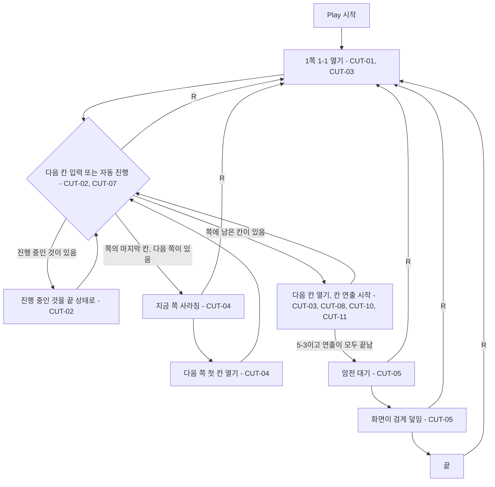

# 인트로 컷툰

## 1. 목적

게임을 시작하기 전에, 운석 충돌로 지구가 무너지고 우주선 한 척이 떠나 주인공이 수면 캡슐 안에서 눈을 감기까지를 만화 칸이 차례로 열리는 컷툰으로 보여 준다. 지금 단계는 아트 없이 회색 도형으로 칸 배치, 칸 순서, 연출 시간을 눈으로 확인하는 그레이 박스다.

## 2. 요구사항

### 진행

- **CUT-01** `[승인]` `Assets/Scenes/Intro.unity`를 Play하면 검은 배경 위에 1쪽이 보이고 1-1 칸이 바로 열린다.
- **CUT-02** `[승인]` Space, Enter, 마우스 왼쪽 클릭 중 하나를 누르면 다음 칸이 열린다. 지금 쪽에서 칸 나타나기나 칸 연출이 아직 진행 중이면 그 입력은 진행 중인 것을 모두 끝 상태로 맞추기만 하고, 다음 입력에서 다음 칸을 연다.
- **CUT-03** `[승인]` 칸이 열리면 `_appearDuration`초 동안 투명도가 0에서 1로 오르며 `_slideOffset`만큼 떨어진 자리에서 제자리로 들어온다.
- **CUT-04** `[승인]` 한 쪽의 칸이 모두 열린 뒤 다음 칸 입력이 들어오면 지금 쪽이 `_pageFadeDuration`초 동안 사라지고, 다음 쪽의 첫 칸이 열린다. 사라지는 동안 들어온 다음 칸 입력은 무시한다.
- **CUT-05** `[승인]` 마지막 쪽의 마지막 칸(5-3)이 열리고 그 쪽의 연출이 모두 끝나면, 입력 없이 `_blackoutDelay`초 뒤 `_blackoutDuration`초 동안 화면 전체가 검게 덮인다. 기다리는 동안과 암전 중에 들어온 다음 칸 입력은 무시한다.
- **CUT-06** `[승인]` R을 누르면 진행 상태와 관계없이 모든 쪽, 칸, 연출, 암전을 처음 상태로 되돌리고 1-1부터 다시 연다.
- **CUT-07** `[승인]` `_autoAdvance`가 켜져 있으면 지금 쪽에서 진행 중인 것이 없어진 뒤 `_autoAdvanceInterval`초가 지날 때마다 입력 없이 다음 칸 입력과 같은 일을 한다. 기본값은 꺼짐이다.
- **CUT-33** `[승인]` (확인용 임시 기능, 나중에 지운다) 편집기와 개발 빌드의 Play 중 숫자패드 1~5를 누르면 그 번호의 쪽으로 바로 간다. 모든 쪽, 칸, 연출, 암전을 처음 상태로 되돌린 뒤 그 쪽의 첫 칸을 열고, 하단 쪽 번호를 바꾼다. 연출 도중, 쪽 넘김 도중, 암전 뒤에도 된다. 정식 빌드에는 들어가지 않고, 하단 안내(CUT-13)에도 적지 않는다.

### 칸 연출

- **CUT-08** `[승인]` 이동·크기·투명도 연출(`CuttoonTween`)은 칸이 열린 뒤 `_delay`초 기다렸다가 `_duration`초 동안 `_curve`를 따라 시작 값에서 끝 값으로 바뀐다. 기다리는 동안은 시작 값에 머문다. 쓰는 곳은 아래 "칸 구성" 표의 연출 열이다.
- ~~**CUT-09**~~ `[폐기]` (폐기: 운석이 아직 부딪히지 않았는데 2-2가 열릴 때 2쪽 전체가 흔들려 이유 없는 강조로 보였다. 2-2의 임팩트는 CUT-30 공기 눌림으로 준다.)
- **CUT-10** `[승인]` 번쩍임(`CuttoonFlash`)은 3-1이 열리면 화면 전체를 흰색(투명도 `_peakAlpha`)으로 덮었다가 `_duration`초 동안 걷어 낸다.
- **CUT-11** `[승인]` 단계 바꾸기(`CuttoonSteps`)는 5-3이 열리면 뜬 눈, 반쯤 감은 눈, 감은 눈을 `_stepInterval`초 간격으로 하나씩만 보인다.

### 그레이 박스 화면

- **CUT-12** `[승인]` 칸은 회색 판에 흰 테두리를 두르고, 칸 밖으로 나간 도형은 잘라 낸다. 1쪽과 2쪽 칸은 3D 블록아웃(CUT-15)으로 보여 주고, 3~5쪽 칸 안의 그림은 회색 도형으로만 그린다. 사람은 원 머리와 둥근 몸통, 운석·지구·눈동자는 원, 우주선은 삼각형, 캡슐은 둥근 상자, 눈은 타원이다. 불길과 타는 지구만 흐린 붉은색을 쓰고, 2-2 운석 가장자리의 달아오른 공기 띠만 다가올수록 옅은 살구빛을 띤다(CUT-34). 칸 왼쪽 위에는 어두운 상자를 두고 첫 줄에 칸 번호와 이름, 둘째 줄에 내용을 적는다.
- **CUT-13** `[승인]` `_showGuide`가 켜져 있으면 화면 아래 왼쪽에 "Space·Enter·클릭: 다음    R: 처음부터", 오른쪽에 `_pageFormat`으로 만든 쪽 번호(예: "쪽 1 / 5")를 표시한다. 안내는 암전 위에도 보인다.

### 씬 만들기

- **CUT-14** `[승인]` 메뉴 `IntroCuttoon/그레이박스 씬 만들기`를 실행하면 도형 그림(원, 삼각형, 2-2 달아오른 공기 띠)이 없을 때만 만들고, 5쪽 14칸 배치를 새 씬에 깔아 `Assets/Scenes/Intro.unity`로 저장한다. 그 씬 파일이 이미 있으면 덮어쓸지 묻고, 취소하면 아무것도 바꾸지 않는다. 열려 있는 씬에 저장하지 않은 변경이 있으면 먼저 저장할지 묻는다. 씬을 만든 뒤에는 칸 위치, 크기, 연출 값으로 씬에 저장된 값을 쓴다.

### 1·2쪽 3D 블록아웃

- **CUT-15** `[승인]` 1쪽과 2쪽 칸에는 칸을 꽉 채우는 RawImage를 두고, 칸마다 따로 있는 카메라가 회색 3D 세트를 찍은 RenderTexture를 보여 준다. 칸 카메라의 위치, 각도, 시야각은 씬에 저장된 값을 쓴다. 단, 1-3 카메라의 위치와 각도는 CUT-23 카메라 빠지기 연출에 저장된 시작 값과 끝 값이 정한다. 화면 UI를 그리는 Main Camera는 UI 레이어만 찍고, 칸 카메라는 UI 레이어를 찍지 않는다. 3D 세트(거리, 줌인 거리, 상반신, 얼굴, 시민 시점)는 서로의 카메라에 보이지 않게 멀리 떨어뜨려 둔다.
- **CUT-16** `[승인]` 1-1 카메라는 거리의 왼쪽 앞 높은 곳에서 오른쪽 아래를 비스듬히 내려다본다(부감). 거리는 화면을 왼쪽 아래에서 오른쪽 위로 가로지르고, 건물은 높이가 다른 상자다. 1-1이 열리면 시민(캡슐)이 화면 왼쪽에서 오른쪽으로 걸어 거리 가운데에 조금 못 미친 곳에서 멈춘다. 그래서 1-2에서 시민은 칸 가운데보다 왼쪽 아래에 선다.
- **CUT-17** `[승인]` 1-2는 1-1 거리 세트와 같은 모양의 줌인용 거리 세트를 따로 두고 찍는다. 1-2 카메라는 그 세트 안에서 1-1 카메라와 같은 위치와 각도에 있고 시야각만 좁혀, 멈춰 선 시민을 크게 찍는다. 1-2에서 새 떼가 칸을 다 지나간 뒤(CUT-26) 그림자만 드리우고 보이지 않는 운석 구체가 다가오며, 그 그림자가 칸 오른쪽 위 모서리 밖에서 들어와 천천히 비치다 점점 빨라져(이즈 인) 대각선으로 땅, 건물, 시민을 덮는다. 그림자 가장자리는 흐리지 않는다. 1-1 거리 세트에는 운석이 없어 1-1 칸에는 그림자가 들어오지 않는다.
- ~~**CUT-18**~~ `[폐기]` (폐기: 칸 밖에서 들어오는 반투명 그림자 덩어리가 칸 안 3D 그림자와 겹쳐 그림자가 이중으로 보였다. 1-2 그림자는 칸 안에서만 보이고, 임팩트는 CUT-17, CUT-21로 준다.)
- **CUT-19** `[승인]` 1-3은 얼굴과 어깨가 보이는 상반신 세트를 눈높이보다 위의 카메라로 내려다보며 찍는다. 인물의 몸은 세트 안에서 오른쪽으로 비스듬히 돌아서 있고, 처음에는 카메라가 몸 정면 쪽에 있어 정자세로 보이며, 최종 구도(CUT-23)에서 오른쪽 어깨가 카메라에 더 가깝고 칸 왼쪽 끝에 걸린다. `?`는 머리 오른쪽 옆에 작게 붙어 있다(CUT-24). 1-3이 열리면 앞을 보던 고개(이마와 정수리 쪽이 보임)가 좌우로 돌지 않고 몸이 향한 방향 그대로 위로 들린다. 정면 구도에서는 정면에서도 고개를 든 것이 보이도록 최종 각도보다 더 높이 들고, 카메라가 빠지는 동안 최종 각도로 내려온다. 그래서 정면 구도에서는 앞쪽 위를, 최종 구도에서는 오른쪽 위 대각선을 올려다보는 모습이 된다. 고개를 다 든 순간부터 `?`가 이즈 인 곡선으로 투명도 0에서 1로 나타난다.
- **CUT-20** `[승인]` 3D 이동·회전 연출(`CuttoonTransformTween`)은 칸이 열린 뒤 `_delay`초 기다렸다가 `_duration`초 동안 `_curve`를 따라 대상 Transform의 로컬 위치, 로컬 회전, 로컬 크기를 시작 값에서 끝 값으로 바꾼다. 켜 둔 항목만 바꾼다.
- **CUT-21** `[승인]` 1-2가 열리면 칸 화면 위에 덮인 검은 막의 투명도가 운석 그림자가 다가오는 시간 동안 이즈 인 곡선으로 0에서 0.35로 올라, 해를 가리듯 칸 전체가 한 단계 어두워진다. 이 막은 칸 라벨보다 아래에 그려진다.
- ~~**CUT-22**~~ `[폐기]` (폐기: 운석이 아직 부딪히지 않았는데 칸이 흔들려 이유 없는 강조로 보였다. 1-2의 위협은 CUT-17 그림자와 CUT-21 어두워짐으로 준다.)
- **CUT-23** `[승인]` 1-3에서 카메라는 인물의 몸 정면 쪽 위, 최종 구도보다 가까운 자리에서 머리를 칸 가운데보다 조금 아래(라벨 상자에 걸리지 않는 높이)에 두고 기다린다. 고개를 다 든 뒤 카메라는 머리 둘레를 옆으로 돌며 뒤로 빠져(CUT-25), 인물이 오른쪽으로 비스듬히 선 최종 구도에서 멈춘다. 그동안 머리는 칸 화면에서 방향이 꺾이지 않고 곧은 선을 따라 칸 가운데 아래에서 최종 자리로 움직인다. 시작 자리·방향과 최종 구도는 카메라 빠지기 연출에 따로 저장되며, 빌더가 씬을 만들 때 최종 구도를 카메라 위치·방향과 같게 넣는다. 위에서 내려다보는 각도는 바뀌지 않고, 좌우 방향만 몸이 돌아선 각도만큼 바뀐다. 카메라가 빠지는 동안 `?`는 인물이 작아지는 만큼 같이 작아지고, 머리 옆 자리는 CUT-24가 지킨다.
- **CUT-24** `[승인]` 1-3의 `?`는 Play 동안 매 프레임 머리(머리 축 아래 부품)의 화면 범위 오른쪽 끝에서 같은 간격만큼 떨어지고, 머리 높이의 위쪽 4분의 1 지점에 붙는다. 고개를 드는 동안, 카메라가 빠지는 동안, Game 창 비율이 달라도 머리와 `?` 사이 간격은 같다. 따라붙기(`CuttoonScreenFollow`)는 켜기 값을 켰을 때만 움직이며 기본값은 꺼져 있고, 씬 만들기(CUT-14)가 1-3의 `?`에 켜서 넣는다.
- **CUT-25** `[승인]` 궤도 연출(`CuttoonOrbitTween`)은 칸이 열린 뒤 `_delay`초 기다렸다가 `_duration`초 동안 `_curve`를 따라 카메라의 좌우 각도(`_fromYaw`→`_toYaw`), 중심점까지 거리(`_fromDistance`→`_toDistance`), 중심점이 놓이는 칸 화면 위치(`_fromView`→`_toView`)를 함께 바꾸고, 중심점이 그 화면 위치에 오도록 카메라 위치와 회전을 정한다. 내려다보는 각도 `_pitch`는 바뀌지 않는다. 기다리는 동안은 시작 값에 머문다.
- **CUT-26** `[승인]` 1-2가 다 나타난 직후, 어두워지기 시작한 하늘을 먼저 느낀 흰 새 떼(9마리)가 칸 오른쪽 아래 밖에서 왼쪽 위 밖으로 비스듬히 무리지어 날아 달아난다. 새는 1-2 카메라 가까이(카메라에서 8~14m, 시민까지는 약 28m)를 날아 크게 보이고, 지나가는 동안 새 사이로 시민이 보인다. 가까운 새일수록 빨리 지나가고, 새마다 출발이 조금씩 늦어 흩어진 무리로 보인다. 새는 등을 카메라 쪽으로 향해 위에서 본 모양(길쭉한 몸통과 머리, 꼬리, 펼친 날개 두 장)으로 보이며, 날갯짓(CUT-27)을 하고, 그림자를 드리우지 않는다. 새가 모두 칸을 벗어나고 한 박자 뒤에 운석 그림자가 칸 오른쪽 위에 들어온다(CUT-17). 새는 1-2 줌인 세트에만 있어 1-1 칸에는 보이지 않는다.
- **CUT-27** `[승인]` 날갯짓 연출(`CuttoonFlap`)은 칸이 열린 뒤 `_delay`초 기다렸다가 `_duration`초 동안 두 날개를 몸의 앞뒤 축으로 1초에 `_frequency`번, 최대 `_amplitude`도만큼 사인 곡선으로 오르내리게 한다. 두 날개는 서로 거울처럼 같은 각도로 움직이고, `_phase`로 날갯짓 시작 자리를 정한다. 기다리는 동안은 시작 각도에 머문다.

- **CUT-28** `[승인]` 2-1은 1-3과 같은 인물(크기, 피부·옷·머리카락 재질)의 얼굴 세트를 따로 두고, 위를 올려다보는 얼굴을 얼굴이 향한 방향(정면)에서 찍는다. 아래에서 올려다보지 않는다. 익스트림 클로즈업보다 조금 떨어진 거리로 눈썹, 눈, 코, 입이 칸을 꽉 채우고, 두 눈 바깥 끝이 칸 양옆에 닿는다. 귀와 목은 칸 밖으로 나가고 턱 끝이 칸 아래 끝에 닿으며, 머리 윗부분은 라벨 상자 아래에 가려도 된다. 고개는 뒤로 젖혀 위를 올려다본다. 칸이 열릴 때는 호기심 어린 표정이다. 칸 오른쪽 눈썹만 조금 높고 바깥 끝이 올라가 갸웃하는 얼굴이고, 눈은 홍채가 위아래 테에 닿는 보통 크기, 동공도 보통 크기, 입은 다물었다. 이 표정은 CUT-32에 따라 잔뜩 경악한 표정으로 바뀐다. 끝 표정은 홍채 둘레로 흰자가 다 보이게 크게 뜬 눈, 위로 치켜 올라가고 안쪽 끝이 더 높은 두 눈썹, 확장된 동공, 세로로 크게 벌린 입이다. 홍채와 동공은 칸 오른쪽(2-2 쪽)으로 치우쳐 있고 끝에는 위쪽으로 더 올라가, 눈이 카메라를 보지 않고 시선이 다음 칸으로 이어진다. 두 동공 가운데에는 운석이 비쳐 있다(CUT-37). 얼굴 세트는 얼굴이 해가 있는 쪽을 보게 돌려 얼굴이 밝게 보인다.
- **CUT-29** `[승인]` 2-2는 2-1의 시민이 올려다본 시점이다. 도시를 옆에서 보지 않고, 시민 눈높이(1.7m)에서 넓은 길 방향으로 60도 올려다본 하늘 가운데에 운석을 둔다. 길 양옆의 높은 건물은 칸 왼쪽과 오른쪽에서 위로 모이는 어두운 실루엣으로 하늘을 감싼다. 시점 세트는 시민이 해가 있는 쪽을 올려다보게 돌려, 운석이 해를 가리고 길과 건물이 운석 그림자에 든다. 운석은 어두운 구체이고 시민 쪽 면에 구덩이가 있다. 2-1과 2-2 카메라 배경(하늘)은 같은 밝기다.
- **CUT-30** `[승인]` 2-2가 열리면 운석이 시선 방향으로 다가온다. 처음엔 거의 멈춘 듯 묵직하게 떠나 점점 빨라지고, 화면에서 커지는 속도는 끝까지 빨라진다(이즈 인). 운석은 반지름 150m로 크고 멀리서 출발해, 끝에는 칸 위아래를 크게 넘치게 차서 건물 사이 하늘을 닫는다. 그 상태로 멈추고, 충돌은 3-1 번쩍임에서 일어난다. 운석 크기는 그대로이고 거리만 줄어든다. 운석은 내내 건물 꼭대기보다 높은 하늘에 있어 앞쪽 건물에 가려진다. 운석 앞에서 짓눌려 달아오른 공기는 운석 가장자리를 둘러싼 밝은 띠로 보인다. 띠는 운석 중심에 붙은 3D 판이라 운석과 함께 다가오며 커지고, 앞쪽 건물과 운석보다 가까운 구름에 가려지며, 운석 몸체 위에는 그려지지 않는다. 띠와 운석 사이에 하늘 틈이 생기지 않는다.
- ~~**CUT-31**~~ `[폐기]` (폐기: 운석이 다가오는 2-2 끝 무렵에 효과음 글자 "쿠오오오"를 찍자 장면이 갑자기 싸구려처럼 보였다. 2-2의 임팩트는 CUT-30 공기 눌림으로 준다.)
- **CUT-32** `[승인]` 2-1이 열리면 실제 사람이 무언가를 알아채고 점점 놀라듯이, 표정이 호기심에서 경악으로 얼굴 전체에 걸쳐 점진적으로 바뀐다. 한 부위만 움직이지 않는다. 눈썹(0.6초부터)이 먼저 올라가고, 이어서 눈이 커지며 시선이 위로 더 올라가고(0.7초부터), 동공이 보통 크기에서 확장되고(0.8초부터), 입은 가장 늦게(1초부터) 다문 선에서 아래로 크게 벌어진다. 부위마다 시작이 조금씩 늦고 서로 겹치며, 모두 천천히 시작해 천천히 끝나는 곡선으로 2.6초에 끝 표정이 된다. 위쪽 입술 자리는 거의 그대로이고, 턱과 볼은 움직이지 않는다.
- **CUT-34** `[승인]` 2-2 운석이 다가올수록 명도와 채도가 바뀌어 실제로 가까워졌다는 것이 보인다. 멀 때는 운석 몸체와 구덩이가 하늘빛에 묻혀 흐리고 대비가 낮으며, 다가올수록 짙어지고 구덩이가 또렷해진다. 운석을 덮은 하늘색 막의 투명도를 줄여 보여 준다. 달아오른 공기 띠(CUT-30)는 흰빛으로 옅게 시작해 다가올수록 진해지며 옅은 살구빛이 된다. 둘 다 운석이 다가오는 시간 동안 천천히 시작해 점점 빨리 바뀐다. 운석이 가까워지면(1.5초부터) 띠 가운데 운석 바로 아래 구름을 향한 쪽이 흰빛에 가깝게 세지고, 그쪽 띠의 폭이 들쭉날쭉하게 일그러지며 천천히 흐른다. 달아오른 공기가 그 구름을 스치기 직전임을 보여 준다. 칸 전체의 밝기와 색, 하늘, 건물, 구름은 바뀌지 않는다.
- **CUT-35** `[승인]` 2-2 구름은 운석에 밀리지 않는다. 시민에게서 거리와 높이가 다른 구름 몇 조각이 하늘 곳곳에 떠 있고, 바람에 아주 천천히 한쪽으로 흐를 뿐이다. 가까운 구름일수록 화면에서 조금 더 빨리 흐른다. 그중 한 조각은 운석 처음 자리의 가장자리를 조금 가리는 곳에 있어, 처음에는 운석이 그 구름 뒤에 있다가 다가오며 구름보다 가까워지면 구름 앞으로 나와 구름을 가린다. 예외로, 운석 가장자리의 달아오른 공기가 운석 바로 아래 구름의 윗면에 닿는 순간(약 2.32초) 그 구름의 가장자리만 한 번 뜯겨 나간다. 왼쪽 덩이가 운석 가장자리를 따라 옆으로 떨어져 나가며 작아지고, 윗면에서 작은 조각 하나가 더 멀리 날아간다. 구름 본체는 그대로 바람에 흐른다. 구름 조각 수와 자리는 4절 표를 따른다.
- **CUT-36** `[승인]` 3D 색 연출(`CuttoonColorTween`)은 칸이 열린 뒤 `_delay`초 기다렸다가 `_duration`초 동안 `_curve`를 따라 대상 Renderer의 색(`_BaseColor`, 투명도 포함)을 시작 색에서 끝 색으로 바꾼다. 재질 애셋은 바꾸지 않고 그 Renderer에만 적용한다.
- **CUT-37** `[승인]` 2-1 두 동공 가운데에 비친 운석은 2-2 처음 화면의 운석과 같은 모습이다. 흐린 회색 몸체를 흰 띠가 둘러싸, 흰 점 하나인 안광처럼 보이지 않는다. 칸이 열릴 때는 작고, 열리자마자 고르게 커지기 시작해 눈이 다 커진 뒤에도 잠시 혼자 더 커지다가 약 3.2초에 끝 크기가 된다. 끝 크기를 키우고 커지는 시간을 늘려, 커지는 것이 동공 확장에 묻히지 않게 한다. 운석이 2-2 전부터 이미 다가오고 있음을 보여 준다. 동공이 커질 때 비친 운석도 함께 커져서, 동공에 견준 크기도 줄지 않고 커진다. 2-1이 멈춘 뒤 2-2에 맞춰 더 커지지는 않는다(두 칸이 함께 움직이면 시선이 갈려 하지 않기로 했다).

### 칸 구성

쪽 안에서 칸은 번호 순서대로 열린다. 우주선은 모든 칸에서 왼쪽에서 오른쪽으로 나아간다.

| 쪽 | 칸 | 칸 이름 | 그림 | 연출 |
|---|---|---|---|---|
| 1 | 1-1 | 도시 거리 | 3D 부감: 대각선 거리, 건물 상자, 작은 시민 | 시민이 화면 왼쪽에서 오른쪽으로 걷는다(3D 위치) |
| 1 | 1-2 | 그림자 | 같은 모양의 줌인용 세트, 같은 각도로 줌인, 멈춘 시민, 카메라 가까이의 흰 새 떼 | 먼저 놀란 흰 새 떼가 오른쪽 아래에서 왼쪽 위로 카메라 가까이를 날아간다(3D 위치, 날갯짓). 새가 다 지나간 뒤 운석 그림자가 오른쪽 위 모서리 밖에서 들어와 점점 빨라지며 덮쳐 오고(3D 위치), 칸이 어두워진다(투명도) |
| 1 | 1-3 | 올려다보기 | 3D 상반신, 처음엔 정자세로 칸 가운데, 최종 구도에선 몸이 오른쪽으로 비스듬히 오른쪽 어깨가 칸 왼쪽 끝, 머리 바로 옆의 작은 `?` | 고개가 몸이 향한 방향 그대로 들린다(3D 회전), 고개를 다 든 뒤 `?`가 이즈 인으로 나타난다(투명도), 카메라가 뒤로 빠지며 옆으로 돌아 최종 구도로 가고(3D 위치·회전) `?`가 작아진다(크기), `?`는 내내 머리 옆에 같은 간격으로 붙는다(위치) |
| 2 | 2-1 | 시민의 얼굴 | 3D 얼굴 정면 클로즈업: 위를 올려다보는 얼굴의 눈썹, 눈, 코, 입이 칸을 꽉 채움, 처음엔 호기심 어린 표정, 두 동공에 비친 운석 | 표정이 호기심에서 경악으로 점진적으로 바뀐다. 눈썹이 올라가고, 눈이 커지며 시선이 위로 가고, 동공이 확장되고, 입이 벌어진다(3D 위치·회전·크기). 동공에 비친 운석이 점점 커진다(3D 크기) |
| 2 | 2-2 | 운석 | 3D 시민 시점: 길 양옆 높은 건물 실루엣 사이로 올려다본 하늘 가운데의 운석, 하늘 곳곳의 구름 몇 조각, 운석 가장자리의 밝은 띠 | 운석이 묵직하게 떠나 점점 빨라지며 다가와 끝에는 칸 위아래를 넘쳐 하늘을 덮고(3D 위치), 처음엔 흐리다가 짙고 또렷해지며(색), 띠가 진해지며 옅은 살구빛이 되고 아래 구름 쪽이 흰빛에 가깝게 세진다(색, 3D 회전). 운석이 가장자리를 가리던 구름을 지나 앞으로 나오고, 구름은 바람에 천천히 흐르며, 띠가 닿은 아래 구름의 가장자리가 한 번 뜯겨 나간다(3D 위치·크기) |
| 3 | 3-1 | 충돌 | 흰 띠 칸 | 화면 번쩍임(CUT-10) |
| 3 | 3-2 | 멸망과 출발 | 별, 지구, 지구 위 불길, 작은 우주선 | 불길이 번진다(크기), 우주선이 오른쪽 위로 빠져나간다(위치) |
| 3 | 3-3 | 우주선 | 우주선 옆모습, 엔진 불꽃 | 우주선이 오른쪽으로 나아간다(위치) |
| 4 | 4-1 | 창 너머 지구 | 창, 타는 지구, 창가의 뒷모습들 | 지구가 작아진다(크기) |
| 4 | 4-2 | 우는 사람들 | 옆얼굴 넷과 눈물, 그중 제복 입은 주인공 | 눈물이 흐른다(위치) |
| 4 | 4-3 | 주인공의 눈 | 크게 뜬 눈, 동공에 비친 타는 지구, 눈물 | 눈물이 흐른다(위치) |
| 5 | 5-1 | 수면 캡슐 | 멀어지는 캡슐 줄, 사람들 | 한 사람이 캡슐 쪽으로 걷는다(위치) |
| 5 | 5-2 | 뚜껑이 닫힘 | 캡슐에 누운 주인공, 유리 뚜껑, 서리 | 뚜껑이 닫힌다(위치), 서리가 낀다(투명도) |
| 5 | 5-3 | 눈을 감다 | 유리 너머 주인공의 눈 | 눈 감김 단계(CUT-11), 끝나면 암전(CUT-05) |

## 3. 상태와 전이

| 지금 상태 | 계기 | 다음 상태 | 관련 요구사항 |
|---|---|---|---|
| 칸 보기 | 다음 칸 입력, 쪽에 진행 중인 것이 있음 | 칸 보기(진행 중인 것을 끝 상태로) | CUT-02 |
| 칸 보기 | 다음 칸 입력, 쪽에 남은 칸이 있음 | 칸 보기(다음 칸 열림) | CUT-02, CUT-03 |
| 칸 보기 | 다음 칸 입력, 쪽의 마지막 칸, 다음 쪽이 있음 | 쪽 넘김 | CUT-04 |
| 쪽 넘김 | `_pageFadeDuration`초 지남 | 칸 보기(다음 쪽 첫 칸 열림) | CUT-04 |
| 칸 보기 | 마지막 쪽의 마지막 칸이 열려 있고 진행 중인 것이 없음 | 암전 대기 | CUT-05 |
| 암전 대기 | `_blackoutDelay`초 지남 | 암전 | CUT-05 |
| 암전 | `_blackoutDuration`초 지남 | 끝 | CUT-05 |
| 모든 상태 | R | 칸 보기(1-1 열림) | CUT-06 |

## 4. 수치 표

기본값은 코드의 필드 초기값이다. 씬이나 프리팹에 저장된 값은 이와 다를 수 있으며, Play에서는 저장된 값이 쓰인다.

| 이름 | 기본값 | 필드(컴포넌트) | 뜻 |
|---|---|---|---|
| 나타나는 시간 | 0.45 | `_appearDuration`(`CuttoonPanel`) | 칸이 투명도 0에서 1로 오르는 시간(초) |
| 밀려 들어오는 거리 | (0, -24) | `_slideOffset`(`CuttoonPanel`) | 칸이 나타나기 시작할 때 제자리에서 떨어진 거리(픽셀) |
| 쪽 사라지는 시간 | 0.35 | `_pageFadeDuration`(`CuttoonPlayer`) | 쪽을 넘길 때 지금 쪽이 사라지는 시간(초) |
| 자동 진행 | 꺼짐 | `_autoAdvance`(`CuttoonPlayer`) | 켜면 입력 없이 다음 칸으로 넘어간다 |
| 자동 진행 간격 | 1.5 | `_autoAdvanceInterval`(`CuttoonPlayer`) | 진행 중인 것이 없어진 뒤 다음 칸까지 기다리는 시간(초) |
| 암전 대기 | 0.8 | `_blackoutDelay`(`CuttoonPlayer`) | 5-3 연출이 끝난 뒤 암전을 시작하기까지의 시간(초) |
| 암전 시간 | 1.6 | `_blackoutDuration`(`CuttoonPlayer`) | 화면이 검게 덮이는 시간(초) |
| 안내 표시 | 켜짐 | `_showGuide`(`CuttoonPlayer`) | 하단 조작 안내와 쪽 번호를 보일지 |
| 쪽 번호 형식 | "쪽 {0} / {1}" | `_pageFormat`(`CuttoonPlayer`) | {0}은 지금 쪽, {1}은 전체 쪽 수 |
| 연출 기다림 | 0 | `_delay`(`CuttoonEffect`) | 칸이 열린 뒤 연출을 시작하기까지의 시간(초) |
| 이동·크기·투명도 시간 | 1 | `_duration`(`CuttoonTween`) | 시작 값에서 끝 값으로 바뀌는 시간(초) |
| 이동·크기·투명도 곡선 | 천천히 시작해 천천히 끝남 | `_curve`(`CuttoonTween`) | 시간에 따른 진행 정도 |
| 흔들림 시간 | 0.6 | `_duration`(`CuttoonShake`) | 흔들리는 시간(초). CUT-09, CUT-22 폐기로 지금 쓰는 칸은 없다 |
| 흔들림 폭 | 18 | `_amplitude`(`CuttoonShake`) | 처음 흔들림의 최대 거리(픽셀). 쓰는 칸 없음 |
| 번쩍임 시간 | 0.9 | `_duration`(`CuttoonFlash`) | 흰 화면을 걷어 내는 시간(초) |
| 번쩍임 세기 | 1 | `_peakAlpha`(`CuttoonFlash`) | 번쩍이는 순간 흰 화면의 투명도 |
| 눈 감김 간격 | 0.9 | `_stepInterval`(`CuttoonSteps`) | 눈 모양이 한 단계 바뀌는 간격(초) |
| 3D 이동·회전·크기 시간 | 1 | `_duration`(`CuttoonTransformTween`) | 시작 값에서 끝 값으로 바뀌는 시간(초) |
| 3D 이동·회전·크기 곡선 | 천천히 시작해 천천히 끝남 | `_curve`(`CuttoonTransformTween`) | 시간에 따른 진행 정도 |
| 궤도 시간 | 1 | `_duration`(`CuttoonOrbitTween`) | 시작 값에서 끝 값으로 바뀌는 시간(초) |
| 궤도 곡선 | 천천히 시작해 천천히 끝남 | `_curve`(`CuttoonOrbitTween`) | 시간에 따른 진행 정도 |
| 궤도 중심점 | (0, 0, 0) | `_pivot`(`CuttoonOrbitTween`) | 카메라 부모 기준 로컬 위치로 적은 중심점 |
| 궤도 내려다보는 각도 | 0 | `_pitch`(`CuttoonOrbitTween`) | 카메라 로컬 X 회전(도), 연출 동안 그대로 |
| 궤도 좌우 각도 | 0 → 0 | `_fromYaw`, `_toYaw`(`CuttoonOrbitTween`) | 카메라 로컬 Y 회전(도) |
| 궤도 거리 | 1 → 1 | `_fromDistance`, `_toDistance`(`CuttoonOrbitTween`) | 카메라가 바라보는 방향으로 잰 중심점까지 거리(미터) |
| 궤도 화면 위치 | (0.5, 0.5) → (0.5, 0.5) | `_fromView`, `_toView`(`CuttoonOrbitTween`) | 중심점이 놓이는 칸 화면 정규화 위치 |
| 날갯짓 시간 | 1 | `_duration`(`CuttoonFlap`) | 날갯짓을 하는 시간(초) |
| 날갯짓 횟수 | 5 | `_frequency`(`CuttoonFlap`) | 1초 동안의 날갯짓 횟수 |
| 날갯짓 각도 | 35 | `_amplitude`(`CuttoonFlap`) | 날개가 오르내리는 최대 각도(도) |
| 날갯짓 시작 자리 | 0 | `_phase`(`CuttoonFlap`) | 날갯짓 한 번을 1로 본 시작 비율 |
| 화면 따라붙기 켜기 | 꺼짐 | `_follow`(`CuttoonScreenFollow`) | 켜면 Play 동안 매 프레임 표시를 부품 옆으로 옮긴다 |
| 화면 따라붙기 간격 | 16 | `_gap`(`CuttoonScreenFollow`) | 부품 화면 범위 오른쪽 끝에서 표시 기준점까지의 간격(칸 화면 단위) |
| 화면 따라붙기 높이 | 0.75 | `_heightRatio`(`CuttoonScreenFollow`) | 표시 기준점 높이를 부품 화면 범위 아래 끝에서 높이의 몇 비율 지점에 둘지 |

씬 만들기(CUT-14)가 처음 넣는 칸별 연출 값이다. 씬에서 고치면 씬 값이 쓰인다.

| 칸 | 연출 | 기다림(초) | 시간(초) | 값 |
|---|---|---|---|---|
| 1-1 | 시민 걷기 | 0 | 3.2 | 거리를 따라 5.5m, 고른 속도 |
| 1-2 | 운석 다가옴(3D 그림자) | 1.4 | 2.2 | 그림자 중심이 시민에서 오른쪽 위로 24.4m 떨어진 곳(경계가 칸 오른쪽 위 모서리 바로 밖)에서 9.4m 떨어진 곳까지, 이즈 인 |
| 1-2 | 칸 어두워짐 | 1.4 | 2.2 | 검은 막 투명도 0에서 0.35, 이즈 인 |
| 1-2 | 새 떼 날아가기(3D 위치) | 0.5 + 새마다 0~0.4 | 카메라에서 떨어진 거리 × 0.082 (0.7~1.15) | 흰색(회색 0.92) 9마리, 카메라에서 8~14m. 칸 화면 가로 1.25에서 -0.25까지, 시민이 보이는 높이에서 새마다 -0.2~0.24 벗어난 높이를 지나며 세로로 1.1만큼 오른다. 고른 속도 |
| 1-2 | 새 날갯짓 | 새 날아가기와 같음 | 새 날아가기와 같음 | 1초에 4.6~5.6번, 최대 50도, 새마다 시작 자리를 다르게 |
| 1-3 | 고개 들기(3D 회전) | 0.4 | 2.7 | 아래로 8도에서 1초 동안 위로 40도까지 들고 0.1초 머문 뒤, 카메라가 빠지는 1.6초 동안 위로 32도로 내려온다. 한 곡선(구간마다 천천히 시작해 천천히 끝남)으로 넣는다. 좌우로는 돌리지 않는다(몸은 오른쪽으로 30도 돌아선 채) |
| 1-3 | 카메라 빠지기(궤도, CUT-25) | 1.5 | 1.6 | 중심점은 고개 숙였을 때와 40도 들었을 때의 머리 중심 평균. 시작: 좌우 방향을 최종 구도에서 몸이 돌아선 30도만큼 돌리고, 거리를 최종보다 0.5m 줄여 중심점을 칸 가로 가운데, 세로 0.39 지점(머리카락이 라벨 상자 아래에 오는 높이)에 둔다. 끝: 최종 카메라에서 잰 거리와 화면 위치. 내려다보는 각도는 그대로, 천천히 시작해 천천히 끝남 |
| 1-3 | `?` 나타남 | 1.4 | 0.9 | 고개를 다 든 뒤 투명도 0에서 1, 이즈 인(글자 크기 60, 상자 80x90) |
| 1-3 | `?` 작아지기 | 1.5 | 1.6 | 카메라 빠지기와 같은 곡선으로, 머리가 작아지는 비율(빌더가 계산, 1.107)에서 1배로 |
| 1-3 | `?` 머리 옆 붙이기 | 0 | 계속 | 머리 화면 범위 오른쪽 끝에서 26픽셀, 머리 높이의 0.75 지점 |
| 2-1 | 눈썹 올라감(3D 위치·회전) | 0.6 | 1.2 | 왼쪽은 높이 1.06m·-3도, 오른쪽은 1.11m·6도(갸웃)에서 둘 다 1.15m, 안쪽 끝이 높게 왼쪽 14도·오른쪽 -14도로. 이마 곡면을 따라 앞뒤 자리도 바꿈. 천천히 시작해 천천히 끝남 |
| 2-1 | 눈 커짐(3D 크기) | 0.7 | 1.2 | 흰자와 테의 세로 배율 0.56에서 1. 천천히 시작해 천천히 끝남 |
| 2-1 | 시선 올라감(3D 위치) | 0.7 | 1.2 | 홍채 묶음이 흰자 가운데에서 위로 0.04m(칸 오른쪽 0.02m는 그대로). 천천히 시작해 천천히 끝남 |
| 2-1 | 동공 확장(3D 크기) | 0.8 | 1.4 | 동공 지름 0.055m에서 0.11m. 천천히 시작해 천천히 끝남 |
| 2-1 | 비친 운석 커짐(3D 크기) | 0 | 3.2 | 동공에 견준 크기 0.46배에서 1배로, 고른 속도. 동공 확장과 겹쳐 실제 지름(띠의 밝은 테까지)은 약 0.012m에서 0.053m. 동공 확장이 끝난 2.2초 뒤에도 약 1.2배 더 커진다 |
| 2-1 | 입 벌어짐(3D 위치·크기) | 1 | 1.6 | 입 구멍(입 축 기준)이 다문 선(가로 0.28m, 세로 0.035m, 0.1m 위)에서 벌린 입(가로 0.34m, 세로 0.32m, 제자리)까지. 천천히 시작해 천천히 끝남 |
| 2-2 | 운석 다가옴(3D 위치) | 0.2 | 2.6 | 반지름 150m(처음 반지름 각도 8도)인 운석이 시민 눈에서 시선 방향으로 1,067m에서 230m까지, 이즈 인(마지막 0.6초에 거리의 31%, 곡선 끝 기울기 1.3). 끝에 화면 반지름 각도 약 41도로 칸 위아래를 넘친다 |
| 2-2 | 운석 흐림 걷힘(색) | 0.2 | 2.6 | 운석을 덮은 하늘색(밝기 0.5) 막의 투명도 0.425에서 0, 이즈 인 |
| 2-2 | 달아오른 공기 띠(색) | 0.2 | 2.6 | 흰색(투명도 0.3)에서 옅은 살구색(R 0.93, G 0.81, B 0.7, 투명도 1)으로, 이즈 인 |
| 2-2 | 띠의 뜨거운 쪽(색) | 1.5 | 1 | 아래 구름을 향한 쪽 띠가 투명도 0에서 0.75로(흰빛 R 1, G 0.96, B 0.9), 천천히 시작해 천천히 끝남 |
| 2-2 | 띠의 뜨거운 쪽 흐름(3D 회전) | 1.5 | 1.3 | 뜨거운 쪽이 그 구름 방향을 가운데로 12도 돈다(시계 반대 방향), 고른 속도 |
| 2-2 | 구름 흐름(3D 위치) | 0 | 2.8 | 모든 구름이 칸 왼쪽으로 5m, 고른 속도 |
| 2-2 | 구름 가장자리 뜯김(3D 위치·크기) | 2.32 | 0.3 | 아래 구름의 왼쪽 공이 칸 왼쪽 조금 아래(195도)로 14m 떨어져 나가며 8x5.5x5.5로 작아지고, 윗면 왼쪽에 숨어 있던 조각이 왼쪽(185도)으로 26m 날아가며 크기 0에서 5x3.5x3.5로 생긴다. 빨리 시작해 천천히 끝남 |
| 3-1 | 화면 번쩍임 | 0 | 0.9 | 세기 1 |
| 3-2 | 불길 번짐 | 0.2 | 2.6 | 크기 0.2에서 1.4 |
| 3-2 | 우주선 빠져나감 | 0.4 | 3 | 오른쪽 360, 위 210픽셀 |
| 3-3 | 우주선 나아감 | 0 | 2.8 | 왼쪽 140픽셀에서 오른쪽 60픽셀까지 |
| 4-1 | 지구 작아짐 | 0.3 | 4.5 | 크기 1에서 0.4 |
| 4-2 | 눈물 둘 | 0.4, 1.0 | 2.4 | 아래로 40픽셀 |
| 4-3 | 눈물 | 0.5 | 2.2 | 아래로 70픽셀 |
| 5-1 | 한 사람 걷기 | 0.2 | 1.8 | 오른쪽으로 70픽셀 |
| 5-2 | 뚜껑 닫힘 | 0.3 | 1.4 | 오른쪽 1100픽셀에서 제자리 |
| 5-2 | 서리 | 1.7 | 1.8 | 투명도 0에서 1 |
| 5-3 | 눈 감김 | 0.6 | 1.8 | 세 단계, 간격 0.9 |

2쪽 세트와 카메라는 씬 만들기(CUT-14)가 처음 넣는 값이다.

| 칸 | 항목 | 값 |
|---|---|---|
| 2-1 | 얼굴 | 1-3 상반신과 같은 크기, 고개를 뒤로 25도 젖힘. 흰자 0.3x0.34m(처음에는 세로 배율 0.56), 홍채 지름 0.17m(칸 오른쪽으로 0.02m, 끝에는 위로 0.04m), 동공 지름 0.055m에서 0.11m, 비친 운석은 동공 가운데 앞의 몸체(빛을 받지 않는 밝기 0.3)와 띠 판(띠 그림, 흰색 투명도 0.65)이고, 동공의 자식이라 동공과 함께 커진다. 끝 크기에서 몸체 지름 0.047m, 띠의 밝은 테까지 약 0.053m, 띠 판 0.069m |
| 2-1 | 카메라 | 시야각 30도, 표정 가운데(두 눈 가운데와 입의 중간점)에서 얼굴이 향한 방향(정면), 그 거리에서 칸 가로에 0.8m가 담기는 거리, 표정 가운데를 칸 세로 0.24 지점에 둠(턱 끝이 칸 아래 끝에 닿음), 배경 밝기 0.5 |
| 2-2 | 카메라 | 시민 눈높이 1.7m, 길 방향으로 위 60도, 시야각 66도, 배경 밝기 0.5, 원평면 1,400m |
| 2-2 | 건물 | 길 가운데에서 양옆 20m(정면 16m), 가로·세로 8m, 높이 20~46m(멀수록 낮게), 어두운 재질(밝기 0.32) |
| 2-2 | 운석 | 반지름 150m, 어두운 재질(밝기 0.3), 시민 쪽 반구에 구덩이 5개(밝기 0.18). 하늘색 막은 운석의 1.05배 구라 구덩이까지 덮는다 |
| 2-2 | 달아오른 공기 띠 | 운석 중심을 지나 시민을 향한 판. 띠 그림의 안쪽 투명 원(그림 반지름의 0.68)이 운석 반지름에 놓이고, 그림 반지름의 0.765(운석 반지름의 1.125배)까지 가장 진한 뒤 바깥 끝(운석 반지름의 1.47배)으로 옅어진다 |
| 2-2 | 띠의 뜨거운 쪽 | 띠 판과 같은 크기의 판. 그림의 오른쪽(0도)이 아래 구름 방향을 보게 돌려 둔다. 오른쪽으로 갈수록 진하고 90도 밖은 비어 있으며, 가장 진한 구간(운석 반지름의 1.12~1.24배)과 바깥 끝(1.3~1.45배)이 각도마다 들쭉날쭉하다 |
| 2-2 | 구름 | 빛을 받지 않는 밝은 재질(0.86), 칸 화면에 똑바로 선 뭉게구름. 시민 눈에서 220m·운석 중심의 왼쪽 위 9.5도·크기 1.6배(처음 운석 가장자리를 가린다), 320m·오른쪽 위 27도·1.3배, 160m·아래 26도·1.4배(윗면 왼쪽에 뜯겨 나갈 조각을 크기 0으로 숨겨 둔다) |

## 5. 코드 위치

| 요구사항 | 파일 | 메서드·속성 |
|---|---|---|
| CUT-01 | `Assets/IntroCuttoon/Scripts/Runtime/CuttoonPlayer.cs` | `Start`, `Restart` |
| CUT-02 | `Assets/IntroCuttoon/Scripts/Runtime/CuttoonPlayer.cs`, `CuttoonPage.cs` | `Update`, `RequestAdvance`, `CuttoonPage.IsBusy`, `CuttoonPage.FinishOpened` |
| CUT-03 | `Assets/IntroCuttoon/Scripts/Runtime/CuttoonPanel.cs` | `Open`, `Update`, `ApplyAppear` |
| CUT-04 | `Assets/IntroCuttoon/Scripts/Runtime/CuttoonPlayer.cs` | `Advance`, `UpdatePageFade` |
| CUT-05 | `Assets/IntroCuttoon/Scripts/Runtime/CuttoonPlayer.cs` | `UpdateShowing`, `UpdateBlackout` |
| CUT-06 | `Assets/IntroCuttoon/Scripts/Runtime/CuttoonPlayer.cs`, `CuttoonPage.cs`, `CuttoonPanel.cs` | `Restart`, `CuttoonPage.ResetPage`, `CuttoonPanel.Hide` |
| CUT-07 | `Assets/IntroCuttoon/Scripts/Runtime/CuttoonPlayer.cs` | `UpdateShowing` |
| CUT-33 | `Assets/IntroCuttoon/Scripts/Runtime/CuttoonPlayer.cs` | `Update`, `JumpToPage` |
| CUT-08 | `Assets/IntroCuttoon/Scripts/Runtime/CuttoonEffect.cs`, `CuttoonTween.cs` | `CuttoonEffect.Play`, `CuttoonEffect.Update`, `CuttoonTween.Apply` |
| CUT-10 | `Assets/IntroCuttoon/Scripts/Runtime/CuttoonFlash.cs` | `Apply`, `ResetState` |
| CUT-11 | `Assets/IntroCuttoon/Scripts/Runtime/CuttoonSteps.cs` | `Apply`, `ShowStep` |
| CUT-12 | `Assets/IntroCuttoon/Scripts/Editor/IntroCuttoonGrayboxBuilder.cs` | `CreatePanel`, `CreateLabel`, `BuildPanelContents` |
| CUT-13 | `Assets/IntroCuttoon/Scripts/Runtime/CuttoonPlayer.cs`, `Assets/IntroCuttoon/Scripts/Editor/IntroCuttoonGrayboxBuilder.cs` | `Start`, `UpdatePageText`, `CreateGuide` |
| CUT-14 | `Assets/IntroCuttoon/Scripts/Editor/IntroCuttoonGrayboxBuilder.cs` | `BuildFromMenu`, `Build`, `PrepareAssets`, `EnsureShapeSprites`, `WriteShapeTexture` |
| CUT-15 | `Assets/IntroCuttoon/Scripts/Editor/IntroCuttoonGrayboxBuilder.cs` | `CreateView`, `CreateSetCamera`, `EnsureRenderTexture`, `CreateCamera`, `BuildPage1`, `BuildPage2` |
| CUT-16 | `Assets/IntroCuttoon/Scripts/Editor/IntroCuttoonGrayboxBuilder.cs` | `BuildCitySet`, `BuildPage1` |
| CUT-17 | `Assets/IntroCuttoon/Scripts/Editor/IntroCuttoonGrayboxBuilder.cs` | `BuildCitySet`, `CreateMeteor`, `CreateLight`, `BuildPage1` |
| CUT-19 | `Assets/IntroCuttoon/Scripts/Editor/IntroCuttoonGrayboxBuilder.cs` | `BuildBustSet`, `BuildPage1`, `EaseInCurve` |
| CUT-20 | `Assets/IntroCuttoon/Scripts/Runtime/CuttoonTransformTween.cs` | `Apply` |
| CUT-21 | `Assets/IntroCuttoon/Scripts/Editor/IntroCuttoonGrayboxBuilder.cs` | `BuildPage1` |
| CUT-23 | `Assets/IntroCuttoon/Scripts/Editor/IntroCuttoonGrayboxBuilder.cs`, `Assets/IntroCuttoon/Scripts/Runtime/CuttoonTween.cs` | `BuildPage1`, `BustStartPose`, `HeadCenter`, `HeadRaiseCurve`, `ViewportBounds`, `CuttoonTween.Apply` |
| CUT-24 | `Assets/IntroCuttoon/Scripts/Runtime/CuttoonScreenFollow.cs`, `Assets/IntroCuttoon/Scripts/Editor/IntroCuttoonGrayboxBuilder.cs` | `CuttoonScreenFollow.LateUpdate`, `CuttoonScreenFollow.PlaceMark`, `CuttoonScreenFollow.ViewportBounds`, `BuildPage1`, `QuestionPoint` |
| CUT-25 | `Assets/IntroCuttoon/Scripts/Runtime/CuttoonOrbitTween.cs`, `Assets/IntroCuttoon/Scripts/Editor/IntroCuttoonGrayboxBuilder.cs` | `CuttoonOrbitTween.Apply`, `BuildPage1` |
| CUT-26 | `Assets/IntroCuttoon/Scripts/Editor/IntroCuttoonGrayboxBuilder.cs`, `Assets/IntroCuttoon/Scripts/Runtime/CuttoonTransformTween.cs` | `BuildPage1`, `CreateBirdFlock`, `CreateBird`, `CuttoonTransformTween.Apply` |
| CUT-27 | `Assets/IntroCuttoon/Scripts/Runtime/CuttoonFlap.cs`, `Assets/IntroCuttoon/Scripts/Editor/IntroCuttoonGrayboxBuilder.cs` | `CuttoonFlap.Apply`, `CreateBirdFlock` |
| CUT-28 | `Assets/IntroCuttoon/Scripts/Editor/IntroCuttoonGrayboxBuilder.cs` | `BuildFaceSet`, `CreateFaceEye`, `SunYaw`, `FaceCameraPose`, `FaceFeatureCenter`, `BuildPage2` |
| CUT-29 | `Assets/IntroCuttoon/Scripts/Editor/IntroCuttoonGrayboxBuilder.cs` | `BuildPovSet`, `CreateBuildingRow`, `SunYaw`, `BuildPage2` |
| CUT-30 | `Assets/IntroCuttoon/Scripts/Editor/IntroCuttoonGrayboxBuilder.cs`, `Assets/IntroCuttoon/Scripts/Runtime/CuttoonTransformTween.cs` | `BuildPovSet`, `EnsureTransparentMaterial`, `GlowCoverage`, `BuildPage2`, `EaseInCurve`, `TweenLocalPosition`, `CuttoonTransformTween.Apply` |
| CUT-32 | `Assets/IntroCuttoon/Scripts/Editor/IntroCuttoonGrayboxBuilder.cs`, `Assets/IntroCuttoon/Scripts/Runtime/CuttoonTransformTween.cs` | `BuildFaceSet`, `CreateFaceEye`, `AddFaceChange`, `BuildPage2`, `TweenLocalPosition`, `TweenLocalRotation`, `TweenLocalScale`, `CuttoonTransformTween.Apply` |
| CUT-34 | `Assets/IntroCuttoon/Scripts/Editor/IntroCuttoonGrayboxBuilder.cs`, `Assets/IntroCuttoon/Scripts/Runtime/CuttoonColorTween.cs`, `CuttoonTransformTween.cs` | `BuildPovSet`, `EnsureShapeSprites`, `GlowHotCoverage`, `EnsureTransparentMaterial`, `BuildPage2`, `AddColorTween`, `TweenColor`, `TweenLocalRotation`, `CuttoonColorTween.Apply`, `CuttoonTransformTween.Apply` |
| CUT-35 | `Assets/IntroCuttoon/Scripts/Editor/IntroCuttoonGrayboxBuilder.cs`, `Assets/IntroCuttoon/Scripts/Runtime/CuttoonTransformTween.cs` | `BuildPovSet`, `SkyDirection`, `BuildPage2`, `EaseOutCurve`, `TweenLocalPosition`, `TweenLocalScale`, `CuttoonTransformTween.Apply` |
| CUT-36 | `Assets/IntroCuttoon/Scripts/Runtime/CuttoonColorTween.cs` | `Awake`, `Apply` |
| CUT-37 | `Assets/IntroCuttoon/Scripts/Editor/IntroCuttoonGrayboxBuilder.cs`, `Assets/IntroCuttoon/Scripts/Runtime/CuttoonTransformTween.cs` | `CreateFaceEye`, `AddFaceChange`, `EnsureUnlitMaterial`, `EnsureTransparentMaterial`, `TweenLocalScale`, `CuttoonTransformTween.Apply` |

## 6. 다른 영역과의 접점

- **부르는 것**: 없음. 글꼴 `Assets/EyeMaze/Fonts/Galmuri11.ttf`만 가져다 쓴다.
- **불리는 것**: 없음. 다른 씬과 이어지지 않는 단독 씬이다.

## 7. 검증 방법

- **CUT-01**: `Intro.unity`를 열고 Play하면 1-1 칸이 열리고 시민이 오른쪽으로 걷는다.
- **CUT-02**: 1-1의 시민이 걷는 도중에 Space를 누르면 시민이 바로 끝 자리로 가고, 한 번 더 누르면 1-2가 열린다. Enter와 마우스 왼쪽 클릭도 같다.
- **CUT-03**: 칸이 열릴 때 조금 아래에서 올라오며 서서히 나타난다.
- **CUT-04**: 1-3까지 연 뒤 Space를 누르면 1쪽이 사라지고 2쪽의 2-1이 열린다. 하단 쪽 번호가 "쪽 2 / 5"로 바뀐다.
- **CUT-05**: 5-3까지 열면 눈이 감기고, 입력 없이 화면이 검게 덮인다.
- **CUT-06**: 아무 쪽에서나, 그리고 암전 뒤에 R을 누르면 1-1부터 다시 시작한다.
- **CUT-07**: `CuttoonPlayer`의 `_autoAdvance`를 켜고 Play하면 입력 없이 끝까지 진행된다.
- **CUT-33**: Play 중 숫자패드 2를 누르면 2쪽 2-1부터 다시 열리고 하단 쪽 번호가 "쪽 2 / 5"가 된다. 숫자패드 1~5가 모두 같은 방식으로 움직이고, 연출 도중이나 암전 뒤에 눌러도 된다.
- **CUT-08**: 칸 구성 표의 연출 열대로 시민, 그림자, 얼굴, 운석, 불길, 우주선, 지구, 눈물, 뚜껑, 서리가 움직인다.
- **CUT-10**: 3-1이 열리는 순간 화면 전체가 하얘졌다가 걷힌다.
- **CUT-11**: 5-3에서 눈이 뜬 눈, 반쯤 감은 눈, 감은 눈 순서로 바뀐다.
- **CUT-12**: 각 쪽을 캡처해 칸 테두리, 회색 도형, 붉은색이 불길과 타는 지구에만, 옅은 살구빛이 2-2 띠에만 쓰였는지, 칸 왼쪽 위 라벨을 확인한다.
- **CUT-13**: 화면 아래 왼쪽에 조작 안내, 오른쪽에 쪽 번호가 보이고, 암전 뒤에도 보인다. `_showGuide`를 끄면 사라진다.
- **CUT-14**: 메뉴를 실행하면 씬이 만들어져 열린다. 다시 실행하면 덮어쓸지 묻고, 취소하면 씬이 그대로다.
- **CUT-15**: 1쪽 세 칸과 2쪽 두 칸에 회색 3D 장면이 보이고, 칸 카메라(`Camera_1-1` 등)의 위치나 시야각을 씬에서 바꾸면 칸 안 구도가 바뀐다. 1-3 카메라 위치와 각도만은 Play에서 CUT-23 연출 값으로 돌아간다. 3D 세트가 화면 UI 뒤에 따로 보이지 않는다.
- **CUT-16**: 1-1에서 거리가 대각선으로 보이고 건물에 윗면과 옆면이 보이며, 시민이 화면 왼쪽에서 오른쪽으로 걷는다.
- **CUT-17**: 1-2가 1-1과 같은 각도로 시민을 크게 보여 주고, 그림자가 칸 오른쪽 위 모서리에서 천천히 비치다 빨라지며 시민을 덮는다. 그림자는 하나뿐이고 경계가 선명하며, 1-1 칸에는 그림자가 생기지 않는다.
- **CUT-19**: 1-3이 열리면 인물이 칸 가운데에서 정자세로 보이고 이마와 정수리 쪽이 보인다. 고개가 좌우로 돌지 않고 위로만 들린다. 고개를 다 든 뒤 머리 바로 옆의 작은 `?`가 천천히 시작해 점점 빨리 진해진다. 최종 구도에서 인물의 오른쪽 어깨가 칸 왼쪽 끝에 걸리고 몸이 오른쪽으로 비스듬하며, 얼굴이 오른쪽 위 대각선을 올려다본다. 최종 구도는 정면 출발을 넣기 전과 같다.
- **CUT-21**: 1-2 그림자가 다가오는 동안 칸 전체가 조금씩 어두워지고, 라벨 글은 어두워지지 않는다.
- **CUT-23**: 1-3이 열리면 머리가 칸 가운데쯤에 있는 가까운 정면 구도로 고개가 다 들릴 때까지 카메라가 멈춰 있고, 그 뒤 카메라가 뒤로 빠지며 옆으로 돌아, 머리는 칸 왼쪽으로 조금 올라가며 곧게 옮겨 가고 몸이 비스듬해져 인물이 칸 왼쪽 아래를 차지한다. 끝나면 씬 편집 화면에서 보던 구도와 같다. 시작할 때 고개를 숙이고 있어도 머리카락이 라벨 상자에 걸리지 않고, 빠지는 동안 `?`가 머리와 함께 조금 작아진다.
- **CUT-24**: 1-3에서 `?`가 나타나기 시작할 때부터 카메라가 멈출 때까지 머리와 `?` 사이 간격이 같다. Game 창 비율을 바꿔도 같다.
- **CUT-25**: 1-3에서 카메라가 빠지는 동안 머리가 칸 화면에서 한 방향으로 곧게 움직이고 중간에 방향이 꺾이지 않는다. 끝나면 씬 편집 화면의 최종 구도와 같다.
- **CUT-26**: 1-2가 다 나타나면 곧 오른쪽 아래에서 흰 새 떼가 나타나 왼쪽 위로 크게 지나가고, 지나가는 동안 새 사이로 시민이 보인다. 새가 모두 칸을 벗어나고 한 박자 뒤에 그림자가 오른쪽 위 모서리에 들어온다. 1-1 칸에는 새가 없고, 새가 땅에 그림자를 남기지 않는다.
- **CUT-27**: 새가 지나가는 동안 날개가 계속 오르내리고(위에서 보면 날개 길이가 줄었다 늘었다 한다), 새마다 날갯짓 박자가 조금씩 다르다.
- **CUT-20**: 시민, 운석, 고개, 2-2 운석과 구름이 표의 시간대로 움직이고, R을 누르면 처음 자리로 돌아간다.
- **CUT-28**: 2-1에 위를 올려다보는 얼굴이 정면으로 보이고(턱 아래나 콧구멍 쪽에서 올려다본 모습이 아님), 눈썹부터 턱까지 표정이 칸을 꽉 채우며 귀와 목은 보이지 않는다. 칸이 열릴 때는 한쪽 눈썹만 올라간 호기심 어린 표정이고, 끝에는 홍채 위아래와 양옆에 흰자가 보인다. 눈동자는 칸 오른쪽(끝에는 위쪽도)을 보며 카메라를 보지 않고, 두 동공 가운데에 운석이 비쳐 있다. 눈썹이 라벨 상자에 걸리지 않는다.
- **CUT-29**: 2-2에서 칸 가운데 하늘에 운석이 있고, 칸 양옆의 어두운 건물이 위로 모여 올려다본 시점으로 보인다. 도시를 옆에서 본 모습이 아니다.
- **CUT-30**: 2-2가 열리면 운석이 처음엔 거의 멈춘 듯하다가 끝으로 갈수록 빨라지며 커지고, 끝에는 칸 위아래가 잘릴 만큼 커져 건물 사이 하늘을 닫은 채 멈춘다. 운석은 건물 꼭대기보다 위에 있어 앞쪽 건물에 가려지고, 가장자리의 밝은 띠가 운석에 붙은 채 함께 커지며 앞쪽 건물에 가려진다. 띠는 운석 몸체 위에 그려지지 않고, 띠와 운석 사이에 하늘 틈이 보이지 않는다.
- **CUT-32**: 2-1이 열리고 잠시 호기심 어린 표정이 머문 뒤 눈썹, 눈, 동공, 입이 조금씩 어긋난 때에 움직이기 시작해 겹치며 바뀐다. 한 부위만 따로 움직이는 순간이 없고, 동공은 보통 크기에서 눈에 띄게 커지며, 약 2.6초에 경악한 표정에서 멈춘다. 2-2에는 효과음 글자가 없다.
- **CUT-34**: 2-2가 열릴 때 운석은 하늘빛에 묻혀 흐리고 구덩이가 잘 안 보이다가, 다가올수록 짙어지고 구덩이가 또렷해진다. 띠는 처음엔 옅은 흰빛이고 끝에는 진한 옅은 살구빛이다. 1.5초쯤부터 띠의 아래 구름 쪽이 흰빛에 가깝게 세지고 폭이 들쭉날쭉하게 흐른다. 하늘, 건물, 구름의 밝기와 색은 그대로다.
- **CUT-35**: 2-2가 열릴 때 구름 하나가 운석 가장자리 일부를 가리고 있다가, 운석이 다가오며 그 구름 앞으로 나와 구름을 가린다. 구름은 운석 둘레로 밀려나거나 납작해지지 않고 모두 같은 쪽으로 아주 천천히 흐르며, 가까운 구름이 조금 더 빨리 흐른다. 약 2.32초에 띠가 아래 구름 윗면에 닿으면 그 구름의 왼쪽 덩이가 옆으로 떨어져 나가고 작은 조각 하나가 더 멀리 날아가며, 구름 본체는 그대로다. 떨어져 나간 조각은 운석이 구름을 덮을 때(약 2.69초)까지 보인다.
- **CUT-36**: 2-2에서 띠와 운석 막의 색이 표의 시간대로 바뀌고, R을 누르면 처음 색으로 돌아간다. Play를 끝낸 뒤에도 재질 애셋(`GB_Glow`, `GB_Haze`)의 색은 그대로다.
- **CUT-37**: 2-1이 열릴 때 두 동공 가운데에 작은 운석(흐린 회색 몸체와 흰 띠)이 비쳐 있고, 동공보다 더 빨리 커지고, 눈과 입이 다 바뀐 뒤에도 잠시 혼자 더 커져 약 3.2초에 멈춘다. 동공 왼쪽 위의 흰 점은 없다. 2-2가 열린 뒤에는 2-1의 비친 운석이 더 커지지 않는다.

## 8. 알려진 문제

- 그레이 박스라서 그림은 모두 도형이다. 아트가 오면 칸 안의 도형을 그림으로 바꾼다.
- 1-2 새는 위에서 본 도형(몸통, 머리, 꼬리, 판 날개)이라 작은 비행기처럼 보일 수 있다. 아트 단계에서 새 그림이나 모델로 바꾼다.
- 1-2 운석 그림자와 칸 어두워짐의 기다림(1.4초)은 새 떼가 모두 칸을 벗어난 뒤(약 1.9초) 한 박자 쉬고 그림자가 칸에 들어오도록(약 2.0초) 맞춘 값이다. 새 출발, 새 거리, 운석 경로나 시간을 바꾸면 함께 고친다. 그래서 1-2 연출은 3.6초에 끝난다.
- 칸 안의 사람, 눈, 지구 같은 도형 일부는 1920x1080 기준 픽셀 크기로 깔려 있어, 화면 비율이 크게 다르면 칸 안 배치가 조금 어긋날 수 있다.
- 본편과 이어지지 않는다. 암전 뒤에는 R로 다시 보는 것만 할 수 있다.
- CUT-33 숫자패드 쪽 바로 가기는 연출을 확인하려고 넣은 임시 기능이다. 확인이 끝나면 `CuttoonPlayer`의 `#if UNITY_EDITOR || DEVELOPMENT_BUILD` 묶음 두 곳과 이 요구사항을 지운다.
- 흔들림(`CuttoonShake`)은 CUT-09, CUT-22 폐기로 지금 쓰는 칸이 없다. 원인이 화면에 보이는 칸(예: 충돌)에 다시 쓸 수 있어 컴포넌트는 남겨 두었다. 매 프레임 무작위 위치로 옮기는 방식이라 프레임 수에 따라 느낌이 조금 다르다.
- 3D 그림자는 URP 설정의 그림자 거리(50) 안에서만 그려진다. 1-1 화면의 먼 곳(위쪽 끝)에서는 그림자가 늦게 나타날 수 있다.
- 1·2쪽 RenderTexture 크기는 씬을 만들 때의 칸 크기(1920x1080 기준)로 정해지며, 칸 크기를 바꿔도 따라 바뀌지 않는다.
- 3~5쪽은 아직 2D 도형이다. 2쪽은 3D로 바꿨다(CUT-28~36).
- 2-2 달아오른 공기 띠는 운석 중심을 지나 시민을 향한 판이다. 운석이 다가오면 판 위에서 운석 윤곽이 놓이는 자리가 운석 반지름의 1.01배에서 1.10배로 바뀌므로, 띠 그림은 운석 반지름의 1~1.125배를 가장 진하게 칠해 어느 거리에서도 운석 가장자리부터 진하게 보이게 했다. 2-2 카메라 시야각이나 운석 거리를 크게 바꾸면 이 범위를 벗어나 띠가 옅어지거나 하늘 틈이 생길 수 있다.
- 2-2 운석은 2-2 카메라의 시선 축을 따라 다가온다. 편집기에서 2-2 카메라 각도만 바꾸면 운석이 화면 가운데에서 벗어난 채 다가온다. 구도를 바꾸려면 빌더 값을 고쳐 씬을 다시 만든다.
- 2-2 운석이 왼쪽 위 구름 거리를 지날 때(약 2.49초) 그 구름은 이미 운석 원판 안쪽이라, 운석 몸체가 구름 위를 휩쓸며 가린다. 3D 도형이 서로 파고들어 잠깐 구름 조각이 운석 위에 점처럼 남을 수 있다.
- 2-2 운석이 다 다가왔을 때 운석 바닥은 건물 꼭대기보다 약 5m 높다. 운석 모양을 불규칙하게 바꾸거나 끝 거리를 줄이면 운석이 건물 사이로 파고들 수 있어 다시 확인한다.
- 2-2 운석이 다 다가오면 띠 판 위에서 운석 윤곽이 운석 반지름의 1.32배 자리라 띠의 가장 진한 구간(1.125배까지)을 벗어나고, 띠는 대부분 칸 밖이거나 건물에 가려진다. 끝 화면의 밝은 빛은 칸 모서리에만 조금 남는다.
- 2-2 다가옴 곡선(처음 기울기 0, 끝 기울기 1.3)은 실제 이동 속도가 약 2.3초에 가장 빠르고 2.8초까지 약 5.5% 줄어든다. 가까워질수록 같은 이동에도 화면에서 더 크게 커지므로, 화면에서 커지는 속도는 끝까지 빨라진다. 사용자가 비교 화면에서 고른 곡선이라 그대로 둔다.
- 2-2 구름 가장자리가 뜯기는 때(2.32초)는 운석 크기, 거리, 곡선과 아래 구름 자리로 맞춘 값이다. 이 값들을 바꾸면 띠가 구름에 닿는 때도 함께 다시 맞춘다. 오른쪽 위 구름은 띠가 닿자마자 운석에 덮여(약 2.5초) 뜯김이 보이지 않아 쓰지 않았다. 아래 구름은 운석보다 가까워 띠가 닿은 뒤에도 약 2.69초까지 운석 앞에 남는다.
- 2-2 하늘색 막과 띠 판은 둘 다 투명 재질이고 중심이 같다. 막 재질의 그리기 순서를 띠보다 하나 늦게 두어 막이 띠 위에 그려지게 했다. 막은 구덩이를 덮으려고 운석보다 조금 커서, 처음에는 운석 둘레의 띠 안쪽 가장자리가 아주 조금 흐려진다.
- 2-1 얼굴 세트와 2-2 시점 세트는 씬을 만들 때 방향광의 좌우 각도를 읽어 해 쪽으로 돌린다. 그 뒤 방향광을 돌려도 세트 방향은 따라 바뀌지 않는다.
- 2-1 표정은 눈썹, 눈 크기, 시선, 동공, 입 구멍의 자리·각도·크기만 바꾼다. 눈꺼풀이 따로 없어 눈이 커지는 것은 흰자 타원의 세로 크기로 보이고, 턱과 볼은 움직이지 않는다.
- 연출의 시작·끝 값은 곡선 `_curve`의 값으로 정해진다. Inspector에서 곡선 끝점을 0과 1이 아닌 값으로 고치면 시작 상태와 끝 상태도 지정한 시작 값, 끝 값과 달라진다.
- 1-3 궤도 중심점은 고개 숙였을 때와 40도 들었을 때의 머리 중심 평균에 고정된다. 카메라가 빠지는 동안 고개가 40도에서 32도로 내려오므로 머리 중심이 조금 움직이지만, 화면 궤적은 곧은 선에 가깝다.
- 1-3 카메라 시작 위치·방향과 `?` 작아지기 비율은 빌더가 씬을 만들 때 한 번 계산해 연출 값으로 저장한다. 편집기에서 카메라만 옮기면 Play에서 카메라는 연출 값 자리로 돌아간다. 구도를 바꾸려면 빌더 값을 고쳐 씬을 다시 만든다. `?` 자리는 Play에서 CUT-24가 매 프레임 맞추므로 머리와 어긋나지 않는다.
- 칸 RenderTexture는 1920x1080 화면 기준 칸 크기로 만든다. Game 창 비율이 16:9가 아니면 칸 그림이 늘어나 보인다.
- CUT-24의 머리와 `?` 사이 간격은 `?` 상자 왼쪽 끝 기준이다. 글꼴에서 `?` 글자는 상자 왼쪽 끝보다 약 1.4픽셀 왼쪽에서 시작하므로, 눈에 보이는 빈칸은 간격 값보다 그만큼 좁다.

## 9. 미결 사항

없음
