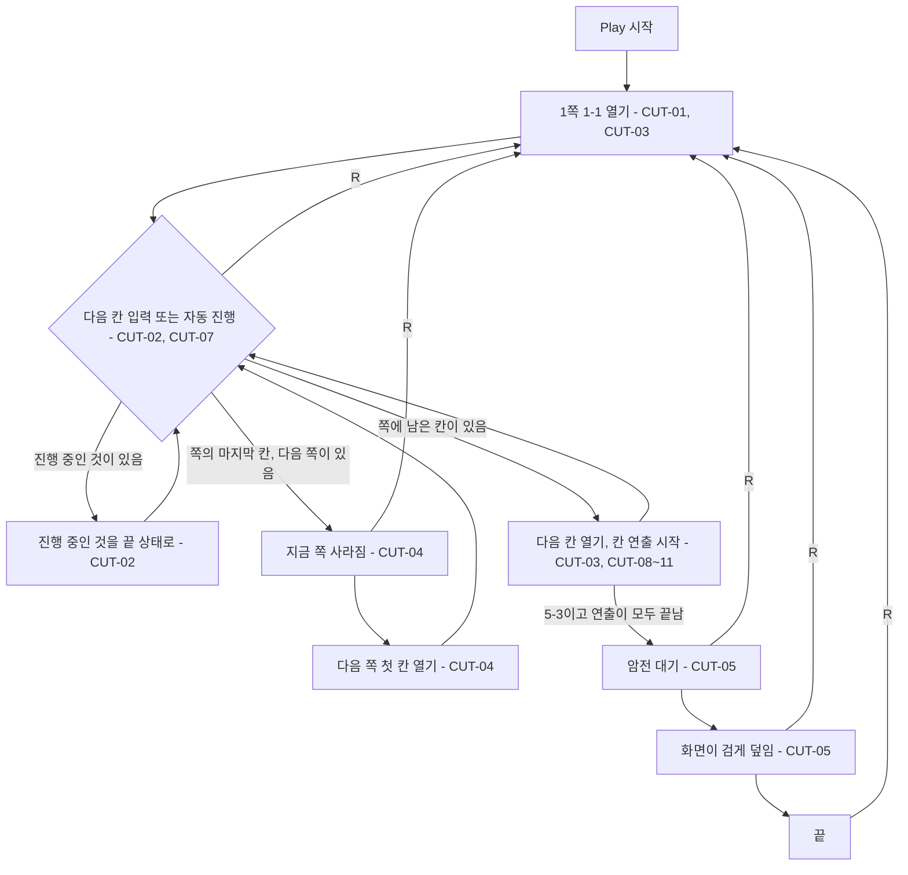

# 인트로 컷툰

## 1. 목적

게임을 시작하기 전에, 운석 충돌로 지구가 무너지고 우주선 한 척이 떠나 주인공이 수면 캡슐 안에서 눈을 감기까지를 만화 칸이 차례로 열리는 컷툰으로 보여 준다. 지금 단계는 아트 없이 회색 도형으로 칸 배치, 칸 순서, 연출 시간을 눈으로 확인하는 그레이 박스다.

## 2. 요구사항

### 진행

- **CUT-01** `[승인]` `Assets/IntroCuttoon/Scenes/IntroCuttoon.unity`를 Play하면 검은 배경 위에 1쪽이 보이고 1-1 칸이 바로 열린다.
- **CUT-02** `[승인]` Space, Enter, 마우스 왼쪽 클릭 중 하나를 누르면 다음 칸이 열린다. 지금 쪽에서 칸 나타나기나 칸 연출이 아직 진행 중이면 그 입력은 진행 중인 것을 모두 끝 상태로 맞추기만 하고, 다음 입력에서 다음 칸을 연다.
- **CUT-03** `[승인]` 칸이 열리면 `_appearDuration`초 동안 투명도가 0에서 1로 오르며 `_slideOffset`만큼 떨어진 자리에서 제자리로 들어온다.
- **CUT-04** `[승인]` 한 쪽의 칸이 모두 열린 뒤 다음 칸 입력이 들어오면 지금 쪽이 `_pageFadeDuration`초 동안 사라지고, 다음 쪽의 첫 칸이 열린다. 사라지는 동안 들어온 다음 칸 입력은 무시한다.
- **CUT-05** `[승인]` 마지막 쪽의 마지막 칸(5-3)이 열리고 그 쪽의 연출이 모두 끝나면, 입력 없이 `_blackoutDelay`초 뒤 `_blackoutDuration`초 동안 화면 전체가 검게 덮인다. 기다리는 동안과 암전 중에 들어온 다음 칸 입력은 무시한다.
- **CUT-06** `[승인]` R을 누르면 진행 상태와 관계없이 모든 쪽, 칸, 연출, 암전을 처음 상태로 되돌리고 1-1부터 다시 연다.
- **CUT-07** `[승인]` `_autoAdvance`가 켜져 있으면 지금 쪽에서 진행 중인 것이 없어진 뒤 `_autoAdvanceInterval`초가 지날 때마다 입력 없이 다음 칸 입력과 같은 일을 한다. 기본값은 꺼짐이다.

### 칸 연출

- **CUT-08** `[승인]` 이동·크기·투명도 연출(`CuttoonTween`)은 칸이 열린 뒤 `_delay`초 기다렸다가 `_duration`초 동안 `_curve`를 따라 시작 값에서 끝 값으로 바뀐다. 기다리는 동안은 시작 값에 머문다. 쓰는 곳은 아래 "칸 구성" 표의 연출 열이다.
- **CUT-09** `[승인]` 흔들림(`CuttoonShake`)은 2-2가 열리면 2쪽 전체를 `_duration`초 동안 `_amplitude` 픽셀 폭에서 0까지 줄어들며 흔든 뒤 제자리에 둔다.
- **CUT-10** `[승인]` 번쩍임(`CuttoonFlash`)은 3-1이 열리면 화면 전체를 흰색(투명도 `_peakAlpha`)으로 덮었다가 `_duration`초 동안 걷어 낸다.
- **CUT-11** `[승인]` 단계 바꾸기(`CuttoonSteps`)는 5-3이 열리면 뜬 눈, 반쯤 감은 눈, 감은 눈을 `_stepInterval`초 간격으로 하나씩만 보인다.

### 그레이 박스 화면

- **CUT-12** `[승인]` 칸은 회색 판에 흰 테두리를 두르고, 칸 밖으로 나간 도형은 잘라 낸다. 1쪽 칸은 3D 블록아웃(CUT-15)으로 보여 주고, 2~5쪽 칸 안의 그림은 회색 도형으로만 그린다. 사람은 원 머리와 둥근 몸통, 운석·지구·눈동자는 원, 우주선은 삼각형, 캡슐은 둥근 상자, 눈은 타원이다. 불길과 타는 지구만 흐린 붉은색을 쓴다. 칸 왼쪽 위에는 어두운 상자를 두고 첫 줄에 칸 번호와 이름, 둘째 줄에 내용을 적는다.
- **CUT-13** `[승인]` `_showGuide`가 켜져 있으면 화면 아래 왼쪽에 "Space·Enter·클릭: 다음    R: 처음부터", 오른쪽에 `_pageFormat`으로 만든 쪽 번호(예: "쪽 1 / 5")를 표시한다. 안내는 암전 위에도 보인다.

### 씬 만들기

- **CUT-14** `[승인]` 메뉴 `IntroCuttoon/그레이박스 씬 만들기`를 실행하면 도형 그림(원, 삼각형)이 없을 때만 만들고, 5쪽 14칸 배치를 새 씬에 깔아 `Assets/IntroCuttoon/Scenes/IntroCuttoon.unity`로 저장한다. 그 씬 파일이 이미 있으면 덮어쓸지 묻고, 취소하면 아무것도 바꾸지 않는다. 열려 있는 씬에 저장하지 않은 변경이 있으면 먼저 저장할지 묻는다. 씬을 만든 뒤에는 칸 위치, 크기, 연출 값으로 씬에 저장된 값을 쓴다.

### 1쪽 3D 블록아웃

- **CUT-15** `[승인]` 1쪽 칸에는 칸을 꽉 채우는 RawImage를 두고, 칸마다 따로 있는 카메라가 회색 3D 세트를 찍은 RenderTexture를 보여 준다. 칸 카메라의 위치, 각도, 시야각은 씬에 저장된 값을 쓴다. 단, 1-3 카메라의 위치는 CUT-23 카메라 빠지기 연출에 저장된 시작 값과 끝 값이 정한다. 화면 UI를 그리는 Main Camera는 UI 레이어만 찍고, 칸 카메라는 UI 레이어를 찍지 않는다. 거리 세트와 상반신 세트는 서로의 카메라에 보이지 않게 멀리 떨어뜨려 둔다.
- **CUT-16** `[승인]` 1-1 카메라는 거리의 왼쪽 앞 높은 곳에서 오른쪽 아래를 비스듬히 내려다본다(부감). 거리는 화면을 왼쪽 아래에서 오른쪽 위로 가로지르고, 건물은 높이가 다른 상자다. 1-1이 열리면 시민(캡슐)이 화면 왼쪽에서 오른쪽으로 걸어 거리 가운데에 조금 못 미친 곳에서 멈춘다. 그래서 1-2에서 시민은 칸 가운데보다 왼쪽 아래에 선다.
- **CUT-17** `[승인]` 1-2는 1-1 거리 세트와 같은 모양의 줌인용 거리 세트를 따로 두고 찍는다. 1-2 카메라는 그 세트 안에서 1-1 카메라와 같은 위치와 각도에 있고 시야각만 좁혀, 멈춰 선 시민을 크게 찍는다. 1-2가 열리고 칸이 흔들리는 도중(CUT-22) 그림자만 드리우고 보이지 않는 운석 구체가 다가오며, 그 그림자가 칸 오른쪽 위 모서리 밖에서 들어와 천천히 비치다 점점 빨라져(이즈 인) 대각선으로 땅, 건물, 시민을 덮는다. 그림자 가장자리는 흐리지 않는다. 1-1 거리 세트에는 운석이 없어 1-1 칸에는 그림자가 들어오지 않는다.
- ~~**CUT-18**~~ `[폐기]` (폐기: 칸 밖에서 들어오는 반투명 그림자 덩어리가 칸 안 3D 그림자와 겹쳐 그림자가 이중으로 보였다. 1-2 그림자는 칸 안에서만 보이고, 임팩트는 CUT-17, CUT-21, CUT-22로 준다.)
- **CUT-19** `[승인]` 1-3은 얼굴과 어깨가 보이는 상반신 세트를 인물 앞쪽, 눈높이보다 조금 위의 가까운 카메라로 내려다보며 찍는다. 인물의 몸은 화면 오른쪽 방향으로 비스듬히 돌아서 있어, 인물의 오른쪽 어깨가 카메라에 더 가깝고 칸 왼쪽 끝에 걸린다. `?`는 머리 오른쪽 옆에 작게 붙어 있다(CUT-24). 1-3이 열리면 앞을 보던 고개(이마와 정수리 쪽이 보임)가 들리며 얼굴이 오른쪽 위 대각선을 올려다보고, 다 들었을 때 얼굴 전체가 보인다. 고개가 들리기 시작하는 순간 `?`가 이즈 인 곡선으로 투명도 0에서 1로 나타난다.
- **CUT-20** `[승인]` 3D 이동·회전 연출(`CuttoonTransformTween`)은 칸이 열린 뒤 `_delay`초 기다렸다가 `_duration`초 동안 `_curve`를 따라 대상 Transform의 로컬 위치와 로컬 회전을 시작 값에서 끝 값으로 바꾼다. 켜 둔 항목만 바꾼다.
- **CUT-21** `[승인]` 1-2가 열리면 칸 화면 위에 덮인 검은 막의 투명도가 운석 그림자가 다가오는 시간 동안 이즈 인 곡선으로 0에서 0.35로 올라, 해를 가리듯 칸 전체가 한 단계 어두워진다. 이 막은 칸 라벨보다 아래에 그려진다.
- **CUT-22** `[승인]` 1-2 칸이 다 나타나면 1-2 칸만 짧게 흔들렸다가 제자리에 선다. 흔들림이 시작되기 전에는 칸 안에 그림자가 보이지 않고, 흔들리는 도중에 그림자가 들어오기 시작한다. 흔들림 방식은 CUT-09와 같고, 시점은 4절 칸별 연출 값을 따른다.
- **CUT-23** `[승인]` 1-3에서 카메라는 최종 구도보다 조금 가깝고 오른쪽 위에 있는 자리에서 기다리다가, 고개를 다 든 뒤 뒤로 빠지며 왼쪽 아래로 움직여 최종 구도에서 멈춘다. 시작 자리와 최종 구도는 카메라 빠지기 연출에 따로 저장되며, 빌더가 씬을 만들 때 최종 구도를 카메라 위치와 같게 넣는다. 카메라가 바라보는 방향은 바뀌지 않는다. 카메라가 빠지는 동안 `?`는 인물이 작아지는 만큼 같이 작아지고, 머리 옆 자리는 CUT-24가 지킨다.
- **CUT-24** `[승인]` 1-3의 `?`는 Play 동안 매 프레임 머리(머리 축 아래 부품)의 화면 범위 오른쪽 끝에서 같은 간격만큼 떨어지고, 머리 높이의 위쪽 4분의 1 지점에 붙는다. 고개를 드는 동안, 카메라가 빠지는 동안, Game 창 비율이 달라도 머리와 `?` 사이 간격은 같다. 따라붙기(`CuttoonScreenFollow`)는 켜기 값을 켰을 때만 움직이며 기본값은 꺼져 있고, 씬 만들기(CUT-14)가 1-3의 `?`에 켜서 넣는다.

### 칸 구성

쪽 안에서 칸은 번호 순서대로 열린다. 우주선은 모든 칸에서 왼쪽에서 오른쪽으로 나아간다.

| 쪽 | 칸 | 칸 이름 | 그림 | 연출 |
|---|---|---|---|---|
| 1 | 1-1 | 도시 거리 | 3D 부감: 대각선 거리, 건물 상자, 작은 시민 | 시민이 화면 왼쪽에서 오른쪽으로 걷는다(3D 위치) |
| 1 | 1-2 | 그림자 | 같은 모양의 줌인용 세트, 같은 각도로 줌인, 멈춘 시민 | 칸이 흔들리고, 흔들리는 도중 운석 그림자가 오른쪽 위 모서리 밖에서 들어와 점점 빨라지며 덮쳐 온다(3D 위치), 칸이 어두워진다(투명도) |
| 1 | 1-3 | 올려다보기 | 3D 상반신, 몸은 화면 오른쪽으로 비스듬히, 오른쪽 어깨가 칸 왼쪽 끝, 가까운 카메라, 머리 바로 옆의 작은 `?` | 고개가 들려 얼굴이 오른쪽 위 대각선을 올려다본다(3D 회전), 같은 순간 `?`가 이즈 인으로 나타난다(투명도), 고개를 다 들면 카메라가 뒤로 빠지고(3D 위치) `?`가 작아진다(크기), `?`는 내내 머리 옆에 같은 간격으로 붙는다(위치) |
| 2 | 2-1 | 시민의 눈 | 크게 뜬 눈, 동공에 비친 운석 | 없음 |
| 2 | 2-2 | 운석 | 하늘을 덮는 운석, 아래의 작은 도시 | 운석이 다가온다(위치, 크기), 2쪽 흔들림(CUT-09) |
| 3 | 3-1 | 충돌 | 흰 띠 칸 | 화면 번쩍임(CUT-10) |
| 3 | 3-2 | 멸망과 출발 | 별, 지구, 지구 위 불길, 작은 우주선 | 불길이 번진다(크기), 우주선이 오른쪽 위로 빠져나간다(위치) |
| 3 | 3-3 | 우주선 | 우주선 옆모습, 엔진 불꽃 | 우주선이 오른쪽으로 나아간다(위치) |
| 4 | 4-1 | 창 너머 지구 | 창, 타는 지구, 창가의 뒷모습들 | 지구가 작아진다(크기) |
| 4 | 4-2 | 우는 사람들 | 옆얼굴 넷과 눈물, 그중 제복 입은 주인공 | 눈물이 흐른다(위치) |
| 4 | 4-3 | 주인공의 눈 | 크게 뜬 눈, 동공에 비친 타는 지구, 눈물 | 눈물이 흐른다(위치) |
| 5 | 5-1 | 수면 캡슐 | 멀어지는 캡슐 줄, 사람들 | 한 사람이 캡슐 쪽으로 걷는다(위치) |
| 5 | 5-2 | 뚜껑이 닫힘 | 캡슐에 누운 주인공, 유리 뚜껑, 서리 | 뚜껑이 닫힌다(위치), 서리가 낀다(투명도) |
| 5 | 5-3 | 눈을 감다 | 유리 너머 주인공의 눈 | 눈 감김 단계(CUT-11), 끝나면 암전(CUT-05) |

## 3. 상태와 전이

| 지금 상태 | 계기 | 다음 상태 | 관련 요구사항 |
|---|---|---|---|
| 칸 보기 | 다음 칸 입력, 쪽에 진행 중인 것이 있음 | 칸 보기(진행 중인 것을 끝 상태로) | CUT-02 |
| 칸 보기 | 다음 칸 입력, 쪽에 남은 칸이 있음 | 칸 보기(다음 칸 열림) | CUT-02, CUT-03 |
| 칸 보기 | 다음 칸 입력, 쪽의 마지막 칸, 다음 쪽이 있음 | 쪽 넘김 | CUT-04 |
| 쪽 넘김 | `_pageFadeDuration`초 지남 | 칸 보기(다음 쪽 첫 칸 열림) | CUT-04 |
| 칸 보기 | 마지막 쪽의 마지막 칸이 열려 있고 진행 중인 것이 없음 | 암전 대기 | CUT-05 |
| 암전 대기 | `_blackoutDelay`초 지남 | 암전 | CUT-05 |
| 암전 | `_blackoutDuration`초 지남 | 끝 | CUT-05 |
| 모든 상태 | R | 칸 보기(1-1 열림) | CUT-06 |

## 4. 수치 표

기본값은 코드의 필드 초기값이다. 씬이나 프리팹에 저장된 값은 이와 다를 수 있으며, Play에서는 저장된 값이 쓰인다.

| 이름 | 기본값 | 필드(컴포넌트) | 뜻 |
|---|---|---|---|
| 나타나는 시간 | 0.45 | `_appearDuration`(`CuttoonPanel`) | 칸이 투명도 0에서 1로 오르는 시간(초) |
| 밀려 들어오는 거리 | (0, -24) | `_slideOffset`(`CuttoonPanel`) | 칸이 나타나기 시작할 때 제자리에서 떨어진 거리(픽셀) |
| 쪽 사라지는 시간 | 0.35 | `_pageFadeDuration`(`CuttoonPlayer`) | 쪽을 넘길 때 지금 쪽이 사라지는 시간(초) |
| 자동 진행 | 꺼짐 | `_autoAdvance`(`CuttoonPlayer`) | 켜면 입력 없이 다음 칸으로 넘어간다 |
| 자동 진행 간격 | 1.5 | `_autoAdvanceInterval`(`CuttoonPlayer`) | 진행 중인 것이 없어진 뒤 다음 칸까지 기다리는 시간(초) |
| 암전 대기 | 0.8 | `_blackoutDelay`(`CuttoonPlayer`) | 5-3 연출이 끝난 뒤 암전을 시작하기까지의 시간(초) |
| 암전 시간 | 1.6 | `_blackoutDuration`(`CuttoonPlayer`) | 화면이 검게 덮이는 시간(초) |
| 안내 표시 | 켜짐 | `_showGuide`(`CuttoonPlayer`) | 하단 조작 안내와 쪽 번호를 보일지 |
| 쪽 번호 형식 | "쪽 {0} / {1}" | `_pageFormat`(`CuttoonPlayer`) | {0}은 지금 쪽, {1}은 전체 쪽 수 |
| 연출 기다림 | 0 | `_delay`(`CuttoonEffect`) | 칸이 열린 뒤 연출을 시작하기까지의 시간(초) |
| 이동·크기·투명도 시간 | 1 | `_duration`(`CuttoonTween`) | 시작 값에서 끝 값으로 바뀌는 시간(초) |
| 이동·크기·투명도 곡선 | 천천히 시작해 천천히 끝남 | `_curve`(`CuttoonTween`) | 시간에 따른 진행 정도 |
| 흔들림 시간 | 0.6 | `_duration`(`CuttoonShake`) | 흔들리는 시간(초) |
| 흔들림 폭 | 18 | `_amplitude`(`CuttoonShake`) | 처음 흔들림의 최대 거리(픽셀) |
| 번쩍임 시간 | 0.9 | `_duration`(`CuttoonFlash`) | 흰 화면을 걷어 내는 시간(초) |
| 번쩍임 세기 | 1 | `_peakAlpha`(`CuttoonFlash`) | 번쩍이는 순간 흰 화면의 투명도 |
| 눈 감김 간격 | 0.9 | `_stepInterval`(`CuttoonSteps`) | 눈 모양이 한 단계 바뀌는 간격(초) |
| 3D 이동·회전 시간 | 1 | `_duration`(`CuttoonTransformTween`) | 시작 값에서 끝 값으로 바뀌는 시간(초) |
| 3D 이동·회전 곡선 | 천천히 시작해 천천히 끝남 | `_curve`(`CuttoonTransformTween`) | 시간에 따른 진행 정도 |
| 화면 따라붙기 켜기 | 꺼짐 | `_follow`(`CuttoonScreenFollow`) | 켜면 Play 동안 매 프레임 표시를 부품 옆으로 옮긴다 |
| 화면 따라붙기 간격 | 16 | `_gap`(`CuttoonScreenFollow`) | 부품 화면 범위 오른쪽 끝에서 표시 기준점까지의 간격(칸 화면 단위) |
| 화면 따라붙기 높이 | 0.75 | `_heightRatio`(`CuttoonScreenFollow`) | 표시 기준점 높이를 부품 화면 범위 아래 끝에서 높이의 몇 비율 지점에 둘지 |

씬 만들기(CUT-14)가 처음 넣는 칸별 연출 값이다. 씬에서 고치면 씬 값이 쓰인다.

| 칸 | 연출 | 기다림(초) | 시간(초) | 값 |
|---|---|---|---|---|
| 1-1 | 시민 걷기 | 0 | 3.2 | 거리를 따라 5.5m, 고른 속도 |
| 1-2 | 운석 다가옴(3D 그림자) | 0.25 | 2.2 | 그림자 중심이 시민에서 오른쪽 위로 24.4m 떨어진 곳(경계가 칸 오른쪽 위 모서리 바로 밖)에서 9.4m 떨어진 곳까지, 이즈 인 |
| 1-2 | 칸 어두워짐 | 0.25 | 2.2 | 검은 막 투명도 0에서 0.35, 이즈 인 |
| 1-2 | 칸 흔들림 | 0.6 | 0.35 | 폭 10픽셀 |
| 1-3 | 고개 들기(3D 회전) | 0.4 | 1 | 아래로 8도에서 위로 32도(몸은 오른쪽으로 30도 돌아선 채, 최종 구도에서 들기 전 얼굴이 카메라와 28도, 다 들면 16도) |
| 1-3 | 카메라 빠지기(3D 위치) | 1.5 | 1.6 | 최종 위치보다 앞으로 0.5m, 카메라 기준 오른쪽 0.2m, 위 0.1m 떨어진 곳에서 최종 위치까지(시작할 때도 머리가 칸 안에 다 들어온다) |
| 1-3 | `?` 나타남 | 0.4 | 0.9 | 투명도 0에서 1, 이즈 인(글자 크기 60, 상자 80x90) |
| 1-3 | `?` 작아지기 | 1.5 | 1.6 | 카메라 빠지기와 같은 곡선으로, 머리가 작아지는 비율(1.14배)에서 1배로 |
| 1-3 | `?` 머리 옆 붙이기 | 0 | 계속 | 머리 화면 범위 오른쪽 끝에서 26픽셀, 머리 높이의 0.75 지점 |
| 2-2 | 운석 다가옴 | 0 | 3.2 | 위 80픽셀에서 제자리, 크기 0.82에서 1 |
| 2-2 | 2쪽 흔들림 | 0 | 0.6 | 폭 18픽셀 |
| 3-1 | 화면 번쩍임 | 0 | 0.9 | 세기 1 |
| 3-2 | 불길 번짐 | 0.2 | 2.6 | 크기 0.2에서 1.4 |
| 3-2 | 우주선 빠져나감 | 0.4 | 3 | 오른쪽 360, 위 210픽셀 |
| 3-3 | 우주선 나아감 | 0 | 2.8 | 왼쪽 140픽셀에서 오른쪽 60픽셀까지 |
| 4-1 | 지구 작아짐 | 0.3 | 4.5 | 크기 1에서 0.4 |
| 4-2 | 눈물 둘 | 0.4, 1.0 | 2.4 | 아래로 40픽셀 |
| 4-3 | 눈물 | 0.5 | 2.2 | 아래로 70픽셀 |
| 5-1 | 한 사람 걷기 | 0.2 | 1.8 | 오른쪽으로 70픽셀 |
| 5-2 | 뚜껑 닫힘 | 0.3 | 1.4 | 오른쪽 1100픽셀에서 제자리 |
| 5-2 | 서리 | 1.7 | 1.8 | 투명도 0에서 1 |
| 5-3 | 눈 감김 | 0.6 | 1.8 | 세 단계, 간격 0.9 |

## 5. 코드 위치

| 요구사항 | 파일 | 메서드·속성 |
|---|---|---|
| CUT-01 | `Assets/IntroCuttoon/Scripts/Runtime/CuttoonPlayer.cs` | `Start`, `Restart` |
| CUT-02 | `Assets/IntroCuttoon/Scripts/Runtime/CuttoonPlayer.cs`, `CuttoonPage.cs` | `Update`, `RequestAdvance`, `CuttoonPage.IsBusy`, `CuttoonPage.FinishOpened` |
| CUT-03 | `Assets/IntroCuttoon/Scripts/Runtime/CuttoonPanel.cs` | `Open`, `Update`, `ApplyAppear` |
| CUT-04 | `Assets/IntroCuttoon/Scripts/Runtime/CuttoonPlayer.cs` | `Advance`, `UpdatePageFade` |
| CUT-05 | `Assets/IntroCuttoon/Scripts/Runtime/CuttoonPlayer.cs` | `UpdateShowing`, `UpdateBlackout` |
| CUT-06 | `Assets/IntroCuttoon/Scripts/Runtime/CuttoonPlayer.cs`, `CuttoonPage.cs`, `CuttoonPanel.cs` | `Restart`, `CuttoonPage.ResetPage`, `CuttoonPanel.Hide` |
| CUT-07 | `Assets/IntroCuttoon/Scripts/Runtime/CuttoonPlayer.cs` | `UpdateShowing` |
| CUT-08 | `Assets/IntroCuttoon/Scripts/Runtime/CuttoonEffect.cs`, `CuttoonTween.cs` | `CuttoonEffect.Play`, `CuttoonEffect.Update`, `CuttoonTween.Apply` |
| CUT-09 | `Assets/IntroCuttoon/Scripts/Runtime/CuttoonShake.cs` | `Apply`, `ResetState` |
| CUT-10 | `Assets/IntroCuttoon/Scripts/Runtime/CuttoonFlash.cs` | `Apply`, `ResetState` |
| CUT-11 | `Assets/IntroCuttoon/Scripts/Runtime/CuttoonSteps.cs` | `Apply`, `ShowStep` |
| CUT-12 | `Assets/IntroCuttoon/Scripts/Editor/IntroCuttoonGrayboxBuilder.cs` | `CreatePanel`, `CreateLabel`, `BuildPanelContents` |
| CUT-13 | `Assets/IntroCuttoon/Scripts/Runtime/CuttoonPlayer.cs`, `Assets/IntroCuttoon/Scripts/Editor/IntroCuttoonGrayboxBuilder.cs` | `Start`, `UpdatePageText`, `CreateGuide` |
| CUT-14 | `Assets/IntroCuttoon/Scripts/Editor/IntroCuttoonGrayboxBuilder.cs` | `BuildFromMenu`, `Build`, `EnsureShapeSprites` |
| CUT-15 | `Assets/IntroCuttoon/Scripts/Editor/IntroCuttoonGrayboxBuilder.cs` | `CreateViewPanel`, `CreateSetCamera`, `EnsureRenderTexture`, `CreateCamera` |
| CUT-16 | `Assets/IntroCuttoon/Scripts/Editor/IntroCuttoonGrayboxBuilder.cs` | `BuildCitySet`, `BuildPage1` |
| CUT-17 | `Assets/IntroCuttoon/Scripts/Editor/IntroCuttoonGrayboxBuilder.cs` | `BuildCitySet`, `CreateMeteor`, `CreateLight`, `BuildPage1` |
| CUT-19 | `Assets/IntroCuttoon/Scripts/Editor/IntroCuttoonGrayboxBuilder.cs` | `BuildBustSet`, `BuildPage1`, `EaseInCurve` |
| CUT-20 | `Assets/IntroCuttoon/Scripts/Runtime/CuttoonTransformTween.cs` | `Apply` |
| CUT-21 | `Assets/IntroCuttoon/Scripts/Editor/IntroCuttoonGrayboxBuilder.cs` | `BuildPage1` |
| CUT-22 | `Assets/IntroCuttoon/Scripts/Editor/IntroCuttoonGrayboxBuilder.cs`, `Assets/IntroCuttoon/Scripts/Runtime/CuttoonShake.cs` | `BuildPage1`, `CuttoonShake.Apply` |
| CUT-23 | `Assets/IntroCuttoon/Scripts/Editor/IntroCuttoonGrayboxBuilder.cs`, `Assets/IntroCuttoon/Scripts/Runtime/CuttoonTransformTween.cs`, `Assets/IntroCuttoon/Scripts/Runtime/CuttoonTween.cs` | `BuildPage1`, `ViewportBounds`, `CuttoonTransformTween.Apply`, `CuttoonTween.Apply` |
| CUT-24 | `Assets/IntroCuttoon/Scripts/Runtime/CuttoonScreenFollow.cs`, `Assets/IntroCuttoon/Scripts/Editor/IntroCuttoonGrayboxBuilder.cs` | `CuttoonScreenFollow.LateUpdate`, `CuttoonScreenFollow.PlaceMark`, `CuttoonScreenFollow.ViewportBounds`, `BuildPage1`, `QuestionPoint` |

## 6. 다른 영역과의 접점

- **부르는 것**: 없음. 글꼴 `Assets/EyeMaze/Fonts/Galmuri11.ttf`만 가져다 쓴다.
- **불리는 것**: 없음. 다른 씬과 이어지지 않는 단독 씬이다.

## 7. 검증 방법

- **CUT-01**: `IntroCuttoon.unity`를 열고 Play하면 1-1 칸이 열리고 시민이 오른쪽으로 걷는다.
- **CUT-02**: 1-1의 시민이 걷는 도중에 Space를 누르면 시민이 바로 끝 자리로 가고, 한 번 더 누르면 1-2가 열린다. Enter와 마우스 왼쪽 클릭도 같다.
- **CUT-03**: 칸이 열릴 때 조금 아래에서 올라오며 서서히 나타난다.
- **CUT-04**: 1-3까지 연 뒤 Space를 누르면 1쪽이 사라지고 2쪽의 2-1이 열린다. 하단 쪽 번호가 "쪽 2 / 5"로 바뀐다.
- **CUT-05**: 5-3까지 열면 눈이 감기고, 입력 없이 화면이 검게 덮인다.
- **CUT-06**: 아무 쪽에서나, 그리고 암전 뒤에 R을 누르면 1-1부터 다시 시작한다.
- **CUT-07**: `CuttoonPlayer`의 `_autoAdvance`를 켜고 Play하면 입력 없이 끝까지 진행된다.
- **CUT-08**: 칸 구성 표의 연출 열대로 시민, 그림자, 얼굴, 운석, 불길, 우주선, 지구, 눈물, 뚜껑, 서리가 움직인다.
- **CUT-09**: 2-2가 열리는 순간 2쪽 전체가 흔들렸다가 제자리에 멈춘다.
- **CUT-10**: 3-1이 열리는 순간 화면 전체가 하얘졌다가 걷힌다.
- **CUT-11**: 5-3에서 눈이 뜬 눈, 반쯤 감은 눈, 감은 눈 순서로 바뀐다.
- **CUT-12**: 각 쪽을 캡처해 칸 테두리, 회색 도형, 붉은색이 불길과 타는 지구에만 쓰였는지, 칸 왼쪽 위 라벨을 확인한다.
- **CUT-13**: 화면 아래 왼쪽에 조작 안내, 오른쪽에 쪽 번호가 보이고, 암전 뒤에도 보인다. `_showGuide`를 끄면 사라진다.
- **CUT-14**: 메뉴를 실행하면 씬이 만들어져 열린다. 다시 실행하면 덮어쓸지 묻고, 취소하면 씬이 그대로다.
- **CUT-15**: 1쪽 세 칸에 회색 3D 장면이 보이고, 칸 카메라(`Camera_1-1` 등)의 위치나 시야각을 씬에서 바꾸면 칸 안 구도가 바뀐다. 1-3 카메라 위치만은 Play에서 CUT-23 연출 값으로 돌아간다. 3D 세트가 화면 UI 뒤에 따로 보이지 않는다.
- **CUT-16**: 1-1에서 거리가 대각선으로 보이고 건물에 윗면과 옆면이 보이며, 시민이 화면 왼쪽에서 오른쪽으로 걷는다.
- **CUT-17**: 1-2가 1-1과 같은 각도로 시민을 크게 보여 주고, 칸이 흔들리는 도중 그림자가 칸 오른쪽 위 모서리에서 천천히 비치다 빨라지며 시민을 덮는다. 그림자는 하나뿐이고 경계가 선명하며, 1-1 칸에는 그림자가 생기지 않는다.
- **CUT-19**: 1-3에서 인물의 오른쪽 어깨가 칸 왼쪽 끝에 걸리고 몸이 오른쪽으로 비스듬하다. 처음엔 이마와 정수리 쪽이 보이다가 고개가 들리며 얼굴 전체가 오른쪽 위를 올려다보고, 같은 때 머리 바로 옆의 작은 `?`가 천천히 시작해 점점 빨리 진해진다.
- **CUT-21**: 1-2 그림자가 다가오는 동안 칸 전체가 조금씩 어두워지고, 라벨 글은 어두워지지 않는다.
- **CUT-22**: 1-2 칸이 다 나타나면 그림자가 보이기 전에 1-2 칸만 짧게 흔들리기 시작하고, 흔들리는 도중 그림자가 오른쪽 위 모서리에서 들어오기 시작한다. 다른 칸은 움직이지 않는다.
- **CUT-23**: 1-3이 열리면 화면이 조금 확대된 상태로 고개가 다 들릴 때까지 카메라가 멈춰 있고, 그 뒤 카메라가 왼쪽 아래 뒤로 빠지며 인물이 조금 작아진다. 끝나면 씬 편집 화면에서 보던 구도와 같다. 시작할 때도 머리가 칸 밖으로 잘리지 않고, 빠지는 동안 `?`가 머리와 함께 조금 작아진다.
- **CUT-24**: 1-3에서 `?`가 나타나기 시작할 때부터 카메라가 멈출 때까지 머리와 `?` 사이 간격이 같다. Game 창 비율을 바꿔도 같다.
- **CUT-20**: 시민, 운석, 고개가 표의 시간대로 움직이고, R을 누르면 처음 자리로 돌아간다.

## 8. 알려진 문제

- 그레이 박스라서 그림은 모두 도형이다. 아트가 오면 칸 안의 도형을 그림으로 바꾼다.
- 칸 안의 사람, 눈, 지구 같은 도형 일부는 1920x1080 기준 픽셀 크기로 깔려 있어, 화면 비율이 크게 다르면 칸 안 배치가 조금 어긋날 수 있다.
- 본편과 이어지지 않는다. 암전 뒤에는 R로 다시 보는 것만 할 수 있다.
- 흔들림은 매 프레임 무작위 위치로 옮기는 방식이라 프레임 수에 따라 느낌이 조금 다르다.
- 3D 그림자는 URP 설정의 그림자 거리(50) 안에서만 그려진다. 1-1 화면의 먼 곳(위쪽 끝)에서는 그림자가 늦게 나타날 수 있다.
- 1쪽 RenderTexture 크기는 씬을 만들 때의 칸 크기(1920x1080 기준)로 정해지며, 칸 크기를 바꿔도 따라 바뀌지 않는다.
- 2~5쪽은 아직 2D 도형이다. 1쪽 확인 뒤 같은 3D 방식으로 바꿀지 정한다.
- 연출의 시작·끝 값은 곡선 `_curve`의 값으로 정해진다. Inspector에서 곡선 끝점을 0과 1이 아닌 값으로 고치면 시작 상태와 끝 상태도 지정한 시작 값, 끝 값과 달라진다.
- 1-3 카메라가 빠지기 전 가까운 자리에서는 머리 위쪽이 칸 라벨 상자와 겹칠 수 있다. 최종 구도에서는 겹치지 않는다.
- 1-2 운석 시작점(그림자 경계가 칸 바로 밖), 운석 기다림, CUT-22 흔들림 시점은 흔들리는 도중 그림자가 들어오도록 함께 맞춘 값이다. 운석 경로나 시간을 바꾸면 흔들림 시점도 함께 고쳐야 한다.
- 1-2 칸 흔들림과 칸 나타나기(CUT-03)는 같은 칸 위치 값을 쓴다. 흔들림 기다림이 칸 나타나기 시간보다 짧으면 두 연출이 서로 덮어쓴다.
- 1-3 카메라 위치와 `?` 작아지기 비율은 빌더가 씬을 만들 때 한 번 계산해 연출 값으로 저장한다. 편집기에서 카메라만 옮기면 Play에서 카메라는 연출 값 자리로 돌아간다. 구도를 바꾸려면 빌더 값을 고쳐 씬을 다시 만든다. `?` 자리는 Play에서 CUT-24가 매 프레임 맞추므로 머리와 어긋나지 않는다.
- 칸 RenderTexture는 1920x1080 화면 기준 칸 크기로 만든다. Game 창 비율이 16:9가 아니면 칸 그림이 늘어나 보인다.
- CUT-24의 머리와 `?` 사이 간격은 `?` 상자 왼쪽 끝 기준이다. 글꼴에서 `?` 글자는 상자 왼쪽 끝보다 약 1.4픽셀 왼쪽에서 시작하므로, 눈에 보이는 빈칸은 간격 값보다 그만큼 좁다.

## 9. 미결 사항

없음
