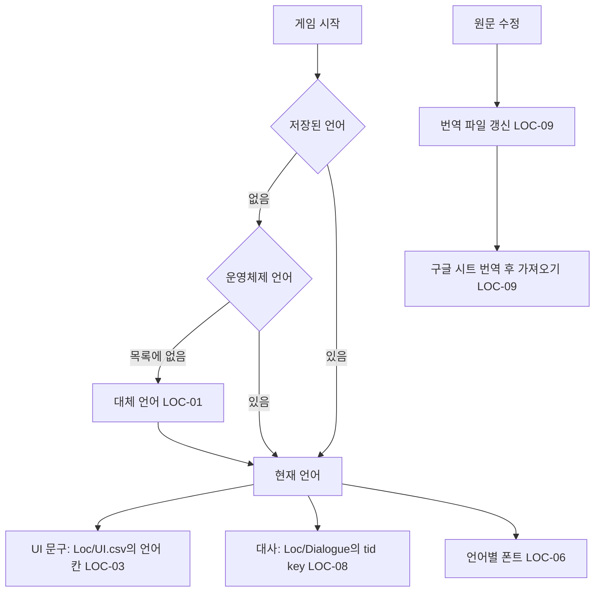

# 현지화

접두어 `LOC` · 다음 번호 `LOC-12`

플레이어가 자기 언어로 게임을 하고, 제작자는 원문을 고치듯 번역을 관리한다.

## 흐름

원문은 한국어이고, 번역이 비어 있으면 원문을 쓴다. 대사 줄은 바뀌지 않는 번호로 번역과 짝을 맞추고, 원문이 바뀐 줄은 다시 확인할 줄로 표시한다.

## 진행 중

### 씬 문구 번역 (LOC-07) `[제안]`

씬 인스펙터에 적힌 화면 문구(회상 물건 글, NPC 재대화, 앉은 뒤 첫마디, 파편 예비 글)도 번역할 수 있게 한다. 방식은 메모의 미결을 정한 뒤 쓴다.

- 확인: 영어로 회상 방 물건을 살펴보면 영어 글이 나온다.

### 대사 번역 (LOC-08) `[제안]`

대사, 파편 힌트, 회상 대사를 언어별로 번역해 보여 준다.

- 원본 대사 줄마다 바뀌지 않는 번호(tid)를 두고, 그 번호로 번역 파일의 줄과 짝을 맞춘다.
- 번역이 없으면 원문이 나온다.
- 번역은 글을 읽을 때마다 고른다. 그래야 대화 기록이 언어를 바꾼 뒤에도 현재 언어로 다시 그려진다. 이때 필드 대화와 엔딩 줄도 기록에 줄 자체를 넘기게 바꾼다.
- 확인: 번역 파일에 영어를 넣고 영어로 그 선택지를 고르면 영어 반응이 나온다.

### 번역 파일 갱신과 가져오기 (LOC-09) `[제안]`

메뉴 하나로 번역 파일을 원본에 맞게 갱신하고, 구글 시트에서 번역한 결과를 가져온다.

- 원문이 바뀐 줄은 다시 확인할 줄로 표시된다.
- 가져올 때는 번역 칸만 반영하고 원문은 건드리지 않는다.
- 확인: 원문 한 줄을 고치고 갱신하면 그 줄만 다시 확인할 줄이 된다.

### 번역 검사 (LOC-10) `[제안]`

기획 데이터 검사가 번역도 검사한다.

- 오류: 같은 줄이 두 번 있음, 원문과 번역의 `{…}` 칸이 다름, 모르는 언어.
- 경고: 빈 번역, 다시 확인할 줄, 글자 수 초과, 폰트에 없는 글자.
- 확인: 번역에서 `{client}`를 지우면 오류가 난다.

### 번역 용어집 (LOC-11) `[제안]`

인물 이름과 고유 용어(파편, 심연, 동공 등)의 정해진 번역을 용어집 파일에 둔다. 게임은 읽지 않는다.

- 확인: 용어집 파일이 있다.

## 완료

### 언어 목록과 시작 언어 (LOC-01)

한국어(원문), 영어, 일본어를 지원하고, 처음에는 알맞은 언어로 시작한다.

- 직접 고른 언어가 있으면 그 언어, 없으면 운영체제 언어, 그것도 없으면 대체 언어로 시작한다.
- 언어를 더할 때는 언어 목록과 번역 파일 칸만 더하면 된다.

### 언어 바꾸기 (LOC-02)

언어를 바꾸면 화면 글이 새 언어로 바뀌고, 대화 기록도 새 언어로 다시 그려진다.

- 고정 글은 바로, 다른 글은 다음에 나오는 글부터 바뀐다.
- 대화 기록에 쌓인 선택지, 반응, 장면 설명, 회상 대사는 기록 창을 그릴 때 현재 언어 글을 쓴다. 필드 대화와 엔딩 줄은 대사 번역(LOC-08) 전까지 남길 때의 글 그대로다.
- 기록 속 손님 이름은 남길 때의 손님으로 고정된다. 나중에 다른 손님과 상담해도 바뀌지 않는다.
- 개발용 메뉴 `EyeMaze/번역/언어 바꾸기`에서 바꾸거나 저장값을 지운다.

### 화면 문구 번역 (LOC-03)

화면에 나오는 문구는 공용 문구 파일의 현재 언어 글을 쓰고, 없으면 한국어를 쓴다.

- 코드에만 있던 문구도 모두 공용 문구 파일로 옮겼다.
- 어순이 언어마다 다른 문장(선택지 번호, 상호작용 안내, 엔딩 제목)은 칸이 있는 한 문장으로 쓴다.

### 고정 라벨 (LOC-04)

코드가 글을 넣지 않는 고정 라벨 여섯 개(부담감, 재생, 닫기, 띵-동, 대화 기록 제목과 안내)도 언어를 따라 바뀐다.

### 이름과 조사 (LOC-05)

문구 속 손님 이름과 대명사를 지금 손님으로 채우고, 받침에 맞는 조사를 붙인다.

- 화면에 보이는 인물 이름도 언어에 맞게 바뀐다.

### 언어별 폰트 (LOC-06)

언어에 폰트가 정해져 있으면 화면 글이 모두 그 폰트로 그려지고, 없으면 기본 폰트(Galmuri11)를 쓴다.

---

## 자세히

### 코드 단서

기능을 고칠 때 먼저 볼 곳이다.

| 기능 | 찾을 곳 |
|---|---|
| LOC-01 | `LocConfig`, `Loc.StartLanguage` |
| LOC-02 | `Loc.SetLanguage`, `DialogueLog.Add`, `DialogueLogUI` |
| LOC-03 | `Strings.Get`, `Loc/UI.csv` |
| LOC-04 | `LocalizedLabel` |
| LOC-07 | |
| LOC-05 | `Strings.Fill`, `Strings.Name` |
| LOC-08 | |
| LOC-09 | |
| LOC-10 | |
| LOC-06 | `GameSettings.ApplyFonts` |
| LOC-11 | |

### 메모

- 미결: LOC-07 방식. 가안은 인스펙터 문구를 `Loc/Scene.csv` key로 옮기는 것(추천), 나안은 컴포넌트마다 고정 ID를 두고 `tid` 방식으로 번역하는 것이다.
- 미결: 처음 내보낼 언어, 중국어(간체·번체) 여부, Steam 언어 설정 반영, 플레이어용 언어 설정 화면 시기.
- 실행 중 프리팹으로 글 상자를 만들면 그 자리에서 `LOC-06` 폰트를 입혀야 한다.
- 대화 기록의 필드 대화 줄과 엔딩 줄은 `LOC-08` 전까지 글자열로 남는다. 지금은 대사에 번역이 없어 화면 차이는 없다.
