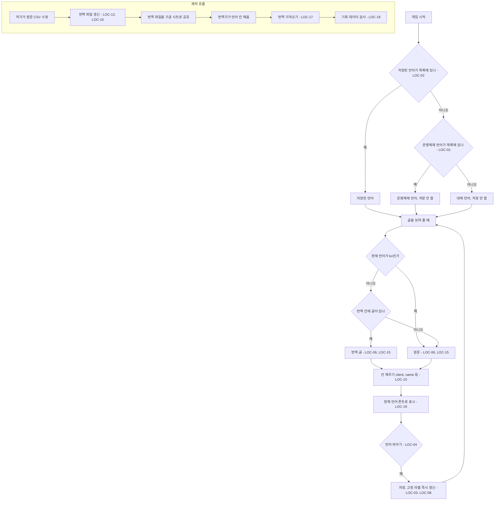

# 현지화

## 1. 목적

플레이어가 한국어 외의 언어로 게임 전체를 읽을 수 있게 한다. 제작자는 지금처럼 한국어 원문을 쓰던 곳에서 계속 쓰고, 번역은 언어별 글만 모은 별도 CSV에 한 줄에 `ko en ja`로 나란히 둔다. 번역가는 이 파일을 구글 시트로 받아 문맥을 보며 번역 칸만 채우고, 제작자는 그 결과를 도구로 가져와 검사한다.

### 범위

- 포함:
  - 언어 목록과 현재 언어 결정·저장·전환, 언어별 폰트
  - UI 문구(지금의 `Strings.csv`, 코드 속 화면 문구, 씬 고정 라벨, 인스펙터 문구)의 번역 파일
  - 대화 문구(인물·회차 CSV, `Flags.csv`의 힌트 글, `Flashbacks.csv`)의 줄 ID(`tid`)와 번역 파일
  - 손님 이름·대명사와 화자 이름의 번역 표시
  - 번역 파일 갱신, 번역 가져오기, 번역 검사 도구
  - 번역 참고용 용어집
- 제외:
  - 중국어(간체·번체). 언어 목록에 열을 더하는 구조만 준비하고, 할지와 어느 쪽을 할지는 9절 미결 사항으로 둔다.
  - 플레이어용 언어 설정 화면. 게임에 설정 화면이 없으므로 9절 미결 사항으로 둔다.
  - 디버그 로그, `Header`·`Tooltip` 같은 에디터 전용 글, 대사 편집기 창 자체의 글
  - 그림 안에 그려진 글자(텍스처) 교체
  - 음성
- 구현 순서: 요구사항이 많으므로 다음 묶음 단위로 승인받는다.
  1. UI 기반: LOC-01, LOC-02, LOC-03, LOC-04, LOC-05, LOC-06, EDITOR-40(`dialogue-editor.md`)
  2. UI 문구 정리: LOC-07, LOC-08, LOC-10, LOC-11, LOC-19
  3. 대화: LOC-12, LOC-13, LOC-14, LOC-15, EDITOR-39(`dialogue-editor.md`)
  4. 도구와 검사: LOC-16, LOC-17, LOC-18, LOC-20
  5. 인스펙터 문구: LOC-09 (9절 미결 사항을 정한 뒤)

### 선택하지 않은 방식

- Unity Localization 패키지(`com.unity.localization`)는 쓰지 않는다. 한국어 원문이 인물·회차 CSV와 대사 편집기에 있어서, 패키지의 String Table로 옮기면 편집기·검사기·CSV 자동 리로드를 다시 만들어야 하고 Addressables 빌드가 더해진다.
- 로직 CSV에 `text_en`처럼 언어 열을 더하지 않는다. 번역가에게 분기·수치 열이 보이고 언어가 늘수록 로직 파일이 넓어진다.
- 언어마다 로직 CSV를 통째로 복사하지 않는다(`Eunjae_Day1_en.csv`). 분기·플래그·수치를 고칠 때 모든 언어 파일을 같이 고쳐야 한다.
- 언어마다 번역 파일을 따로 두지 않는다(`Loc/en/…`, `Loc/ja/…`). 한 줄에 원문과 모든 번역을 나란히 보는 편이 비교와 누락 확인이 쉽다. 언어가 다섯 개를 넘어 파일이 지나치게 넓어지면 다시 정한다.
- 한국어 대화 원문을 번역 파일로 옮기지 않는다. 대사 편집기에서 흐름을 읽을 수 없게 된다.
- 문장 속 `은재`·`그녀` 글자를 찾아 바꾸는 방식은 버린다. 다른 언어에서는 바꿀 글자가 없고, 한국어에서도 이름이 바뀌면 조사가 틀어진다.

### 예외 및 경계 조건

- 언어 코드는 ISO 639-1을 쓴다: `ko`, `en`, `ja`. 중국어를 한다면 `zh-Hans`(간체), `zh-Hant`(번체)를 쓴다.
- `ko`는 원문 언어다. `ko`를 고를 때는 번역 파일을 거치지 않고 원문을 그대로 쓴다.
- 번역 칸이 비어 있으면 그 줄만 `ko` 원문으로 보인다. 게임은 멈추지 않는다.
- 원문이 빈 칸(예: 첫 줄이 아닌 행의 `situation`)은 번역 대상이 아니며 번역 파일에 줄을 만들지 않는다.
- 원문의 `\n` 줄바꿈 표기는 번역에서도 같은 뜻이다. `response`처럼 한 줄씩 넘기는 칸은 번역의 줄 수가 원문과 달라도 된다.
- 같은 key를 여러 줄 쓰는 UI 문구(예: `opening`)는 원문과 번역이 같은 줄에 있으므로 줄마다 번역한다. 번역이 빈 줄은 그 줄만 `ko`로 보인다.
- 번역에 `O` 표시가 없어도(`<언어>_ok`가 빈 칸) 번역 글이 있으면 게임은 그 글을 쓴다. `_ok`는 사람이 다시 확인할 줄을 찾는 표시다.

## 2. 요구사항

### 언어와 설정

- **LOC-01** `[승인]` 언어 설정 에셋(`LocConfig`)에 언어 목록을 둔다. 한 항목은 언어 코드, 언어 이름(그 언어로 쓴 이름, 예: `English`, `日本語`), 그 언어의 폰트다. 처음 목록은 `ko`, `en`, `ja`이며 `ko`가 첫 항목이자 원문이다. 언어를 더할 때는 이 목록에 항목을 넣고 번역 파일에 `<코드>`, `<코드>_ok` 열을 더하는 것으로 끝나야 한다.
- **LOC-02** `[승인]` 게임을 시작하면 다음 순서로 현재 언어를 정한다.
  1. 저장된 언어 코드(PlayerPrefs `_languagePrefKey`)가 언어 목록에 있으면 그 언어
  2. 없으면 운영체제 언어(`Application.systemLanguage`)를 4절 "운영체제 언어 대응" 표로 바꾼 코드가 언어 목록에 있으면 그 언어
  3. 둘 다 아니면 `LocConfig`의 대체 언어(`_fallbackLanguage`)
  - 2·3으로 정한 언어는 저장하지 않는다. 플레이어가 언어를 직접 바꿀 때(LOC-04, 이후 설정 화면)만 그 코드를 저장한다. 그래서 저장값이 없는 동안에는 운영체제 언어를 바꾸면 다음 실행부터 따라간다.
  - `_detectSystemLanguage`를 끄면 2를 건너뛴다(개발 중 항상 한국어로 시작하고 싶을 때).
- **LOC-03** `[승인]` 현재 언어를 바꾸면 화면에 떠 있는 고정 라벨(LOC-08)은 곧바로 새 언어로 바뀐다. 대사·상황·선택지·안내 문구는 다음에 새로 나오는 글부터 새 언어로 나온다. 이미 대화 기록 창(`DLG-24`~`DLG-31`, `dialogue.md`)에 쌓인 줄은 바꾸지 않는다.
- **LOC-04** `[승인]` 메뉴 `EyeMaze/번역/언어 바꾸기`는 언어 바꾸기 창을 연다. 창은 현재 언어, 저장된 언어, 운영체제 언어와 그 대응 코드를 보여 주고, 언어 목록의 언어마다 버튼을 둔다. 버튼을 누르면 그 언어를 저장하고 현재 언어로 삼는다(Play Mode가 아니면 다음 Play부터 그 언어로 시작한다). `저장된 언어 지우기` 버튼은 저장값을 지우고 LOC-02 규칙으로 언어를 다시 정한다. 개발 확인용이며 플레이어용 설정 화면은 범위 밖이다.

### UI 문구

- **LOC-05** `[승인]` 공용 문구 파일 `Assets/EyeMaze/Data/Strings.csv`를 `.meta`와 함께 `Assets/EyeMaze/Data/Loc/UI.csv`로 옮겨 GUID를 유지하고, 머리글을 `key,context,maxlen,ko,en,ja,note,en_ok,ja_ok,ko_synced`로 바꾼다. 기존 `text`는 `ko`로, `memo`는 `note`로 옮긴다. `ko` 칸이 UI 문구의 원문이며 제작자가 이 파일에서 직접 고친다. `Assets/EyeMaze/Data/README.md`의 `Strings.csv` 절을 새 파일 형식으로 고친다.
- **LOC-06** `[승인]` `Strings.Get`과 `Strings.Lines`는 현재 언어 칸의 글을 돌려준다. 그 칸이 비어 있으면 `ko` 칸을, `ko`도 없으면 지금처럼 코드의 기본 글을 쓴다. `{name}` 같은 칸 채우기는 지금처럼 고른 글에 한다.
- **LOC-07** `[작성중]` 화면에 나오는 글 가운데 코드에만 적힌 것을 모두 `Loc/UI.csv`의 key로 옮긴다. `Strings.Get`의 기본 글로 적힌 글은 같은 key의 `ko` 줄로 넣는다. 코드가 글을 이어 붙여 만드는 문장(예: `$"{i + 1}. " + …`)은 `{n}`, `{text}` 같은 칸을 가진 문장 하나의 key로 바꿔, 어순을 언어별 글이 정하게 한다. 디버그 로그, `Header`, `Tooltip`은 옮기지 않는다.
- **LOC-08** `[작성중]` 씬과 프리팹의 고정 라벨(uGUI `Text`에 직접 적힌 글)에는 `LocalizedLabel` 컴포넌트를 붙인다. `LocalizedLabel`은 `[SerializeField]`로 같은 오브젝트의 `Text`와 `Loc/UI.csv` key를 참조하고, 켜질 때와 언어가 바뀔 때 그 key의 글을 넣는다. 코드가 매번 글을 넣는 `Text`(예: `EyeMazeUI._message`)에는 붙이지 않는다.
- **LOC-09** `[작성중]` 씬 인스펙터에 적힌 화면 문구(회상 사물의 `_actionText`·`_lookText`·`_lookTextAfter`, 인물·사물의 `_displayName`, 방 이름 `_roomName`, 컷신·문 대사 등)를 번역할 수 있게 한다. 방식은 9절 미결 사항에서 정한다. 정하기 전까지 인스펙터 문구는 언어와 관계없이 원문으로 나온다.
- **LOC-10** `[작성중]` `EyeMazeDirector.Personalize`의 `은재`·`그녀` 글자 바꾸기를 없앤다. 대신 문구에 `{client}`(손님 이름)와 `{client_pron}`(손님 3인칭)을 쓰고, 게임이 지금 손님 값으로 채운다. 손님 이름은 `name.<손님 actor ID>`, 3인칭은 `pron.<손님 actor ID>` key의 현재 언어 글이다. 지금 이 바꾸기를 거치는 문구(`Loc/UI.csv`, 대화 CSV, 씬의 `_abyssMessage` 등)에 적힌 `은재`·`그녀` 가운데 손님을 가리키는 것을 칸으로 바꾼다.
- **LOC-11** `[작성중]` 대사창·대화 기록·회상의 화자 이름은 `name.<원래 이름>` key의 현재 언어 글로 보인다. key가 없으면 원래 이름을 그대로 보인다. 원래 이름은 대화 CSV `speaker` 칸이나 `Flashbacks.csv` `speaker` 칸 값, 없으면 그 NPC의 `DisplayName`이다. `-`(서술)와 `???`는 바꾸지 않는다. 초상화 찾기(`FieldNPC.PortraitOf`)와 actor 판정은 번역 전 원래 이름으로 한다.

### 대화 문구

- **LOC-12** `[작성중]` 인물·회차 CSV와 `Flashbacks.csv`에 `tid` 열을 둔다. `tid`는 줄 하나의 고정 ID이고, 한 번 정하면 줄을 옮기거나 글을 고쳐도 바꾸지 않는다. 인물·회차 CSV의 `tid`는 `<파일 이름 소문자>_<네 자리 번호>`(예: `jisu_day1_0005`), `Flashbacks.csv`의 `tid`는 `fb_<네 자리 번호>`다. 빈 `tid`는 대사 편집기 저장(EDITOR-39)이나 번역 파일 갱신(LOC-16) 때 채우며, 번호는 그 원본 파일과 그 번역 파일에 있는 가장 큰 번호 다음부터 쓴다. 같은 파일 안에서 `tid`가 겹치면 뒤쪽 줄에 새 번호를 주고 경고한다.
- **LOC-13** `[작성중]` 번역 key는 `<tid>.<칸 이름>`이다(예: `jisu_day1_0005.response`). 번역 대상 칸은 인물·회차 CSV의 `situation`, `text`, `response`, `back`, `rest`, `title`, `after`, `Flashbacks.csv`의 `text`다. `Flags.csv`는 `id`를 그대로 써서 `flag.<id>.title`, `flag.<id>.text`를 key로 한다. `speaker` 칸은 번역 대상이 아니다(LOC-11).
- **LOC-14** `[작성중]` 대화 번역 파일은 `Assets/EyeMaze/Data/Loc/Dialogue/<원본 파일 이름>.csv`다(예: `Loc/Dialogue/Jisu_Day1.csv`, `Loc/Dialogue/Flags.csv`, `Loc/Dialogue/Flashbacks.csv`). 머리글은 `key,speaker,context,maxlen,ko,en,ja,note,en_ok,ja_ok`다. 줄은 원본의 줄 순서(대화는 대본 순서)를 따른다. `speaker`, `context`, `ko`는 번역 파일 갱신이 원본에서 채우는 칸이고, 사람은 언어 칸·`note`·`maxlen`·`_ok`만 고친다.
- **LOC-15** `[작성중]` 현재 언어가 `ko`가 아니면, 대화 문구를 읽는 곳(`DialogueScript`, `TalkScript`, `EndingScript`, `Flags`, `FlashbackScript`)은 원문 칸 대신 같은 key의 현재 언어 글을 쓴다. 그 글이 없거나 비어 있으면 원문을 쓴다. `tid`가 비어 있는 줄은 원문을 쓴다. `tid`가 전역에서 겹치지 않으므로 `LocConfig`에 등록한 대화 번역 파일을 모두 한 표로 합쳐 찾는다.

### 도구와 검사

- **LOC-16** `[작성중]` 메뉴 `EyeMaze/번역/번역 파일 갱신`을 누르면 다음을 한다.
  - 인물·회차 CSV, `Flags.csv`, `Flashbacks.csv`의 빈 `tid`를 LOC-12 규칙으로 채운다.
  - 원본마다 대화 번역 파일을 만들거나 고친다. 원본의 번역 대상 칸마다 한 줄을 두고, `speaker`, `context`, `ko`를 원본 값으로 채운다. `context`는 `<section>/<actor>/<id>`와, `response`면 그 선택지 글, Talk·Ending·회상 대사면 바로 앞 대사를 적는다.
  - 원본에 새로 생긴 key는 줄을 더하고, 원본에서 사라진 key의 줄은 지운다. 지운 줄 수를 보고한다.
  - `ko`가 바뀐 줄은 모든 `<언어>_ok`를 비운다. `Loc/UI.csv`는 `ko`와 `ko_synced`가 다른 줄의 `_ok`를 비우고 `ko_synced`에 지금 `ko`를 적는다.
  - 언어 칸, `note`, `maxlen`은 건드리지 않는다. 내용이 같으면 파일을 다시 쓰지 않는다.
- **LOC-17** `[작성중]` 메뉴 `EyeMaze/번역/가져오기`로 구글 시트에서 받은 CSV(`Loc/UI.csv`나 대화 번역 파일과 같은 머리글)를 고르면, `key`가 같은 줄의 언어 칸과 `note`만 해당 번역 파일에 반영한다. `ko`, `speaker`, `context`, `ko_synced`는 읽지 않는다. 가져온 언어 칸이 비어 있지 않고 받은 파일의 `ko`가 지금 `ko`와 같으면 그 언어의 `_ok`에 `O`를 적는다. `ko`가 다르면 글은 반영하되 `_ok`는 비워 두고 경고한다. 번역 파일에 없는 key는 반영하지 않고 목록으로 보고한다. 반영 전에 LOC-18의 오류 검사를 하고, 오류가 있는 줄은 반영하지 않는다.
- **LOC-18** `[작성중]` 메뉴 `EyeMaze/기획 데이터 검사`가 번역도 검사한다.
  - 오류: 번역 파일 안의 같은 key 중복, 원문과 번역의 `{…}` 칸 이름 집합이 다름, 언어 칸 이름이 `LocConfig` 목록에 없음.
  - 경고: 언어별 빈 번역 개수, 글은 있는데 `_ok`가 빈 줄(다시 확인할 줄) 개수, `maxlen`보다 긴 번역, 원본에 없는 key(번역 파일 갱신이 필요), 그 언어 폰트에 없는 글자(LOC-19).
- **LOC-19** `[작성중]` 현재 언어의 `LocConfig` 폰트가 지정돼 있으면, 화면의 uGUI `Text`는 그 폰트로 글을 그린다. 폰트가 비어 있으면 씬에 지정된 폰트(지금 `Galmuri11`)를 쓴다. 폰트를 바꿔도 글자 크기·정렬·위치는 씬 값을 유지한다.
- **LOC-20** `[작성중]` 번역 참고용 용어집 `Assets/EyeMaze/Data/Loc/Glossary.csv`를 둔다. 머리글은 `ko,en,ja,note`이고 인물 이름, 고유 용어(파편, 심연, 동공 등)의 정해진 번역을 적는다. 게임과 검사기는 이 파일을 읽지 않는다.

## 3. 상태와 전이

| 지금 상태 | 계기 | 다음 상태 | 관련 요구사항 |
|---|---|---|---|
| 언어 미정 | 게임 시작, 저장값이 목록에 있음 | 저장된 언어 | LOC-02 |
| 언어 미정 | 게임 시작, 저장값 없음, 운영체제 언어가 목록에 있음 | 운영체제 언어 (저장 안 함) | LOC-02 |
| 언어 미정 | 게임 시작, 저장값 없음, 운영체제 언어가 목록에 없음 | 대체 언어 (저장 안 함) | LOC-02 |
| 현재 언어 A | 언어 바꾸기(LOC-04 메뉴) | 현재 언어 B, 저장 | LOC-02, LOC-03, LOC-04 |
| 번역 줄 확인됨(`_ok=O`) | 원문 `ko`가 바뀌고 번역 파일 갱신 | 확인 필요(`_ok` 빈 칸) | LOC-16 |
| 번역 줄 확인 필요 | 같은 원문으로 번역 가져오기 | 확인됨 | LOC-17 |



## 4. 수치 표

기본값은 코드의 필드 초기값이다. 씬이나 프리팹에 저장된 값은 이와 다를 수 있으며, Play에서는 저장된 값이 쓰인다. 모두 새로 만들 값이다.

| 이름 | 기본값 | 필드(컴포넌트) | 뜻 |
|---|---|---|---|
| 언어 목록 | `ko`, `en`, `ja` | `_languages` (`LocConfig`) | 언어 코드, 언어 이름, 폰트(Font, 비면 씬 폰트) |
| 운영체제 언어 감지 | 켬 | `_detectSystemLanguage` (`LocConfig`) | 저장값이 없을 때 운영체제 언어를 볼지 (bool) |
| 대체 언어 | `en` | `_fallbackLanguage` (`LocConfig`) | 저장값도 없고 운영체제 언어도 목록에 없을 때 쓰는 언어 코드. 감지를 끄면 저장값이 없을 때 바로 이 언어 |
| 언어 저장 이름 | `EyeMaze.Language` | `_languagePrefKey` (`LocConfig`) | 현재 언어 코드를 저장하는 PlayerPrefs 이름 |
| 언어 설정 | `Data/Loc/LocConfig.asset` | `_locConfig` (`GameSettings`) | 게임이 쓰는 언어 설정 에셋 |
| UI 번역 파일 | `Data/Loc/UI.csv` | `_stringsCsv` (`EyeMazeDirector`) | UI 문구 원문과 번역 (TextAsset). 옛 `Strings.csv` 참조를 GUID 그대로 쓴다 |
| 대화 번역 파일 | `Data/Loc/Dialogue/*.csv` | `_dialogueTables` (`LocConfig`) | 대화 번역 파일 목록 (TextAsset 배열). LOC-15를 구현할 때 더한다 |
| 라벨 key | 빈 값 | `_key` (`LocalizedLabel`) | `Loc/UI.csv`의 key |
| 라벨 글 상자 | 같은 오브젝트에서 연결 | `_label` (`LocalizedLabel`) | 글을 넣을 uGUI `Text` |
| tid 번호 자릿수 | 4 | 상수 | `jisu_day1_0005`의 번호 자릿수 |

### 운영체제 언어 대응

| `SystemLanguage` | 언어 코드 |
|---|---|
| `Korean` | `ko` |
| `English` | `en` |
| `Japanese` | `ja` |
| `ChineseSimplified`, `Chinese` | `zh-Hans` (목록에 없으면 대체 언어) |
| `ChineseTraditional` | `zh-Hant` (목록에 없으면 대체 언어) |
| 그 외 | 대체 언어 |

### 파일 형식

`Loc/UI.csv`

```
key,context,maxlen,ko,en,ja,note,en_ok,ja_ok,ko_synced
gate.first,신뢰 1 문에 막혔을 때,60,단단히 닫힌 문이다. {client}가 조금 더 마음을 열어야 한다.,The door is shut tight. {client} needs to open up a little more.,,{client}=손님 이름,O,,단단히 닫힌 문이다. {client}가 조금 더 마음을 열어야 한다.
name.EunjaeMom,대사창 이름,8,은재 어머니,Eunjae's Mother,,,O,,은재 어머니
```

`Loc/Dialogue/Jisu_Day1.csv`

```
key,speaker,context,maxlen,ko,en,ja,note,en_ok,ja_ok
jisu_day1_0005.situation,-,dialogue/Jisu/smile,,지수가 웃으며 말한다. …,Jisu smiles as she speaks. …,,,O,
jisu_day1_0005.text,상담사,dialogue/Jisu/smile,40,피곤하면 푹 쉬셔야죠. 오늘은 일찍 들어가세요.,,,,,
jisu_day1_0005.response,Jisu,dialogue/Jisu/smile · 선택지: 피곤하면 푹 쉬셔야죠. …,,"""네, 그럴게요!"" 대답이 너무 빨랐다.",,,,,
```

- `_ok` 칸은 `O` 또는 빈 칸이다.
- 파일은 지금 CSV와 같이 UTF-8로 저장한다(`Assets/EyeMaze/Data/README.md`).

## 5. 코드 위치

> LOC-01~LOC-06은 구현했다. 나머지는 고칠 예정인 곳이며, 구현 후 메서드 이름까지 갱신한다.

| 요구사항 | 파일 | 메서드·속성 |
|---|---|---|
| LOC-01 | `Assets/EyeMaze/Scripts/Runtime/LocConfig.cs`, `Assets/EyeMaze/Data/Loc/LocConfig.asset` | `LocConfig.Languages`, `LocConfig.Find`, `LocConfig.Has`, `LocConfig.OnValidate` |
| LOC-02 | `Assets/EyeMaze/Scripts/Runtime/Loc.cs`, `Assets/EyeMaze/Scripts/Runtime/GameSettings.cs`, `Assets/Scenes/EyeMaze.unity`(`게임 설정 (GameSettings)` 오브젝트) | `Loc.Init`, `Loc.StartLanguage`, `Loc.FromSystemLanguage`, `Loc.SetLanguage`, `GameSettings.Awake`, `GameSettings.Language`, `GameSettings.SetLanguage` |
| LOC-03 | `Assets/EyeMaze/Scripts/Runtime/Loc.cs`, `Assets/EyeMaze/Scripts/Runtime/Strings.cs` | `Loc.LanguageChanged`, `Strings.Pick`(글을 꺼낼 때마다 현재 언어를 봄). 고정 라벨 즉시 갱신은 LOC-08에서 |
| LOC-04 | `Assets/EyeMaze/Scripts/Editor/LocTools.cs` | `LocTools.Open`, `LocTools.OnGUI`, `Loc.ClearSavedLanguage` |
| LOC-05 | `Assets/EyeMaze/Data/Loc/UI.csv`, `Assets/EyeMaze/Data/README.md`, `Assets/EyeMaze/Scripts/Runtime/Strings.cs` | `Strings.DefaultPath`, `Strings.SOURCE_COLUMN` |
| LOC-06 | `Assets/EyeMaze/Scripts/Runtime/Strings.cs` | `Strings.Load`, `Strings.Pick`, `Strings.Get`, `Strings.Lines` |
| LOC-16, LOC-17 | 새 메뉴를 `Assets/EyeMaze/Scripts/Editor/LocTools.cs`에 더함 | 확인하지 못함 (구현 전) |
| LOC-07 | `Strings.Get`을 부르는 코드(`EyeMazeDirector.cs`, `EyeMazeUI.cs`, `FieldNPC.cs`, `FieldCutscene.cs`, `OpeningMonologue.cs`, `GameFlowUI.cs`, `MazeGate.cs`, `MazeLayer.cs`, `FieldClue.cs`, `CutsceneFastForward.cs` 등) | 확인하지 못함 |
| LOC-08 | 새 `Assets/EyeMaze/Scripts/Runtime/LocalizedLabel.cs`, `Assets/Scenes/EyeMaze.unity`, `Assets/EyeMaze/Prefabs/DialogueLogCanvas.prefab` | 확인하지 못함 (새 파일) |
| LOC-10 | `Assets/EyeMaze/Scripts/Runtime/EyeMazeDirector.cs`, `Assets/EyeMaze/Scripts/Runtime/EyeMazeUI.cs`, `Assets/EyeMaze/Scripts/Runtime/ClientCase.cs` | `EyeMazeDirector.Personalize`, `ClientCase.PersonName`, `ClientCase.Pronoun` |
| LOC-11 | `Assets/EyeMaze/Scripts/Runtime/FieldNPC.cs`, `Assets/EyeMaze/Scripts/Runtime/GameFlowUI.cs`, `Assets/EyeMaze/Scripts/Runtime/DialogueLogUI.cs`, `Assets/EyeMaze/Scripts/Runtime/FlashbackPlayer.cs` | `FieldNPC.PortraitOf`, 확인하지 못함 |
| LOC-12, LOC-13, LOC-15 | `Assets/EyeMaze/Scripts/Runtime/DialogueScript.cs`, `TalkScript.cs`, `EndingScript.cs`, `Flags.cs`, `FlashbackScript.cs`, `Csv.cs` | 원문 칸을 읽는 곳(`r["text"]` 등) |
| LOC-14, LOC-20 | 새 `Assets/EyeMaze/Data/Loc/Dialogue/*.csv`, 새 `Assets/EyeMaze/Data/Loc/Glossary.csv` | 해당 없음 |
| LOC-18 | `Assets/EyeMaze/Scripts/Editor/DialogueData.cs` | `EyeMaze/기획 데이터 검사` 메뉴 |
| LOC-19 | `Assets/EyeMaze/Scripts/Runtime/Loc.cs`, `LocalizedLabel.cs` | 확인하지 못함 |

### 구조

| 구분 | 이름 | 역할 |
|------|------|------|
| 컴포넌트 | GameSettings | 게임 전역 설정 매니저. 씬에 하나 두고 `[DefaultExecutionOrder(-1000)]`로 다른 스크립트보다 먼저 `Loc.Init`을 부른다. 현재 언어 코드는 `GameSettings.Language`로 읽는다 |
| ScriptableObject | LocConfig | 언어 목록, 운영체제 언어 감지, 대체 언어, 저장 이름, (LOC-15에서) 대화 번역 파일 참조 |
| 정적 클래스 | Loc | 현재 언어 보관·저장, 번역 표 읽기, key로 글 찾기, 언어 변경 알림 |
| 컴포넌트 | LocalizedLabel | 고정 라벨의 `Text`에 key의 글과 현재 언어 폰트를 넣음 |
| 에디터 창 | LocTools | 언어 바꾸기 창. 번역 파일 갱신, 번역 가져오기 메뉴도 이 파일에 더한다 |

- 오브젝트 구성: 씬 루트의 `게임 설정 (GameSettings)` 오브젝트가 `[SerializeField] _locConfig`로 `LocConfig`를 참조하고, `Awake`에서 `Loc.Init`에 넘긴다. 현재 언어 값은 정적 `Loc`에 두므로 다른 스크립트는 오브젝트를 찾지 않고 `GameSettings.Language`(`Loc.Current`)로 읽는다.
- 실행 순서 의존성: `GameSettings`는 `[DefaultExecutionOrder(-1000)]`이라 다른 스크립트의 `Awake`보다 먼저 시작 언어를 정한다. 에디터에서는 `Loc.Ensure`가 `Strings.Ensure`처럼 기본 경로(`Loc.DefaultConfigPath`)의 설정을 직접 읽는다.
- 기존 코드와의 접점: `Strings`는 `Loc`의 UI 표를 쓰도록 바뀐다. 대화를 읽는 스크립트는 원문 칸을 읽은 뒤 `Loc`에 `<tid>.<칸>`을 물어 번역이 있으면 바꾼다.

## 6. 다른 영역과의 접점

- **부르는 것**: `Strings`(공용 문구), `Csv`(CSV 읽기), `DialogueData`(기획 데이터 검사), `FieldNPC.PortraitOf`(초상화)
- **불리는 것**: 화면에 글을 내는 모든 영역이 `Strings`와 대화 스크립트를 거쳐 현재 언어 글을 받는다.
- **다른 스펙의 데이터**: 인물·회차 CSV 형식과 `tid` 열 보존은 `EDITOR-39`, 공용 문구 파일 편집은 `EDITOR-40`(`dialogue-editor.md`)을 따른다. 대화 기록 창은 `DLG-24`~`DLG-31`(`dialogue.md`), 회상 대본은 `MEM-11`~`MEM-16`(`memory-fragments.md`), 시작 독백 문구는 `OPEN-01`(`opening.md`)이다.

## 7. 검증 방법

- **LOC-01, LOC-02**: `LocConfig`에 `ko`, `en`, `ja`를 두고 대체 언어를 `en`으로 한다. 저장값을 지운 뒤 한국어 Windows에서 Play하면 한국어로, Windows 표시 언어를 일본어로 바꾸면 일본어로, 프랑스어로 바꾸면 영어로 시작한다. 이때 PlayerPrefs에 언어가 저장되지 않는다. LOC-04 메뉴로 `English`를 고르고 Play를 다시 시작하면 운영체제 언어와 관계없이 영어로 시작한다. PlayerPrefs 값을 목록에 없는 코드로 바꾸면 운영체제 언어 규칙으로 정한다. `_detectSystemLanguage`를 끄고 저장값을 지우면 대체 언어로 시작한다.
- **LOC-03, LOC-04**: 상담 중 언어를 바꾸면 고정 라벨은 곧바로, 다음 선택지·상황 문구는 새 언어로 나오고 대화 기록 창의 이전 줄은 그대로다.
- **LOC-05, LOC-06**: `Loc/UI.csv`의 `gate.first`에 `en` 글을 넣고 영어로 잠긴 문에 부딪히면 영어 글이 나온다. `en` 칸을 비우면 한국어가, `ko` 줄까지 지우면 코드 기본 글이 나온다.
- **LOC-07**: 영어로 오프닝부터 은재·지수 상담 끝까지 진행할 때, `Loc/UI.csv`의 모든 key에 `en`이 있다면 화면에 한글이 남지 않는다(인스펙터 문구 LOC-09 제외).
- **LOC-08**: `LocalizedLabel`을 붙인 라벨이 언어를 바꿀 때마다 바뀐다.
- **LOC-10**: 은재와 지수 상담에서 잠긴 문·심연 문구에 각 손님 이름이 들어간다. 영어에서는 `name.Eunjae`, `pron.Eunjae`의 영어 값이 들어간다.
- **LOC-11**: 영어에서 은재 어머니 대사의 이름 칸이 `name.EunjaeMom`의 영어 값으로 나오고 초상화는 그대로 나온다. 첫 줄의 `???`는 그대로다.
- **LOC-12, LOC-16**: 지수 Day1 CSV의 `tid`를 비우고 번역 파일 갱신을 누르면 `jisu_day1_0001`부터 채워지고, `Loc/Dialogue/Jisu_Day1.csv`가 대본 순서로 생긴다. 원문 한 줄을 고치고 다시 누르면 그 줄의 `_ok`만 비워지고 번역 글은 남는다. 원문 줄을 지우고 누르면 그 줄이 번역 파일에서 지워지고 지운 수가 보고된다.
- **LOC-13, LOC-14, LOC-15**: 번역 파일의 `jisu_day1_0005.response`에 `en` 글을 넣고 영어로 그 선택지를 고르면 영어 반응이 나온다. 한 줄씩 넘기는 `\n`도 영어 글 기준으로 나뉜다. `Flags.csv`의 파편 힌트, 회상 대사도 같은 방법으로 확인한다.
- **LOC-17**: 번역 파일을 구글 시트에 올려 `en` 칸을 채우고 CSV로 받아 가져오면 해당 줄의 `en`과 `en_ok=O`가 반영된다. 받은 뒤 원문을 고쳐 두고 가져오면 글은 들어가고 `en_ok`는 빈 칸이며 경고가 나온다. `ko` 칸을 시트에서 고쳐 가져와도 원문은 바뀌지 않는다.
- **LOC-18**: 번역 글에서 `{client}`를 지우면 오류가 나고 가져오기에서 그 줄이 빠진다. `maxlen`을 넘는 번역, 빈 번역, `_ok`가 빈 줄이 경고 수로 나온다.
- **LOC-19**: `ja`에 다른 폰트를 지정하고 일본어로 바꾸면 화면 글이 그 폰트로 그려지고 글 상자 위치·크기는 그대로다.
- **LOC-20**: 해당 없음 (게임 동작 없음). 파일이 있고 머리글이 맞는지만 본다.

## 8. 알려진 문제

- 씬이 하나뿐이라 `GameSettings`에 `DontDestroyOnLoad`를 쓰지 않는다. 씬이 늘면 첫 씬에 두고 유지할지 정한다.
- `LocTools` 창에서 Play Mode가 아닐 때 언어를 고르면 에디터의 현재 언어도 바뀐다. Play를 시작하면 정적 값이 초기화되어 저장값으로 다시 정한다.
- 화면 글은 TextMeshPro가 아니라 uGUI 레거시 `Text`와 동적 폰트 `Galmuri11`로 그린다(`opening.md` 선택하지 않은 방식). `Galmuri11`이 일본어 가나와 필요한 한자를 모두 갖는지는 확인하지 못했다. LOC-18의 폰트 글자 검사에 `Font.HasCharacter`를 쓸 수 있는지(동적 폰트에서 정확한지)도 확인하지 못했다.
- 씬 인스펙터에 한글이 적힌 필드가 약 300개 있다. 많은 순서로 `_displayName` 59(`FieldInteractable`, `FlashbackProp`, `MazeLayer`, `Person`), `_actionText` 51·`_lookText` 48·`_lookTextAfter` 10(`FlashbackProp`), `m_Text` 25(uGUI `Text`), `_title` 24, `_situation` 18, `_text` 29, `_response` 16, `_roomName` 12, `_afterLine` 11이다. 이 가운데 `DialogueNode`·`EndingDef`의 `_situation`·`_response`·`_text`·`_afterLine`이 CSV를 연결한 뒤에도 화면에 쓰이는지는 확인하지 못했다. 쓰이지 않으면 번역 대상에서 뺀다.
- `FieldNPC.PortraitOf`는 화면 이름으로 초상화를 찾는다. LOC-11에서 이름을 번역하면 번역 전 원래 이름으로 찾도록 바꿔야 한다.
- 한국어 문구에서 `{client}` 뒤 조사는 지금 손님 이름(은재, 지수)이 모두 받침이 없다는 전제로 쓴다(`{client}가`). 받침 있는 이름의 손님이 생기면 조사가 틀린다.
- 대사 편집기는 저장할 때 모르는 열을 지운다(`dialogue-editor.md` 1절 제외 항목). `tid` 열을 알려진 열로 넣기(EDITOR-39) 전에 대화 CSV에 `tid`를 적으면 편집기 저장 때 사라진다.

## 9. 미결 사항

- 인스펙터 문구(LOC-09)를 어떻게 번역할지 정한다. 제안은 다음 둘이다.
  - 가: 인스펙터 문구를 새 `Loc/Scene.csv`의 key로 옮기고, 인스펙터 칸에는 key를 저장한다. 칸 옆에 `ko` 원문을 보여 주고 그 자리에서 고치면 `Loc/Scene.csv`의 `ko`에 저장하는 인스펙터 표시를 만든다. 한 번 옮기는 도구를 별도 메뉴로 둔다. (추천: 원문과 번역이 UI 문구와 같은 방식으로 한 파일에 모인다)
  - 나: 인스펙터 문구는 원문으로 그대로 두고, 컴포넌트마다 고정 ID 칸을 더해 대화처럼 `tid` 방식으로 번역 파일을 만든다. 오브젝트를 복제하면 ID가 겹쳐 검사로 잡아야 한다.
- 처음 실제로 번역해 내보낼 언어를 정한다. 구조는 `en`, `ja`를 함께 준비하고, LOC-18 경고는 목록의 모든 언어에 대해 낸다.
- 중국어를 할지, 간체(`zh-Hans`)와 번체(`zh-Hant`) 중 무엇을 할지 정한다.
- Steam 등 플랫폼에 낼지 정한다. Steam에 내면 운영체제 언어보다 Steam 클라이언트의 게임 언어 설정(Steamworks `GetCurrentGameLanguage`)을 먼저 보도록 LOC-02 순서에 단계를 더한다.
- 플레이어가 언어를 바꿀 설정 화면을 언제 만들지, 첫 실행 때 언어 선택 창을 띄울지 정한다. 자동 감지(LOC-02)가 틀릴 수 있으므로 출시 전에는 필요하다. 만들면 그 화면의 영역 스펙에 요구사항을 둔다.
- 받침 있는 손님 이름의 조사 처리(예: `{client|이/가}`)를 넣을지 정한다.
