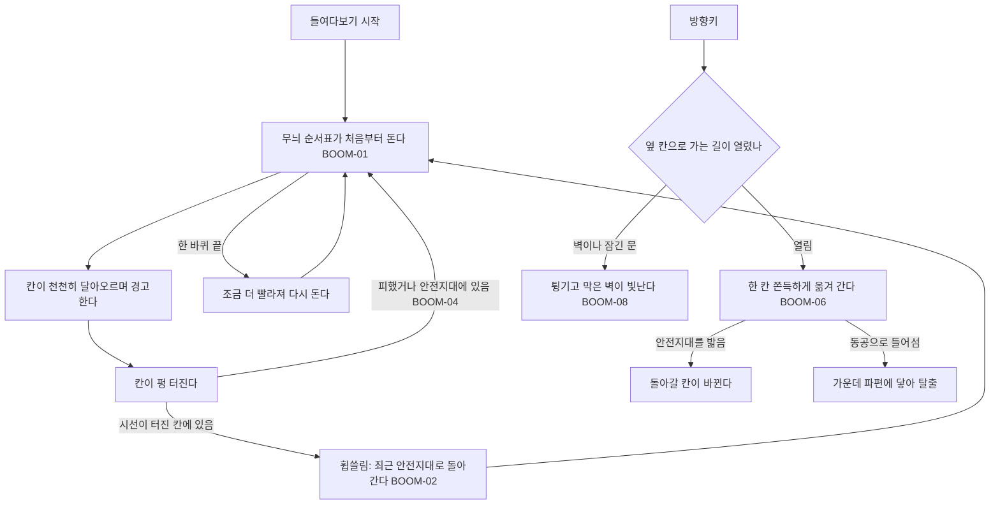

# 폭발 미로

접두어 `BOOM` · 다음 번호 `BOOM-09`

미로 칸들이 정해진 무늬로 번갈아 터지고, 플레이어는 칸 단위로 움직이며 경고를 보고 피해 동공까지 빠져나간다. 길 찾기에 타이밍과 위치 판단을 더한다.

## 흐름

시선은 격자선으로 나뉜 칸 하나씩 움직이고, 폭발과 휩쓸림도 같은 칸 단위다. 곳곳의 안전지대 칸과 돌아갈 칸은 어떤 무늬에도 터지지 않는다. 폭발 미로 설정은 프리팹 하나에 모여 있다.

## 기능

### 터지는 칸 무늬 (BOOM-01)

들여다보는 동안 미로 칸들이 정해진 무늬 순서대로 경고한 뒤 터진다.

- 터질 칸은 깜빡이지 않고 겨우 보이는 어두운 붉은빛에서 짙은 붉은빛까지만 천천히 달아오른다. 미로가 경고 색으로 덮여 보이지 않는다.
- 터지는 순간 밝은 주황으로 확 부풀었다 돌아오고(자기 칸을 넘지 않는다), 빨강으로 식으며 사라진다.
- 기본 순서는 체크 무늬, 도는 나선, 흩뿌림, 빠른 체크 무늬이고 한 바퀴는 약 30초다. 바퀴마다 조금씩 빨라진다(최대 1.6배).
- 동공 안(심연)은 터지지 않는다.

### 휩쓸림 (BOOM-02)

시선이 터지는 칸에 있으면 휩쓸려 가장 최근에 밟은 안전지대로 돌아간다.

- 아직 안전지대를 밟지 않았으면 시작 칸으로 돌아간다.
- 시선이 번쩍이고 "폭발에 휩쓸렸다. (n번째)"가 보인다.
- 돌아간 직후 1초 동안은 다시 휩쓸리지 않는다.

### 테스트 씬과 프리팹 (BOOM-03)

눈 미로 테스트 씬에서 폭발 미로를 바로 해 본다.

- 테스트 씬의 미로 아래에 폭발 미로 프리팹이 있고, 본 게임 씬에는 없다.
- 순서표, 안전지대, 격자, 그림 색, 칸 단위 이동 설정은 모두 프리팹에 있어, 프리팹을 고치면 열려 있는 씬에도 바로 반영된다.
- 폭발 미로가 켜져 있는 동안 눈이 깜빡이지 않는다. 파편을 읽거나 회상하는 중, 탈출한 뒤에는 무늬 시간이 멈추고, R로 다시 하면 처음부터 돈다.

### 안전지대 (BOOM-04)

미로 곳곳에 절대 터지지 않는 칸이 있다.

- 안전지대 오브젝트 하나가 칸 하나다. 씬 뷰에서 끌어 놓으면 칸 한가운데에 맞춰지고, 복제하거나 지워 늘리고 줄인다.
- 층마다 2칸씩 원의 정반대 자리에 6칸이 있고, 층마다 자리를 돌려 놓아 한 줄로 늘어서지 않는다. 씬 뷰에서는 청록색 테두리로, 들여다보는 동안에는 옅은 청록색 칸으로 보인다.
- 휩쓸렸을 때 돌아가는 칸도 터지지 않는다.

### 모서리 보정 (BOOM-05)

자유 이동에서 시선이 벽 모서리나 통로 입구에 걸리지 않는다.

- 통로 입구를 살짝 빗나가도 입구가 가까우면 그쪽으로 비켜 들어가고, 벽에 비스듬히 밀면 벽을 따라 제 속도로 미끄러진다.
- 디렉터에서 켜고 끈다. 본 게임 씬은 꺼져 있고, 테스트 씬은 칸 단위 이동을 써서 미로 안에서는 쓰이지 않는다.

### 칸 단위 이동 (BOOM-06)

테스트 씬에서 시선이 칸 하나씩 상하좌우로 움직인다.

- 원 기준이다: 위 = 바깥쪽, 아래 = 안쪽(동공 쪽), 왼쪽 = 반시계, 오른쪽 = 시계. 프리팹에서 월드(화면) 좌표 기준으로 바꿀 수 있다.
- 짧게 누르면 한 칸 가고, 누르고 있으면 잠깐 뒤부터 한 칸씩 이어 간다.
- 빠르게 튀어 나가 칸 한가운데를 살짝 지나쳤다가 되돌아와 앉고, 가는 동안 점이 늘어났다가 앉을 때 납작해진다.
- 가장 안쪽 고리에서 동공 쪽으로 열린 곳을 지나면 가운데 파편까지 한 번에 가서 탈출한다.

### 격자선 (BOOM-07)

들여다보는 동안 칸을 나누는 옅은 격자선이 보인다.

- 고리 경계마다 원, 칸 경계마다 선이 어두운 반투명 회색으로 그려진다. 흰 벽보다 가늘고 어두워 벽이 먼저 보인다.
- 화면에서 1픽셀 굵기이고, 화면 크기나 카메라 확대가 바뀌어도 1픽셀 아래로 가늘어져 사라지지 않는다.
- 칸 그림 위, 벽 아래에 그려진다.

### 벽에 부딪힘 (BOOM-08)

칸 단위로 움직이다 막히면 부딪힌 것이 보인다.

- 시선이 막힌 쪽으로 살짝 밀렸다가 튕겨 돌아오고, 막은 벽이 붉은빛으로 빛나며 굵어졌다가 돌아온다.
- 잠긴 문이면 문 안내가 뜨고 시선이 튕긴다. 가장 바깥 고리에서 바깥으로 누르면 시선만 튕긴다.

---

## 자세히

개발자용: 고칠 때 볼 것 (주의, 하지 않는 것, 구성, 코드 단서, 메모)

### 주의

- 판정과 그림 모두 시선과 같은 미로 기준 칸(`GazeCursor.Ring`, `GazeCursor.Sector`)을 쓴다. 칸 그림만 다른 기준으로 옮기면 보이는 칸과 터지는 칸이 어긋난다.
- `BOOM-03` 설정을 씬의 디렉터나 씬 파일에 두지 않는다. 씬을 연 채 밖에서 씬 파일을 고치면 Unity가 메모리 속 씬을 그대로 써서 반영되지 않는다.
- `BOOM-04` 안전지대는 아주 작은 위치 오차로는 옮기지 않는다. 옮기면 프리팹 인스턴스에 쓸데없는 위치 오버라이드가 생긴다.
- `BOOM-06` 동공으로 들어가는 걸음은 지나치지 않게 한다. 반지름 0을 지나치면 반대편으로 넘어간다.
- `BOOM-07` 픽셀 카메라(세로 270픽셀)에서 한 픽셀보다 가는 선은 끊기거나 사라진다. 굵기는 카메라에서 한 픽셀 크기를 구해 픽셀 정수배로 맞춘다.

### 하지 않는 것

- 본 게임 흐름(부담감, 대화, 엔딩)에 폭발을 넣지 않는다.
- 벽을 부수거나 길을 바꾸지 않는다. 터지는 것은 칸이다.
- 고리 전체가 한꺼번에 터지는 무늬를 기본 순서표에 넣지 않는다. 벽 때문에 고리를 벗어날 수 없는 칸에서는 피할 수 없다.
- 자유 이동(본 게임)에서는 벽을 빛내지 않는다.

### 구성

- `Assets/EyeMaze/Prefabs/MazeBoom.prefab`의 루트 `폭발 (Maze Boom)`에 `MazeBoomField`가 있고, 자식으로 `안전지대 1~12`(`BoomSafeZone`)가 있다.
- 테스트 씬은 `미로 (Iris Maze)` 아래에 프리팹 인스턴스를 두어 미로가 돌면 함께 돈다. 디렉터와 카메라 연결만 인스턴스 오버라이드다.
- 칸 그림(`폭발 칸`)과 격자(`격자`)는 Play 중 프리팹 루트 아래에 LineRenderer로 만든다. 정렬 순서는 칸 그림 3, 격자선 4, 벽 5다.
- 칸 단위 이동 설정은 `GridMoveSettings` 묶음이다. 디렉터가 자기 값을 갖고, 폭발 미로가 켜져 있으면 프리팹의 값을 넘겨받아 쓴다.

### 코드 단서

기능을 고칠 때 먼저 볼 곳이다.

| 기능 | 찾을 곳 |
|---|---|
| BOOM-01 | `MazeBoomField.EvaluateCells`, `MazeBoomField.DrawCells`, `BoomWave` |
| BOOM-02 | `MazeBoomField.CheckHit`, `EyeMazeDirector.WarpGaze` |
| BOOM-03 | `MazeBoomField`, `EyeMazeDirector.GridOverride` |
| BOOM-04 | `BoomSafeZone`, `MazeBoomField.CollectSafeZones` |
| BOOM-05 | `EyeMazeDirector.TryRoundCorner` |
| BOOM-06 | `EyeMazeDirector.SteerGrid`, `EyeMazeDirector.GridEase`, `GridMoveSettings` |
| BOOM-07 | `MazeBoomField.BuildGrid`, `MazeBoomField.GridLineWidth` |
| BOOM-08 | `EyeMazeDirector.StartGridBounce`, `MazeWall.Glow` |

### 메모

- 테스트 씬 `MTEST`에서만 켠다. 본 게임 씬에는 붙이지 않는다.
- 깜빡임(`BLINK-01`), 파편 읽기와 회상(`MEM-03`) 동안에는 무늬 시간이 멈춘다.
- 벽 빛남은 미로 벽(`LAYOUT`)의 그림에 더해진다.
- `BOOM-05`는 테스트 씬에서 쓰이지 않아 Play로 확인하지 못했다.

