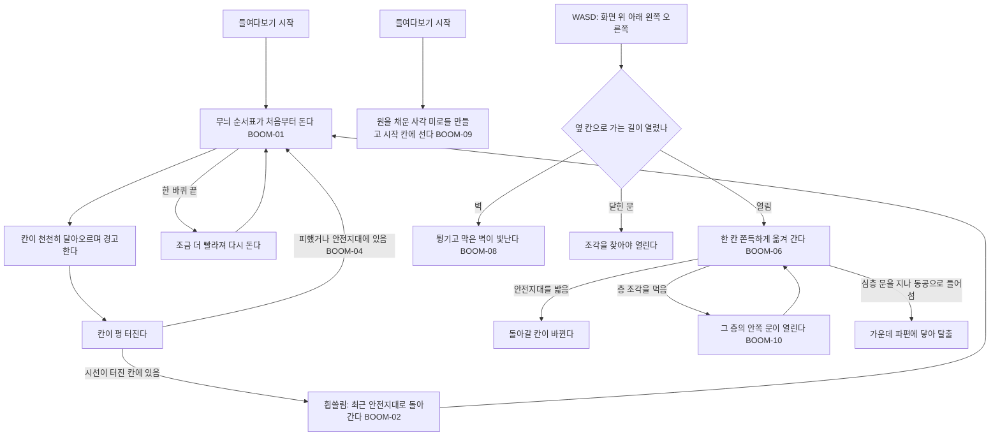

# 폭발 미로

접두어 `BOOM` · 다음 번호 `BOOM-11`

홍채 원을 채운 사각 칸 미로에서 칸들이 정해진 무늬로 번갈아 터지고, 플레이어는 WASD로 한 칸씩 움직이며 경고를 피해 외각, 내각, 심층의 조각을 차례로 먹어 문을 열고 가운데 동공까지 빠져나간다. 길 찾기에 타이밍과 위치 판단을 더한다.

## 흐름

시선은 십자 격자선으로 나뉜 사각 칸 하나씩 움직이고, 폭발과 휩쓸림도 같은 칸 단위다. 미로는 바깥에서 안으로 외각, 내각, 심층 세 층이고, 층마다 조각을 먹어야 안쪽 문이 열린다. 곳곳의 안전지대 칸과 돌아갈 칸은 어떤 무늬에도 터지지 않는다. 폭발 미로 설정은 프리팹 하나에 모여 있다.

## 기능

### 사각 미로 (BOOM-09)

테스트 씬의 폭발 미로는 동심원 고리 대신 가로세로 사각 칸으로 된 미로이고, 테두리 선 없이 눈(홍채) 가장자리가 그대로 미로의 끝이다.

- 홍채 원 안을 사각 칸이 바둑판처럼 채운다. 칸 전체가 원 안에 드는 칸만 시선이 다니는 미로 칸이다.
- 원에 걸친 바깥 칸은 눈 모양을 채우는 그림일 뿐이다. 검정 바탕에 회색 격자선만 보이고 원 가장자리에서 잘리며, 들어갈 수 없다. 벽, 폭발, 안전지대, 조각, 문이 없다.
- 미로를 두르는 테두리 선은 없다. 안쪽 벽은 칸 경계를 따라 곧은 가로선, 세로선이고, 원형 벽은 보이지 않는다.
- 벽 굵기는 화면에서 늘 정수 픽셀이라 보통 벽은 어디서나 1픽셀, 층 경계 벽과 문은 어디서나 2픽셀이다.
- 가운데 동공 원에 걸치는 칸은 동공 자리로 비워 둔다. 동공 자리로 들어가면 가운데 파편까지 가서 탈출한다.
- 시선은 맨 아래 가운데 칸에서 시작한다. 막다른 길을 줄이려고 벽을 조금 더 뚫는다. R로 다시 해도 같은 미로다.
- 칸 크기, 원의 바깥·안쪽 반지름, 시작 칸, 시드는 프리팹에서 고친다.

### 층과 조각 문 (BOOM-10)

사각 미로가 바깥에서 안으로 외각, 내각, 심층 세 층으로 나뉘고, 층마다 조각을 먹어야 안쪽 문이 열린다.

- 층 경계는 동심원을 따라 칸 경계로 이어진 계단 모양 벽이고, 보통 벽보다 굵다. 외각과 내각 사이, 내각과 심층 사이, 심층과 동공 자리 사이마다 노란 문이 하나 있다.
- 층마다 하늘색 마름모 조각이 하나 반짝인다. 시선이 조각 칸에 들어가면 조각을 먹고 그 층의 안쪽 문이 흰빛으로 번쩍이며 사라지고 "문이 열렸다."가 뜬다.
- 닫힌 문에 부딪히면 "조각을 찾아야 열린다."가 뜨고 시선이 튕기며 문이 빛난다.
- 층 안의 칸은 모두 이어져 있고, 조각은 층에 들어온 자리(외각은 시작 칸, 안쪽 층은 문)에서 길로 가장 먼 칸에 있다. 조각 칸과 문 양쪽 칸은 터지지 않는다.
- 휩쓸려도 먹은 조각과 열린 문은 그대로이고, R로 다시 하면 처음 상태로 돌아간다.

### 터지는 칸 무늬 (BOOM-01)

들여다보는 동안 사각 미로 칸들이 정해진 무늬 순서대로 경고한 뒤 터진다.

- 터질 칸은 깜빡이지 않고 겨우 보이는 어두운 붉은빛에서 짙은 붉은빛까지만 천천히 달아오른다. 미로가 경고 색으로 덮여 보이지 않는다.
- 터지는 순간 밝은 주황으로 확 부풀었다 돌아오고(자기 칸을 넘지 않는다), 빨강으로 식으며 사라진다.
- 기본 순서는 체크 무늬, 대각선 줄 무늬(반복마다 한 칸씩 밀려남), 흩뿌림, 빠른 체크 무늬이고 한 바퀴는 약 30초다. 바퀴마다 조금씩 빨라진다(최대 1.6배).
- 동공 자리와 원에 걸친 바깥 칸은 터지지 않는다.

### 휩쓸림 (BOOM-02)

시선이 터지는 칸에 있으면 휩쓸려 가장 최근에 밟은 안전지대로 돌아간다.

- 아직 안전지대를 밟지 않았으면 시작 칸으로 돌아간다.
- 시선이 번쩍이고 "폭발에 휩쓸렸다. (n번째)"가 보인다.
- 돌아간 직후 1초 동안은 다시 휩쓸리지 않는다.

### 테스트 씬과 프리팹 (BOOM-03)

눈 미로 테스트 씬에서 폭발 미로를 바로 해 본다.

- 테스트 씬의 미로 아래에 폭발 미로 프리팹이 있고, 본 게임 씬에는 없다.
- 사각 미로 모양, 순서표, 안전지대, 격자, 그림 색, 칸 단위 이동 설정은 모두 프리팹에 있어, 프리팹을 고치면 열려 있는 씬에도 바로 반영된다.
- 폭발 미로가 켜져 있는 동안 눈이 깜빡이지 않는다. 파편을 읽거나 회상하는 중, 탈출한 뒤에는 무늬 시간이 멈추고, R로 다시 하면 처음부터 돈다.

### 안전지대 (BOOM-04)

미로 곳곳에 절대 터지지 않는 칸이 있다.

- 안전지대 오브젝트 하나가 사각 칸 하나다. 씬 뷰에서 끌어 놓으면 사각 칸 한가운데에 맞춰지고, 복제하거나 지워 늘리고 줄인다.
- 층마다 2칸씩 마주 보는 자리에 6칸이 있다. 씬 뷰에서는 청록색 사각 테두리로, 들여다보는 동안에는 옅은 청록색 칸으로 보인다.
- 휩쓸렸을 때 돌아가는 칸도 터지지 않는다.

### 모서리 보정 (BOOM-05)

자유 이동에서 시선이 벽 모서리나 통로 입구에 걸리지 않는다.

- 통로 입구를 살짝 빗나가도 입구가 가까우면 그쪽으로 비켜 들어가고, 벽에 비스듬히 밀면 벽을 따라 제 속도로 미끄러진다.
- 디렉터에서 켜고 끈다. 본 게임 씬은 꺼져 있고, 테스트 씬은 칸 단위 이동을 써서 미로 안에서는 쓰이지 않는다.

### 칸 단위 이동 (BOOM-06)

테스트 씬에서 시선이 화면 기준 WASD(방향키)로 사각 칸 하나씩 움직인다.

- W = 화면 위, S = 화면 아래, A = 화면 왼쪽, D = 화면 오른쪽 칸이다. 사각 미로에서는 원 기준(바깥, 안쪽, 시계, 반시계) 방식을 쓰지 않는다.
- 짧게 누르면 한 칸 가고, 누르고 있으면 잠깐 뒤부터 한 칸씩 이어 간다.
- 빠르게 튀어 나가 칸 한가운데를 살짝 지나쳤다가 되돌아와 앉고, 가는 동안 점이 늘어났다가 앉을 때 납작해진다.
- 심층 문(동공 문)이 열린 뒤 그 문으로 동공 쪽을 누르면 가운데 파편까지 한 번에 가서 탈출한다.

### 격자선 (BOOM-07)

들여다보는 동안 칸을 나누는 옅은 격자선이 보인다.

- 미로 칸 경계를 따라 곧은 가로선과 세로선(십자 모양)이 어두운 반투명 회색으로 그려진다. 원에 걸친 바깥 칸에도 그려지고 원 가장자리에서 잘린다. 동공 자리 안쪽에는 없다. 흰 벽보다 가늘고 어두워 벽이 먼저 보인다.
- 화면에서 1픽셀 굵기이고, 화면 크기나 카메라 확대가 바뀌어도 1픽셀 아래로 가늘어져 사라지지 않는다.
- 칸 그림 위, 벽 아래에 그려진다.

### 벽에 부딪힘 (BOOM-08)

칸 단위로 움직이다 막히면 부딪힌 것이 보인다.

- 시선이 막힌 쪽으로 살짝 밀렸다가 튕겨 돌아오고, 막은 벽이 붉은빛으로 빛나며 굵어졌다가 돌아온다.
- 바깥 칸 쪽으로 누르면 들어가지 못하고 시선이 튕기며, 평소 선이 없는 그 경계가 잠깐 붉게 나타났다 사라진다. 닫힌 문은 `BOOM-10`을 따른다.

---

## 자세히

개발자용: 고칠 때 볼 것 (주의, 하지 않는 것, 구성, 코드 단서, 메모)

### 주의

- 판정과 그림 모두 같은 사각 칸(`BoomSquareMaze.CellAtMaze`)을 쓴다. 칸 그림만 다른 기준으로 옮기면 보이는 칸과 터지는 칸이 어긋난다.
- `BOOM-09` 미로를 만드는 중에는 열림 기록을 바로 읽는다. 다 만든 뒤에만 열림을 알려 주는 판정을 쓰면 첫 판과 R로 다시 한 판의 미로가 달라진다.
- `BOOM-09` 픽셀 카메라(세로 270픽셀)에서 1픽셀은 미로 기준 약 0.049다. 벽 굵기를 정수 픽셀로 맞추지 않으면 같은 벽도 위치에 따라 1~2픽셀로 달라 보인다. 폭발 미로가 카메라로 한 픽셀 크기를 구해 사각 미로에 넘긴다.
- `BOOM-10` 문 경계는 열림 기록과 따로 문 목록으로 관리한다. 문을 열림 기록에 섞으면 층 안을 이을 때 문이 미리 뚫린다.
- `BOOM-10` 층 경계 반지름과 칸 크기를 바꾸면 층이 끊길 수 있다. 끊기면 Play를 시작할 때 "칸이 끊겨 닿지 못한다" 경고가 뜬다.
- `BOOM-09` 시선은 반지름과 각도로 위치를 가진다. 사각 칸 걸음은 반지름과 각도를 보간하면 휘어지므로 미로 기준 좌표로 곧게 옮긴다.
- `BOOM-03` 설정을 씬의 디렉터나 씬 파일에 두지 않는다. 씬을 연 채 밖에서 씬 파일을 고치면 Unity가 메모리 속 씬을 그대로 써서 반영되지 않는다.
- `BOOM-04` 안전지대는 아주 작은 위치 오차로는 옮기지 않는다. 옮기면 프리팹 인스턴스에 쓸데없는 위치 오버라이드가 생긴다.
- `BOOM-06` 동공으로 들어가는 걸음은 지나치지 않게 한다. 반지름 0을 지나치면 반대편으로 넘어간다.
- `BOOM-07` 픽셀 카메라(세로 270픽셀)에서 한 픽셀보다 가는 선은 끊기거나 사라진다. 굵기는 카메라에서 한 픽셀 크기를 구해 픽셀 정수배로 맞춘다.

### 하지 않는 것

- 본 게임 흐름(부담감, 대화, 엔딩)에 폭발을 넣지 않는다.
- 벽을 부수거나 길을 바꾸지 않는다. 터지는 것은 칸이다.
- 한 줄(가로 또는 세로) 전체가 한꺼번에 터지는 무늬를 기본 순서표에 넣지 않는다. 벽 때문에 그 줄을 벗어날 수 없는 칸에서는 피할 수 없다.
- 사각 미로의 조각은 기억 파편(회상, 글)이 아니다. 사각 미로에는 원형 미로의 층 문 조건(신뢰, 플래그), 상처 무늬(숨은 벽), 깜빡임 회전이 없다. 테스트 씬의 T와 `[ ]`는 사각 미로에서 보이는 변화가 없다.
- 자유 이동(본 게임)에서는 벽을 빛내지 않는다.

### 구성

- `Assets/EyeMaze/Prefabs/MazeBoom.prefab`의 루트 `폭발 (Maze Boom)`에 `MazeBoomField`와 `BoomSquareMaze`가 있고, 자식으로 `안전지대 1~6`(`BoomSafeZone`)이 있다.
- 사각 미로는 루트의 로컬 원점이 원의 한가운데다. 기본은 칸 0.3, 바깥 반지름 3(홍채, 눈 그림의 홍채 원판은 3.1), 안쪽 반지름 0.9(동공)로 21×21 바둑판에서 칸 전체가 원 안에 드는 232칸이 미로 칸, 원에 걸친 80칸이 그림 칸이다. 시작 칸은 (10, 1)이다. 층 경계 반지름은 2.2, 1.55다.
- 사각 미로가 켜져 있는 동안 원형 미로 층의 벽과 문 그림(LineRenderer)만 끈다. 원형 벽 오브젝트와 판정은 그대로다.
- 테스트 씬은 `미로 (Iris Maze)` 아래에 프리팹 인스턴스를 두어 미로가 돌면 함께 돈다. 디렉터와 카메라 연결만 인스턴스 오버라이드다.
- 칸 그림(`폭발 칸`), 격자(`격자`), 사각 벽(`사각 벽`, 문, 바깥 경계 빛남 선, 조각 포함)은 Play 중 프리팹 루트 아래에 LineRenderer로 만든다. 정렬 순서는 칸 그림 3, 격자선 4, 벽 5, 조각 7이다.
- 칸 단위 이동 설정은 `GridMoveSettings` 묶음이다. 디렉터가 자기 값을 갖고, 폭발 미로가 켜져 있으면 프리팹의 값과 사각 미로를 넘겨받아 쓴다.

### 코드 단서

기능을 고칠 때 먼저 볼 곳이다.

| 기능 | 찾을 곳 |
|---|---|
| BOOM-01 | `MazeBoomField.EvaluateCells`, `MazeBoomField.DrawCells`, `BoomWave` |
| BOOM-02 | `MazeBoomField.CheckHit`, `EyeMazeDirector.WarpGazeTo` |
| BOOM-03 | `MazeBoomField`, `EyeMazeDirector.GridOverride` |
| BOOM-04 | `BoomSafeZone`, `MazeBoomField.CollectSafeZones` |
| BOOM-05 | `EyeMazeDirector.TryRoundCorner` |
| BOOM-06 | `EyeMazeDirector.StepSquare`, `EyeMazeDirector.GridEase`, `GridMoveSettings` |
| BOOM-07 | `MazeBoomField.BuildGrid`, `MazeBoomField.GridLineWidth` |
| BOOM-08 | `EyeMazeDirector.StartSquareBounce`, `BoomSquareMaze.GlowWall` |
| BOOM-09 | `BoomSquareMaze.Generate`, `BoomSquareMaze.IsMazeCell`, `BoomSquareMaze.IsDecorCell`, `BoomSquareMaze.SnapWidth` |
| BOOM-10 | `BoomSquareMaze.TryTakeShard`, `BoomSquareMaze.PickGate`, `MazeBoomField.TakeShard` |

### 메모

- 테스트 씬 `MTEST`에서만 켠다. 본 게임 씬에는 붙이지 않는다.
- 깜빡임(`BLINK-01`), 파편 읽기와 회상(`MEM-03`) 동안에는 무늬 시간이 멈춘다.
- 원형 미로의 칸 단위 이동에서는 벽 빛남이 미로 벽(`LAYOUT`)의 그림에 더해진다. 사각 미로는 자기 벽을 빛낸다.
- 오른쪽 위 제목의 층 이름은 원형 미로의 고리 기준이라, 사각 미로에서는 시선 자리와 맞지 않는다.
- `BOOM-05`는 테스트 씬에서 쓰이지 않아 Play로 확인하지 못했다.

