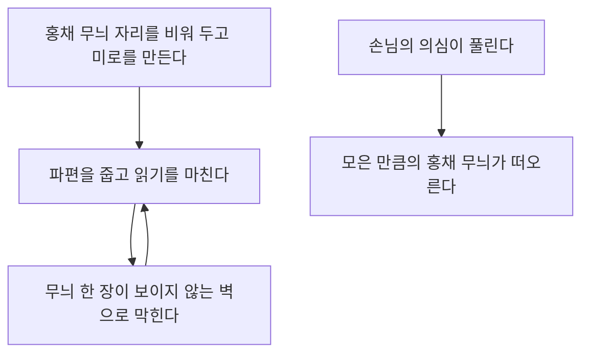

# 미로 레이아웃

접두어 `LAYOUT` · 다음 번호 `LAYOUT-04`

손님의 눈 속 미로가 어떤 모양으로 만들어지고, 기억을 모으는 동안 어떻게 복잡해지며, 무엇이 보이고 무엇이 숨는지 정한다.

## 흐름

손님마다 홍채 무늬가 여러 장으로 나뉘어 있다. 미로는 무늬 자리를 비워 둔 채 모든 칸이 이어지게 만들어지고, 기억을 모을 때마다 무늬가 한 장씩 벽으로 막혀 길이 끊기지 않으면서 복잡해진다. 의심이 풀리면 지금까지 겹친 무늬가 드러난다.

## 기능

---

## 자세히

개발자용: 고칠 때 볼 것 (주의, 하지 않는 것, 구성, 코드 단서, 메모)

### 메모

- 층 사이 문은 `DLG-06`, `DLG-11`, 파편은 `MEM`, 파편 뒤 벽 재생성은 `BLINK-02`, `BLINK-07`, `BLINK-08`, 손님 감정은 `EMO-01`과 얽힌다.

