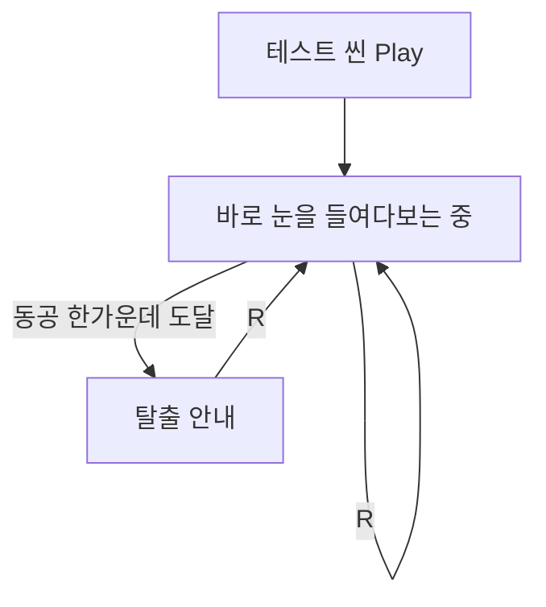

# 눈 미로 테스트 씬

접두어 `MTEST` · 다음 번호 `MTEST-06`

필드, 시작 독백, 대화 없이 눈 미로만 바로 플레이해 보는 별도 씬이다. 미로 플레이 방식을 바꿔 볼 때 본 게임 흐름을 거치지 않고 빠르게 확인한다.

## 흐름

본 게임 씬은 바꾸지 않는다. 테스트 씬은 본 게임 씬의 눈 미로와 같은 디렉터, 미로, 깜빡임, 파편을 그대로 쓴다.

## 기능

---

## 자세히

개발자용: 고칠 때 볼 것 (주의, 하지 않는 것, 구성, 코드 단서, 메모)

### 메모

- 깜빡임은 `BLINK`, 부담감은 `BURDEN`, 파편과 회상은 `MEM` 영역의 동작을 그대로 따른다.

