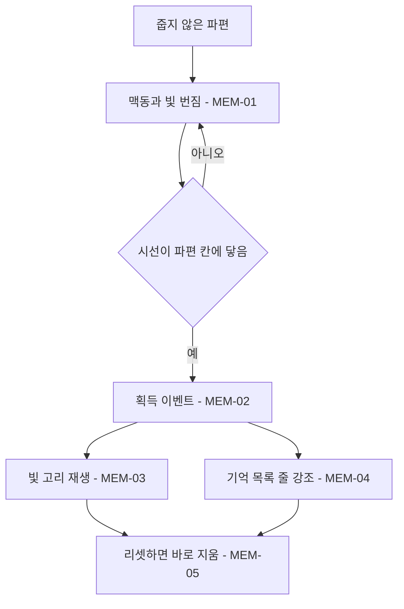
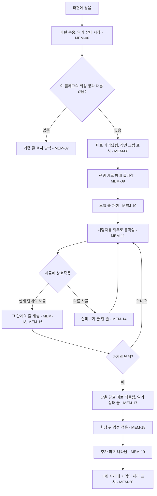
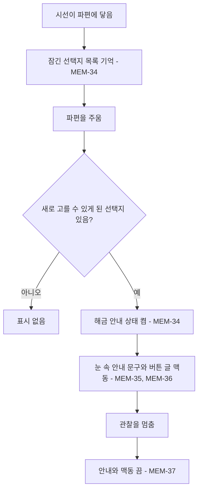
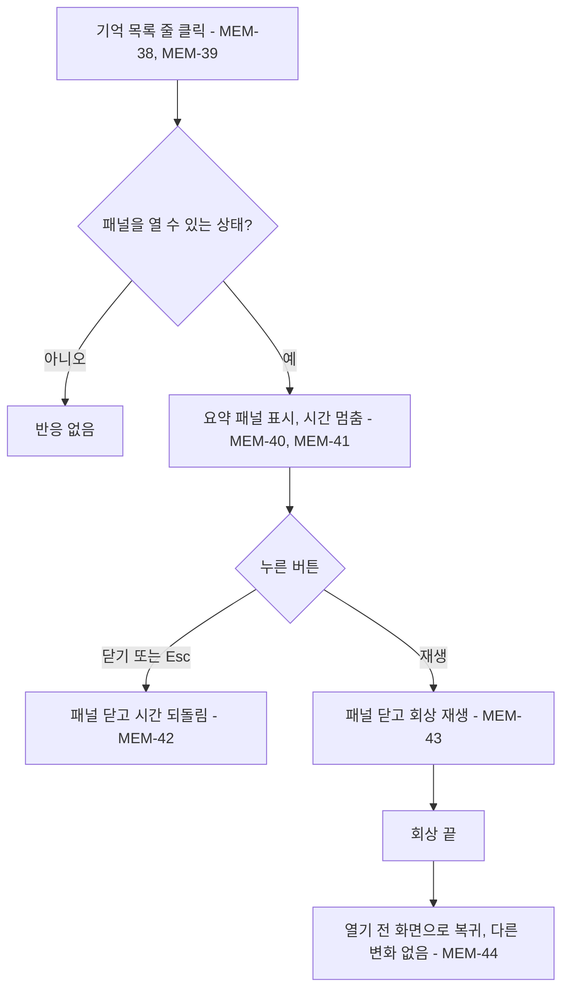

# 기억 파편

## 1. 목적

미로 속 파편이 눈에 잘 띄게 하고 주운 순간을 바로 알아차리게 한다. 파편에 닿으면 글 몇 줄 대신 그 순간의 장면 그림이 나오고, 플레이어가 그 그림 속 방에 들어가 내담자가 되어 그때 한 행동을 직접 하게 한다. 회상이 끝나면 내담자의 감정 변화와 추가 파편, 새 선택지로 이어지며, 선택지가 열린 순간을 알려 관찰을 멈추고 대화로 돌아갈 이유를 느끼게 한다. 이미 본 단서는 기억 목록에서 눌러 요약을 읽고 회상을 다시 볼 수 있다.

- 파편 가시성: 미로 속 파편이 눈에 잘 띄게 하고, 파편을 주운 순간을 플레이어가 바로 알아차리게 한다.
- 회상 재연: 파편에 닿았을 때 글 몇 줄 대신 그 순간의 장면 그림이 나오고, 플레이어가 그 그림 속 방에 들어가 내담자가 되어 그때 한 행동을 직접 하게 한다. 회상이 끝난 뒤에는 내담자의 감정 변화와 추가 파편, 새 선택지로 이어지게 한다.
- 단서 해금과 다시 보기: 단서를 봐서 잠겨 있던 선택지가 열린 순간을 플레이어가 바로 알아차려 관찰을 멈추고 대화로 돌아갈 이유를 느끼게 한다. 이미 본 단서는 기억 목록에서 눌러 요약을 읽고 회상을 다시 볼 수 있게 한다.
- 대상: 플레이어, 연출 값을 조절하는 제작자, 회상 대본을 쓰고 회상 방을 배치하는 제작자

### 범위

#### 파편 가시성

- 포함:
  - 파편 본체의 마름모 모양과 밝기 맥동, 마름모 후광
  - 파편을 주운 자리에서 퍼지는 빛 고리
  - 기억 목록에서 새로 얻은 파편 줄 강조
- 제외:
  - 시선 점보다 큰 본체
  - 소리
  - 말풍선, 읽기 상태, 부담감, 깜빡임, 이동 규칙 변경
  - 문구 추가

#### 회상 재연

- 포함:
  - 파편에 닿으면 미로가 가라앉고 장면 그림이 나오는 기능
  - 장면 그림에서 회상 방으로 들어가 내담자를 직접 움직이는 조작(필드와 같은 좌우 이동과 상호작용)
  - 방 안 사물에 상호작용하면 그 순간의 말과 일이 글로 나오는 단계 진행
  - 회상 대본 데이터(`Flashbacks.csv`)
  - 회상이 끝난 뒤의 내담자 감정 변화
  - 회상이 끝난 자리에 생기는 추가 파편
  - 회상을 본 파편 자리를 미로에 남기는 표시
- 제외:
  - 방을 옮겨 다니는 회상. 회상 한 편은 방 하나에서만 일어난다.
  - 회상 안의 분기. 플레이어는 내담자가 실제로 한 행동만 순서대로 한다.
  - 주인공의 독백이나 해설. 회상에는 그 순간에 있었던 말과 일만 넣는다.
  - 빨리감기(`DLG-32`~`DLG-39`(`dialogue.md`)). 회상은 조작 구간이므로 적용하지 않는다.
  - 은재의 회상 대본, 회상 방 배치, 그림. 이 스펙의 기능을 구현한 뒤 콘텐츠 작업으로 만든다. 그림은 Codex 기록 담당이 만들고, 기존 인물 초상과 외형이 다른 그림은 쓰지 않는다.

#### 단서 해금과 다시 보기

- 포함:
  - 파편을 주워 잠긴 선택지가 열렸을 때의 눈 속 안내 문구와 `관찰 중지` 버튼 글 맥동
  - 기억 목록을 줄마다 누를 수 있는 버튼으로 표시
  - 파편 요약 패널(제목, 획득 문구, `재생`, `닫기`)
  - 요약 패널에서 회상 다시 재생
- 제외:
  - 키보드만으로 기억 목록 줄을 고르는 조작
  - 파편 요약 글을 새로 쓰는 일 (기존 `Flags.csv`의 `title`, `text`를 쓴다)
  - 회상 대본과 회상 방의 변경
  - 선택지가 열리는 조건(`need`)의 변경
  - 대화 화면에서 새로 열린 선택지를 따로 표시하는 일 (어느 선택지가 방금 열렸는지 짚어 주면 그것부터 고르게 되므로 하지 않는다)

### 선택하지 않은 방식

#### 파편 가시성

- `EyeMazeDirector.CheckFragment()`에 호출을 추가하는 방식은 대화·깜빡임 코드와 같은 파일을 고쳐야 하므로 사용하지 않는다.

#### 회상 재연

- 회상을 지켜보기만 하는 글 재생으로 만들지 않는다.
- 회상 내용을 기존 말풍선 문구(`_message`)로 보여 주지 않는다.
- 회상에 사실이 아닌 내용이나 일부를 가린 내용을 넣는 기능은 만들지 않는다.
- 회상 뒤 해설 문구를 자동으로 붙이지 않는다.
- 다음에 상호작용할 사물을 색이나 빛으로 미리 표시하지 않는다.
- `FlashbackProp`은 `FieldInteractable`을 상속하지 않는다(`GameFlow`의 필드 상호작용 탐색에 섞이지 않게 한다).
- 회상 화면의 UI 오브젝트를 코드로 만들지 않는다.

#### 단서 해금과 다시 보기

- 기억 목록 줄을 코드로 생성하지 않는다 (UI GameObject는 씬에 저장한다).
- TextMeshPro를 쓰지 않는다 (기존 만남 UI와 같은 uGUI `Text`).
- 요약 글을 따로 저장하는 새 CSV를 만들지 않는다.

## 2. 요구사항

### 파편 가시성

- **MEM-01** `[구현완료]` Play Mode에서 파편이 줍지 않은 상태일 때 `MemoryFragment`는 `_pulseSeconds` 주기로 맥동하는 밝기로 층 회전과 관계없이 기울지 않는 마름모 본체를 그리고, `FragmentFeedback`은 본체 뒤에 투명도가 같은 주기로 맥동하는 파편 색의 마름모 후광을 그린다.
- **MEM-02** `[구현완료]` `MemoryFragment.Collected`가 Play Mode에서 false에서 true로 바뀔 때 `MemoryFragment`는 획득 이벤트를 한 번 낸다.
- **MEM-03** `[구현완료]` 획득 이벤트를 받을 때 `FragmentFeedback`은 파편 자리에서 파편 색 고리를 `_ringSeconds` 동안 넓히며 투명하게 한다.
- **MEM-04** `[승인]` 획득 이벤트를 받을 때 `EyeMazeUI`는 기억 목록의 새 파편 줄(`MEM-38`의 줄 버튼 글)의 색을 `_highlightSeconds`에 걸쳐 원래 색에서 파편 색으로 바꿨다가 다시 원래 색으로 되돌린다.
- **MEM-05** `[구현완료]` `ResetAll`이나 손님 전환이 일어날 때 `FragmentFeedback`과 `EyeMazeUI`는 재생 중인 고리와 줄 강조를 바로 지운다.

### 회상 재연

- **MEM-06** `[승인]` 시선이 줍지 않은 파편에 닿았을 때 `EyeMazeDirector`는 그 파편을 주운 것으로 하고 파편 읽기 상태를 시작한다.
- **MEM-07** `[승인]` 주운 파편의 플래그에 회상 방 또는 회상 대본이 없을 때 `EyeMazeDirector`는 기존처럼 파편의 제목과 글을 문구로 보여 준다.
- **MEM-08** `[승인]` 주운 파편의 플래그에 회상 방과 회상 대본이 있을 때 `FlashbackPlayer`는 미로를 `_dimSeconds`초에 걸쳐 `_mazeDimAlpha`까지 가라앉히고, 만남 UI를 숨기고, 그 방의 장면 그림을 `_coverFadeSeconds`초에 걸쳐 보여 준다.
- **MEM-09** `[승인]` 장면 그림이 다 나온 뒤 플레이어가 진행 키를 눌렀을 때 `FlashbackPlayer`는 그 방을 켜고, 카메라를 그 방의 카메라 기준점과 크기로 옮기고, 내담자를 시작 위치에 둔 뒤, `_enterSeconds`초에 걸쳐 장면 그림을 그 방의 테두리(`FlashbackRoom._frame`)를 가로·세로 모두 덮는 크기로 줄이면서, 줄어드는 시간의 `_enterFadeStart` 지점부터 함께 흐려지게 해 그 아래의 옆모습 방이 다가오듯 드러나게 한다. 줄어듦은 `_enterCurve`를 따르고, 흐려짐은 부드럽게 시작하고 끝나며, 같은 시간 동안 카메라 크기는 방 크기의 `_enterCameraZoom`배에서 방 크기로 다가오다 천천히 멈춘다. 특정 사물을 향해 확대하지 않는다.
- **MEM-10** `[승인]` 방에 들어온 직후 `prop`이 빈 첫 줄들(도입 줄)이 있을 때 `FlashbackPlayer`는 그 줄들을 회상 글 칸에 `order` 순서대로 보여 준다.
- **MEM-11** `[승인]` 방 안에서 글 칸이 닫혀 있을 때 `FlashbackPlayer`는 필드와 같은 좌우 이동 입력을 내담자 `FieldPlayer`에 전달한다.
- **MEM-12** `[승인]` 방 안에서 글 칸이 닫혀 있고 내담자가 어떤 `FlashbackProp`의 상호작용 범위 안에 있을 때 `FlashbackPlayer`는 가장 가까운 사물의 행동 글(`_actionText`, 비면 이름)을 `_hintFormat` 형식(누를 키와 행동)으로 그 사물의 `_hintOffset` 위치 위에 보여 준다. 위치는 카메라 화면의 비율을 `_cameraView` 사각형 안으로 옮겨 정한다.
- **MEM-13** `[승인]` 내담자가 현재 단계의 `FlashbackProp` 범위 안에서 상호작용 키를 눌렀을 때 `FlashbackPlayer`는 그 단계의 대본 줄을 회상 글 칸에 보여 주기 시작한다.
- **MEM-14** `[승인]` 내담자가 현재 단계가 아닌 `FlashbackProp` 범위 안에서 상호작용 키를 눌렀을 때 `FlashbackPlayer`는 그 사물의 살펴보기 글 한 줄을 보여 주고 단계를 넘기지 않는다.
- **MEM-15** `[승인]` `MEM-14`에서 그 사물을 쓰는 단계를 이미 한 번이라도 지났고 그 사물의 `_lookTextAfter`가 비어 있지 않을 때 `FlashbackPlayer`는 `_lookText` 대신 `_lookTextAfter`를 보여 준다. 쓰기 전의 글은 지금 해야 할 사물 쪽으로 눈이 가게 쓰고, 쓴 뒤의 글은 그 사물로 이미 일어난 일과 어긋나지 않게 쓴다.
- **MEM-16** `[승인]` 대본 줄이 다 나온 뒤 플레이어가 진행 키를 눌렀을 때 `FlashbackPlayer`는 그 단계의 다음 줄을 보여 주고, 단계의 마지막 줄이었으면 글 칸을 닫고 다음 단계로 넘어간다. 화자가 있는 줄은 화자 이름과 함께 보여 준다.
- **MEM-17** `[승인]` 마지막 단계의 마지막 줄에서 진행 키를 눌렀을 때 `FlashbackPlayer`는 방을 끄고, 카메라를 회상 전 위치와 크기로 되돌리고, 만남 UI를 다시 보이고, 미로를 `_dimSeconds`초에 걸쳐 되돌리며, `EyeMazeDirector`는 파편 읽기 상태를 끝내고 기존 파편 글을 닫을 때와 같이 `RespawnMaze()`를 호출한다(`BLINK-03`(`blink-maze.md`)). 벽이 바뀌는 모습은 `BLINK-39`의 파문 교차 전환으로 보여 준다.
- **MEM-18** `[승인]` 회상이 끝났고 그 회상의 `emotion_after` 값이 있을 때 `EyeMazeDirector`는 `EMO-02`(`emotion-maze.md`)와 같은 방식으로 감정을 그 값으로 바꾼다.
- **MEM-19** `[승인]` 회상이 끝났을 때 `EyeMazeDirector`는 `_appearAfter`가 그 파편의 플래그인 `MemoryFragment`를 미로에 나타낸다.
- **MEM-20** `[승인]` 회상이 끝났을 때 `EyeMazeDirector`는 그 파편의 `_seen`을 켜고, `MemoryFragment`는 자기 칸에 `_seenSprite`(그 회상의 사물 그림)를 `_seenMarkColor`로 그린다. `_seenSprite`가 없으면 본체 지름 절반 크기의 맥동 없는 마름모를 같은 색으로 그린다.
- **MEM-21** `[승인]` 회상이 재생되는 동안 `EyeMazeDirector`는 부담감 증가, 깜빡임 타이머, 밀려남, 시선 이동 입력을 멈춘다.
- **MEM-22** `[승인]` 회상 대본 줄이 글 칸에 나올 때 `FlashbackPlayer`는 그 줄을 `DialogueLog`에 남긴다. 살펴보기 글은 남기지 않는다.
- ~~**MEM-23**~~ `[폐기]` (폐기: 2026-11-27 회상 방 추가 소품 묶음 제거)
- **MEM-24** `[승인]` 회상이 재생되는 동안 `EyeMazeDirector`와 `GameFlow`는 R(리셋), Q(자리 떠나기), 읽기 상태의 진행 키를 처리하지 않는다.
- ~~**MEM-25**~~ `[폐기]` (폐기: 2026-11-12 기억 잇기를 게임에서 뺌)
- ~~**MEM-26**~~ `[폐기]` (폐기: 2026-11-12 기억 잇기를 게임에서 뺌)
- ~~**MEM-27**~~ `[폐기]` (폐기: 2026-11-12 기억 잇기를 게임에서 뺌)
- ~~**MEM-28**~~ `[폐기]` (폐기: 2026-11-12 기억 잇기를 게임에서 뺌)
- ~~**MEM-29**~~ `[폐기]` (폐기: 2026-11-12 기억 잇기를 게임에서 뺌)
- ~~**MEM-30**~~ `[폐기]` (폐기: 2026-11-12 기억 잇기를 게임에서 뺌)
- ~~**MEM-31**~~ `[폐기]` (폐기: 2026-11-12 기억 잇기를 게임에서 뺌)
- ~~**MEM-32**~~ `[폐기]` (폐기: 2026-11-12 기억 잇기를 게임에서 뺌)
- ~~**MEM-33**~~ `[폐기]` (폐기: 2026-11-12 기억 잇기를 게임에서 뺌)

구현 순서: 묶음 1 (`MEM-06` ~ `MEM-10`, `MEM-17`, `MEM-21`, `MEM-24`, 진입과 종료) → 묶음 2 (`MEM-11` ~ `MEM-14`, `MEM-16`, `MEM-22`, 방 안 조작과 단계) → 묶음 3 (`MEM-18` ~ `MEM-20`, 회상 뒤 처리)

### 단서 해금과 다시 보기

- **MEM-34** `[승인]` Play Mode에서 시선이 파편을 주웠을 때 `EyeMazeDirector`는 지금 손님 대화의 모든 장면에서, 줍기 직전에는 `need`가 채워지지 않아 고를 수 없었고 주운 직후에는 고를 수 있게 된 선택지가 하나라도 있으면 해금 안내 상태를 켠다.
- **MEM-35** `[승인]` 해금 안내 상태에서 눈을 들여다보는 중이고 파편을 읽는 중과 심연이 아닐 때 `EyeMazeUI`는 눈 속 표시 아래에 `ui.new_talk_hint`(`(새로 꺼낼 수 있는 이야기가 생겼다. 관찰을 멈춰보자.)`)를 보여 준다.
- **MEM-36** `[승인]` 해금 안내 상태에서 눈을 들여다보는 중일 때 `EyeMazeUI`는 `관찰 중지` 버튼 글의 색을 원래 색과 `_gazePulseColor` 사이에서 `_newTalkPulseSeconds` 주기로 오가게 한다.
- **MEM-37** `[승인]` 시선을 거두어 대화로 돌아올 때 `EyeMazeDirector`는 해금 안내 상태를 끄고, `EyeMazeUI`는 버튼 글의 색을 원래 색으로 되돌린다.
- **MEM-38** `[승인]` `EyeMazeUI`는 기억 목록의 머리글(`파편들 (N/M)`) 아래에 주운 파편마다 줄 버튼 하나를 주운 순서와 무관하게 파편 목록 순서대로 보여 주고, 남는 줄 버튼은 숨긴다. 주운 파편이 없으면 머리글 아래에 `· 아직 없음`을 보여 준다.
- **MEM-39** `[승인]` Play Mode에서 줄 버튼을 누르고 `EyeMazeDirector.CanOpenRecap`이 true일 때 `FragmentRecapUI`는 그 파편의 요약 패널을 연다.
- **MEM-40** `[승인]` 요약 패널이 열릴 때 `FragmentRecapUI`는 파편의 제목과 획득 문구(`MemoryFragment.Title`, `Text`)를 보여 주고, 그 파편에 회상 방과 회상 대본이 있으면 `재생`과 `닫기`를, 없으면 `닫기`만 보여 준다.
- **MEM-41** `[승인]` 요약 패널이 열려 있는 동안 `Time.timeScale`은 0이고, `EyeMazeDirector`와 `GameFlow`는 키 입력을 처리하지 않는다.
- **MEM-42** `[승인]` `닫기`를 누르거나 Esc 키 또는 게임패드 B(East) 버튼을 누를 때 `FragmentRecapUI`는 패널을 닫고 `Time.timeScale`을 열기 전 값으로 되돌린다.
- **MEM-43** `[승인]` `재생`을 누를 때 `FragmentRecapUI`는 `MEM-42`와 같이 패널을 닫은 뒤 `EyeMazeDirector.ReplayFlashback()`을 부르고, `EyeMazeDirector`는 그 파편의 회상을 `MEM-08` ~ `MEM-16`과 같이 처음부터 재생한다.
- **MEM-44** `[승인]` 다시 재생한 회상이 끝났을 때 `EyeMazeDirector`는 읽기 상태만 끝내고, 감정, 추가 파편, 기억의 자리, 미로 벽, 문구를 바꾸지 않는다.

구현 순서: 묶음 1 (`MEM-34` ~ `MEM-37`, 해금 피드백) → 묶음 2 (`MEM-38` ~ `MEM-44`, `MEM-04`, 다시 보기)

### 예외 및 경계 조건

#### 파편 가시성

- 파편 본체 크기: 마름모 대각선은 `RingWidth × 0.46`이고, 맥동해도 시선 점 지름보다 커지지 않는다.
- 대화 중과 눈물 연출 중: 맥동과 후광에도 기존 `WallAlpha`, `FocusAlpha`를 곱한다.
- 파편 위치: 층의 회전을 따라가되 Play Mode에서는 메인 카메라 렌더 텍스처(480×270)의 픽셀 중심에 맞춘다. 층 회전 자체는 바꾸지 않는다.
- 바깥 후광: `_outerGlowAlpha`가 0이면 보이지 않는다.
- 에디트 모드: 맥동, 후광, 기울기 고정, 픽셀 맞춤, 이벤트, 고리, 강조가 모두 일어나지 않는다. 파편 Transform은 Play 중에만 바뀌고 씬에 저장되지 않는다.
- `ResetAll`의 `Collected = false` 대입: 이벤트를 내지 않는다.
- 연출 전체: 말풍선, `_reading`, 부담감, 깜빡임 타이머, 이동 입력을 바꾸지 않는다.
- 파편을 읽다가 바로 닫아 깜빡임이 이어짐: 고리는 층을 따라가며 끝까지 재생하고, 표시 오프셋은 건드리지 않는다.
- 파편을 읽고 닫을 때 벽 재생성(`BLINK-03`(`blink-maze.md`)): 시선이 있는 층은 다시 만들어지지 않으므로 고리에 영향이 없다.

#### 회상 재연

- 회상 길이 기준: 방 하나, 단계 3~5개, 플레이 30초~1분을 기준으로 쓴다. 한 회상의 대본 줄이 12줄을 넘으면 플래그 관리자 검사에서 경고로 보고한다.
- 글자가 나오는 중 진행 키: 그 줄 전체를 바로 보여 준다. 다음 줄로 넘기지 않는다.
- 상호작용 범위 안 사물들의 거리가 같음: 현재 단계의 사물을 고른다. 둘 다 현재 단계가 아니면 `FlashbackProp` 목록에서 앞선 사물을 고른다.
- 회상 도중 Q 또는 R을 누름: 반응하지 않는다. 회상이 끝난 뒤에 자리를 떠나거나 리셋할 수 있다.
- 회상 대본이 없어 기존 글로 읽은 파편(`MEM-07`): 기억의 자리가 되지 않고 그림도 남기지 않는다.
- Play Mode가 회상 도중 끝남: `OnDisable`에서 `IsPlaying`을 false로 되돌린다.
- 회상 도중 대화 기록 창(`DLG-24`~`DLG-31`(`dialogue.md`))을 엶: 창이 열려 있는 동안 `FlashbackPlayer`는 입력을 처리하지 않는다.
- 추가 파편이 나타날 칸에 시선이 서 있음: 파편을 나타내되 그 칸을 벗어났다 다시 들어올 때 줍는다.
- `_appearAfter`가 지정된 파편: 조건이 충족되기 전에는 보이지 않고 주울 수 없다. `ResetAll()`에서 다시 숨긴다.
- 회상이 끝난 뒤의 감정이 현재 감정과 같음: 감정 전환 연출을 하지 않는다.
- 장면 그림이 없는 방: 그림 단계를 건너뛰고 미로를 가라앉힌 뒤 바로 방으로 들어간다.
- 배경 그림이 없는 방: `FieldRoom`이 그리는 바닥과 벽만 보인다.
- `Flashbacks.csv`의 `flag`가 `Flags.csv`에 없는 이름: 플래그 관리자 검사에서 오류로 보고한다.
- `Flashbacks.csv`의 `prop`이 그 방에 없는 id: 플래그 관리자 검사에서 오류로 보고한다.
- 대본 줄에 `prop`이 하나도 없는 회상: 도입 줄이 끝나면 바로 회상을 끝낸다.
- 에디트 모드: 회상은 재생되지 않는다.

#### 단서 해금과 다시 보기

- 새로 열린 선택지가 지금 장면이 아닌 다른 장면에 있음: 안내와 맥동은 똑같이 나온다.
- 대화 화면: 새로 열린 선택지도 다른 선택지와 같은 색으로 보인다.
- 파편 하나로는 열리지 않는 선택지(`DLG-42`(`dialogue.md`)의 문 선택지): 그 층의 마지막 단서를 주운 순간에만 `MEM-34`가 일어난다.
- 주운 직후 회상이 재생됨: 안내는 회상이 끝나고 눈 속 화면으로 돌아온 뒤에 보인다. 읽는 중과 회상 중에는 기존 표시를 쓴다.
- 해금 안내와 휴식 신호 안내(`BURDEN-36`(`burden.md`))가 함께 켜짐: 두 문구를 휴식 신호, 해금 순서로 줄을 바꿔 모두 보여 준다.
- 관찰을 멈췄다가 새로 열린 선택지를 고르지 않고 다시 들여다봄: 안내와 맥동은 다시 나오지 않는다.
- `ResetAll()`과 손님 전환: 해금 안내 상태를 지운다.
- 에디트 모드: 안내와 맥동이 일어나지 않는다. 기억 목록 줄은 에디트 모드에서도 주운 파편을 보여 준다.
- `CanOpenRecap`이 false인 때: 손님과 만나지 않는 중(필드), 엔딩, 심연, 파편을 읽는 중, 회상 재생 중, 선택지 결과 줄을 넘기는 중, 깜빡임과 벽 변화 연출 중, 대화 기록 창이 열려 있는 중. 이때 줄 버튼을 눌러도 반응하지 않는다.
- 주운 파편이 줄 버튼 수보다 많음: 줄 버튼 수만큼만 보인다. 늘리려면 씬에서 줄을 복제해 `_memoryRows`에 추가한다.
- 회상 방이 없는 파편: `재생` 버튼을 숨기고 `닫기`만 보인다.
- 요약 패널이 열린 채 대화 기록 창(L)을 엶: 대화 기록 창이 열려 있는 동안 요약 패널은 Esc와 게임패드 B에 반응하지 않고, 대화 기록 창을 닫은 뒤 닫을 수 있다.
- 요약 패널이 열린 채 Play Mode 종료: `OnDisable`에서 `Time.timeScale`을 되돌리고 `IsOpen`을 false로 한다.
- 다시 재생 중: `MEM-21`, `MEM-24`와 같이 부담감, 깜빡임, 이동, R, Q가 멈춘다. 대화 중에 재생해도 끝나면 대화 화면으로 돌아온다.
- 다시 재생한 회상의 대본 줄: `MEM-22`와 같이 대화 기록에 다시 남는다.
- 패널을 닫은 프레임의 Esc, B, 클릭: `BlocksInput`이 true라 `GameFlow`와 `EyeMazeDirector`가 그 입력을 쓰지 않는다.

## 3. 상태와 전이

| 지금 상태 | 계기 | 다음 상태 | 관련 요구사항 |
|---|---|---|---|
| 숨은 추가 파편 | `_appearAfter` 플래그의 회상이 끝남 | 줍지 않은 파편 | MEM-19 |
| 줍지 않은 파편 | 시선이 파편 칸에 닿음 | 주운 파편, 읽기 상태 | MEM-02, MEM-06 |
| 읽기 상태 | 회상 방 또는 대본이 없음 | 기존 글 표시 | MEM-07 |
| 읽기 상태 | 회상 방과 대본이 있음 | 회상 재생 중(`FlashbackPlayer.IsPlaying`) | MEM-08 |
| 회상 재생 중 | 마지막 단계의 마지막 줄에서 진행 키 | 기억의 자리(`_seen`) | MEM-17, MEM-20 |
| 해금 안내 꺼짐 | 파편을 주워 새로 고를 수 있게 된 선택지가 생김 | 해금 안내 켜짐 | MEM-34 |
| 해금 안내 켜짐 | 시선을 거두어 대화로 돌아옴 | 해금 안내 꺼짐 | MEM-37 |
| 요약 패널 닫힘 | 줄 버튼 클릭, `CanOpenRecap`이 true | 요약 패널 열림 | MEM-39 |
| 요약 패널 열림 | `닫기`, Esc, 게임패드 B | 요약 패널 닫힘 | MEM-42 |
| 요약 패널 열림 | `재생` | 다시 재생 중 | MEM-43 |
| 다시 재생 중 | 회상 끝 | 열기 전 화면 | MEM-44 |

### 파편 가시성

### 회상 재연

### 단서 해금과 다시 보기

선택지 해금 피드백

단서 다시 보기

## 4. 수치 표

기본값은 코드의 필드 초기값이다. 씬이나 프리팹에 저장된 값은 이와 다를 수 있으며, Play에서는 저장된 값이 쓰인다.

### 파편 가시성

상태와 데이터

| 이름 | 타입 | 설명 | 초기값 |
|------|------|------|--------|
| `MemoryFragment` 획득 이벤트 | event | 파편을 주운 순간 알리는 이벤트 | 구독 없음 |
| `_activeRings` | List | `FragmentFeedback`이 재생 중인 고리 | 빈 목록 |
| `_highlightT` | float | `EyeMazeUI`의 줄 강조 남은 시간(초) | 0 |

Inspector 노출값

| 필드 | 타입 | 기본값 | 설명 |
|------|------|--------|------|
| `MemoryFragment._pulseSeconds` | float | 1.6 | 맥동 한 주기(초) |
| `MemoryFragment._pulseMinBrightness` | float | 0.7 | 맥동의 가장 어두운 밝기 배율 |
| `FragmentFeedback._glowSizeRatio` | float | 0.6 | 안쪽 후광 대각선 (`RingWidth` 배율) |
| `FragmentFeedback._glowAlpha` | float | 0.3 | 안쪽 후광 투명도 |
| `FragmentFeedback._outerGlowSizeRatio` | float | 1.3 | 바깥 후광 대각선 (`RingWidth` 배율) |
| `FragmentFeedback._outerGlowAlpha` | float | 0 | 바깥 후광 투명도 |
| `FragmentFeedback._glowPulseMinAlpha` | float | 0.45 | 맥동이 가장 어두울 때의 후광 투명도 배율 |
| `FragmentFeedback._glowPulseMinScale` | float | 1 | 맥동이 가장 작을 때의 후광 크기 배율 (1이면 크기 변화 없음) |
| `FragmentFeedback._ringSeconds` | float | 0.6 | 획득 고리 재생 시간(초) |
| `FragmentFeedback._ringEndRatio` | float | 1.5 | 고리가 끝날 때의 지름 (`RingWidth` 배율) |
| `EyeMazeUI._highlightSeconds` | float | 0.6 | 기억 목록 줄 강조 시간(초) |

### 회상 재연

상태와 데이터

| 이름 | 타입 | 설명 | 초기값 |
|------|------|------|--------|
| `Flashbacks.csv`의 `flag` | 문자열 | 이 줄이 속한 회상의 파편 플래그 | 없음 |
| `Flashbacks.csv`의 `order` | 정수 | 회상 안에서의 순서 | 없음 |
| `Flashbacks.csv`의 `prop` | 문자열 | 이 줄에서 새 단계가 시작될 때 상호작용해야 하는 사물의 id. 비우면 앞줄과 같은 단계에 이어진다 | 빈 값 |
| `Flashbacks.csv`의 `speaker` | 문자열 | 그 순간에 말한 사람. 비우면 장면 서술 | 빈 값 |
| `Flashbacks.csv`의 `text` | 문자열 | 그 순간의 말 또는 일어난 일 | 없음 |
| `Flashbacks.csv`의 `emotion_after` | 문자열 | 회상이 끝난 뒤의 감정. 그 회상의 첫 줄에만 적는다 | 빈 값 |
| `FlashbackPlayer._stepIndex` | `int` | 지금 진행 중인 단계 번호 | 0 |
| `FlashbackPlayer.IsPlaying` | `static bool` | 회상이 재생되는 중인지. `EyeMazeDirector`와 `GameFlow`가 입력 차단에 쓴다 | false |
| `MemoryFragment._seen` | `bool` | 이 파편의 회상을 끝까지 봤는지 | false |

Inspector 노출값

| 필드 | 타입 | 기본값 | 설명 |
|------|------|--------|------|
| `FlashbackPlayer._rooms` | `FlashbackRoom[]` | 빈 배열 | 씬에 있는 회상 방 목록 |
| `FlashbackPlayer._camera` | `Camera` | 씬의 메인 카메라 | 회상 방을 비출 카메라 |
| `FlashbackPlayer._mazeDimAlpha` | `float` | 0.15 | 회상 중 미로의 투명도 |
| `FlashbackPlayer._dimSeconds` | `float` | 0.8 | 미로가 가라앉고 되돌아오는 시간 |
| `FlashbackPlayer._coverFadeSeconds` | `float` | 0.5 | 장면 그림이 나타나는 시간 |
| `FlashbackPlayer._enterSeconds` | `float` | 2 | 장면 그림이 방 테두리 크기로 줄어들며 사라지는 시간 |
| `FlashbackPlayer._enterFadeStart` | `float` | 0.35 | 줄어드는 시간 중 흐려지기 시작하는 지점(0~0.9). 0이면 줄어들기 시작할 때부터 함께 흐려진다 |
| `FlashbackPlayer._enterCurve` | `AnimationCurve` | 천천히 시작해 천천히 끝나는 곡선 | 장면 그림이 줄어드는 빠르기 |
| `FlashbackPlayer._enterCameraZoom` | `float` | 1.15 | 진입을 시작할 때 방 카메라 크기 배율. 1보다 크면 방이 멀리서 다가온다 |
| `FlashbackPlayer._hintFormat` | `string` | `[Space] {0}` | 사물 안내 글 형식. `{0}`에 사물 행동 글이 들어간다 |
| `FlashbackPlayer._cameraView` | `RectTransform` | 씬의 도트 화면 RawImage | 카메라 화면을 띄우는 사각형. 안내 글을 사물 위에 놓을 때 쓴다 |
| `FlashbackProp._actionText` | `string` | 빈 값 | 가까이 갔을 때 보이는 행동 글. 비우면 이름을 쓴다 |
| `FlashbackProp._hintOffset` | `Vector2` | (0, 0.6) | 안내 글이 뜨는 위치. 사물 위치에서 더하는 거리 |
| `FlashbackPlayer._coverImage` | `Image` | 회상 화면의 장면 그림 | 장면 그림을 보여 줄 오브젝트 |
| `FlashbackPlayer._textBox` | `GameObject` | 회상 화면의 글 칸 | 대본 줄을 보여 줄 칸 |
| `FlashbackPlayer._speakerText`, `_bodyText`, `_hintText` | `Text` | 회상 화면의 글 오브젝트 | 화자, 본문, 사물 이름 안내 |
| `FlashbackPlayer._encounterUi` | `GameObject` | 씬의 만남 UI 루트 | 회상 중 끄고 끝나면 다시 켤 오브젝트 |
| `MemoryFragment._seenSprite` | `Sprite` | 없음 | 회상을 본 뒤 자리에 남는 사물 그림 |
| `MemoryFragment._seenRenderer` | `SpriteRenderer` | 파편의 자식 오브젝트 | 사물 그림을 그릴 렌더러 |
| `FlashbackRoom._flag` | `string` | 빈 값 | 이 방이 속한 파편의 플래그 |
| `FlashbackRoom._cover` | `Sprite` | 없음 | 먼저 나오는 장면 그림 |
| `FlashbackRoom._frame` | `FieldRoom` | 씬 연결 | 방으로 들어갈 때 장면 그림이 줄어들어 맞춰질 방 테두리 (방 안의 FieldRoom) |
| `FlashbackRoom._actor` | `FieldPlayer` | 방 안의 내담자 | 플레이어가 움직일 내담자 |
| `FlashbackRoom._startPoint` | `Transform` | 방 안의 빈 오브젝트 | 내담자의 시작 위치 |
| `FlashbackRoom._cameraPoint` | `Transform` | 방 안의 빈 오브젝트 | 카메라가 놓일 위치 |
| `FlashbackRoom._cameraSize` | `float` | 4.5 | 카메라 크기 |
| `FlashbackProp._id` | `string` | 빈 값 | `Flashbacks.csv`의 `prop`에 적는 id |
| `FlashbackProp._displayName` | `string` | `무언가` | 가까이 갔을 때 보이는 이름 |
| `FlashbackProp._lookText` | `string` | 빈 값 | 현재 단계가 아닐 때 보이는 살펴보기 글. 비우면 반응하지 않는다 |
| `FlashbackProp._interactRange` | `float` | 0.9 | 상호작용할 수 있는 거리 |
| `MemoryFragment._appearAfter` | `string` | 빈 값 | 이 플래그의 회상이 끝난 뒤에 나타난다. 비우면 처음부터 있다 |
| `EyeMazeDirector._seenMarkColor` | `Color` | 파편 색의 반투명 | 기억의 자리 표시 색 |

### 단서 해금과 다시 보기

상태와 데이터

| 이름 | 타입 | 설명 | 초기값 |
|------|------|------|--------|
| `EyeMazeDirector._newTalkReady` | `bool` | 해금 안내 상태인지 | false |
| `EyeMazeDirector.CanOpenRecap` | `bool` (계산값) | 요약 패널을 열 수 있는지 | - |
| `FragmentRecapUI.IsOpen` | `static bool` | 패널이 열려 있는지 | false |
| `FragmentRecapUI.ClosedFrame` | `static int` | 패널을 닫은 프레임 번호 | -1 |
| `FragmentRecapUI.BlocksInput` | `static bool` (계산값) | `IsOpen`이거나 이번 프레임에 닫혔으면 true | false |
| `FragmentRecapUI._fragment` | `MemoryFragment` | 지금 패널에 보이는 파편 | 없음 |
| `FragmentRecapUI._savedTimeScale` | `float` | 패널을 열기 전 timeScale | 1 |

Inspector 노출값

| 필드 | 타입 | 기본값 | 설명 |
|------|------|--------|------|
| `EyeMazeUI._gazePulseColor` | `Color` | (0.85, 0.35, 0.1, 1) | `관찰 중지` 버튼 글이 맥동할 때 오가는 색 |
| `EyeMazeUI._newTalkPulseSeconds` | `float` | 1.2 | 버튼 글 색이 한 번 오가는 시간(초) |
| `EyeMazeUI._memoryRows` | `Button[]` | 줄 버튼 8개 | 기억 목록의 줄 버튼 |
| `EyeMazeUI._memoryRowLabels` | `Text[]` | 줄 글 8개 | 줄 버튼의 글 |
| `EyeMazeUI._recap` | `FragmentRecapUI` | 씬의 요약 패널 | 줄을 눌렀을 때 열 패널 |
| `FragmentRecapUI._director` | `EyeMazeDirector` | 씬의 디렉터 | 열 수 있는지 묻고 재생을 맡길 디렉터 |
| `FragmentRecapUI._panel` | `GameObject` | 패널 오브젝트 | 열고 닫을 패널 |
| `FragmentRecapUI._titleText` | `Text` | 제목 글 | 파편 제목 |
| `FragmentRecapUI._bodyText` | `Text` | 본문 글 | 파편 획득 문구 |
| `FragmentRecapUI._playButton` | `Button` | 재생 버튼 | 회상 다시 재생 |
| `FragmentRecapUI._closeButton` | `Button` | 닫기 버튼 | 패널 닫기 |

## 5. 코드 위치

### 파편 가시성

| 구분 | 이름 | 역할 |
|------|------|------|
| 클래스 | `MemoryFragment` | 맥동을 그리고 획득 이벤트를 낸다 |
| 클래스 | `FragmentFeedback` | 빛 번짐과 획득 고리를 만들고 재생하고 지운다 |
| 클래스 | `EyeMazeUI` | 기억 목록의 새 파편 줄을 강조한다 |
| 씬 | `EyeMaze` | `FragmentFeedback` 컴포넌트 1개를 가진다 |

- 오브젝트 구성: `FragmentFeedback`을 `EyeMaze` 씬의 오브젝트 하나에 붙인다. 파편별 씬 변경은 없다. 고리는 파편이 속한 층의 자식으로 만든다.
- 클래스 간 관계: `FragmentFeedback` → `MemoryFragment` 획득 이벤트 구독, `EyeMazeUI` → `MemoryFragment` 획득 이벤트 구독
- 실행 순서 의존성: 해당 없음
- 기존 코드와의 접점: `MemoryFragment.Collected`, `MemoryFragment.Update()`, `EyeMazeUI`의 기억 목록 표시
- 사용 기술/API: `LineRenderer`, 프로젝트의 `Shapes`, `IrisMaze.LineMaterial`, uGUI `Text`의 기존 기억 목록
- 핵심 방식: `MemoryFragment.Collected` 세터에서 false→true 전환을 이벤트로 알리고, 새 컴포넌트 `FragmentFeedback`이 빛 번짐과 고리를 Play 중에 만들어 그린다.

### 회상 재연

| 구분 | 이름 | 역할 |
|------|------|------|
| 클래스 | `FlashbackScript` | `Flashbacks.csv`를 읽어 플래그별 단계와 대본 줄 목록을 제공한다 |
| 클래스 | `FlashbackPlayer` | 장면 그림 표시, 방 진입, 내담자 조작 전달, 단계 진행, 종료를 맡는다 |
| 클래스 | `FlashbackRoom` | 회상 방 하나. 플래그, 장면 그림, 방, 내담자, 카메라 기준점을 가진다 |
| 클래스 | `FlashbackProp` | 회상 방 안의 사물. id, 이름, 상호작용 범위, 살펴보기 글을 가진다 |
| 클래스 | `EyeMazeDirector` | 파편에 닿았을 때 회상을 시작하고, 끝났을 때 감정과 추가 파편을 처리한다 |
| 클래스 | `MemoryFragment` | 추가 파편의 등장 조건(`_appearAfter`)과 회상을 봤는지 여부를 가진다 |
| 데이터 | `Assets/EyeMaze/Data/Flashbacks.csv` | 회상 대본 |
| 씬 | `EyeMaze` | 회상 화면 오브젝트, `FlashbackPlayer`, 회상 방들을 둔다 |

- 오브젝트 구성:
  - 회상 화면은 기존 `UI (Canvas)`와 별개의 Canvas로 에디터에서 만든 uGUI 오브젝트 묶음(장면 그림 `Image`, 글 칸, 화자 글, 본문 글, 사물 이름 안내 글)이고 그 루트에 `FlashbackPlayer`를 붙인다. 본문 글에는 `Typewriter`를 붙인다. `FlashbackPlayer`는 이 오브젝트들을 `[SerializeField]`로 참조만 한다.
  - 회상 방은 씬의 미로와 상담실에서 떨어진 위치에 방마다 오브젝트 하나로 두고 `FlashbackRoom`을 붙인다. 그 아래에 `FieldRoom`, 배경 그림(`SpriteRenderer`), 내담자(`FieldPlayer`), 사물들(`FlashbackProp`), 시작 위치와 카메라 기준점(빈 `Transform`)을 둔다. 방 오브젝트는 꺼진 채로 저장하고 재생하는 동안만 켠다.
- 클래스 간 관계: `EyeMazeDirector`가 `FlashbackPlayer.Play(flag, onFinished)`를 호출하고 완료 콜백을 받는다. `FlashbackPlayer`는 `FlashbackScript`에서 단계를 가져오고, `FlashbackRoom`의 내담자 `FieldPlayer.Steer()`를 호출하며, Inspector로 참조한 만남 UI 루트 오브젝트를 끄고 다시 켠다. `MemoryFragment`는 자신의 회상 본 상태에 따라 기억의 자리 그림을 그린다.
- 실행 순서 의존성: `FlashbackScript`는 `Flags`와 같은 시점에 CSV를 읽는다.
- 기존 코드와의 접점: `EyeMazeDirector.CheckFragment()`와 파편 읽기 종료 처리, `ResetAll()`. `MemoryFragment`의 표시 조건. `EyeMazeDirector.HandleInput()`의 읽기 상태 분기. `MemoryFragment.Update()`의 그리기. 다른 영역과의 접점은 6절에 둔다.
- 사용 기술/API: Unity `MonoBehaviour`, uGUI `Image`와 `Text`(기존 만남 UI와 같은 글 컴포넌트. `Typewriter`가 `Text`만 받는다), 기존 CSV 로더(`Csv`), `Typewriter`, 기존 필드 조작 클래스(`FieldPlayer`, `FieldRoom`)
- 핵심 방식: 회상은 파편의 플래그에 묶인 방 하나와 단계 목록이다. 파편에 닿으면 `EyeMazeDirector`가 기존 파편 읽기 상태(`_reading`)로 들어가 이동, 부담감, 깜빡임, 밀려남을 멈추고 `FlashbackPlayer`에 재생을 맡긴다. `FlashbackPlayer`는 미로를 가라앉히고 그 방의 장면 그림을 보여 준 뒤, 진행 키를 받으면 카메라를 그 방으로 옮기고 방 안의 내담자(`FieldPlayer`)에게 이동 입력을 전달한다. 플레이어가 현재 단계의 사물(`FlashbackProp`)에 상호작용하면 그 단계의 대본 줄을 회상 글 칸에 순서대로 보여 준다. 마지막 단계가 끝나면 카메라와 미로를 되돌리고 완료를 알린다. 완료 때 `EyeMazeDirector`가 감정을 바꾸고 추가 파편을 나타낸다.
- 입력 나누기: 회상이 재생되는 동안 `FlashbackPlayer.IsPlaying`이 true다. 이 동안 `EyeMazeDirector.HandleInput()`의 읽기 상태 분기는 진행 키로 읽기를 끝내지 않고, `GameFlow.Update()`는 Q(자리 떠나기)를 처리하지 않는다. 글자가 찍히는 중의 진행 키는 기존처럼 `GameFlow`가 `Typewriter.SkipAll()`로 줄 전체를 보여 준다. `FlashbackPlayer`는 `Typewriter.AnyTyping`이 false일 때의 진행 키만 다음 줄로 처리한다.
- 숨은 파편: `EyeMazeDirector.Fragments`는 켜진 오브젝트만 모으므로, `_appearAfter`가 지정된 파편은 나타나기 전까지 `GameObject`를 꺼 둔다. 그러면 줍기 판정, 후광 연출(`MEM-01`), 파편 목록에서 함께 빠지고, 나타날 때 목록에 칸이 생긴다.
- 조작 재사용 범위: 이동 가속, 방 경계 판정, 상호작용 거리 계산만 필드와 같은 것을 쓴다. 회상 방은 상담실과 다른 공간이며 방마다 자기 `FieldRoom`(크기, 색), 배경 그림, 사물을 따로 가진다. 방은 필드와 같은 옆모습 2D 그림(투명 바탕 흰 선, 물건마다 개별 오브젝트)으로 만들고, 원근 장면 그림은 들어가기 전에만 보여 준다.
- 파편 배치 원칙: 서로 이어지는 기억(같은 사건을 다른 때에 본 기억)은 같은 층에 둔다. 다른 층으로 옮겨 가는 순간 흐름이 끊기기 때문이다. 은재는 0층에 피아노 기억, 1층에 전화 기억(빨간 버튼, 음성 메시지, 뒤집힌 휴대폰), 2층에 열쇠 기억을 둔다.

### 단서 해금과 다시 보기

| 구분 | 이름 | 역할 |
|------|------|------|
| 클래스 | `EyeMazeDirector` | 선택지가 새로 열렸는지 판단, 요약 패널을 열 수 있는지 판단, 회상 다시 재생 |
| 클래스 | `EyeMazeUI` | 눈 속 안내 문구, 버튼 글 맥동, 기억 목록 줄 표시 |
| 클래스 | `FragmentRecapUI` | 요약 패널 열기, 닫기, 재생 |
| 씬 | `EyeMaze` | 기억 목록 줄 버튼과 요약 패널 |

- 오브젝트 구성: 만남 UI의 기억 목록 글 아래에 줄 버튼(`Button` + 자식 `Text`) 8개를 둔다. 만남 UI 아래에 항상 켜진 `기억 요약 (Recap)` 오브젝트에 `FragmentRecapUI`를 붙이고, 그 자식인 패널(배경 `Image`, 제목 `Text`, 본문 `Text`, `재생` 버튼, `닫기` 버튼)은 꺼 둔다.
- 클래스 간 관계: `EyeMazeUI`가 줄 버튼 클릭을 받아 `FragmentRecapUI.Open()`을 부른다. `FragmentRecapUI`가 `EyeMazeDirector.ReplayFlashback()`을 부른다. `EyeMazeDirector`와 `GameFlow`는 `FragmentRecapUI.BlocksInput`을 읽어 입력을 막는다.
- 실행 순서 의존성: 해당 없음
- 기존 코드와의 접점: `EyeMazeDirector.CheckFragment()`, `ExitGaze()`, `ResetAll()`, `Update()`의 입력 차단, `EyeMazeUI.Update()`. 다른 영역과의 접점은 6절에 둔다.
- 사용 기술/API: uGUI `Button`, `Text`, Unity Input System, `Time.timeScale`
- 핵심 방식:
  - 파편을 줍기 직전에 잠겨 있던 선택지를 모든 장면에서 모으고, 주운 직후 그중 고를 수 있게 된 선택지가 있는지만 본다.
  - 기억 목록 줄과 요약 패널은 씬에 미리 놓은 UI를 `[SerializeField]`로 참조하고, 보이기와 글만 바꾼다. 버튼 클릭은 Play를 시작할 때 코드로 연결한다.
  - 요약 패널이 열려 있는 동안 대화 기록 창(`DLG-29`(`dialogue.md`))과 같이 `Time.timeScale`을 0으로 두고, 닫을 때 열기 전 값으로 되돌린다.
  - 다시 재생은 회상 재연의 `FlashbackPlayer.Play()`를 그대로 쓰고, 끝났을 때의 처리만 다르게 한다.

## 6. 다른 영역과의 접점

### 파편 가시성

- **외부 의존성**: `IrisMaze`, `MazeLayer`, `EyeMazeUI`

### 회상 재연

- **외부 의존성**: `EyeMazeDirector`, `EyeMazeUI`, `MemoryFragment`, `Flags`, `IrisMaze`, `FragmentFeedback`, `DialogueLog`, `FieldPlayer`, `FieldRoom`, `Typewriter`, 부담감(`BURDEN-01`~`BURDEN-09`(`burden.md`)), 깜빡임(`BLINK-01`~`BLINK-04`(`blink-maze.md`)), 대화 기록(`DLG-24`~`DLG-31`(`dialogue.md`)), 파편 가시성(`MEM-01`~`MEM-05`), 감정(`emotion-maze.md`)
- **부르는 것**:
  - 감정 변경 `EMO-02`(`emotion-maze.md`) ← 회상 뒤 감정 적용 `MEM-18`
  - `EyeMazeDirector.RespawnMaze()`(`BLINK-03`)와 `BLINK-39`(`blink-maze.md`)의 파문 교차 전환
  - `FieldPlayer.Steer()`, `FieldRoom`(필드 조작)
  - `Typewriter.SkipAll()`, `Typewriter.AnyTyping`
  - `DialogueLog`(`DLG-24`~`DLG-31`(`dialogue.md`))
- **불리는 것**:
  - `FlashbackPlayer.IsPlaying` ← `GameFlow.Update()`의 Q 처리
  - `GameFlow`가 쓰는 카메라: `GameFlow`는 상담실 상태에서만 카메라를 매 프레임 놓으므로 회상 중 옮긴 위치가 유지된다.
  - 플래그 관리자(`FlagManagerWindow`)의 검사

### 단서 해금과 다시 보기

- **외부 의존성**: `EyeMazeDirector`, `EyeMazeUI`, `FlashbackPlayer`, `MemoryFragment`, `DialogueScript`, `Flags`, `Strings`, `DialogueLog`, `GameFlow`
- **불리는 것**: `FragmentRecapUI.BlocksInput` ← `GameFlow`의 입력 차단
- **부르는 것**: `DialogueScript`의 선택지 `need` 판정

## 7. 검증 방법

### 파편 가시성

- MEM-01: Play Mode로 눈을 들여다보면 줍지 않은 파편이 층이 돌아도 같은 마름모로 보이고, 약 1.6초 주기로 본체와 후광이 밝아졌다 어두워지며, 본체는 시선 점보다 커지지 않는다.
- MEM-02: Play Mode에서 파편을 주울 때 고리와 줄 강조가 한 번만 일어나고, R로 리셋할 때와 Inspector에서 `_collected`를 바꿀 때는 일어나지 않는다.
- MEM-03: 파편을 주운 자리에서 파편 색 고리가 0.6초 동안 퍼지며 사라지고, 층이 돌면 함께 돈다.
- MEM-04: 파편을 주운 직후 기억 목록에서 그 파편의 줄 버튼 글이 원래 색에서 시작해 파편 색이 됐다가 0.6초 안에 원래 색으로 돌아온다.
- MEM-05: 고리가 재생되는 동안 R을 누르면 고리와 줄 강조가 바로 사라진다.

### 회상 재연

- MEM-06: Play Mode에서 파편에 닿으면 파편이 주워지고 시선이 멈춘다.
- MEM-07: 회상 방이나 대본이 없는 플래그의 파편에 닿으면 지금처럼 제목과 글이 문구로 나온다.
- MEM-08: 회상 방과 대본이 있는 파편에 닿으면 미로가 0.8초에 걸쳐 흐려지고 만남 UI가 사라지며 장면 그림이 나온다.
- MEM-09: 장면 그림에서 Space를 누르면 그림이 방 테두리 크기로 줄어드는 동시에 흐려지며, 그 뒤에서 필드와 같은 옆모습 방이 다가오듯 드러나고, 그림이 사라지기까지 약 2초 걸리며 그동안 방이 멀리서 다가온다. 그림은 기울지 않는다. 그 뒤 내담자가 시작 위치에 서 있다. 내담자와 물건은 대사 칸에 가리지 않는다.
- MEM-10: 도입 줄이 있는 회상은 방에 들어오자마자 그 줄이 글 칸에 나온다.
- MEM-11: 글 칸이 닫힌 뒤 A/D 또는 방향키로 내담자가 상담실에서와 같은 가속으로 좌우로 걷고 방 밖으로 나가지 않는다.
- MEM-12: 사물 가까이 가면 그 사물 바로 위에 `[Space] 휴대폰을 집는다`처럼 누를 키와 그 사물의 행동 글이 보이고, 다른 사물로 옮기면 위치와 글이 함께 바뀌며, 멀어지면 사라진다.
- MEM-13: 현재 단계의 사물 앞에서 Space를 누르면 그 단계의 첫 줄이 글 칸에 나온다.
- MEM-14: 현재 단계가 아닌 사물 앞에서 Space를 누르면 살펴보기 글 한 줄만 나오고, 닫은 뒤에도 현재 단계가 그대로다.
- MEM-15: `_lookTextAfter`가 있는 사물을 그 사물을 쓰는 단계 전에 누르면 `_lookText`가 나오고, 그 단계를 지난 뒤 다시 누르면 `_lookTextAfter`가 나온다.
- MEM-16: 줄이 다 나온 뒤 Space를 누르면 다음 줄이 나오고, 단계의 마지막 줄에서 누르면 글 칸이 닫히고 다시 걸을 수 있다. `speaker`가 있는 줄에는 이름이 함께 보인다.
- MEM-17: 마지막 단계의 마지막 줄에서 Space를 누르면 화면이 미로로 돌아오고 만남 UI가 보이며 시선을 다시 움직일 수 있다. `_respawnMazeAfterReading`이 켜져 있으면 시선이 있는 층을 뺀 나머지 층의 벽이 바뀌어 있다.
- MEM-18: `emotion_after`가 `sad`인 회상이 끝나면 `_emotion`이 슬픔으로 바뀌고 감정 전환 연출(`EMO-03`, `emotion-maze.md`)이 일어난다.
- MEM-19: `_appearAfter`를 지정한 파편은 처음에는 보이지 않다가 해당 회상이 끝나면 미로에 나타나고 주울 수 있다.
- MEM-20: 회상이 끝난 뒤 파편이 있던 칸에 그 회상의 사물 그림이 반투명하게 남아 있다. `_seenSprite`를 비운 파편은 작은 마름모가 남는다.
- MEM-21: 회상이 재생되는 동안 부담감 값이 변하지 않고, 회상에서 돌아온 직후 깜빡임이 밀려서 한꺼번에 일어나지 않는다.
- MEM-22: 회상을 본 뒤 L 키로 대화 기록을 열면 회상 대본 줄이 기록에 있고 살펴보기 글은 없다.
- MEM-24: 회상 방 안에서 R, Q를 눌러도 아무 일도 일어나지 않고, 줄이 다 나온 뒤의 Space는 다음 줄로만 넘어가며 회상이 중간에 끝나지 않는다.

### 단서 해금과 다시 보기

- MEM-34: 은재의 눈에서 건반 치는 손가락 파편만 주우면 표시가 없고, 닫힌 피아노 파편까지 주우면 해금 안내 상태가 켜진다.
- MEM-35: `MEM-34` 직후 회상이 끝나고 눈 속 화면으로 돌아오면 눈 속 표시 아래에 `(새로 꺼낼 수 있는 이야기가 생겼다. 관찰을 멈춰보자.)`가 보인다.
- MEM-36: 같은 때 `관찰 중지 (Space)` 버튼 글의 색이 주기적으로 밝아졌다 돌아온다.
- MEM-37: Space로 관찰을 멈추면 안내 문구가 사라지고 버튼 글이 원래 색으로 돌아온다.
- MEM-38: 파편을 주울 때마다 기억 목록에 줄이 하나씩 늘고, 주운 파편이 없을 때는 `· 아직 없음`만 보인다.
- MEM-39: 대화 중과 들여다보는 중에 줄을 누르면 패널이 열리고, 엔딩 중이나 회상 중에는 열리지 않는다.
- MEM-40: 패널에 그 파편의 제목과 획득 문구가 보인다. 회상이 있는 파편은 `재생`과 `닫기`가, 없는 파편은 `닫기`만 보인다.
- MEM-41: 패널이 열려 있는 동안 들여다보는 중이어도 부담감 막대가 오르지 않고, 이동 키와 숫자키, Q가 듣지 않는다.
- MEM-42: `닫기`나 Esc로 패널이 닫히고 게임이 다시 흐른다.
- MEM-43: `재생`을 누르면 패널이 닫히고 그 파편의 장면 그림부터 회상이 다시 시작된다.
- MEM-44: 다시 본 회상이 끝나면 열기 전 화면(대화 또는 눈 속)으로 돌아오고, 미로의 벽과 내담자의 눈 표현, 문구 줄이 그대로다.

## 8. 알려진 문제

없음

## 9. 미결 사항

없음
