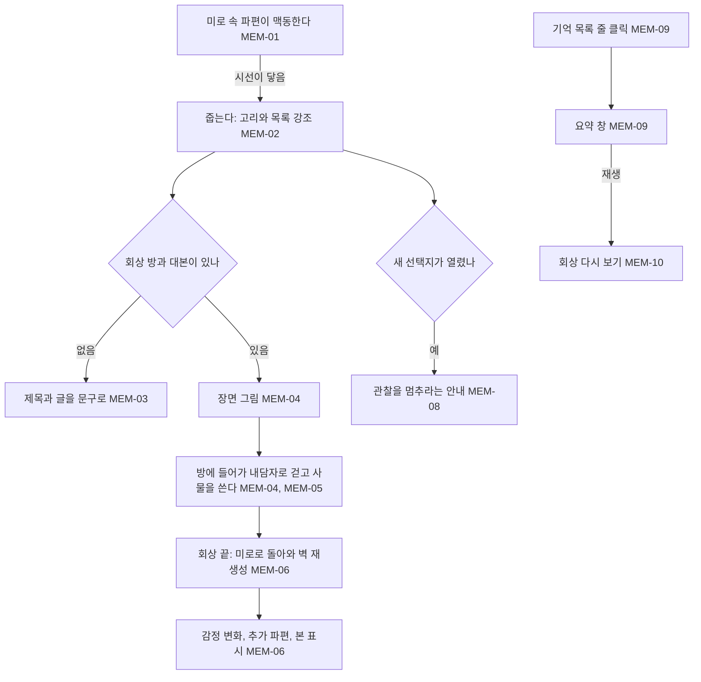

# 기억 파편

접두어 `MEM` · 다음 번호 `MEM-11`

미로 속 파편이 잘 보이고 주운 순간을 바로 알게 한다. 파편에 닿으면 그 순간의 장면 속 방에 들어가 내담자가 되어 행동을 재연하고, 끝나면 감정 변화, 추가 파편, 새 선택지로 이어진다. 본 단서는 기억 목록에서 다시 볼 수 있다.

## 흐름

파편을 읽거나 회상하는 동안에는 미로의 시간이 멈춘다. 회상 방은 상담실과 다른 옆모습 공간이고, 장면 그림은 들어가기 전에만 보인다. 다시 보기는 처음 봤을 때의 결과(감정, 새 파편, 벽)를 다시 일으키지 않는다.

## 진행 중

없음

## 완료

### 파편 표시 (MEM-01)

미로 속 줍지 않은 파편은 빛나는 마름모로 천천히 맥동해 눈에 잘 띈다.

### 파편 줍기 알림 (MEM-02)

파편을 주우면 그 자리에서 고리가 퍼지고, 기억 목록의 새 줄이 잠깐 빛난다.

### 파편 읽기 (MEM-03)

파편에 닿으면 줍고 읽기 상태가 된다.

- 읽는 동안 이동, 부담감, 깜빡임이 멈추고 R과 Q도 받지 않는다.
- 회상이 없는 파편은 제목과 글만 보여 준다.

### 회상 들어가기 (MEM-04)

회상이 있는 파편은 미로가 가라앉고 그때의 장면 그림이 나온다. 키를 누르면 그림 속 방으로 들어간다.

- 그림이 줄어들며 옆모습 방이 다가오듯 드러나고, 도입 대사가 나온다.

### 회상 방에서 행동하기 (MEM-05)

방 안에서 내담자가 되어 걷고 물건을 써서 그때의 일을 재연한다.

- 물건 가까이 가면 할 수 있는 행동이 뜬다.
- 지금 할 차례의 물건을 쓰면 대본이 진행되고, 다른 물건은 살펴보는 글만 나온다.
- 회상 대사도 대화 기록에 남는다.

### 회상 끝 (MEM-06)

회상이 끝나면 미로로 돌아오고, 그 기억에 따라 손님이 바뀐다.

- 미로 벽이 다시 만들어진다(`BLINK-08`).
- 손님의 감정이 바뀌거나, 새 파편이 나타나거나, 본 파편 자리에 그림이 남는다.

### 연결 회상 (MEM-07)

두 기억을 이은 회상은 한 방을 다시 쓰면서 그 회상에 필요한 물건만 꺼내 보인다.

### 새 선택지 알림 (MEM-08)

파편을 주워 새로 꺼낼 이야기가 생기면, 들여다보는 동안 관찰을 멈추라는 안내가 나온다.

- "관찰 중지" 버튼 글이 깜빡인다. 시선을 거두면 꺼진다.

### 기억 목록과 요약 (MEM-09)

기억 목록에서 주운 파편을 눌러 제목과 내용을 다시 읽을 수 있다.

- 요약 창이 열린 동안 게임이 멈추고, 닫기나 Esc로 닫는다.

### 회상 다시 보기 (MEM-10)

요약 창의 "재생"으로 본 회상을 처음부터 다시 볼 수 있다.

- 다시 봐도 감정, 새 파편, 미로는 바뀌지 않는다.

---

## 자세히

### 주의

- `MEM-01` 마름모 대각선은 `RingWidth × 0.46`이고 맥동해도 시선 점보다 커지지 않는다. Play 중에는 렌더 텍스처(480×270) 픽셀 중심에 맞춘다. 대화 중과 눈물 연출 중에는 `WallAlpha`, `FocusAlpha`를 곱한다.
- `MEM-02` 리셋의 `Collected = false`는 이벤트를 내지 않는다. 에디트 모드에서는 맥동, 후광, 이벤트, 고리, 강조가 모두 일어나지 않고 파편 Transform은 저장되지 않는다.
- `MEM-02` 획득 연출은 말풍선, 읽기 상태, 부담감, 깜빡임, 입력을 바꾸지 않는다. 읽고 바로 닫아 깜빡임이 이어져도 고리는 층을 따라 끝까지 재생한다.
- `MEM-03` 대본이 없어 글로 읽은 파편은 본 표시(`MEM-06`)를 남기지 않는다.
- `MEM-04` 장면 그림이 없는 방은 그림 단계를 건너뛴다. 배경 그림이 없으면 바닥과 벽만 보인다.
- `MEM-05` 범위 안 사물의 거리가 같으면 지금 단계의 사물을, 둘 다 아니면 목록에서 앞선 사물을 고른다.
- `MEM-05` `prop`이 하나도 없는 회상은 도입 줄이 끝나면 바로 끝난다.
- `MEM-05` 글자가 찍히는 중의 진행 키는 그 줄을 바로 다 보여 주고 넘기지 않는다.
- `MEM-06` Play가 회상 도중 끝나면 재생 상태를 되돌린다. 회상 중 대화 기록 창이 열리면 입력을 처리하지 않는다.
- `MEM-06` 회상 뒤 감정이 지금과 같으면 전환 연출을 하지 않는다.
- `MEM-06` `_appearAfter`가 있는 파편은 나타나기 전까지 `GameObject`를 꺼 둔다. 그래야 줍기, 후광, 파편 목록에서 함께 빠진다. 리셋하면 다시 숨긴다. 나타날 칸에 시선이 있으면 칸을 벗어났다 다시 들어올 때 줍는다.
- `MEM-03` 회상 중 Q와 R은 반응하지 않는다. 글자가 찍히는 중 진행 키는 `GameFlow`가 처리하고, `FlashbackPlayer`는 다 찍힌 뒤의 진행 키만 받는다.
- `MEM-08` 새로 열린 선택지가 다른 장면에 있어도 안내는 같다. 문 선택지처럼 파편 여럿이 필요하면 마지막 파편을 주운 순간에만 켜진다. 주운 직후 회상이 재생되면 회상이 끝난 뒤에 보인다. 리셋과 손님 전환은 안내를 지운다.
- `MEM-08` 휴식 신호 안내(`BURDEN-08`)와 함께 켜지면 휴식, 해금 순서로 두 줄 모두 보인다. 관찰을 멈췄다 다시 들여다보면 다시 나오지 않는다.
- `MEM-09` 줄 버튼 수(8개)보다 많이 주우면 그만큼만 보인다. 에디트 모드에서도 주운 파편을 보인다.
- `MEM-09` 필드, 엔딩, 심연, 읽는 중, 회상 중, 결과 줄 넘기기, 깜빡임과 벽 연출, 대화 기록 창이 열린 동안은 줄을 눌러도 열리지 않는다.
- `MEM-09` 대화 기록 창이 함께 열려 있으면 그 창을 닫은 뒤에 닫을 수 있다. 닫은 프레임의 Esc, B, 클릭은 게임 입력으로 새지 않는다. Play가 끝나면 시간 배율을 되돌린다.
- `MEM-10` 다시 재생해도 `MEM-03`, `MEM-05`의 멈춤과 기록이 그대로 적용된다. 대화 중에 재생해도 끝나면 대화 화면으로 돌아온다.
- 회상 대본이 12줄을 넘거나, `Flashbacks.csv`의 `flag`나 `prop`이 없는 이름이면 기획 데이터 검사가 경고·오류를 낸다.

### 하지 않는 것

- 회상을 지켜보기만 하는 글 재생이나 기존 말풍선 문구로 만들지 않는다.
- 회상에 사실이 아니거나 일부를 가린 내용을 넣지 않는다. 회상 뒤 해설 문구를 자동으로 붙이지 않는다.
- 다음에 쓸 사물을 색이나 빛으로 미리 표시하지 않는다.
- `FlashbackProp`은 `FieldInteractable`을 상속하지 않는다. 필드 상호작용 탐색에 섞인다.
- 획득 연출을 `CheckFragment()`에 직접 넣지 않는다. 획득 이벤트를 구독한다.
- 요약 글을 따로 저장하는 CSV를 만들지 않는다. 파편의 제목과 획득 문구를 쓴다.

### 구성

- `FragmentFeedback`은 씬의 오브젝트 하나에 붙고, 고리는 파편이 속한 층의 자식으로 Play 중 만든다.
- 회상 방마다 자기 `FieldRoom`(크기, 색), 배경 그림, `FlashbackProp`, 내담자 `FieldPlayer`, 카메라 기준점을 가진다. 만남 UI 루트는 `FlashbackPlayer`가 Inspector 참조로 끄고 켠다.
- 기억 목록 줄은 만남 UI의 목록 글 아래 줄 버튼 8개이고 `_memoryRows`에 연결한다. 늘리려면 씬에서 복제한다.
- 만남 UI 아래 항상 켜진 `기억 요약 (Recap)`에 `FragmentRecapUI`가 있고, 그 자식 패널(배경, 제목, 본문, 재생, 닫기)은 꺼 둔다.
- 파편 배치: 은재는 0층 피아노, 1층 전화(빨간 버튼, 음성 메시지, 뒤집힌 휴대폰), 2층 열쇠 기억. 지수는 0층 괜찮은 척, 1층 그만두지 못하는 이유, 2층 열쇠 기억. 이어지는 기억은 같은 층에 둔다.

### 코드 단서

기능을 고칠 때 먼저 볼 곳이다.

| 기능 | 찾을 곳 |
|---|---|
| MEM-01 | `MemoryFragment`, `FragmentFeedback.UpdateGlows` |
| MEM-02 | `FragmentFeedback.PlayRing`, `EyeMazeUI.OnFragmentPickedUp` |
| MEM-03 | `EyeMazeDirector.CheckFragment` |
| MEM-04 | `FlashbackPlayer.Play`, `FlashbackPlayer.EnterRoom` |
| MEM-05 | `FlashbackPlayer.TickRoom`, `FlashbackPlayer.Interact` |
| MEM-06 | `EyeMazeDirector.FinishFlashback`, `EyeMazeDirector.ShowFragmentsAfter` |
| MEM-07 | `FlashbackPlayer.Play` |
| MEM-08 | `EyeMazeDirector.CheckUnlockedChoices` |
| MEM-09 | `EyeMazeUI.UpdateMemoryRows`, `FragmentRecapUI` |
| MEM-10 | `EyeMazeDirector.ReplayFlashback` |

### 메모

- MEM-23을 지금 부르는 곳이 있는지 확인하지 못했다.
