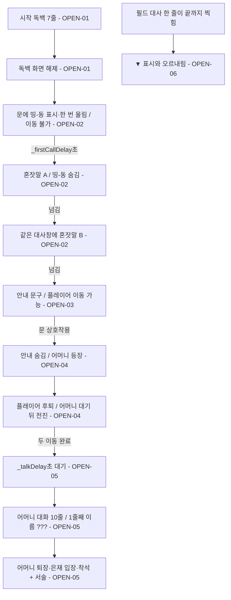

# 시작 독백과 첫 손님 입장

## 1. 목적

게임을 시작하면 주인공의 독백으로 이야기의 전제를 알리고, 초인종 소리와 혼잣말로 첫 손님이 왔음을 느끼게 한다. 플레이어가 직접 문을 열어 은재 어머니를 맞이하고, 어머니의 사연을 들은 뒤 은재와 마주 앉는 데까지 이어진다.

### 범위

- 포함:
  - 게임 시작 독백 7줄
  - 독백이 끝난 뒤 문의 `띵-동` 글씨와 주인공의 혼잣말 두 줄
  - 문 앞 안내 문구와 플레이어의 문 상호작용
  - 은재 어머니 등장, 두 인물의 한 걸음 이동, 어머니 대화 10줄
  - 은재 착석 뒤 서술 3줄
  - 모든 필드 대사창의 넘김 표시 `▼`
- 제외:
  - 어머니 퇴장, 은재 입장·착석 동작. 기존 `FieldCutscene` 흐름을 그대로 쓴다.
  - 문짝과 손잡이의 열림 애니메이션

### 선택하지 않은 방식

- 문 열림 연출은 넣지 않는다.
- 호출 글씨를 씬의 `TextMesh`로 두는 방식은 쓰지 않는다. uGUI 레거시 `Text`를 쓴다.
- TextMeshPro는 쓰지 않는다. 프로젝트에 TMP Essentials와 한글 TMP 폰트 에셋이 없어 기존 uGUI 레거시 `Text`(Galmuri11) 방식을 쓴다.
- 혼잣말 A 뒤에 대사창을 닫고 입력을 기다렸다 B를 여는 방식은 쓰지 않는다. A를 넘기면 같은 창에 B가 바로 이어진다.
- `띵-동` 글씨를 혼잣말 A 뒤나 문 대기 중에도 보이는 방식은 쓰지 않는다. 독백 직후에만 나타난다.

## 2. 요구사항

- **OPEN-01** `[구현완료]` 새 게임의 시작 독백은 "확정된 대사"의 시작 독백 7줄을 순서대로 보여 준다. 6·7번 줄도 독백 화면의 일반 줄과 같은 방식으로 표시한다. `OpeningMonologue`의 글자 출력, 넘기기 입력, 마지막 줄 뒤 암전 해제 동작을 유지한다. 독백이 표시되는 동안 필드 이동과 상호작용은 막는다.
- **OPEN-02** `[구현완료]` 독백 화면이 완전히 걷히면 상담실 `문` 위에 `띵-동` 글씨가 나타나 한 번 울린다. `_firstCallDelay`초 뒤 필드 대사창이 열리며 혼잣말 A를 보여 준다. 대사창이 열리면 `띵-동` 글씨는 사라지고 다시 나타나지 않는다. A를 넘기면(Space·Enter·Z) 대사창을 닫지 않은 채 같은 창에 혼잣말 B가 이어진다. B를 넘기면 플레이어가 움직일 수 있다.
  - 이 구간 동안 플레이어 이동과 필드 상호작용은 막는다. 대사 넘기기는 기존 입력으로 한다.
  - `띵-동` 글씨는 나타나는 순간 초인종이 울리듯 한 번 커졌다 작아지며 좌우로 흔들린 뒤 제자리에 멈춘다. 울림 횟수(`_ringCount`, 0이면 계속)·간격·길이·크기·각도·흔들림 횟수는 `FieldDoor` Inspector에서 조절한다.
  - 혼잣말은 `GameFlow.ShowConversation`으로 화자 이름·초상화 없이 띄운다. 문구는 `FieldCutscene` Inspector에 저장한다.
- **OPEN-03** `[구현완료]` B가 닫힌 뒤부터 문 상호작용이 수락될 때까지 다음을 유지한다. 상호작용이 수락되면 안내 문구가 사라진다.
  - 문 위에 `띵-동` 글씨는 보이지 않는다.
  - 화면 오른쪽 위의 필드 조작 안내 자리(`GameFlowUI`의 `_fieldHint`)에 "문을 열어서 손님을 맞이하세요."를 표시한다.
  - 플레이어는 이동할 수 있다. 어머니는 아직 등장하지 않으며, 시간이 지나도 자동 입장하지 않는다.
  - 플레이어가 문에 접근하면 상호작용 안내(`Z  맞이하기 — 문`)가 뜨고, 필드 상호작용 입력(Z·Enter·Space)으로 문과 상호작용할 수 있다.
- **OPEN-04** `[구현완료]` 문 상호작용을 한 번 수락하면 은재 어머니가 출입구 위치에서 나타난다. 문짝과 손잡이에는 열림 애니메이션을 넣지 않는다. 플레이어는 상호작용 직후 출입구에서 멀어지는 방향으로 한 걸음 물러선다. 어머니는 출입구에 나타난 뒤 `_motherWaitSeconds`초 동안 가만히 서 있다가, 실내 방향으로 한 걸음 걸어 들어온다. 이 한 걸음은 출발부터 도착까지 `_motherWalkSeconds`초가 걸린다. 이때 추가 문 상호작용이나 플레이어 이동 입력으로 시퀀스를 중복 실행하거나 이동을 끊을 수 없다.
  - 한 걸음은 상대 거리로 정한다. 플레이어는 상호작용한 위치에서 `_playerStep`만큼 물러서고, 어머니는 출입구에서 `_motherStep`만큼 들어온다. 플레이어가 문에 바짝 붙어 있어 두 사람의 간격이 최소 간격(`_talkDistance`)보다 좁아지면 플레이어가 그 간격까지 더 물러선다.
  - 한 걸음 거리·최소 간격·이동 시간과 호출 글씨의 위치는 씬/Inspector에서 제작자가 조절한다. 씬에서 수동으로 조절한 값을 재생 시작 시 덮어쓰지 않는다.
- **OPEN-05** `[구현완료]` 플레이어와 어머니의 한 걸음 이동이 모두 끝난 순간부터 `_talkDelay`초를 센다. 그동안 두 인물은 멈춰 있고 플레이어 이동·상호작용은 막는다. 시간이 지나면 어머니 대사("확정된 대사"의 10줄, `Data/Dialogue/Eunjae_Day1.csv`의 `section=talk`, `actor=EunjaeMom`, `id=enter`)를 시작한다. 첫 줄의 이름은 `???`로 가리고 2번 줄부터 `은재 어머니`를 보인다. 이름 가리기는 같은 줄의 `speaker` 칸에 `???`를 적어 정한다. 대사를 넘기는 기존 입력은 작동한다. 마지막 줄 이후의 어머니 퇴장, 은재 입장·착석은 기존 `FieldCutscene` 동작을 따르고, 착석 뒤에는 서술 3줄을 차례로 표시한다.
- **OPEN-06** `[구현완료]` 모든 필드 대사창의 오른쪽 아래에 `▼` 삼각형을 둔다. 한 줄이 끝까지 찍히면 삼각형이 나타나 제자리에서 위아래로 천천히 오르내리고, 글자가 찍히는 동안에는 숨긴다. Space·Enter(Z 포함)로 넘길 수 있다는 시각 정보다. 오르내리는 폭(`_markBob`)과 빠르기(`_markBobSpeed`)는 `GameFlowUI` Inspector에서 조절한다.

### 확정된 대사

시작 독백 (검은 독백 화면, `OpeningMonologue`가 한 줄씩 표시)

1. 눈은 영혼의 창이라는 말이 있다.
2. 내겐 이 말이 단순한 비유가 아니다.
3. 언제부터인가, 사람의 눈을 들여다보면 그 너머 마음의 조각을 읽을 수 있게 되었다.
4. 상담소를 연 것도 그래서였다. 내가 본 것을 그들도 보았으면 해서.
5. 그토록 아름다운 마음의 조각들을.
6. 띵-동
7. ..?

문 앞 혼잣말 (필드 대사창, 화자 이름·초상화 없음)

- A. 뭐야? 한창 분위기 잡고있는데.
- B. 아직 첫 상담까지는 시간이 남았을 텐데...

안내 문구

- 문을 열어서 손님을 맞이하세요.

은재 어머니 (`FieldNPC.TalkLines`, 10줄. 1번 줄에서는 이름 자리에 `???`를 보이고, 2번 줄부터 `은재 어머니`를 보인다)

1. 안녕하세요, 선생님. 상담 시간 전인데 번거롭게 죄송해요.
2. 오늘 첫 상담으로 예약한 은재 말인데요... 상담을 신청한 게 저예요.
3. 미리 설명드릴 게 있어서 예약 시간보다 일찍 찾아뵈었어요.
4. 우리 은재가... 세 달째 아무말도 하지 않고 있어요. 단 한마디도요.
5. 세 달 전에 콩쿠르 결선이 있었어요. 그리고 그날 은재 아빠가 공연장 로비에서 쓰러졌어요.
6. 쓰러지기 전 은재에게 전화를 했나봐요. 은재는 무대 위라 전화를 못 받았대요.
7. ...그게 그이가 살면서 한 마지막 전화였어요.
8. 그 날 이후 피아노는 거들떠보지도 않고, 휴대전화도 늘 뒤집어 놓아요.
9. 이미 여러 상담소를 찾아가보았지만 은재는 한번도 입을 열지 않았어요. 선생님은 다르다고 해서… 그래서 찾아왔어요.
10. 꼭 좀 부탁드릴게요. 무슨 말이라도 좋으니 은재와 다시 이야기하게 해주세요.

은재 착석 뒤 서술 (`FieldNPC.RevealLines`, 은재 초상화와 함께 한 줄씩)

1. 정은재. 17세. 아직 얼굴에서 앳됨이 묻어나오는 소녀.
2. 하지만 표정에는 그 나이답지 않은 짙은 그늘이 드리워져있다.
3. 은재는 나를 잠깐 보더니, 말없이 창밖으로 시선을 돌렸다.

### 예외 및 경계 조건

- 이동 중 반복 입력: 어머니가 다시 나타나거나 대사가 중복 시작되지 않는다.
- 한쪽 이동이 먼저 끝남: 다른 쪽 이동이 끝나기 전에는 대기 시간을 세지 않고 대사가 나오지 않는다.
- 문 대기 중 입력 없이 기다림: 어머니가 자동 입장하지 않는다.

## 3. 상태와 전이

| 지금 상태 | 계기 | 다음 상태 | 관련 요구사항 |
|---|---|---|---|
| 시작 독백 | 마지막 줄을 넘기고 암전 해제 | 호출 (`띵-동`, 이동 불가) | OPEN-01, OPEN-02 |
| 호출 | `_firstCallDelay`초 지남 | 혼잣말 A | OPEN-02 |
| 혼잣말 A | 넘김 | 혼잣말 B (같은 창) | OPEN-02 |
| 혼잣말 B | 넘김 | 문 대기 (안내 문구, 이동 가능) | OPEN-02, OPEN-03 |
| 문 대기 | 문 상호작용 | 어머니 등장과 이동 | OPEN-03, OPEN-04 |
| 어머니 등장과 이동 | 두 이동 모두 끝남 | 대화 대기 | OPEN-05 |
| 대화 대기 | `_talkDelay`초 지남 | 어머니 대화 | OPEN-05 |
| 어머니 대화 | 마지막 줄 넘김 | 어머니 퇴장·은재 입장·착석과 서술 | OPEN-05 |

## 4. 수치 표

기본값은 코드의 필드 초기값이다. 씬이나 프리팹에 저장된 값은 이와 다를 수 있으며, Play에서는 저장된 값이 쓰인다.

| 이름 | 기본값 | 필드(컴포넌트) | 뜻 |
|---|---|---|---|
| 혼잣말 대기 | 2 | `_firstCallDelay` (`FieldCutscene`) | 독백이 걷히고 띵-동이 뜬 뒤 첫 혼잣말이 나오기까지 (초) |
| 혼잣말 A | `뭐야? 한창 분위기 잡고있는데.` | `_firstCallLine` (`FieldCutscene`) | 문 앞 혼잣말 A의 예비값 |
| 혼잣말 B | `아직 첫 상담까지는 시간이 남았을 텐데...` | `_secondCallLine` (`FieldCutscene`) | 문 앞 혼잣말 B의 예비값 |
| 문 안내 | `문을 열어서 손님을 맞이하세요.` | `_doorGuide` (`FieldCutscene`) | 문 대기 중 안내 문구의 예비값 |
| 어머니 한 걸음 | 0.6 | `_motherStep` (`FieldCutscene`) | 어머니가 출입구에서 방 안쪽으로 걸어 들어오는 한 걸음 거리 |
| 어머니 대기 | 1 | `_motherWaitSeconds` (`FieldCutscene`) | 어머니가 출입구에 나타난 뒤 걷기 시작할 때까지 서 있는 시간 (초) |
| 어머니 걷기 | 1 | `_motherWalkSeconds` (`FieldCutscene`) | 어머니가 한 걸음을 출발해서 도착하기까지 걸리는 시간 (초) |
| 플레이어 한 걸음 | 0.6 | `_playerStep` (`FieldCutscene`) | 플레이어가 출입구에서 멀어지며 물러서는 한 걸음 거리 |
| 플레이어 이동 시간 | 0.35 | `_playerStepSeconds` (`FieldCutscene`) | 플레이어가 한 걸음 물러서는 데 걸리는 시간 (초) |
| 최소 간격 | 1.1 | `_talkDistance` (`FieldCutscene`) | 두 사람 사이 최소 간격. 플레이어가 문에 너무 붙어 있으면 이만큼 떨어지도록 더 물러선다 |
| 대화 대기 | 2 | `_talkDelay` (`FieldCutscene`) | 두 사람의 이동이 모두 끝난 뒤 대화가 시작되기까지 (초) |
| 실내 방향 | -1 | `_inwardSign` (`FieldCutscene`) | 출입구에서 실내로 들어오는 방향의 부호. 뜻은 코드 이름으로만 확인함 |
| 호출 글씨 | 씬 연결 | `_bell` (`FieldDoor`) | `띵-동` uGUI Text |
| 호출 글씨 위치 | (0, 1.4) | `_bellWorldOffset` (`FieldDoor`) | 문 월드 위치에서 호출 글씨까지의 오프셋 |
| 울림 횟수 | 1 | `_ringCount` (`FieldDoor`) | 울림 횟수. 0이면 계속 |
| 울림 간격 | 1 | `_ringInterval` (`FieldDoor`) | 울림 사이 간격 (초) |
| 울림 길이 | 0.45 | `_ringDuration` (`FieldDoor`) | 한 번 울리는 시간 (초) |
| 울림 크기 | 0.35 | `_ringScale` (`FieldDoor`) | 울릴 때 커지는 정도 |
| 울림 각도 | 12 | `_ringAngle` (`FieldDoor`) | 좌우로 흔들리는 각도 |
| 흔들림 횟수 | 3 | `_ringWiggles` (`FieldDoor`) | 한 번 울릴 때 흔들리는 횟수 |
| 넘김 표시 | 씬 연결 | `_advanceMark` (`GameFlowUI`) | `▼` uGUI Text |
| 넘김 표시 폭 | 4 | `_markBob` (`GameFlowUI`) | 삼각형이 위아래로 오르내리는 폭 (픽셀) |
| 넘김 표시 빠르기 | 1.5 | `_markBobSpeed` (`GameFlowUI`) | 삼각형이 오르내리는 빠르기 (초당 왕복 수) |

## 5. 코드 위치

| 요구사항 | 파일 | 메서드·속성 |
|---|---|---|
| OPEN-01 | `Assets/EyeMaze/Scripts/Runtime/OpeningMonologue.cs`, `Assets/EyeMaze/Data/Strings.csv` | `DefaultLines()`, `opening` |
| OPEN-02 | `Assets/EyeMaze/Scripts/Runtime/FieldCutscene.cs`, `Assets/EyeMaze/Scripts/Runtime/FieldDoor.cs`, `Assets/EyeMaze/Data/Strings.csv` | `_firstCallDelay`, `_firstCallLine`, `_secondCallLine`, `field.call_first`, `field.call_second` |
| OPEN-03 | `Assets/EyeMaze/Scripts/Runtime/FieldCutscene.cs`, `Assets/EyeMaze/Scripts/Runtime/GameFlowUI.cs`, `Assets/EyeMaze/Data/Strings.csv` | `_doorGuide`, `_fieldHint`, `hint.door` |
| OPEN-04 | `Assets/EyeMaze/Scripts/Runtime/FieldCutscene.cs` | `_motherStep`, `_motherWaitSeconds`, `_motherWalkSeconds`, `_playerStep`, `_playerStepSeconds`, `_talkDistance` |
| OPEN-05 | `Assets/EyeMaze/Scripts/Runtime/FieldCutscene.cs`, `Assets/EyeMaze/Scripts/Runtime/FieldNPC.cs`, `Assets/EyeMaze/Scripts/Runtime/GameFlow.cs`, `Assets/EyeMaze/Scripts/Runtime/TalkScript.cs`, `Assets/EyeMaze/Data/Dialogue/Eunjae_Day1.csv` | `_talkDelay`, `_revealLines`, `TalkScript.Unknown`, `enter`, `reveal` |
| OPEN-06 | `Assets/EyeMaze/Scripts/Runtime/GameFlowUI.cs` | `_advanceMark`, `_markBob`, `_markBobSpeed` |

### 구현 방식

- 대사는 CSV 데이터 구조를 따른다. 시작 독백은 `Data/Strings.csv`의 `opening`, 혼잣말 A·B는 `field.call_first`·`field.call_second`, 문 안내 문구는 `hint.door`, 어머니 대사와 착석 뒤 서술은 `Data/Dialogue/Eunjae_Day1.csv`의 `actor=EunjaeMom` talk 줄 `enter`·`reveal`에 둔다. 씬·Inspector 값은 CSV에 해당 줄이 없을 때만 쓰는 예비값이다.
- `speaker` 칸에 `???`를 쓰면 이름 자리에 `???`를 보이고 초상화는 말을 건 사람 것을 쓴다(`TalkScript.Unknown`).
- 안내 문구는 기존 `_fieldHint` Text를 재사용하므로 새 UI 오브젝트가 필요 없다.
- `띵-동` 글씨는 화면 전체로 늘어난 `필드 UI` 아래의 uGUI `Text` 하나이고, 폰트는 Galmuri11이다. 제작자가 에디터 메뉴(GameObject > UI > Legacy > Text)로 만들어 씬에 저장한다. `FieldDoor`가 그 Text를 `[SerializeField]`로 참조하고, 켜고 끄며, 문 월드 위치 + Inspector 오프셋으로 화면 위치를 맞춘다. 런타임에 UI GameObject를 생성하지 않는다.
- 넘김 삼각형은 `텍스트 상자/속지` 아래의 uGUI 레거시 `Text`(Galmuri11, `▼`)로 에디터 메뉴(GameObject > UI (Canvas) > Legacy > Text)로 만들어 씬에 저장하고, `GameFlowUI`가 `[SerializeField]`로 참조한다.
- `FieldCutscene`은 독백 종료와 문 상호작용 사이에 호출 단계를 두고, 문 대기 중 안내 문구 상태를 노출한다.
- `FieldNPC`·`GameFlow`는 서술을 여러 줄(`_revealLines`)로 다루고, 첫 대화 앞쪽 줄의 이름을 가린다.
- `Assets/Scenes/EyeMaze.unity`: 어머니 `_talkLines`·`_revealLines`·가릴 이름 설정, 혼잣말·대기 값, 호출 글씨와 넘김 삼각형 uGUI Text 연결.

## 6. 다른 영역과의 접점

- **부르는 것**: `GameFlow.ShowConversation`, `TalkScript`(회차 CSV의 talk 줄, `dialogue-editor.md`의 형식)
- **불리는 것**: `OpeningMonologue.IsPlaying`, `FieldCutscene.IsPlaying`, `OpeningMonologue.Advance` ← `CutsceneFastForward`(dialogue, DLG-32~DLG-36). `OpeningMonologue.IsPlaying` ← `DialogueLogUI`(dialogue, DLG-28)

## 7. 검증 방법

- **OPEN-01**: 새 게임을 시작해 독백을 끝까지 넘기면 지정한 7줄만 정확한 순서로 보이고, 마지막 줄 뒤 기존 방식으로 필드가 드러난다.
- **OPEN-02**: 독백이 걷히면 문 위에 `띵-동`이 나타나 한 번만 울리고, 약 2초 뒤 혼잣말 A가 뜨면서 `띵-동`이 사라진다. A에서 Space를 누르면 대사창이 닫히지 않은 채 B가 이어진다. `띵-동`은 다시 나타나지 않는다. 이 구간에서는 플레이어가 움직일 수 없다.
- **OPEN-03**: B를 넘기면 플레이어가 움직일 수 있고, 오른쪽 위 안내 "문을 열어서 손님을 맞이하세요."가 보이고, 문 위에 `띵-동`은 보이지 않는다. 아무 입력 없이 3초 이상 기다려도 어머니가 자동 입장하지 않는다. 문에 다가가면 `Z  맞이하기 — 문`이 뜨고, Z·Enter·Space로 상호작용하면 안내 문구가 사라진다.
- **OPEN-04**: 상호작용하면 어머니가 출입구에서 나타나고 문짝·손잡이는 움직이지 않는다. 플레이어가 물러서고, 어머니는 1초 서 있다가 1초에 걸쳐 한 걸음 들어온다. 이동 중 반복 입력으로 재등장하거나 대사가 중복 시작되지 않는다.
- **OPEN-05**: 한쪽이 먼저 도착해도 다른 쪽이 끝나기 전에는 대사가 나오지 않는다. 두 이동을 모두 마친 시점부터 약 2초 뒤 어머니 대사 10줄이 순서대로 나온다. 1번 줄의 이름은 `???`, 2번 줄부터는 `은재 어머니`다. 그 전에는 플레이어가 움직일 수 없다. 마지막 대사 이후 퇴장·은재 입장·착석이 이어지고, 착석 뒤 서술 3줄이 차례로 나오며 은재 상담에 들어갈 수 있다.
- **OPEN-06**: 필드 대사창에서 한 줄이 다 찍히면 오른쪽 아래에 `▼`가 보이며 오르내리고, 글자가 찍히는 동안에는 보이지 않는다.

## 8. 알려진 문제

- 이전 구현 때 씬에 직접 넣은 `TextMesh` 오브젝트(`문/호출 글씨 (띵-동)`)는 제거됨.
- `AGENTS.md`의 TextMeshPro 규칙에 대한 예외로 uGUI 레거시 `Text`를 쓴다.
- `_inwardSign`의 뜻은 필드 이름으로만 추정했고 코드 동작은 확인하지 못했다.

## 9. 미결 사항

없음
