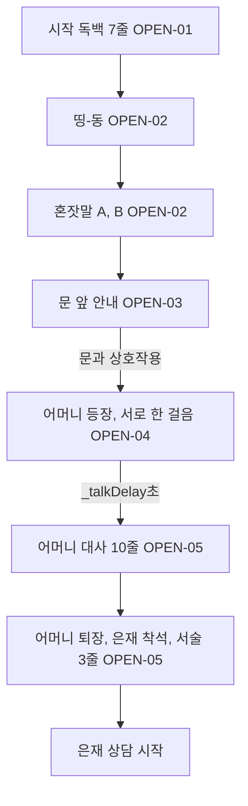

# 시작 독백과 첫 손님 입장

접두어 `OPEN` · 다음 번호 `OPEN-07`

주인공의 독백으로 이야기의 전제를 알리고, 초인종과 혼잣말로 첫 손님이 왔음을 느끼게 한다. 플레이어가 문을 열어 은재 어머니를 맞고, 사연을 들은 뒤 은재와 마주 앉는다.

## 흐름

필드 컷신은 `FieldCutscene`이 단계별로 진행하고, 그동안 플레이어 이동과 상호작용을 막는다. 문 대기 단계만 플레이어가 움직일 수 있다. 대사 원문은 CSV에 두고 Inspector 값은 CSV에 줄이 없을 때의 예비값이다.

## 진행 중

없음

## 완료

- **OPEN-01** 새 게임은 시작 독백 7줄(`opening`)을 차례로 보여 주고, 그동안 필드 입력을 막는다.
- **OPEN-02** 독백이 걷히면 문 위에 `띵-동`이 한 번 울리고, `_firstCallDelay`초 뒤 대사창에 혼잣말 A(`field.call_first`)가 뜨며 `띵-동`은 사라진다. A를 넘기면 같은 창에 B(`field.call_second`)가 이어진다. 이 동안 이동은 막힌다.
- **OPEN-03** B가 닫히면 오른쪽 위에 `hint.door`("문을 열어서 손님을 맞이하세요.")가 보이고 플레이어가 움직일 수 있다. 어머니는 자동으로 들어오지 않는다. 문에서 상호작용하면 안내가 사라진다.
- **OPEN-04** 문과 상호작용하면 어머니가 출입구에 나타나고 플레이어는 한 걸음 물러선다. 어머니는 `_motherWaitSeconds`초 서 있다가 `_motherWalkSeconds`초에 걸쳐 한 걸음 들어온다. 두 사람 간격은 `_talkDistance` 이상이다. 그동안 다시 시작하거나 끊을 수 없다.
- **OPEN-05** 두 이동이 끝나고 `_talkDelay`초 뒤 어머니 대사(`Eunjae_Day1.csv`의 talk `enter`) 10줄이 나온다. 첫 줄 이름은 `???`다. 이어서 퇴장, 은재 입장·착석, 서술 3줄(`reveal`)이 나온다.
- **OPEN-06** 필드 대사창은 줄이 다 찍히면 오른쪽 아래에 `▼`가 오르내리고, 찍히는 동안은 숨긴다.

---

## 자세히

### 주의

- `OPEN-03` 문 대기 중 아무리 기다려도 어머니는 자동으로 들어오지 않는다.
- `OPEN-04` 이동 중 반복 입력으로 어머니가 다시 나타나거나 대사가 중복 시작되지 않는다. 한 걸음 거리와 시간은 씬 값을 쓰고 재생 시작 때 덮어쓰지 않는다.
- `OPEN-05` 한쪽 이동이 먼저 끝나도 둘 다 끝나기 전에는 대기 시간을 세지 않는다. 첫 줄 이름 가리기는 CSV `speaker` 칸의 `???`로 정한다.

### 하지 않는 것

- 문짝과 손잡이 열림 연출을 넣지 않는다.
- 호출 글씨를 씬의 `TextMesh`로 두지 않는다.
- TextMeshPro를 쓰지 않는다. 한글 TMP 폰트 에셋이 없어 uGUI 레거시 `Text`(Galmuri11)를 쓴다. `AGENTS.md` TMP 규칙의 예외다.
- 혼잣말 A 뒤에 창을 닫았다 B를 열지 않는다. 같은 창에 이어진다.
- `띵-동`을 독백 직후 말고는 보이지 않는다.

### 구성

- `띵-동`은 화면 전체로 늘어난 `필드 UI` 아래 uGUI `Text`이고, `FieldDoor`가 문 월드 위치와 Inspector 오프셋으로 화면 위치를 맞춘다.
- `▼`는 `텍스트 상자/속지` 아래 uGUI `Text`이고 `GameFlowUI._advanceMark`로 연결한다.
- 문 안내는 새 UI 없이 `GameFlowUI._fieldHint`를 쓴다.
- 대사 원문은 `Data/Strings.csv`(`opening`, `field.call_first`, `field.call_second`, `hint.door`)와 `Dialogue/Eunjae_Day1.csv`의 talk `enter`, `reveal`이다.

### 메모

- `_inwardSign`의 뜻은 확인하지 못함.
