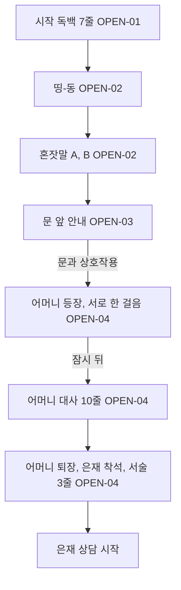

# 시작 독백과 첫 손님 입장

접두어 `OPEN` · 다음 번호 `OPEN-06`

주인공의 독백으로 이야기의 전제를 알리고, 초인종과 혼잣말로 첫 손님이 왔음을 느끼게 한다. 플레이어가 문을 열어 은재 어머니를 맞고, 사연을 들은 뒤 은재와 마주 앉는다.

## 흐름

첫 손님이 들어오는 과정은 정해진 순서대로 흘러가는 컷신이고, 그동안 플레이어는 움직일 수 없다. 문을 열어 주기를 기다리는 동안만 움직일 수 있다. 대사는 모두 대사 파일에 들어 있다.

## 기능

### 시작 독백 (OPEN-01)

새 게임을 시작하면 검은 화면에 주인공의 독백 7줄이 한 줄씩 나온다. 그동안 필드에서는 움직일 수 없다.

### 초인종과 혼잣말 (OPEN-02)

독백이 끝나면 문 위에 "띵-동"이 울리고, 잠시 뒤 주인공의 혼잣말 두 줄이 한 대사창에 이어진다.

### 문 앞 안내 (OPEN-03)

혼잣말이 끝나면 "문을 열어서 손님을 맞이하세요."가 보이고 플레이어가 움직일 수 있다. 문을 열기 전에는 손님이 들어오지 않는다.

### 첫 손님 입장 (OPEN-04)

문을 열면 은재 어머니가 들어와 사연을 이야기하고, 은재가 들어와 앉는다.

- 주인공은 한 걸음 물러서고, 어머니는 잠깐 서 있다가 한 걸음 들어온다.
- 둘 다 멈추고 잠시 뒤 어머니 대사 10줄이 나온다. 첫 줄 이름은 "???"다.
- 어머니가 나가고 은재가 앉은 뒤 서술 3줄이 이어진다.

### 대사 넘김 표시 (OPEN-05)

필드 대사창에서 한 줄이 다 나오면 오른쪽 아래에 ▼가 오르내린다.

---

## 자세히

개발자용: 고칠 때 볼 것 (주의, 하지 않는 것, 구성, 코드 단서, 메모)

### 주의

- `OPEN-04` 이동 중 반복 입력으로 어머니가 다시 나타나거나 대사가 중복 시작되지 않는다. 한 걸음 거리와 시간은 씬 값을 쓰고 재생 시작 때 덮어쓰지 않는다.
- `OPEN-04` 한쪽 이동이 먼저 끝나도 둘 다 끝나기 전에는 대기 시간을 세지 않는다. 첫 줄 이름 가리기는 CSV `speaker` 칸의 `???`로 정한다.

### 하지 않는 것

- 문짝과 손잡이 열림 연출을 넣지 않는다.
- 호출 글씨를 씬의 `TextMesh`로 두지 않는다.
- TextMeshPro를 쓰지 않는다. 한글 TMP 폰트 에셋이 없어 uGUI 레거시 `Text`(Galmuri11)를 쓴다. `AGENTS.md` TMP 규칙의 예외다.
- 혼잣말 A 뒤에 창을 닫았다 B를 열지 않는다. 같은 창에 이어진다.
- `띵-동`을 독백 직후 말고는 보이지 않는다.

### 구성

- `띵-동`은 화면 전체로 늘어난 `필드 UI` 아래 uGUI `Text`이고, `FieldDoor`가 문 월드 위치와 Inspector 오프셋으로 화면 위치를 맞춘다.
- `▼`는 `텍스트 상자/속지` 아래 uGUI `Text`이고 `GameFlowUI._advanceMark`로 연결한다.
- 문 안내는 새 UI 없이 `GameFlowUI._fieldHint`를 쓴다.
- 대사 원문은 `Data/Loc/UI.csv`(`opening`, `field.call_first`, `field.call_second`, `hint.door`)와 `Dialogue/Eunjae_Day1.csv`의 talk `enter`, `reveal`이다.

### 코드 단서

기능을 고칠 때 먼저 볼 곳이다.

| 기능 | 찾을 곳 |
|---|---|
| OPEN-01 | `OpeningMonologue` |
| OPEN-02 | `FieldCutscene`, `FieldDoor.Ring` |
| OPEN-03 | `FieldCutscene`, `FieldDoor.Interact` |
| OPEN-04 | `FieldCutscene.BeginArrival` |
| OPEN-05 | `GameFlowUI.UpdateAdvanceMark` |

### 메모

- `_inwardSign`의 뜻은 확인하지 못함.

