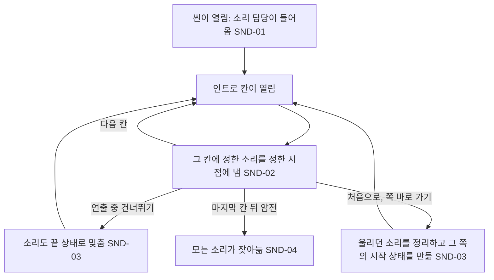

# 사운드

접두어 `SND` · 다음 번호 `SND-05`

게임의 효과음과 환경음을 FMOD로 낸다. 장면마다 어떤 소리가 언제 나고 어떻게 끝나는지 정하고, 플레이어가 칸을 넘기거나 건너뛰거나 처음으로 돌아가도 소리가 화면과 어긋나지 않게 한다.

## 흐름

환경음은 칸이나 쪽이 바뀌어도 끄라는 지시가 있을 때까지 반복된다. 효과음은 한 번 나고 스스로 끝난다. 칸이 끝나기 전에는 다음 칸이 열리지 않으므로 건너뛰기는 마지막으로 연 칸의 소리에만 걸린다.

## 기능

### 소리 재생 준비 (SND-01)

인트로 컷툰 씬이 열리면 소리 담당이 스스로 들어와 저장소의 소리 묶음으로 소리를 낸다.

- 씬을 다시 만들어도 소리 담당은 사라지지 않는다. 씬에는 들어 있지 않고, 씬이 열릴 때 컷툰 진행이 있으면 놓인다.
- 소리를 듣는 자리는 하나뿐이다.
- 효과음은 효과음 묶음, 환경음은 환경음 묶음으로 나간다.

### 칸별 소리 (SND-02)

인트로 14칸 가운데 13칸에서 정한 효과음과 환경음이 정한 시점에 난다. 음악은 없고, 1-3에는 새 소리를 내지 않는다.

- 도시 소리는 1-1에서 켜져 1-2에서 먹먹하고 가늘어지고, 2-1에서 운석의 낮은 울림에 묻혀 사라진다.
- 2-2에서 바람 소리가 커지고 울림이 세지다가, 3-1이 열리는 순간 둘이 줄지 않고 끊기며 충돌음이 난다.
- 우주의 울림과 엔진 소리는 4-1에서 우주선 안 소리로, 우주선 안 소리는 5-1에서 수면실 소리로 바뀐다. 5-3에서 눈이 감길 때마다 수면실 소리가 3분의 1씩 멀어진다.
- 같은 환경음을 다시 켜라고 하면 겹쳐 틀지 않는다.

### 넘김, 건너뛰기, 처음으로, 쪽 바로 가기 (SND-03)

칸 연출 중에 넘기면 소리도 그 칸의 끝 상태로 맞추고, 처음으로나 쪽 바로 가기에서는 그 쪽의 시작 상태를 만든다.

- 건너뛰면 아직 나지 않은 효과음은 내지 않고, 울리던 효과음은 짧게 줄여 끈다. 3-1 충돌음은 끝까지 울린다.
- 환경음이 켜지고 꺼지는 것과 먹먹해지는 정도는 짧은 시간 안에 그 칸의 끝 값으로 간다.
- 처음으로나 쪽 바로 가기에서는 울리던 소리를 짧게 줄여 끈다. 2쪽은 먹먹해진 도시 소리, 4쪽은 우주의 울림과 엔진 소리, 5쪽은 우주선 안 소리가 켜진 채 시작하고, 1쪽과 3쪽은 소리 없이 시작한다.

### 마지막 암전 (SND-04)

마지막 칸 뒤 화면이 검게 덮이는 동안 울리던 소리가 모두 고르게 작아지고, 다 덮이면 꺼진다.

---

## 자세히

개발자용: 고칠 때 볼 것 (주의, 하지 않는 것, 구성, 코드 단서, 메모)

### 주의

- `SND-01` 소리 담당은 `Assets/Sound/Resources/IntroCuttoonSound.prefab`이다. 칸별 소리 표, 쪽 시작 상태, 건너뛰기·처음으로에 쓰는 시간은 모두 이 프리팹의 Inspector 값이다. 씬에 직접 놓으면 컷툰 진행에 이어지지 않아 소리가 나지 않는다.
- `SND-02` 칸과 쪽 번호는 화면에 보이는 대로 1부터 센다. 컷툰의 칸 순서를 바꾸면 이 표도 함께 고친다.
- `SND-02` 환경음 6개는 FMOD 타임라인의 반복 구간으로 돈다. 반복 구간을 지우면 음원 길이(40초, 엔진은 약 21초)가 지난 뒤 소리가 멈춘다.
- `SND-02` 먹먹함은 FMOD 이벤트 파라미터다. `City`의 `Hush`는 음량을 9dB 낮추고 필터를 20kHz에서 1.5kHz로 내린다. `MeteorRumble`의 `Intensity`는 음량을 -2dB에서 +10dB로 올리고 한 옥타브 높인 같은 음원 층을 -80dB에서 -6dB로 섞는다. `CryoBay`의 `Fade`는 음량을 18dB 낮추고 필터를 20kHz에서 600Hz로 내린다. 값은 FMOD Studio에서 고치고 다시 빌드한다.
- `SND-03` 건너뛰기에서 다른 칸이 켠 환경음이라도 이 칸이 건 파라미터 변화는 끝 값으로 맞춘다. 2-2의 울림 세기가 그 예다.
- FMOD 2.04.00에서 뱅크 지정(Assign to Bank)을 하면 창이든 명령줄이든 죽는다. 새 이벤트는 이벤트 XML에 SFX 뱅크 연결을 직접 넣는다.

### 하지 않는 것

- 컷툰 연출 틀(`CuttoonEffect`)로 소리를 내지 않는다. 연출의 끝 처리는 진행 중이 아닐 때 바로 돌아가고, 쪽을 넘길 때 모든 연출이 되돌려져 여러 쪽에 걸치는 환경음을 다룰 수 없다.
- 인트로 씬과 씬 만들기 스크립트에는 소리 담당을 넣지 않는다. 씬은 만들기 스크립트가 통째로 다시 만든다.

### 구성

- 프리팹 `IntroCuttoonSound`는 소리 담당과 FMOD 듣는 자리(`StudioListener`)를 함께 가진다. 인트로 소리는 모두 위치가 없는 소리라 듣는 자리의 위치는 상관없다.

### 코드 단서

| 기능 | 찾을 곳 |
|---|---|
| SND-01 | `IntroCuttoonSound.HandleSceneLoaded` |
| SND-02 | `IntroCuttoonSound.HandlePanelOpened`, `IntroCuttoonSound.Execute` |
| SND-03 | `IntroCuttoonSound.HandleFinishingOpened`, `IntroCuttoonSound.HandleRestarting` |
| SND-04 | `IntroCuttoonSound.HandleBlackoutStarted` |

### 메모

- 5-1의 금속 발소리는 음원이 정해지지 않아 넣지 않았다. 정해지면 5-1 칸에 효과음 하나를 더한다.
- FMOD Studio가 없는 PC에서 소리가 나는지는 확인하지 못함.
- 음량 옵션, 대화 기록 창의 일시정지 소리, 배경음, 옛 오프닝 초인종, Unity 기본 오디오 끄기, 빌드 배포는 아직 없다.

